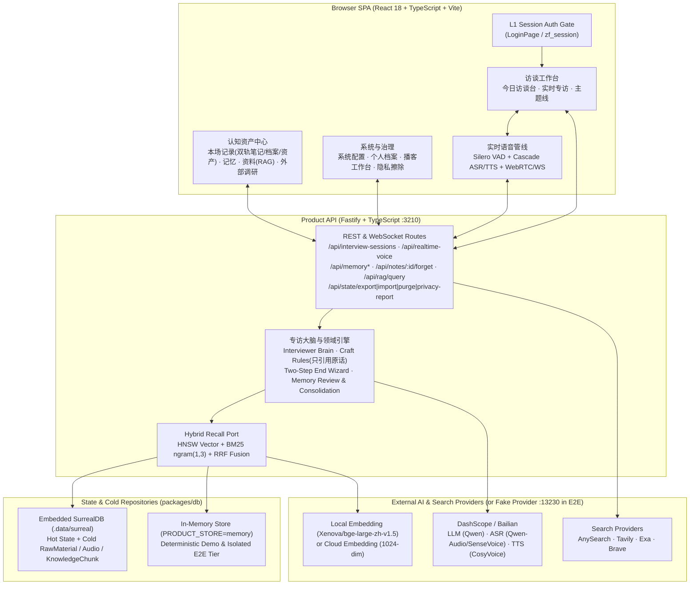

# 专访日记 · Zhuanfang

> **An AI-Powered Personal Cognitive Interview & Dual-Track Diary Workbench**  
> **以深度专访代写日记：用克制、追根究底的语音与文字追问，把碎片表达沉淀为可验证的个人认知传记资产。**

[](LICENSE)
[](tsconfig.json)
[](apps/api)
[](packages/db)

---

## 1. Product Philosophy / 产品理念

### 中文简介
大多数人在写日记或做复盘时，往往停留在情绪宣泄或抽象结论（「今天很忙」「下次要注意」），很难凭一己之力追问到具体时刻、隐含假设与真实取舍。

**专访日记（Zhuanfang）** 将个人复盘重构为一场**持续跟踪同一个人的私人深度专访**：
1. **会前有准备（Boot Context & Revisit Queue）**：开场前自动召回过往主题线、到期决策、未还知识债与外部调研简报，拒绝空泛寒暄，第一句即切入跟踪点。
2. **会中讲纪律（Interviewer Craft Rules）**：遵循深度人物专访技法——每次只问一个核心问题、遇到抽象词必钉具体时刻、**只引用受访者真实说过的原话**（严禁把 AI 脑补当成「你上次说」）、尊重思考留白（「保持留白」而非催促抢话，说完再「正在读下一问」）。
3. **会后诚实沉淀（Two-Step End & HITL Memory Governance）**：结束专访时生成区分「我说了什么」与「我学到了什么」的**双轨笔记（Dual-Track Note）**，抽取观点、问题、决策、知识债与候选长期记忆。遵循**「点头之后，下场才认」**的两步结束向导：若存在待审记忆，必须先经用户确认才宣称专访档案已生成并进入跨场召回。
4. **全生命周期数据主权（Privacy & Right to Erasure）**：支持单条长期记忆随时撤回（停止引用）、单场专访一键「忘掉这场」（级联清理专属抽出物与已点头记忆）、全量 JSON 备份导出/导入与个人数据彻底擦除。

### English Overview
Traditional journaling often stalls at surface-level summaries. **Zhuanfang** turns personal reflection into a continuous, longitudinal **AI-assisted cognitive interview**:
- **Prepared Openings**: Automatically synthesizes your longitudinal themes, due decisions, open knowledge debts, and external research briefs before the first question.
- **Disciplined Follow-ups**: Enforces strict interviewer craft rules—one sharp question at a time, anchoring abstract claims to concrete moments, **verbatim quote-only citations** (`只引用原话`), and natural conversational pacing (`保持留白` / `正在读下一问`).
- **Two-Step Finalization & Human-in-the-Loop Memory**: Separates *"What I Said"* from *"What I Learned"* into Dual-Track Notes and cognitive assets (Points, Questions, Decisions, Knowledge Debts, Themes). Extracted long-term memories require explicit user confirmation before entering future recall.
- **Complete Data Sovereignty**: Built-in privacy inventory report, full JSON backup export/restore, single-session forgetting (`忘掉这场`), memory deprecation, and one-click personal data purge.

---

## 2. Core Features / 核心特性

- **工作台三区九口（Workbench Navigation）**：
  - **访谈工作台**：`今日访谈台`（一键开场 / 未完成续接 / 回访队列）、`实时专访`（文字 + 级联/WebRTC/LiveKit 实时语音）、`主题线`（跨场认知演化轨迹）。
  - **认知资产**：`本场记录`（双轨笔记 / 专访档案 / 四类认知资产库）、`记忆`（待审候选审批、内联修正、矛盾裁决、近重复整理）、`资料`（个人资料库导入与 Hybrid RAG 问答）、`外部调研`（多源联网搜索简报与持续追踪）。
  - **系统与治理**：`系统配置`（Provider 实时健康度、运行参数、产品策略）、`个人档案`（认知传记画像、播客工作台联动、备份导出与隐私擦除）。
- **实时语音与留白状态机（Realtime Voice & Turn Endpointing）**：
  - 支持 **Cascade 级联语音栈（ASR → LLM → Streaming TTS）**、百炼 Qwen-Omni Realtime（WebSocket / WebRTC）与可选 LiveKit 通道。
  - 内置ブラウザ端 Silero 神经 VAD（`pvad-experimental`）与语义完整性融合判定，支持会中自然打断（Barge-in 截断回填）、断线尾段隔离确认（Quarantined Transcript Review）以及「保持留白 → 整理追问 → 正在读下一问」状态流转。
- **混合检索知识底座（Embedded SurrealDB Hybrid RAG）**：
  - 默认采用嵌入式 SurrealDB（`surrealkv`），原生集成 **HNSW 1024 维向量检索 + BM25 中文 ngram(1,3) 全文检索 + RRF（Reciprocal Rank Fusion）混合重排**，并支持 `memory` 纯内存隔离档用于快速测试与演示。

---

## 3. Functional & Technical Architecture / 功能与技术架构图



---

## 4. Quickstart / 快速开始

### A. Local Development / 本地开发启动

```bash
# 1. Clone & install dependencies (automatically copies local Silero VAD WASM/ONNX assets)
git clone git@github.com:liuwenpinghaher-commits/zhuanfang.git
cd zhuanfang
npm install

# 2. Prepare local environment config
cp .env.example .env.local
# Edit .env.local to fill in DASHSCOPE_API_KEY (optional if running with fake provider or inspecting UI)

# 3. Start both Product API (http://127.0.0.1:3210) and Vite Web UI (http://127.0.0.1:3220)
npm run dev:full
```

You can also start the backend and frontend in separate terminals:

```bash
npm run dev:api   # Fastify Product API on http://127.0.0.1:3210
npm run dev       # Vite SPA on http://127.0.0.1:3220
```

### B. Zero-Key Local Mock / Offline Mode (无商业密钥本地体验与边界替身模式)

**Honesty by Design（诚实降级与边界替身设计）**：
- 当未配置 `DASHSCOPE_API_KEY` 等商业 API 密钥时，系统配置页（`系统配置 -> 状态`）会清晰展示各能力模块的 `未配置 / 需密钥` 状态提示，且默认**绝不自动发起任何长语音或商业大模型扣费请求**。
- 若希望在**无任何商业 API Key** 的环境下完整体验或测试「开启专访 → AI 追问 → 实时语音会话 → 结束归档 → 记忆抽取与确认 → 播客生成 → 外部调研」全链路，可直接启动内置的**本地网络边界替身服务（Fake Provider Server）**：

```bash
# 终端 1：启动本地 Fake Provider（监听 127.0.0.1:13230，零外部网络请求、零商业账单）
node tests/e2e/fake-provider-server.mjs

# 终端 2：使用内存态与本地替身启动 Product API (:3210) 与前端 (:3220)
PRODUCT_STORE=memory \
DASHSCOPE_API_KEY=local-mock-key \
ANYSEARCH_API_KEY=local-mock-key \
BAILIAN_BASE_URL=http://127.0.0.1:13230 \
BAILIAN_AUDIO_BASE_URL=http://127.0.0.1:13230 \
BAILIAN_TTS_WS_URL=ws://127.0.0.1:13230/api-ws/v1/inference \
ANYSEARCH_BASE_URL=http://127.0.0.1:13230 \
npm run dev:full
```

### C. Docker One-Click Deployment / Docker 一键部署

```bash
cp .env.production.example .env.production.local
# 必填：设置强随机 PRODUCT_API_TOKEN（生产模式 fail-closed 鉴权守卫）
# 按需填入：DASHSCOPE_API_KEY、PRODUCT_WEB_ORIGINS（正式访问域名）

env -u PRODUCT_API_TOKEN -u VITE_PRODUCT_API_TOKEN -u PRODUCT_WEB_ORIGINS \
  -u DEPLOYMENT_PROFILE -u PRODUCT_STATIC_DIR -u PRODUCT_ENV_FILE \
  docker compose --env-file .env.production.local up --build -d

# 验证健康状态
curl -sS http://127.0.0.1:3210/api/health
```

> **安全提示**：当 `DEPLOYMENT_PROFILE=production` 时，`PRODUCT_API_TOKEN` 为强制必填项，缺失时容器会直接拒绝启动（Fail-Closed），防止无鉴权暴露个人数据导出或配置修改接口。

---

## 5. Testing & E2E Verification / 单元测试与深度 E2E 测试

本项目提供完整的离线单元测试与基于真实前后端 + 隔离端口的 Playwright 深度业务 E2E 测试套件（默认在 `:13210` API / `:13220` Web / `:13230` Fake Provider 独立运行，零触碰 `:3210` 生产端口与 `.data/` 目录）：

```bash
# 1. 类型检查
npm run typecheck

# 2. 全量单元与集成测试（关闭真实外部 Provider Smoke，零商业 API 调用）
REAL_PROVIDER_SMOKE=off RATE_LIMIT_DISABLED=true npm test -- --run

# 3. 生产构建验证
npm run build

# 4. 全套 Playwright 真实业务深度 E2E 测试（自动拉起 :13230 替身 + :13210 内存态 API + :13220 前端）
npm run test:e2e
```

Playwright E2E（含 `tests/e2e/deep-business-loop.spec.ts`、`interview-lifecycle.spec.ts`、`interview-api.spec.ts`、`data-governance.spec.ts`、`memory-inline-edit.spec.ts` 等）完整覆盖：
1. **用户会话登录门禁**：`LoginPage` 账号密码鉴权、错误密码拦截与 `HttpOnly` 会话建立；
2. **开启语音 / 文字专访**：一键开始专访、WebSocket 实时语音建连与麦克风状态流转；
3. **AI 追问流转**：逐字引用受访者原话（「只引用原话」）、剥离 `<pre_signals>`、会中节奏（保持留白 / 正在读下一问）与访谈调节抽屉（放慢一点 / 阶段总结 / 换个角度）；
4. **两步结束向导与待审记忆确认**：结束本场后先进入待审记忆拦截横幅（`本场已结束，记忆待你确认`），用户点击 `确认记住` 后自动宣称 `专访档案已生成` 并跳入本场记录；
5. **认知传记档案生成与导出**：双轨笔记（「我说了什么」/「我学到了什么」）、认知资产库落盘与个人档案完整 JSON 备份包下载；
6. **记忆撤回与隐私擦除闭环**：已确认长期记忆「撤销（停止引用）」、单场笔记「删除这场」（忘掉本场及专属抽出物）、个人数据彻底清空与隐私库存归零验证。

---

## 6. Environment Variables / 环境变量说明

完整模板见 [`.env.example`](.env.example) 与 [`.env.production.example`](.env.production.example)。核心配置项如下：

| 变量名 | 默认值 / 示例 | 必填 | 说明 |
| --- | --- | --- | --- |
| `PRODUCT_STORE` | `surreal` | 否 | 状态存储档位：`surreal`（默认嵌入式 SurrealDB 持久化）或 `memory`（内存态，重启归零） |
| `PRODUCT_STATE_DB_PATH` | `.data/product-state.db` | 否 | 状态库路径（Surreal 数据目录位于同级 `surreal/`；设为 `memory` 进入内存态） |
| `HOST` / `PORT` | `127.0.0.1` / `3210` | 否 | Product API 监听地址与端口 |
| `PRODUCT_WEB_ORIGINS` | `http://127.0.0.1:3220` | 否 | CORS 放行前端 Origin 列表（逗号分隔） |
| `DEPLOYMENT_PROFILE` | `local` | 否 | `local`（开发态）或 `production`（生产态，强制要求 `PRODUCT_API_TOKEN`） |
| `PRODUCT_API_TOKEN` | 空（生产必填） | 生产必填 | Product API Bearer / WS 鉴权令牌 |
| `PRODUCT_AUTH_ENABLED` | `0` | 否 | 设为 `1` 开启 L1 人类账号密码登录（Cookie `zf_session`） |
| `PRODUCT_SESSION_SECRET` | 空 | 开启 L1 时必填 | 签名 `zf_session` Cookie 的 HMAC 密钥（建议 32+ 随机字符） |
| `PRODUCT_BOOTSTRAP_USERS` | `admin:local-dev-pass` | 否 | L1 初始引导账号列表（`user1:pass1,user2:pass2`） |
| `DASHSCOPE_API_KEY` | `sk-your-bailian-key` | 按需 | 阿里云百炼 / DashScope 主密钥（LLM / ASR / TTS / Embedding） |
| `BAILIAN_BASE_URL` | `https://dashscope.aliyuncs.com/compatible-mode/v1` | 否 | 百炼 OpenAI 兼容接口基址 |
| `BAILIAN_AUDIO_BASE_URL` | `https://dashscope.aliyuncs.com` | 否 | 百炼语音合成/识别接口基址 |
| `BAILIAN_MODEL` / `BAILIAN_CHARACTER_MODEL` | `qwen3.7-plus` | 否 | 通用分析与角色扮演专访追问模型 |
| `BAILIAN_TTS_MODEL` / `BAILIAN_TTS_VOICE` | `qwen-audio-3.0-tts-plus` / `longanlingxin` | 否 | 级联语音与播客 TTS 模型及预置音色 |
| `BAILIAN_ASR_MODEL` | `qwen-audio-3.0-asr-flash` | 否 | 语料转写与语音识别模型 |
| `EMBEDDING_PROVIDER` | 云端（可设 `local`） | 否 | 设为 `local` 时使用本机 `bge-large-zh-v1.5`（1024 维）离线生成向量 |
| `ANYSEARCH_API_KEY` / `TAVILY_API_KEY` / `EXA_API_KEY` / `BRAVE_SEARCH_API_KEY` | 空 | 否 | 外部联网搜索 Provider 密钥（按需选配） |

---

## 7. Hybrid RAG 架构与数据恢复说明

### 三路混合索引（SurrealDB）

| 表 | HNSW（向量） | BM25 全文 | Analyzer |
| --- | --- | --- | --- |
| `memory` | `memory_emb` COSINE dim=1024 | `memory_ft` on `text` | `zh` ngram(1,3) |
| `rag_chunk` | `rag_emb` | `rag_ft` | 同上 |
| `knowledge_chunk` | `kc_emb` | `kc_ft` | 同上 |

- **混合召回（`recallRagChunks` / `searchHybrid`）**：通过 `search::rrf([$vec, $bm], limit, 60)` 融合向量与 BM25 命中，并为无向量块保留 BM25 名额，经域层 `usage` 与敏感度门控二次核验后注入上下文。
- **备份与灾难恢复**：
  - `GET /api/state/export` 生成的 JSON 包附带 `completeness.status`（`complete` 或 `partial`）与隐私库存报告。
  - 可通过个人档案页「导入」或 `POST /api/state/import`（`confirm=REPLACE_ALL_STATE`）一键完整恢复。

---

## 8. Repository Structure / 目录结构

- `src/domain`：核心领域模型、专访策略引擎、主持人追问铁律（`interviewer-craft.ts`）、两步结束状态机（`session-end-presentation.ts`）、资产沉淀与质量报告。
- `src/features`：前端九大业务视图与登录门禁组件。
- `src/realtime`：浏览器端级联语音管线（`cascadedPipeline.ts`）、Silero 神经 VAD（`pvadEndpointing.ts`）、WebRTC/WebSocket/LiveKit 语音桥接。
- `src/hooks` & `src/api`：前端状态同步（`useOfflineProductSync.ts`）、语音控制 Hooks 与 Product API 客户端。
- `apps/api/src`：Fastify Product API 服务端、L1 会话鉴权、LLM/ASR/TTS/Search Provider 客户端、日志脱敏与路由。
- `packages/db/src`：嵌入式 SurrealDB 仓储（热态 + 三冷层 + 原生混合召回）与内存仓储实现。
- `tests/e2e`：Playwright 真实业务 E2E 测试套件与 `fake-provider-server.mjs`。

---

## 9. Contributing & Security / 贡献与安全

- 贡献指南请阅读 [CONTRIBUTING.md](CONTRIBUTING.md)。
- 安全漏洞报告与隐私架构请阅读 [SECURITY.md](SECURITY.md)。
- 开源许可证：[MIT License](LICENSE) — Copyright (c) 2026 Liu Wenping.
