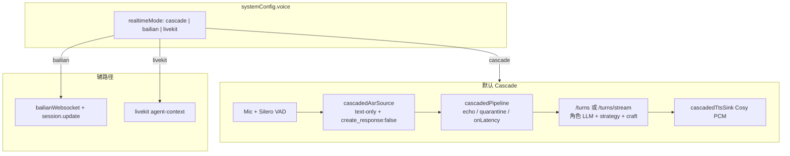
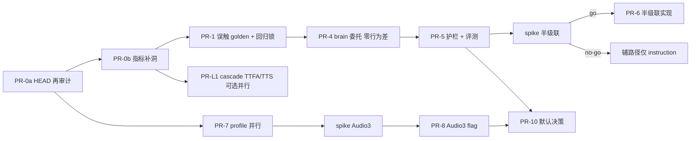
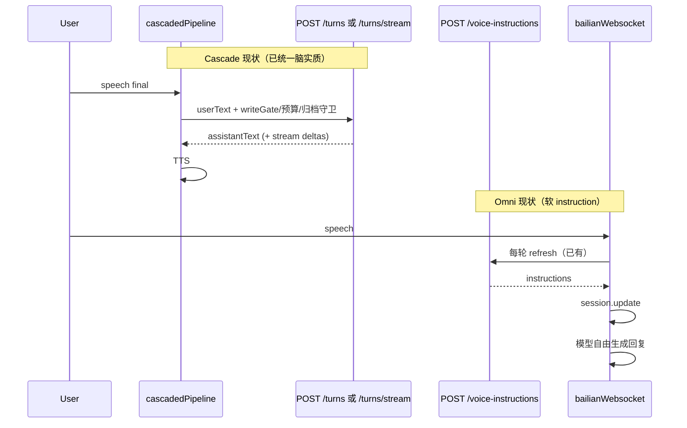
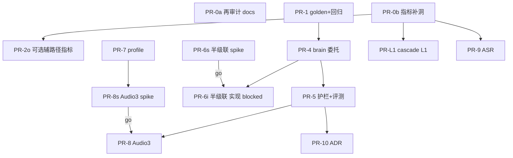

# 专访语音系统最优改进方案：级联为脑 · 声学分层 · 工艺护城河

| 字段 | 值 |
|------|-----|
| **文档标题** | 专访（zhuanfang）语音系统 ROI 最优改进设计 |
| **作者** | Grok Design（系统架构） |
| **日期** | 2026-08-10 |
| **修订** | Rev C — 用户决议锁定 OQ1/OQ2 与实施起点（2026-08-10）；基于 Rev B |
| **状态** | Ready for Implementation |
| **产品路径** | `/home/admin/projects/zhuanfang` |
| **HEAD 锚点** | 实现前以工作区 `main` HEAD 再核；债务表以本文 **§HEAD 债务再审计** 为准，**不以** `系统问题复审报告-2026-06-20.md` 原文当未修缺陷 |
| **决策主线** | 最大化 ROI，不拿工艺质量（L3）赌声学手感（L1） |
| **实施起点** | **首 PR = PR-0b（指标补洞）**；可与 **PR-1 / PR-7 并行**；策略仍为 CFC+（不默认 E2E、不优先 Audio3） |

---

## Overview

专访是**纵向私人采访 OS**，不是通用语音聊天助手。默认语音路径已是 **cascade**（`realtimeMode: "cascade"`，见 `src/domain/seed.ts`、`useRealtimeVoiceControls.ts` 中 `?? "cascade"`）：

```
mic → ASR（Realtime WS，`modalities:["text"]` + `create_response:false`）
    → 文本「主持人脑」`POST /turns` **或流式** `POST /turns/stream`（cascade 已接 `sendUserTurnStream`）
    → CosyVoice TTS（`cascadedTtsSink`，支持子句级流式播放）
```

端到端 Omni（`bailian`）与 LiveKit 为辅路径。工艺铁律（`INTERVIEWER_CRAFT_RULES`、开场纪律、记忆召回、质量护栏、硬边界）集中落在 **文本 turn 生成** 与 **统一 instruction 构建** 上；这是产品核心 IP。

**最优策略（明确选择，非「全都可选」）**：

> **Craft-First Cascade Plus（CFC+）**  
> 保持 cascade 为默认与验收主路径；**Phase 1 仅回归锁定 + 真实残留洞**（不以 6 月报告原文开 fix PR）；强化「主持人脑」契约与工艺评测（L3/L4）；声学侧分层增强（Audio 3.0 仅挂辅路径；**默认路径 L1** 允许 Cosy 韵律/TTFA/endpoint 优化，与 ASR/Audio3 **可并行**）；**不**默认翻盘到 E2E Omni/Audio 3.0。

**默认用户收益叙事（诚实）**：

| 层 | 默认 cascade 用户是否直接受益 | 说明 |
|----|------------------------------|------|
| L2 轮转/误触 | **是** | 误触可观测 + golden 加固 |
| L3 工艺/召回 | **是** | 统一脑 + 输出护栏 + rubric |
| L4 闭环 | **是** | barge-in/打断字段补洞、转写一致性回归 |
| L1 听感/延迟 | **部分** | 依赖 cascade 自身 TTFA/TTS 优化；**不是** Audio 3.0（那是辅路径） |

对外话术：**「系统级」= 默认路径 L2–L4 + 可控 L1 分段优化**，**不是**「全体五星听感」。Audio 3.0 手感主要服务 bailian 实验用户。

**实施起点（用户已决 · 2026-08-10）**：按 CFC+ 推荐顺序开工——**首实现 PR = PR-0b（指标补洞）**，可与 **PR-1（误触 golden + 回归锁）**、**PR-7（model profile 层）** 并行；不要改策略为默认 E2E，也不优先 Audio3 生产落地（见 KD16、OQ1/OQ2）。

---

## Background & Motivation

### 当前架构事实（代码核实，可作实现前提）

| 模式 | 配置 | 结构 | 默认 |
|------|------|------|------|
| Cascade | `realtimeMode: "cascade"` | ASR WS 纯转写 → **`/turns` 或 `/turns/stream`** → CosyVoice TTS | **是** |
| Bailian E2E | `"bailian"` | Omni Realtime 全双工（WS/WebRTC） | 否 |
| LiveKit | `"livekit"` | 外部 Python agent | 否 |

| 职责 | 路径 |
|------|------|
| 模式选择 / 连接编排 | `src/hooks/useRealtimeVoiceControls.ts`、`src/realtime/startRealtimeVoiceConnect.ts` |
| Cascade 编排 | `src/realtime/cascadedPipeline.ts`（~900 行）；`sendUserTurnStream` + `onLatency` 已接 |
| ASR 源 | `src/realtime/cascadedAsrSource.ts`（`create_response: false` 已 spike） |
| TTS sink | `src/realtime/cascadedTtsSink.ts`（`close()` 释放 AudioContext） |
| Omni WS | `src/realtime/bailianWebsocket.ts`（重连、schema 告警、打断恢复、`updateInstructions`） |
| 转写追加 | `src/domain/session-transcript.ts` → `appendAssistantTranscriptFinal` |
| 会话配置 / 模型 | `apps/api/src/routes/realtime-voice-helpers.ts`、`apps/api/src/providers/bailian/_impl.ts` |
| 流式 turn | `POST /api/interview-sessions/:id/turns/stream`（`interview-sessions.ts`）+ `createAssistantTurnStream` |
| 工艺 / 指令 | `src/domain/interviewer-craft.ts`、`src/domain/voice-instructions.ts` |
| Cosy 音色白名单 | `apps/api/src/voice-presets.ts` |
| 延迟指标 | `apps/api/src/observability/runtime-metrics.ts` + `useCascadeVoiceMetrics` → `POST .../runtime-metrics/voice` |
| 默认 env | `.env.example`：`BAILIAN_REALTIME_MODEL=qwen3.5-omni-flash-realtime`，TTS `longanyang` |



### 质量分层

```
L1  声学与双工：听清、endpoint、barge-in、延迟、自然音色
L2  轮转：backchannel、思考留白、回声误触
L3  采访认知：工艺、记忆、护栏、策略、一问一钉
L4  产品闭环：转写落库、打断截断、笔记资产、多路径一致
```

| 投资项 | 改善量级 | 风险 | 主要作用层 | 默认用户？ |
|--------|----------|------|------------|-----------|
| 只改 env 模型名 | ★☆☆☆☆ | 中高 | 可能破坏 L1/L2 | 否/有害 |
| bailian 辅路径迁 Audio 3.0 + 音色 + smoke | ★★★☆☆ | 中 | L1 辅路径 | **否** |
| **默认** bailian + Audio 3.0 | ★★★★☆ 手感 / ★★☆☆☆ 认知 | **高** | L1↑ L3 风险 | 全量高风险 |
| Cascade ASR → 专用流式 ASR | ★★☆☆☆ | 中 | L1/L2 | 是（若瓶颈在 ASR） |
| **Cascade TTS/韵律/流式 TTFA 分段优化** | ★★★☆☆ | 低–中 | **默认 L1** | **是** |
| **默认路径 TTFA（已接线 stream 的进一步压测/优化）** | ★★☆☆☆ | 低 | 默认 L1 | **是** |
| 修 cascade 残留工程洞 + 回归锁定 | ★★☆☆☆–★★★ | **低** | L2/L4 | 是 |
| 统一主持人脑（契约/护栏，非假大空换模） | ★★★★★ | 中 | L3 | 是 |
| 工艺/护栏/召回质量本身 | ★★★★★ | 低–中 | L3 | 是 |
| 收缩辅路径（冻结 LiveKit/bailian） | ★★☆☆☆ 维护 | 低 | 运维 | 间接 |

Qwen-Audio-Realtime 3.0 主要抬 **L1 + 部分 L2**；**不是** Omni drop-in；须 profile + spike + 音色白名单。

---

## HEAD 债务再审计（必做，PR-0a；不以 2026-06-20 报告原文为准）

对照 **当前仓库 HEAD**（实现启动日再跑一遍本表）。来源报告仅作历史线索。

| 历史 ID | 原问题摘要 | HEAD 状态 | 证据（路径/行为） | Phase 1 动作 | PR 映射 |
|---------|------------|-----------|-------------------|--------------|---------|
| P1-06 Omni 重连 | omni 无重连 | **fixed** | `bailianWebsocket.ts`：`maxReconnectAttempts`、退避、`onReconnecting`/`onReconnected`；`bailianWebsocket.test.ts` 标 `P1-06` | **回归锁定**（勿回退） | PR-1r |
| P1-06 LiveKit | 无重连信号 | **fixed（SDK 级）** | `livekitVoice.ts`：`RoomEvent.Reconnecting` 等 | 文档/SLA 标明依赖 SDK | — |
| P1-07 Omni schema | 裸拼 delta | **fixed** | 校验 `text`/`stash` + `asr_invalid_delta` 告警；测试标 `P1-07` | 回归锁定 | PR-1r |
| P1-08 TTS close | AudioContext 泄漏 | **fixed** | `cascadedTtsSink.close()`；pipeline 测试 P1-08 | 回归锁定 | PR-1r |
| P1-09 Provider 超时 | 无 timeout | **fixed（主体）** | `_impl.ts` per-request timeout；streaming-tts connect timeout | **residual**：抽查遗漏点清单写入 PR-1r checklist | PR-1r |
| P1-10 LiveKit interrupt | 「空操作」 | **fixed 为 best-effort 实装** | 停本地播放 + `publishData` interrupt + 重开麦；`agent/main.py` fallback | **residual**：成功率**未量化**，非「再写 interrupt」 | PR-2o 可选 |
| P1-11 Omni 打断恢复 | 仅部分 scene | **fixed** | `cancelAndSaveContext`：除 `backchannel` 外全部 scene（注释明确旧洞已修） | 回归锁定 + 可选成功率打点 | PR-1r / PR-0b |
| P1-12 覆盖式 final | 多段只剩最后 | **fixed（主路径）** | `session-transcript.appendAssistantTranscriptFinal`；`startRealtimeVoiceConnect` / `useRealtimeVoiceControls` 接入 | 回归锁定；禁止旁路再 `setSession` 覆盖 | PR-1r |
| echo maxWait 竞态 | 不查 micSuppressed | **fixed（P2-14）** | `armMaxWait` 检查 `!micSuppressed && state∉{thinking,speaking}` | 回归 + **误触可观测** | PR-0b / PR-1 |
| echo quarantine | 高相似转写 | **fixed（逻辑）** | `turnAssembler` quarantine；pipeline `onTranscriptQuarantined` | **residual**：**无服务端 falseTrigger 计数** | PR-0b |
| cascade 韧性 | 断线 | **fixed（主体）** | `asrConnectionLifecycle`、recovery review | 回归 | 已有 e2e |
| TTFA 分段 | 无 | **fixed（骨架+接线）** | pipeline `onLatency` → `useCascadeVoiceMetrics` → `POST .../runtime-metrics/voice` | **residual 见 Phase 0** | PR-0b |
| bargeIn / interruptRecovery 客户端 | 类型有、上报缺 | **residual** | `VoiceLatencySample` 有字段；**`reportVoiceLatency` / health POST 不传** `bargeInSuccess`/`interruptRecovery`；interrupt 路由会写 | 扩展 body + cascade 自然 barge-in 上报 | PR-0b |
| falseTrigger 指标 | 无 | **still open** | 无 counter 类型/API | 新增事件 | PR-0b |
| craft 会话合规率 | 无 | **still open** | 仅有 `craft-golden` 策略单测 | 人工 rubric + 可选启发式 | PR-5 |
| turn-15 tracking | 无 | **still open** | Open 算法 | 人工晋级门禁优先 | PR-5 |
| Audio3 / 半级联协议 | 未验证 | **still open** | — | **spike 硬门禁** | PR-spike-* |

**Phase 1 重定义**：不是「按 6 月报告修 P1-06..12」，而是：

1. **回归锁定**已修行为（测试 + demo 冒烟禁止回归项）；  
2. **补真实残留洞**（指标字段、误触事件、LiveKit 成功率可选、timeout 抽查）。

---

## Goals & Non-Goals

### Goals

1. 默认路径工艺不回退；craft-golden 与既有 stream 路径行为锁。  
2. ROI 顺序：**残留洞 + 回归** → L3 脑契约/护栏 → **默认 L1 可并行**与辅路径 Audio3 → ASR 仅瓶颈驱动 → 默认翻盘默认否。  
3. 门禁**可判定**：事件定义、钩子、分母、最小 n、自动 vs 人工。  
4. InterviewerBrain = **对现有 `/turns`+`/turns/stream`+`voice-instructions`+agent-context 的委托重构**，非平行大脑。  
5. 半级联 **spike 通过前不承诺** omni L3 持平交付。  
6. Audio 3.0 可插拔，不成为计划全部。

### Non-Goals

1. 本阶段不默认改 `realtimeMode` 为 bailian/Audio3。  
2. 未验证 `create_response:false` 前不用对话模型当 cascade ASR。  
3. 不引入第二套 LiveKit 框架。  
4. 不在 Grok 机全量 `npm ci`/Playwright/本机 Surreal 验收；**验收 = demo 已部署栈冒烟**。  
5. 不为验收起平行库。  
6. 不承诺 Audio3 解决 L3。  
7. 不把「系统级五星」营销成默认用户 L1 全体升级。

---

## Proposed Design

### 策略与阶段总览



**并行规则**：PR-7 / cascade L1（PR-L1）/ Audio3 spike **不**被 Gantt 串死在 P3 之后；若 Phase 0 显示瓶颈在 `llmTtft`/`ttsTtfb`，**优先 PR-L1**，可与 P3/Audio3 并行。日历「串行」仅表示依赖链上界，**≠ 禁止独立合并**。

---

### Phase 0 — 指标补洞（非从零建骨架）

#### 已有（勿重复建设）

| 能力 | 位置 |
|------|------|
| 样本类型分段字段 | `runtime-metrics.ts`：`vadEndToSttMs` / `sttToLlmMs` / `llmTtftMs` / `ttsTtfbMs`、TTFA P50/P95、`budgetHint` 700/1200、barge-in / interruptRecovery **汇总** |
| Cascade 上报接线 | `cascadedPipeline` `onLatency` → `startRealtimeVoiceConnect` → `useCascadeVoiceMetrics` → `POST /api/system/runtime-metrics/voice` |
| Config/system 展示 | `system.ts` 暴露 voice 摘要；ConfigView 可看 segments |
| Interrupt 路由写 barge-in | `realtime-voice.ts` interrupt 路径 `recordVoiceLatency({ bargeInSuccess, interruptRecovery })` |

#### 真实缺口（本 Phase 唯一范围）

1. **客户端 / health POST 不传** `bargeInSuccess` / `interruptRecovery`（`productApi.types` `reportVoiceLatency`、`health.ts` POST body）。  
2. **无** `falseTrigger` / quarantine 事件类型与 API。  
3. craft 会话合规、turn-15：**零实现**（见门禁分级，不在 P0 伪造自动率）。  
4. **进程内** `MAX_VOICE=64`，重启丢基线；单用户噪声大 → 基线靠 **落盘模板** 而非假设常驻内存。

#### 事件与 API 扩展（实现规格）

```ts
// 扩展 VoiceLatencySample / POST body（向后兼容）
bargeInSuccess?: boolean;
interruptRecovery?: boolean;
// 新：误触类（也可独立 counter API）
falseTriggerKind?:
  | "quarantine_echo_suspect"
  | "max_wait_suppressed"
  | "auto_committed_echo_suspect"; // 若未来误自动提交才计
```

| 事件 | 定义 | 钩子 | 分母建议 |
|------|------|------|----------|
| `quarantine_echo_suspect` | turnAssembler/pipeline 决定 quarantine（高相似+TTS 窗） | `onTranscriptQuarantined` / pipeline 上报 | 每会话 ASR final 次数 |
| `max_wait_suppressed` | maxWait 回调因 micSuppress/state 跳过 | `armMaxWait` 内 | maxWait 触发尝试次数 |
| `bargeInSuccess=true/false` | 用户 barge-in 是否停播并 abort 进行中 turn | cascade `handleSpeechStarted` 成功/失败分支；手动 interrupt API 已有 true | 已知 barge-in 尝试 |
| `interruptRecovery` | 打断后下一轮是否带截断/stash 上下文 | interrupt API + 下一 turn 是否带 stash（既有 consumeInterruptStash） | interrupted 样本 |

**基线保存（强制产出物）**：见文末 **附录 A · 基线记录模板**。每 Phase 晋级前在 demo 机填一份（日期、compose 版本/git sha、n、P50/P95、截图或 `curl` JSON 粘贴）。**不**依赖进程内存跨部署存活。

#### Phase 0 完成定义（可区分）

- [ ] POST voice 接受并汇总 `bargeInSuccess` / `interruptRecovery`  
- [ ] 至少一类 falseTrigger 事件可从 system metrics 读出（非零路径：单测或 demo 注入 quarantine）  
- [ ] 附录 A 基线表填过 **n≥10** cascade 回合（单用户产品不要求 20 才开工；**晋级 Phase 2 建议 n≥20 累计落盘**）  
- [ ] **不**要求新建分段 TTFA 骨架  

---

### Phase 1 — 回归锁定 + 残留洞（原「工程债」重定义）

#### 1.1 回归锁定（已修项）

| 项 | 测试/冒烟 |
|----|-----------|
| TTS `close()` | `cascadedPipeline.test` P1-08；demo 10 次开关语音无哑火 |
| echo maxWait + micSuppress | 单测 armMaxWait；禁止自问自答 |
| `create_response:false` | ASR session.update 不变；改 ASR 模型必须重跑 spike |
| Omni P1-06/07 | `bailianWebsocket.test` 保持绿 |
| P1-11 全 scene 恢复 | 单测或脚本覆盖 non-backchannel |
| append final | 禁止旁路覆盖式 `setSession` |

#### 1.2 残留加固（薄）

| 项 | 动作 | 非目标 |
|----|------|--------|
| 误触 golden 补强 | TTS 窗高相似 → quarantine 且 **不** `sendUserTurn`（已有部分测试，补 edge） | 重写 half-duplex |
| 可选 `echoWindowMs` 配置 | `systemConfig.voice` **新可选字段**，默认保持代码现状 1200；迁移无感 | 必须 UI 暴露 |
| LiveKit interrupt 成功率 | 可选：publish 失败已 log → 记 `bargeInSuccess=false` | 宣称 SLA=cascade |
| timeout 抽查 | 清单：streaming-tts / search / SDP 是否全有 signal | 大重构 |

**禁止**：以「fix P1-06」为标题开空转 PR。

---

### Phase 2 — 统一主持人脑（可施工规格）

#### 2.0 现状序列（差距量化）



| 路径 | 谁生成下一问 | 记忆刷新 | 与「统一脑」差距 |
|------|--------------|----------|------------------|
| cascade | `/turns` 或 **`/turns/stream`**（`createAssistantTurn` / `createAssistantTurnStream`） | turn 内 embed+recall | **实质已是 brain**；缺统一模块边界 |
| text | 同上 | 同上 | 同 cascade |
| omni | **Omni 模型** | 客户端已 `voice-instructions` + `updateInstructions` | L3 软约束；**2a 增量=审计强制+失败可见，非从零刷新** |
| livekit | Python agent | `agent-context?latestUserText=` | 需确认与 craft 同源（已有注入） |

#### 2.1 分层与委托（零行为变化重构）

| 层 | 职责 | 建议路径 |
|----|------|----------|
| **domain** | craft 字符串、guide 块、strategy 纯函数、输出护栏启发式 | 已有 `interviewer-craft` / `voice-instructions` / strategy；护栏纯函数可放 domain |
| **api application** | 编排 writeGate、预算 429、归档 409、embed、调 LLM、组结果 | **新建** `apps/api/src/interview/interviewer-brain.ts` **仅委托**现有 handler 逻辑 |
| **routes** | HTTP 适配 | `interview-sessions.ts` 的 `/turns` 与 **`/turns/stream` 必须同委托** |

**替换 vs 委托**：

- Brain **不**复制 LLM 调用；**调用**既有 `bailianInterviewClient.createAssistantTurn` / `createAssistantTurnStream`。  
- `/turns` 与 `/turns/stream` 共用 `runInterviewerBrainTurn(...)`；stream 路径 **禁止**退回仅非流式（除非 client 无 `createAssistantTurnStream` 的既有 fallback）。  
- writeGate / 409 归档 / 429 预算：**仍在 route 层**先执行，再进 brain（或 brain 接收已通过守卫的 context）——**行为锁**：现有 `interview-sessions` 测试矩阵全绿。

```ts
// apps/api/src/interview/interviewer-brain.ts — 委托外形（示意）
import type { InteractionPreSignals, InterviewStrategyDecision } from "../../../../src/domain/types";

export type BrainPath = "cascade" | "omni" | "livekit" | "text";

export interface InterviewerBrainTurnInput {
  interviewSessionId: string;
  latestUserText: string;
  path: BrainPath;
  signal?: AbortSignal;
  /** stream 时由 route 注入；与 createAssistantTurnStream 对齐 */
  onDelta?: (chunk: string) => void;
}

export interface InterviewerBrainTurnResult {
  assistantText: string;
  instructions: string; // buildRealtimeVoiceInstructions 同源
  preSignals?: InteractionPreSignals;
  strategyDecision?: InterviewStrategyDecision;
  recall: { hitCount: number; topScore?: number };
  craftMeta: {
    openingDisciplineApplied: boolean;
    qualityGuardrailsCount: number;
    /** 护栏是否触发过截断/重试 — 非字面 true 约束 */
    outputGuardTriggered: boolean;
    singleQuestionHeuristicOk: boolean;
  };
}

/** 实现：抽取自现 /turns 主体；stream 走 createAssistantTurnStream */
export async function runInterviewerBrainTurn(
  input: InterviewerBrainTurnInput,
  deps: BrainDeps
): Promise<InterviewerBrainTurnResult>;
```

#### 2.2 输出护栏（行为可变化，flag 控制）

- 启发式：多问号、过长、咨询师复述套路关键词 → 一次重试或截断（domain 纯函数 + brain 调用）。  
- Flag：`VOICE_CRAFT_OUTPUT_GUARD`（默认 true 需审慎：建议 **先 false 上重构，再 true 开护栏**）。

#### 2.3 Omni 2a vs 2b

| 子阶段 | 内容 | 与现状差 | 交付条件 |
|--------|------|----------|----------|
| **2a** | 强制每轮 refresh **失败可见**；刷新顺序/竞态审查；metrics | 刷新**已存在**；增量是可观测与失败 UX | 无协议依赖 |
| **2b 半级联** | Omni 仅耳嘴，口播 brain 文本 | **大**；需 DashScope 注入 assistant / 指定 response 文本 | **`PR-spike-half-cascade` go** 后才开实现 PR |

**半级联失败降级（升为决策 KD11）**：spike no-go → 辅路径 L3 **仅** instruction + 更短会话建议；**不**占 Phase 5「L3 持平」日历。

**成本（数量级，挂钩 `docs/COST-ENVELOPE.md`）**：

| 模式 | 会话侧 LLM 次/轮（量级） | 供应商实时音频 |
|------|--------------------------|----------------|
| cascade 现状 | ~1 角色 turn（+可选 endpoint/pre_signals） | ASR WS + Cosy TTS（多不进 llm-budget） |
| 半级联 omni | **+1** 角色 turn **且** Omni 会话仍在 | Omni 全双工费用 **叠加** 角色 LLM → **约 2× 会话 LLM + 更高实时费** |
| Audio3 长访 | 同 E2E；50 轮/300s 导致更频续会 → **更多 session 创建** | 按续会次数线性 |

预算：半级联必须计入 `session` 桶；建议实验 flag 时 **降低** `LLM_MAX_CALLS_PER_SESSION` 或单独告警。单会话软上限：与信封默认 200 次对齐，半级联按「有效采访轮数 ≈ 预算/2」规划。

#### 2.4 Flag 真旁路（KD + 运维）

| Flag | 默认 | 真旁路？ |
|------|------|----------|
| `VOICE_BRAIN_UNIFIED` | 重构期 **true=委托模块** | **必须**保留旧 inline 路径或 **删除 flag 并写明只能 git revert**。禁止「flag off 仍只走新模块」的假旁路。 |
| `VOICE_CRAFT_OUTPUT_GUARD` | 建议先 false | true 时跳过护栏分支即可真旁路 |
| `VOICE_OMNI_BRAIN_TEXT` | false | 仅 spike go 后允许 true；false=现网 Omni 自由说 |

#### 2.5 `POST .../brain/preview`（若做）

| 项 | 规定 |
|----|------|
| 鉴权 | **与 production 同级**（bearer）；禁止匿名 |
| 默认 | **仅** `DEPLOYMENT_PROFILE≠production` 注册，或显式 `VOICE_BRAIN_PREVIEW=1` |
| 落库 | **不**写 session turns |
| 响应 | 可返回 `assistantText`；**默认不**回传完整 `instructions`（或 redacted）；禁止打日志全文 instructions |
| 限流 | 走既有 voice/chat 严格桶 |

---

### Phase 3 — Audio 3.0 辅路径（A，flag 默认关）

保持 profile 层设计；**model id / smart_turn / 音色** 以 demo spike 冻结。  
**默认 cascade 不变**。Cascade ASR 默认仍用已验证 omni-text；Audio3 作 ASR 仅 `asrTextOnlyVerified===true`。

与 **默认 L1（PR-L1）并行**，不阻塞。

---

### Phase 4 — 默认路径 L1 与可选专用 ASR

#### 4.1 默认用户 L1（优先于「只为 bailian 做 Audio3」的叙事）

在 ROI 上显式投入（可与 P3 并行）：

| 项 | 文件/方向 | 触发条件 |
|----|-----------|----------|
| TTS 韵律 / instruct / 预设 | `cascadedTtsSink`、`speech-text` prosody、spike-tts-* | 听感投诉或 ttsTtfb 高 |
| 流式 TTFA 压测 | 已有 `/turns/stream` + 子句 TTS | llmTtft 为瓶颈时继续削峰 |
| endpointing 调参 | `silenceDurationMs`、`endpointingMode`、minPause | 抢话/傻等 |
| 专用流式 ASR | 新 AsrSource 实现 | **vadEndToStt 或 CER** 为证伪瓶颈 |

#### 4.2 专用 ASR

须重跑 `scripts/spike-asr-create-response.mjs`（参数化 model）。禁止裸改。

---

### Phase 5 — 默认 E2E？默认否决

仅当：统一脑落地 +（半级联 go 或证明 instruction-only 已持平）+ 辅路径 L1 显著优 + **对照实验协议**完成 + 小流量 opt-in。  
否则保持 cascade 默认。

**对照实验协议（人工晋级）**：

- 同卡、同人、相近环境；cascade vs 实验路径各 ≥3 场或 ≥30 回合累计；  
- 使用 `docs/superpowers/eval/interview-rubric.md` 五维 0–2；  
- 记录于 `docs/superpowers/eval/samples/`；  
- L3「持平」= 实验路径总分均值 ≥ cascade − 0.5（十分制量表上）且开场寒暄剧本 0 寒暄。

---

## 门禁规格：自动硬门禁 vs 人工晋级

### 原则

- **PR 合并硬门禁** = 自动化、确定性、CI/本域单测可跑（demo 机或开发机轻量）。  
- **Phase 晋级 / 发布门禁** = 人工 rubric + 落盘基线；**百分比在 n 不足时不得假 go**。  
- 单用户 demo：**最小 n 不满足 → 状态 = `insufficient_data`，不得标 go**。

### 总表

| 指标 | 事件定义 | 代码钩子 | 分母 | 最小 n | 判定 | 阻塞合并？ | 阻塞 Phase 晋级？ |
|------|----------|----------|------|--------|------|------------|-------------------|
| craft-golden 100% | 5 场景确定性 | `craft-golden.test.ts` | 用例数 | 全套 | 自动 | **是** | 是 |
| 既有 interview-sessions / pipeline 相关测 | 行为锁 | 既有 vitest | — | 全绿 | 自动 | **是**（触及文件时） | 是 |
| TTFA P95 观察 | 样本 ttfaMs | onLatency → metrics | ttfa 样本 | 10（观察）/ 20（晋级建议） | 自动汇总 + 人工读基线表 | 否 | P2 后建议 |
| bargeInSuccessRate | 成功/失败尝试 | interrupt API + cascade barge 上报 | 尝试次数 | 5 次尝试 | 自动率；n&lt;5 → insufficient | 否 | P1 后建议 ≥0.9 |
| falseTrigger **事件存在** | quarantine 等 | PR-0b | — | ≥1 注入路径 | 自动 | **是**（PR-0b） | — |
| falseTriggerRate ≤2% | 误确认或 auto_committed_echo | 人工审 quarantine 结果 + 计数 | ASR finals 或 quarantine 数 | 50 finals 或 20 quarantine | **人工**算率 | 否 | P2 晋级建议 |
| craft compliance ≥80% | rubric 五维 | 人工打分 `interview-rubric.md` | 抽检回合 | 20 回合 | **人工** | 否 | Phase 2→3 |
| 开场寒暄率 0 | 固定剧本：开场 30s 内禁止寒暄套话 | 规则词表或人工听 | 剧本会话 | 3 会话 | 自动词表可选 + **人工确认** | 否 | Phase 2 |
| turn-15 tracking ≥70% | 第 15 用户轮后 guide 债/跟踪点是否被引用 | **人工**（OQ#4 截止前不自动） | 长会话数 | 5 场 | **人工** | 否 | Phase 5 前 |
| L3 与 cascade 持平 | 对照协议 | 上节 | 见协议 | 见协议 | **人工** | 否 | Phase 5 |
| Audio3 spike | 建连+一轮音频+音色 | spike 脚本 | — | 1 成功 | 自动/半自动 | **阻塞 PR-8** | — |
| 半级联 spike | 注入 brain 文本可播 | spike | — | 1 成功 | 自动/半自动 | **阻塞 PR-6 实现** | — |

**falseTrigger 落地顺序**：先 **可计数事件**（PR-0b）→ 再谈 2%（人工晋级）。禁止在无 counter 时写 CI 门禁 2%。

**开场寒暄检测（若做自动）**：词表示例「你好吗|最近怎么样|我是.*助手|很高兴和你」；固定 `suggestedOpening` 剧本会话；命中 → fail。不替代人工听感。

---

## API / Interface Changes

### 配置

```ts
// systemConfig.voice 扩展（可选字段，缺省=现状）
echoWindowMs?: number;
realtimeProfile?: "omni-default" | "audio3-flash";
experimentalBailianAudio3?: boolean;
// 已有：minBargeInMs, endpointingMode, realtimeMode, defaultVoice
```

### 服务端

| 端点 | 变更 |
|------|------|
| `POST /api/system/runtime-metrics/voice` | 接受 bargeInSuccess、interruptRecovery、falseTriggerKind |
| `POST /turns` & **`/turns/stream`** | 委托 `runInterviewerBrainTurn`（行为锁） |
| `POST /voice-instructions` | 保持；brain.instructions 同源 |
| agent-context | 同源 craft 块 |
| `POST .../brain/preview` | 可选；鉴权/限流/不落库/默认不回 instructions |
| interrupt | 保持；补客户端对称字段 |

### Feature flags

| Flag | 默认 | 说明 |
|------|------|------|
| `VOICE_BRAIN_UNIFIED` | 见 2.4 | 真旁路或删除 |
| `VOICE_CRAFT_OUTPUT_GUARD` | false→true | 护栏 |
| `VOICE_OMNI_BRAIN_TEXT` | false | 半级联；spike 门禁 |
| `VOICE_BAILIAN_AUDIO3` | false | 辅路径 |
| `VOICE_CASCADE_ASR_PROFILE` | omni-text | ASR 实现 |
| `BAILIAN_REALTIME_PROFILE` | omni-default | 模型族 |
| `VOICE_BRAIN_PREVIEW` | 未设=关 | preview 路由 |

---

## Data Model Changes

- 无强制 Surreal 迁移。  
- 可选 turn metadata：`brainPath`、`outputGuardTriggered`、`cascadeDecisionTrace`。  
- `echoWindowMs` 等配置可选，缺省兼容。  
- 指标仍进程内；**基线落盘模板**弥补 MAX_VOICE=64。

---

## Alternatives Considered

### 1. 方案 B：默认 E2E Audio 3.0

否决为当前最优（高风险 L3）；仅 Phase 5 门禁后 opt-in。

### 2. 只改 env / 只上 Audio3

否决为交付形态；裸改禁止。

### 3. 纯 C：只修债不碰脑

作为 Phase 1 **子集**正确；不足以吃 ★★★★★ L3 ROI。

### 4. 立刻换 cascade ASR

数据驱动 Phase 4；禁止抢跑。

### 5. 收缩辅路径（冻结/降级 LiveKit 与 bailian）— 新增

| 维度 | 评价 |
|------|------|
| 维护成本 | 降（少路径） |
| 默认用户 | 几乎无损（本就 cascade） |
| 风险 | 失去声学实验床与外部 agent 出口 |
| **结论** | **可部分采纳**：LiveKit 维持 best-effort、不进默认 SLA、不排进 P1 主路径；bailian **保留**作 Audio3/半级联实验床。不物理删代码除非用户要求。 |

### 6. 仅默认路径声学（Cosy 韵律/endpoint/TTFA）— 新增

| 维度 | 评价 |
|------|------|
| 默认 L1 | **直接受益** |
| 风险 | 低–中 |
| **结论** | **纳入 CFC+ 为 PR-L1**，与 Audio3 并行；修正「L1 只砸辅路径」的 ROI 偏置。 |

### 7. 仅统一 prompt 模块、不引入 InterviewerBrain 类型 — 新增

| 维度 | 评价 |
|------|------|
| 收益 | 可能拿到 ~60–80% L3 收敛（减少文案分叉） |
| 成本 | 低于新 `runInterviewerBrainTurn` |
| **结论** | **Phase 2.1 允许最小选项**：若委托重构风险过高，**先**抽共享 builder（已有 voice-instructions 块）+ 三路径收敛测试；**InterviewerBrain 薄封装**仍建议做以便 stream/turns 单入口。实现者降级范围时：**最小 = prompt 收敛 + boundaries 测试**；完整 = runInterviewerBrainTurn。 |

---

## Security & Privacy

| 威胁 | 缓解 |
|------|------|
| preview 泄 instructions | dev-only/flag；默认响应 redacted；同级鉴权+限流 |
| 日志敏感 | 复用 websocketResilience 清洗 |
| WS Origin | `isAllowedWsOrigin` |
| 半级联双费 | COST 表 + 预算告警 |
| 边界分叉 | **PR-5 门禁**：扩展 `prompt-channel-convergence.test.ts` 方向——三路径 instructions 均含 `explicitBoundaries` |
| 注入 | 既有 sanitize / 护栏 |

---

## Observability & 运维

### 指标

沿用 `runtime-metrics`；补 falseTrigger 与客户端 barge-in 字段。  
告警（写入 `docs/runbooks/ALERTS.md` 观察项时用固定名）：

| 信号名 | 条件（建议） | 动作 |
|--------|--------------|------|
| `voice.ttfa_p95_high` | 窗口 n≥10 且 P95&gt;1500ms | 查分段；优先 llm/tts |
| `voice.false_trigger_spike` | 1h quarantine 事件异常高 | 查 echo 窗/外放 |
| `voice.brain_error_rate` | brain/turns 5xx 升高 | 回滚 flag / revert |
| `voice.audio3_session_error` | Audio3 profile 错误码 | 关 flag |

### 回滚

| 变更 | 回滚 |
|------|------|
| 指标 | 兼容字段，可忽略 |
| 护栏 | `VOICE_CRAFT_OUTPUT_GUARD=false` |
| Brain 委托 | **真旁路旧路径** 或 **git revert**（诚实） |
| Audio3 | profile + flag off |
| 半级联 | `VOICE_OMNI_BRAIN_TEXT=false` |

---

## Rollout

- **推荐开工顺序（用户已决）**：**先做 PR-0b**；**PR-1** 与 **PR-7** 可并行；其后 PR-4 → PR-5；PR-6s（半级联 spike，OQ2 已决值得做）可并行但不阻塞 0b；**PR-8 生产路径保持 blocked**（OQ1 暂不冻结 Audio3）。  
- 每 PR **独立可合并**；Gantt 依赖为上界，允许并行。  
- 人力假设（修订）：**1 名全栈**，spike 含 demo 部署缓冲；仍 blocked 的 PR（PR-6i、PR-8）不得当 ready 开工实现。  
- 粗日历（非承诺）：P0b 优先 2–4d；P1/P7 并行 3–5d；P2.1 5–8d；P2.2+5 5d；PR-6s spike 穿插；半级联实现仅 spike go 后。总串行上界可压到 ~30–40 工作日量级。  
- 验收：**demo 已部署**（`www.qing.blue` / 专访 compose）冒烟，步骤见各 PR。

---

## 明确禁止

1. 裸改 `BAILIAN_REALTIME_MODEL` 无 profile/spike/白名单。  
2. 未验证 `create_response:false` 当 cascade ASR。  
3. 静默改默认 `realtimeMode`。  
4. 用 Omni 自由生成冒充系统工艺升级。  
5. Cosy `normalizeCosyVoiceId` 套 Realtime 音色。  
6. Grok 机全量重活验收。  
7. 清空 demo 数据卷 / 平行库验收。  
8. Audio3 超长访无续会策略。  
9. 回退已修 close/echo/P1-06/07/11/12。  
10. 按 2026-06-20 报告原文开「fix P1-xx」空转 PR。  
11. 无 counter 时用 falseTrigger≤2% 做自动 CI 门禁。  
12. 半级联 spike 未通过却合并口播 brain 实现。

---

## Open Questions（含截止默认 / 用户决议）

| ID | 问题 | 状态 | 结论（用户决议或默认） |
|----|------|------|------------------------|
| OQ1 | Audio3 正式 model id / smart_turn / 音色 | **已决（2026-08-10）** | **暂不冻结**。不合并生产 **PR-8**；profile 占位可保留（PR-7）；**PR-8s** spike 可后续做，但 **PR-8 实现 blocked until freeze**。 |
| OQ2 | 半级联协议是否支持注入 assistant 文本 | **已决（2026-08-10）** | **值得做 PR-6s** 半级联协议 spike。若 spike **失败** → 辅路径 L3 仅 instruction（**KD11**），**不排 PR-6i 实现**。 |
| OQ3 | 专用 ASR 选型 | 仍开放（数据驱动） | 无瓶颈数据 → 不做 PR-9 |
| OQ4 | turn-15 自动判分 | 仍开放 | 未做 → **仅人工**；不进 CI |
| OQ5 | 实验桶形态 | 仍开放 | 单用户 → **显式 opt-in**，非百分比 |

---

## Risks

| 风险 | 严重度 | 缓解 |
|------|--------|------|
| 债务表过时再修已修项 | 高 | HEAD 再审计；PR-0a |
| 半级联不可行仍排期 | 高 | spike 硬门禁 |
| 假 go（n 不足百分比） | 中 | insufficient_data 规则 |
| Brain 重构破 stream | 高 | 行为锁测 + 强制委托 stream |
| 双模型成本 | 中 | COST 表 + 预算 |
| 假 flag 旁路 | 中 | 真旁路或 git revert |
| 默认 L1 被忽视 | 中 | PR-L1 并行 |

---

## Success Metrics（计划级，分自动/人工）

见门禁总表。摘要：

| 指标 | 类型 | 目标 |
|------|------|------|
| craft-golden | 自动硬 | 100% |
| TTFA P95 | 观察/人工晋级 | 相对基线不恶化 &gt;10% 或 ≤1200ms 观察 |
| falseTrigger 事件 | 自动（存在性） | PR-0b 绿 |
| falseTriggerRate | 人工 | ≤2%（n 足够时） |
| craft compliance | 人工 rubric | ≥80% |
| interrupt 字段完整上报 | 自动 | barge-in 路径可区分成功失败 |
| turn-15 | 人工 | ≥70% 长会话 |

---

## 实现就绪检查表（按 Phase）

| Phase | 已知文件:符号 | 验收（demo） | 未决 | PR 状态 |
|-------|---------------|--------------|------|---------|
| P0b | `runtime-metrics.ts` `recordVoiceLatency`；`health.ts` POST；`useCascadeVoiceMetrics`；`cascadedPipeline` quarantine 回调 | curl POST 带 bargeInSuccess；读 GET runtime-metrics；注入 quarantine 见计数 | — | ready |
| P1 | `cascadedPipeline.test.ts`；`turnAssembler`；`bailianWebsocket.test` | 10× 开关语音；echo 剧本不自问自答 | — | ready |
| P2.1 | `interview-sessions.ts` `/turns` `/turns/stream`；新建 `interviewer-brain.ts` | 文本一轮 + 语音一轮 stream；相关 vitest 绿 | 抽取边界 | ready（高审） |
| P2.2 | domain 护栏纯函数 | flag on/off 对比 | 启发式调参 | ready |
| P2a | `useRealtimeVoiceControls` refresh；`updateInstructions` | 断网 refresh 失败有提示 | — | ready（薄） |
| P2b | omni 注入 | spike 脚本 | OQ2 **已决：做 PR-6s** | **PR-6i blocked** until spike go；fail→取消 |
| P3 | `realtime-model-profile.ts`；spike-audio3 | flag off 默认 | OQ1 **已决：暂不冻结** | profile ready；**PR-8 blocked** until freeze |
| L1 | tts/prosody/stream | TTFA 分段对比基线 | 瓶颈归属 | ready when 数据 |
| P5 | ADR + opt-in | 不写默认翻转 | 对照数据 | ready 文档 |

---

## References

- `src/hooks/useRealtimeVoiceControls.ts`、`src/realtime/startRealtimeVoiceConnect.ts`  
- `src/realtime/cascadedPipeline.ts`、`cascadedAsrSource.ts`、`cascadedTtsSink.ts`  
- `src/realtime/bailianWebsocket.ts` + **`.test.ts`（P1-06/07）**  
- `src/realtime/livekitVoice.ts`（interrupt best-effort）  
- `src/domain/session-transcript.ts`（`appendAssistantTranscriptFinal`）  
- `src/domain/interviewer-craft.ts`、`voice-instructions.ts`  
- `apps/api/src/routes/interview-sessions.ts`（**`/turns` + `/turns/stream`**）  
- `apps/api/src/providers/bailian/_impl.ts`（`createAssistantTurnStream`）  
- `apps/api/src/observability/runtime-metrics.ts`、`routes/health.ts`  
- `src/hooks/useCascadeVoiceMetrics.ts`  
- `docs/COST-ENVELOPE.md`、`docs/superpowers/eval/craft-golden.md`、`interview-rubric.md`  
- `docs/realtime-improvement-plan.md`、`docs/superpowers/plans/2026-08-02-realtime-voice-resilience.md`  
- `系统问题复审报告-2026-06-20.md`（**历史线索 only**）  
- `scripts/spike-asr-create-response.mjs`  

---

## Key Decisions

1. **CFC+：默认 cascade，拒绝无门禁 E2E 翻盘** — 采访 OS，L3 为 IP。  
2. **Phase 1 = HEAD 再审计后的回归锁定 + 残留洞**，**不以** 2026-06-20 报告原文当未修清单（**KD12**）。  
3. **Phase 0 = 指标补洞**（barge-in 字段、falseTrigger 事件、基线模板），非从零建 TTFA 骨架。  
4. **统一 InterviewerBrain = 委托 `/turns`+`/turns/stream`+instructions**，强制保留 stream；分层 domain 纯函数 / api 编排。  
5. **半级联以 demo spike 为硬依赖；失败则辅路径 L3 仅 instruction（KD11）**，不承诺 omni L3 持平。  
6. **Audio 3.0 仅辅路径 + profile/flag/白名单**。  
7. **Cascade ASR 保持已验证 omni-text** 直到 Phase 4 数据驱动。  
8. **Cosy 与 Realtime 音色分离**。  
9. **默认用户收益 = L2/L3/L4 + 可选 cascade L1（PR-L1）**；不把 Audio3 算进默认听感。  
10. **验收只打 demo 已部署栈**。  
11. **（KD11）半级联协议未验证前不排实现交付、不占 Phase 5 L3 持平假设**。  
12. **（KD12）债务与 PR 以 HEAD 再审计表为准**。  
13. **（KD13）门禁分级：自动硬门禁 vs 人工晋级；n 不足 → insufficient_data**。  
14. **`VOICE_BRAIN_UNIFIED` 必须真旁路或删除 flag 改 git revert**。  
15. **P3/P4/L1 允许并行**；瓶颈在 llm/tts 时 L1 可先于 Audio3。  
16. **（KD16 · 用户决议 2026-08-10）** OQ1 **暂不冻结** Audio3 → **不合并 PR-8**（PR-8s 可后续，实现仍 blocked until freeze）；OQ2 **做 PR-6s** 半级联 spike，失败则 KD11 降级且 **不排 PR-6i**；实施按 CFC+ 推荐顺序，**首 PR = PR-0b**，可与 **PR-1 / PR-7 并行**——不改为默认 E2E、不优先 Audio3 生产。

---

## PR Plan（按残留债务重切）

每 PR：**Demo 冒烟 3–5 步** + **禁止回归项**。标 `blocked` 者不得当 ready 开工实现（spike 除外）。

### PR-0a: HEAD 债务再审计落盘

- **标题**：`docs(voice): HEAD debt re-audit fixed vs residual`
- **影响**：`docs/superpowers/specs/` 或 plans 短文；可更新本设计表日期/sha  
- **依赖**：无  
- **简述**：实现启动日记一次 fixed/residual；禁止按 6 月报告开 fix。  
- **Demo 冒烟**：无代码则跳过；有文档 PR 即可。  
- **禁止回归**：N/A  

### PR-0b: 指标补洞（barge-in 字段 + falseTrigger 事件）— **推荐首 PR**

- **标题**：`observability(voice): barge-in fields + false-trigger events`  
- **影响**：`runtime-metrics.ts`、`health.ts`、`productApi.types`/`client`、`useCascadeVoiceMetrics.ts`、pipeline quarantine 钩子、tests、`voice-slo-smoke.ts`  
- **依赖**：无（不依赖 PR-0a 代码）；**可与 PR-1 / PR-7 并行**  
- **实施优先级**：用户已决 **最优开工点**（2026-08-10）  
- **简述**：扩展 POST body；quarantine/max_wait_suppressed 可计数；**不**新建 TTFA 骨架。  
- **Demo 冒烟**：  
  1. `curl` POST voice 带 `bargeInSuccess:true`  
  2. GET runtime-metrics 见汇总  
  3. cascade 一轮，segments 仍有值  
  4. 人工制造/脚本触发 quarantine 后计数 ≥1  
- **禁止回归**：TTFA 上报路径不断；MAX 环缓冲行为可接受  

### PR-1: 误触 golden 加固 + 已修项回归锁

- **标题**：`test(cascade): echo-guard golden + regression locks for fixed P1s`  
- **影响**：`cascadedPipeline.test.ts`、`turnAssembler.test.ts`；可选薄生产修补；**不**以 fix P1-06 标题重写 omni  
- **依赖**：无（可与 PR-0b 并行；**不**强制依赖 PR-0）  
- **简述**：锁 echo/quarantine/maxWait；清单勾选 P1-08/06/07/11/12 测试仍绿。  
- **Demo 冒烟**：开关语音 5–10 次；外放自听不触发自动 turn（尽量）。  
- **禁止回归**：`create_response:false`、TTS `close()`  

### PR-2o（可选）: 辅路径残留可观测

- **标题**：`chore(voice): livekit/omni residual metrics only`  
- **影响**：livekit interrupt 失败 → bargeInSuccess=false；omni 重连 UX 文案  
- **依赖**：PR-0b 建议  
- **简述**：**不是** fix 空操作 interrupt；只向量化 residual。可与主路径脱钩延期。  
- **Demo 冒烟**：bailian 模式断网见重连提示（若已有）。  
- **禁止回归**：cascade 默认  

### PR-4: InterviewerBrain 委托重构（行为等价）

- **标题**：`refactor(interview): InterviewerBrain delegates /turns and /turns/stream`  
- **影响**：新建 `apps/api/src/interview/interviewer-brain.ts`；`interview-sessions.ts` 委托；**禁止**拆破 writeGate/429/409；agent-context 仅共享 builder  
- **依赖**：PR-1 建议（主路径测稳）；**不**依赖 Audio3  
- **简述**：零用户可见行为差；stream 与非 stream 同入口；验收=既有 interview-sessions 测试矩阵。  
- **Demo 冒烟**：  
  1. 文本 turn 正常  
  2. cascade 语音一轮（stream TTS 仍出声）  
  3. 归档会话 409 仍在  
  4. 预算耗尽 429 仍在  
- **禁止回归**：stream 被静默删掉；双重写 turn  
- **Flag**：若引入 `VOICE_BRAIN_UNIFIED`，必须真旁路  

### PR-5: 输出护栏 + 评测钩子 + boundaries 收敛测试

- **标题**：`feat(craft): output guard flag + rubric hooks + boundaries convergence`  
- **影响**：domain 护栏；brain 调用；`craft-golden`；`prompt-channel-convergence` 扩展；`interview-rubric` 操作注记  
- **依赖**：PR-4  
- **简述**：护栏 flag 默认谨慎；turn-15 **仅人工**流程文档。  
- **Demo 冒烟**：flag off 行为同 PR-4；flag on 对「双问号」合成输入见截断/重试日志。  
- **禁止回归**：craft-golden 100%  

### PR-6s: 半级联协议 spike（独立，可 fail）— **用户已决：值得做**

- **标题**：`spike(omni): half-cascade inject assistant text`  
- **影响**：`scripts/spike-half-cascade.mjs`（新建）；笔记结论进 docs  
- **依赖**：无（可与 PR-4 / PR-0b 并行，不阻塞首 PR）  
- **状态**：OQ2 **已决（2026-08-10）** — 安排 spike；**失败则不排 PR-6i**（KD11）  
- **简述**：demo 机验证能否口播指定文本；**失败则 PR-6i 永不排期（本轮）**。  
- **Demo 冒烟**：spike 退出码 0 + 可闻音频。  
- **禁止回归**：不改默认生产路径  

### PR-6i: 半级联实现（blocked until PR-6s go）

- **标题**：`feat(omni): optional brain-spoken text behind VOICE_OMNI_BRAIN_TEXT`  
- **影响**：`bailianWebsocket.ts`、controls、COST 注记  
- **依赖**：**PR-6s go** + PR-4  
- **状态**：**blocked** until PR-6s go；若 spike 失败 → **取消本轮**（OQ2/KD11）  
- **Demo 冒烟**：flag on 短会话；flag off 完全回到现网。  
- **禁止回归**：flag 默认 false  

### PR-7: Realtime model profile 层（Omni 现状配置化）

- **标题**：`refactor(realtime): model profile layer omni-default`  
- **影响**：`realtime-model-profile.ts`；`resolveBailianRealtimeModels`；`realtime-voice-helpers`；`.env.example`  
- **依赖**：无；**与 PR-0b/1/4 并行**  
- **简述**：行为不变；扩展点唯一合法。  
- **Demo 冒烟**：默认 bailian/cascade 建连与改前一致。  
- **禁止回归**：默认模型/音色  

### PR-8s: Audio3 spike

- **标题**：`spike(realtime): Audio 3.0 session + voice allowlist`  
- **影响**：`scripts/spike-audio3-session.mjs`  
- **依赖**：PR-7 建议  
- **状态**：OQ1 **已决暂不冻结** → spike **可后续**做；**PR-8 仍 blocked until freeze**（不因 spike 绿而强行合生产）  
- **Demo 冒烟**：建连+一轮。  

### PR-8: Audio3 辅路径 flag

- **标题**：`feat(realtime): Audio3 profile behind VOICE_BAILIAN_AUDIO3`  
- **依赖**：PR-7 + PR-8s go + PR-5 工艺门禁可用 + **OQ1 冻结 model id/音色**  
- **状态**：**blocked**（用户决议 OQ1 2026-08-10：暂不冻结 → **不合并生产 PR-8**）  
- **Demo 冒烟**：flag off；flag on 仅 bailian 模式。  
- **禁止回归**：默认 cascade；未验证 ASR 切换  

### PR-L1: 默认路径 L1（TTS/TTFA/endpoint）— 可与 PR-8 并行

- **标题**：`perf(cascade): TTS prosody / TTFA segment focus`  
- **影响**：tts sink、prosody、endpoint 配置；基线对比附录 A  
- **依赖**：PR-0b（有分段数据）  
- **简述**：服务**默认用户**听感/延迟；不碰 Omni 族。  
- **Demo 冒烟**：同剧本 TTFA P50 对比基线表。  
- **禁止回归**：stream 路径  

### PR-9: Cascade ASR 可插拔（默认 omni-text）

- **标题**：`feat(cascade): pluggable AsrSource profile`  
- **依赖**：PR-0b 瓶颈证据；新模型须 spike-asr  
- **状态**：无证据可 defer  
- **禁止回归**：`create_response:false`  

### PR-10: 默认模式决策 ADR + 仅 opt-in

- **标题**：`docs(voice): keep cascade default; opt-in experiment only`  
- **依赖**：PR-5 数据；可选 PR-8  
- **简述**：书面否决静默翻盘。  

---

### PR 依赖图（修订）



---

## 附录 A · 基线记录模板（Phase 0 产出）

```text
日期:
demo 主机 / URL:
git sha / 镜像 tag:
realtimeMode: cascade
样本 n (ttfa):
ttfa P50 / P95 (ms):
vadEndToStt P50:
llmTtft P50:
ttsTtfb P50:
barge-in 尝试 / 成功:
quarantine 事件数:
falseTrigger 备注（人工）:
操作人:
curl/JSON 粘贴或截图路径:
结论: baseline | insufficient_data | regression
```

---

## 附录 B · 默认用户 vs 实验用户收益矩阵

| 工作包 | 默认 cascade | bailian 实验 |
|--------|--------------|--------------|
| PR-0b/1 指标与误触 | ✓ | ✓ |
| PR-4/5 脑与工艺 | ✓ | 指令同源 ✓ |
| PR-L1 TTS/TTFA | ✓ | 部分 |
| PR-8 Audio3 | — | ✓ |
| PR-6i 半级联 | — | ✓（若 go） |

---

*Rev C：用户锁定 OQ1/OQ2 与首 PR=PR-0b（并行 PR-1/PR-7）。策略仍为 CFC+；状态 Ready for Implementation。*
