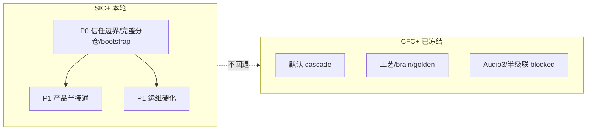
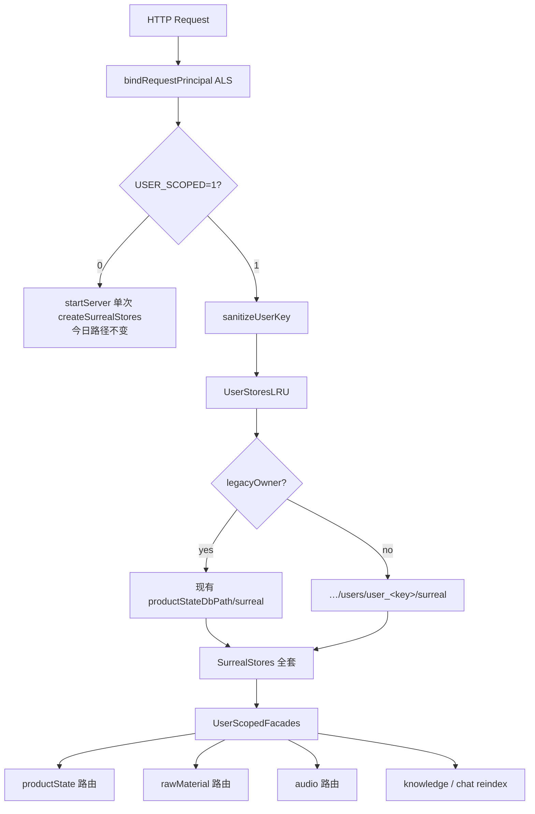
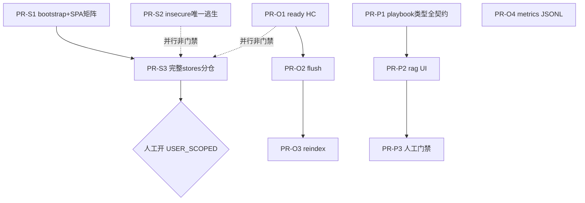
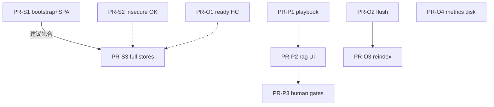

# 专访产品最优改进方案：信任边界优先 · 半接通收敛 · 运维硬化

| 字段 | 值 |
|------|-----|
| **文档标题** | 专访（zhuanfang）系统级最优改进设计 — SIC+ |
| **作者** | Grok Design（系统架构） |
| **日期** | 2026-08-10 |
| **修订** | **Rev C.1** — 用户决议锁定 OQ-S2 / OQ-S3（2026-08-10）；基于 Rev C |
| **状态** | **Ready for Implementation**（PR-S1/S2/S3/O*/P* 均可按本文施工；开启 `USER_SCOPED=1` 仍靠人工晋级 · **OQ-S2 已决**） |
| **产品路径** | `/home/admin/projects/zhuanfang` |
| **HEAD 锚点** | `9e3585d`（CFC+ execute-plan 54f36045 已合 main；其后 spike 关闭文档） |
| **策略短名** | **SIC+**（Secure Isolation Continuity Plus） |
| **决策主线** | P0 信任边界 / 完整 stores 分仓 **先于** 产品接通 **先于** 运维硬化；**永不** 用 Audio3/半级联花活抢道 |
| **继承** | CFC+ 默认 cascade；OQ1 未冻结不排 Audio3；spike 无 GO 不排半级联 |

---

## Overview

专访是**纵向私人采访 OS**（非通用语音助手）。CFC+ 已收口默认语音路径与工艺护城河：

```text
mic → ASR text-only → POST /turns|/turns/stream → CosyVoice TTS
```

本设计**不翻盘语音默认**，也不重开已取消的 pr-6i / pr-8。  
当前最大产品风险已从「听感/工艺」切到：

1. **信任边界未满格**（分仓默认关；当前 flag=1 仅为**内存 ProductState + 共享冷层**的假隔离；仅机器 token 时 bootstrap 仍可写共享密钥 Cookie；嵌入路径 production warn-only）  
2. **产品半接通**（Playbook 硬路由偏科、RAG API 与主 UI 语义分裂、**GATE-HUMAN-VALUE** / turn-15 人工门禁仍 open）  
3. **运维误判与静默丢失**（health ok vs ready、flush 10s、索引 fire-and-forget、指标重启清空）

**北极星（一句话）**：

> **SIC+ — Secure Isolation Continuity Plus**  
> **先把多用户信任边界与密钥下发纪律做实（含热态+三冷层完整仓），再按 ROI 接通半成品产品环并硬化运维；默认 cascade 与 CFC+ 工艺不回退；辅路径/Audio3/半级联维持冻结。**

**拒绝「全做」**：本轮不交付多租户 CRDT、不交付第二 TSDB 全家桶、不交付 Audio3 生产、不交付半级联生产、不伪造 GATE-HUMAN-VALUE 真人价值 GO。

---

## Background & Motivation

### 已完成（CFC+ / 54f36045）— 禁止当未做再开空转 PR

| 已交付 | 证据 |
|--------|------|
| InterviewerBrain 委托 `/turns` + stream | `apps/api/src/interview/interviewer-brain.ts` |
| barge-in / falseTrigger 指标补洞；LiveKit/omni residual metrics | `runtime-metrics.ts` + POST body |
| echo-guard golden 回归锁 | cascade 相关测试 |
| craft 输出护栏 flag 默认关 + boundaries 三路收敛 + rubric 文档 | `craft-output-guard.ts`、`docs/interview-rubric.md` |
| cascade L1 TTS/TTFA 默认路径优化 | cascaded TTS sink / pipeline |
| Realtime model profile 层（omni-default；audio3-flash 占位 null） | profile 层 |
| cascade 默认 ADR | `docs/superpowers/specs/2026-08-10-voice-cascade-default-opt-in-adr.md` |
| half-cascade / Audio3 spike | **401 InvalidApiKey** → pr-6i / pr-8 **本轮取消** |

参考：`docs/design-voice-system-cfc-plus-f77a7584.md`、`docs/superpowers/specs/2026-08-10-execute-plan-54f36045-closure.md`。

### HEAD 核实：deep-research 主张（2026-08-10 demo + 代码）

#### P0 安全

| ID | 主张 | HEAD 核实 | 严重度 |
|----|------|-----------|--------|
| **S15** | `PRODUCT_USER_SCOPED_STATE` 默认关时共享 ProductState | **确认**。demo：`PRODUCT_USER_SCOPED_STATE=0`。`server.ts` 仅当 session auth **且** flag 开启才包装。**更危险**：flag=1 时 `createInMemoryUserRepoFactory()` 使非 legacy 用户 **进程内内存热态**，冷层 **进程级单例共享**；`startServer` 只 `createSurrealStores` 一次。与 `docs/L1-AUTH-SESSION-PLAN.md`「每用户 Surreal」**未对齐** | **P0** |
| **S16** | 鉴权未激活时 `isAuthorized=true`；production 缺凭证 `buildApiServer` 仅 warn | **确认**。`auth.ts`；`startServer` fail-closed；`buildApiServer` 仅 warn | **P0 residual** |
| **S17** | 仅机器 token 时 bootstrap 可 Set-Cookie 共享 `PRODUCT_API_TOKEN` | **确认**（legacy machine 分支）。session 模式 demo 已不下发 | **P0** |

Demo 冒烟（2026-08-10）：

```text
DEPLOYMENT_PROFILE=production
PRODUCT_AUTH_ENABLED=1
PRODUCT_USER_SCOPED_STATE=0
GET /api/health → ok:true ready:true
GET /api/state  → 401（无会话）
GET /api/runtime-bootstrap → mode:session cookieSet:false（未登录）
```

#### P1 产品半接通

| ID | 主张 | HEAD 核实 |
|----|------|-----------|
| **S1** | Playbook 硬路由 mainly concrete-moment / mechanism-reversal；follow-up 无对等硬分支；语音最多 3 条 | **确认**。`strategy.ts`；`MAX_VOICE_PLAYBOOK_RULES = 3`；`InterviewStrategyId` / `PLAYBOOK_DRIVEN_STRATEGIES` 无 follow-up 驱动 id |
| **S2** | `POST /api/rag/query` 有、主 UI 走 `/api/chat` | **确认**。`rag.ts` 注释 + `AssetChatView` |
| **S5** | 真人价值门禁仍 open | **确认**。本设计 ID：**GATE-HUMAN-VALUE**（**≠** `MAINTENANCE-ROADMAP` 的 **D4.a11y** 键盘/无障碍切片） |
| **S6** | 会话级 / turn-15 craft 合规 residual | **确认**。人工 rubric；禁止假自动 CI |

#### P2 语音辅路径

| ID | 主张 | HEAD 核实 |
|----|------|-----------|
| **S3/S4/S22** | Audio3 / 半级联生产未通；Realtime WS 401 | **确认**；本轮不排 |
| **S23** | LiveKit 打断 SLA 未量化 | **确认**；defer |

#### 运维 P1–P2

| ID | 主张 | HEAD 核实 |
|----|------|-----------|
| **S18** | ok vs ready 易误判 | **部分已分字段**；Dockerfile HEALTHCHECK 只看 HTTP `r.ok`，不解析 `ready` |
| **S19** | flush 10s 可能丢已 200 未落库写 | **确认** |
| **S20** | 知识索引 fire-and-forget | **确认**；且 reindex 绑定装配期**单一** knowledge repo |
| **S21** | 指标进程内环，重启空 | **确认** MAX_VOICE=64 等 |

### 与 Scribe3 对照（一笔带过）

Scribe3 以 `work.owner_user_id` 为自然隔离单位；专访是**整站一份 ProductState + 三冷层**。本设计只改 zhuanfang。

---

## Goals & Non-Goals

### Goals

1. **P0 安全满格**：生产/demo 不可再以「共享 ProductState + 共享长期密钥 Cookie」为默认安全模型。  
2. **完整用户仓可生产**：flag=1 时用户 A/B 的 **热态 + raw + audio + knowledge** 持久互不可见；legacy 继承现有目录。  
3. **Bootstrap 永不下发长期机器密钥**（含 machine_token）；SPA/部署矩阵闭合。  
4. **Playbook follow-up 硬路由** 含类型/标签/PLAYBOOK_DRIVEN 全契约。  
5. **RAG vs Chat 双入口产品语义**。  
6. **运维探针与关闭纪律**（ready 可编排消费；flush 可配；索引/指标最小可见性）。  
7. **继承 CFC+**。  
8. **GATE-HUMAN-VALUE / turn-15**：流程与样本落盘，**不**用代码伪造 GO。

### Non-Goals

| 不做 | 原因 |
|------|------|
| 默认改 `realtimeMode` | ADR 已否决 |
| Audio3 / 半级联生产 | OQ1 / spike 无 GO |
| 可插拔 ASR 全量 | 无瓶颈证据 |
| Prometheus/TSDB 全家桶 | ROI 低 |
| 全量 `owner_user_id` 行级 schema | 改动面过大 |
| 跨用户 admin 控制台 | 本轮不做 |
| LiveKit 多用户跨仓扫描 | OQ-S4 锁死 machine→legacy |
| 前端全局「degraded 禁写」门禁（默认） | 非 O1 范围；可选另 PR |
| 伪造 GATE-HUMAN-VALUE GO | 产品/流程 |
| Grok 机平行 Surreal 验收 | 资源规则 |

---

## 策略命名与北极星

| 项 | 内容 |
|----|------|
| **短名** | **SIC+** |
| **一句话** | 信任边界与**完整 stores** 分仓优先；半接通按 ROI 收敛；运维可观测硬化；cascade 工艺延续。 |
| **三不** | 不默认 E2E 翻盘；不排无 GO 辅路径生产；不把人工 GATE-HUMAN-VALUE/turn-15 伪造成自动绿。 |
| **与 CFC+** | SIC+ 叠在 CFC+ 上，**不修改**默认 cascade 结论。 |



---

## ROI 排序（投入 / 产出）

评分：产出 1–5、投入 1–5、**ROI ≈ 产出/投入**。  
**约束：P0 安全必须排在声学/辅路径花活之前；运维 O1 不得阻塞 S3 编码。**

| 优先级 | 工作项 | 对应 | 产出 | 投入 | ROI | 说明 |
|--------|--------|------|------|------|-----|------|
| **1** | Bootstrap 禁下发长期机器密钥 + SPA 部署矩阵 | S17 | 5 | 1 | **5.0** | PR-S1 |
| **2** | 生产 `buildApiServer` fail-closed（单一逃生口） | S16 residual | 4 | 1 | **4.0** | PR-S2 |
| **3** | **完整 SurrealStores 分仓**（热+三冷+能力透传+LRU/shutdown） | S15 | 5 | 5 | **1.0** | PR-S3 投入上调（含冷层）；**仍必做** |
| **4** | HEALTHCHECK / runbook 消费 `ready` | S18 | 4 | 1 | **4.0** | PR-O1 **与 S3 并行**，非 S3 门禁 |
| **5** | Playbook `follow-up` 硬分支 + 类型全契约 | S1 | 4 | 2 | **2.0** | PR-P1 |
| **6** | 资料 QA UI 接 rag | S2 | 3 | 2 | **1.5** | PR-P2 |
| **7** | flush 可配 + 可观测 | S19 | 4 | 2 | **2.0** | PR-O2 |
| **8** | 索引滞后可观测 | S20 | 3 | 2 | **1.5** | PR-O3 |
| **9** | 指标可选 JSONL（不改 record schema） | S21 | 2 | 2 | **1.0** | PR-O4 |
| **10** | turn-15 / craft 人工抽检包 | S6 | 3 | 1 | **3.0** | PR-P3 |
| **11** | GATE-HUMAN-VALUE 书面门禁 | S5 | 5 | 3 | **1.7** | **人工晋级** |
| **—** | Audio3 / 半级联 / LiveKit SLA | S3/4/22/23 | — | — | **不排/defer** | |

**推荐实施序（拒绝全做）**：

```text
S1 ∥ S2          → 安全快赢
S3               → 完整分仓（建议 S1 合入后合 S3，叙事/密钥纪律；S2/O1 非功能前置）
O1 ∥ O2 ∥ O3     → 运维（与 S3 并行）
P1 ∥ P2          → 产品半接通（不依赖 S*）
O4? / P3         → 可选与人工包
人工：demo 开 USER_SCOPED=1
```

---

## Proposed Design

### Phase 0 — 基线与门禁定义（0.5d）

1. 锁定 demo 姿态：session 开、分仓关、machine bootstrap 路径仍危险。  
2. 自动硬门禁 vs 人工晋级（见 §Go/No-Go）。  
3. 验收：ssh demo **已部署栈**冒烟。

### Phase 1 — P0 信任边界

#### 1.A · S17 Bootstrap 密钥纪律（PR-S1）

**目标**：任何部署模式下，`GET /api/runtime-bootstrap` **不得** `Set-Cookie` 写入 `PRODUCT_API_TOKEN`（除非应急 flag）。

| 模式 | 行为 |
|------|------|
| session（`PRODUCT_AUTH_ENABLED`） | 报告 `authenticated` / `username`；无密钥 cookie |
| 仅 machine token | `authRequired: true, cookieSet: false, mode: "machine_token"`；**不下发**密钥 |
| 守卫未激活 | `authRequired: false` |

**应急**：`PRODUCT_BOOTSTRAP_LEGACY_TOKEN_COOKIE=1` 默认 **false**；开启时 error 级日志 `bootstrap_legacy_token_cookie`。

##### 部署矩阵（SPA 必须闭合）

| 部署形态 | 服务端 env | 浏览器如何带凭证 | 前端 gate 行为（`main.tsx`） |
|----------|------------|------------------|------------------------------|
| **A. Session（推荐生产/demo）** | `PRODUCT_AUTH_ENABLED=1` + session secret +（建议）machine token 给 agent | 登录 → `zf_session` HttpOnly | `authRequired && !authenticated` → **LoginPage** |
| **B. Machine + bake-in** | 仅 `PRODUCT_API_TOKEN`；**无** session auth | `VITE_PRODUCT_API_TOKEN` → `Authorization: Bearer`（`productApi`） | bootstrap `mode: machine_token` 且 `cookieSet: false`；**探测** `/api/state` 带 bake-in header：200 → 进 App；401 → **运维配置页文案**（「请设置 VITE_PRODUCT_API_TOKEN 或改开 session」），**禁止**假装 LoginPage 可账密登录 |
| **C. 双开** | session + machine token | 人类 cookie；agent Bearer | 人类走 A；agent 不受 bootstrap 影响 |
| **D. 应急 legacy cookie** | `PRODUCT_BOOTSTRAP_LEGACY_TOKEN_COOKIE=1` | 旧 cookie | 仅迁移窗口；审计日志 |

**前端改动要点**：

- `src/main.tsx`：`resolveAuthGate` 读取 bootstrap `mode`；`machine_token` 且无 bake-in / 探 state 401 → 新态 `need_machine_token`（非 LoginPage）。  
- `productApi.types.ts`：文档标明 `sessionStorage.product_api_token` 为 **deprecated**；PR-S1 可不删读路径一版，但 **bootstrap 不再写入**；后续 PR 可清。  
- 登录失败文案：session 模式才渲染 `LoginPage`。

**文件**：`auth-bootstrap.ts`、`server.test.ts`、`session-auth.test.ts`、`main.tsx`、README、L1 文档、**machine 模式 inject 测**（无 Set-Cookie、body 无 secret、`Authorization` 仍可访问）。

**Demo 冒烟**：

```bash
curl -sSI https://www.qing.blue/zhuanfang/api/runtime-bootstrap | tr -d '\r' | grep -i set-cookie || echo "no set-cookie ok"
# 期望不含 product_api_token
```

**迁移 runbook（曾用 machine cookie 的环境）**：

1. 在构建/compose 注入 `VITE_PRODUCT_API_TOKEN`（或改 session）；  
2. 部署 PR-S1；  
3. 用户清站点 cookie 中的 `product_api_token`；  
4. 验证 SPA 可加载 `/api/state`。

#### 1.B · S16 嵌入路径硬闸（PR-S2）

**目标**：`DEPLOYMENT_PROFILE=production` 时，`buildApiServer` 与 `startServer` 鉴权要求对齐。

##### 单一逃生口契约（KD4 写死）

| 规则 | 说明 |
|------|------|
| **默认** | production 且既无 `PRODUCT_API_TOKEN` 又无 session auth 配置完整 → **`assertProductionAuthConfigured` 在 `buildApiServer` 入口 throw** |
| **唯一逃生口** | env **`PRODUCT_AUTH_INSECURE_OK=1`**（或 `true`/`yes`/`on`）：允许启动并打 **error 级**日志 `auth_insecure_ok_enabled`；可选进程内 counter |
| **删除双轨** | **不**再使用 `PRODUCT_AUTH_STRICT_EMBED` 与「内建 assert / 可选 strict」两套说法；`options.allowInsecureProductionAuth` **仅测试**可映射为与 env 等价，或测试设 `PRODUCT_AUTH_INSECURE_OK=1` |
| **VITEST** | **不**隐式放行 production 无凭证；需要 insecure 的用例必须显式设逃生口或不用 production profile |

**嵌入合法用法（SIC+ 后）**：宿主自带鉴权层时，仍须设 `PRODUCT_AUTH_INSECURE_OK=1` 并接受 error 日志——**显式承认**，禁止静默 warn。

**文件**：`server.ts`、`auth-bootstrap.ts`、`server.test.ts`（改「production 无 token 不 enforce」用例）。

#### 1.C · S15 完整持久用户分仓（PR-S3）— **架构锁定（Rev B）**

##### 1.C.0 状态与 OQ-S1 关闭

| 项 | 决议 |
|----|------|
| **OQ-S1** | **关闭**：选定 **每用户独立 dataDir + 独立 `createSurrealStores` 连接 + 进程内 LRU** |
| **否决** | 单连接多 DB + 全局 `USE NS/DB`（与 R2a 热冷同连接 / governance 事务 / 并发请求切换 DB 竞态不兼容，实现分叉成本高） |
| **文档状态** | PR-S3 **可编码**；**开启 flag=1 上 demo** 仍人工晋级 |

##### 1.C.1 核心不变量（防止假多租户）

1. **用户仓 = 完整 `SurrealStores`**：`{ productState, rawMaterial, audio, knowledgeIndex, close/flush }`，**禁止**只包 ProductState。  
2. **冷层必须请求级解析**：`raw` / `audio` / `knowledge` 与热态同一 `userKey`；禁止进程级单例共享给多用户。  
3. **能力透传**：scoped 适配器必须转发 Surreal 可选能力（见 1.C.3）。  
4. **生产禁止内存工厂**：`DEPLOYMENT_PROFILE=production` 且 `PRODUCT_USER_SCOPED_STATE=1` 时，工厂必须是持久 Surreal；否则 **拒绝启动**。  
5. **Machine 默认只进 legacy 仓**（`PRODUCT_MACHINE_SCOPE=legacy` 写死默认）；跨用户扫库本轮不做。

##### 1.C.2 架构



**路径布局**（相对 `PRODUCT_STATE_DB_PATH` 父目录）：

```text
<dataDir>/
  surreal/                    # legacy / flag=0：现有布局（不变）
  users/
    user_<sanitize>/
      surreal/                # 非 legacy 用户独立 surrealkv 目录
```

**LRU + 开仓并发契约（强制 · 对齐嵌入式 surrealkv 独占锁）**：

HEAD：`createSurrealStores` / `connect.ts` — **同一 dataDir 不可并行第二连接**（同进程热冷共连；重复 open 同路径 → 超时 / `SurrealConnectTimeoutError`）。

| 参数 / 规则 | 要求 |
|-------------|------|
| `PRODUCT_USER_STORE_LRU_MAX` | 默认 4（demo 足够） |
| **singleflight** | `resolve(userKey)`：若该 key **未就绪**，必须把并发调用合并到 **同一个** `openPromise`（`Map<userKey, Promise<SurrealStores>>`）。**禁止**两路 miss 各调一次 `createSurrealStores(同一 dataDir)` |
| **就绪 map** | open 成功后写入 `Map<userKey, OpenedEntry>`，后续 resolve 直接返回；open 失败则删除 inflight 项并 503，允许下次重试 |
| **pin / refcount** | 每个进行中的请求 `acquire(userKey)` → `pinCount++`，`finally release` → `pinCount--`。**LRU 驱逐仅当** `pinCount===0` 且不在 inflight open；被 pin 的 entry **禁止 close/evict** |
| 驱逐 | victim 满足可驱逐 → `await stores.close()`（含 persist flush）→ 删 map；日志 `user_store_evict` |
| 打开失败 | 503 + 日志，**不**静默回落共享仓 / legacy |
| 单测硬门禁 | ① 并行两请求同 `userKey` → `createSurrealStores` **调用次数 = 1**；② pin 期间 LRU 满也不 evict 该 key；③ 不同 userKey 可并行 open（不同 dataDir） |

```text
// user-stores-registry.ts 伪代码（PR-S3 必实现）
async function resolve(userKey: string): Promise<SurrealStores> {
  const opened = ready.get(userKey);
  if (opened) { pin(userKey); return opened.stores; }

  let inflight = opening.get(userKey);
  if (!inflight) {
    inflight = (async () => {
      maybeEvictIfNeeded(); // 只 evict pinCount===0
      const stores = await createSurrealStores({ url: urlFor(userKey) });
      ready.set(userKey, { stores, pinCount: 0, lastUsed: Date.now() });
      return stores;
    })().finally(() => opening.delete(userKey));
    opening.set(userKey, inflight);
  }
  const stores = await inflight;
  pin(userKey);
  return stores;
}
// 路由/facade：try { const s = await resolve(k); ... } finally { release(k); }
```

**`startServer` 装配（必须改，非仅 buildApiServer）**：

| flag | 行为 |
|------|------|
| **0** | 保持今日：一次 `createSurrealStores` → 注入 `buildApiServer`；`storesClose` 关这一份 |
| **1** | **不**在 listen 前为所有用户预开仓；构造 `UserStoresRegistry`（含 singleflight + pin + LRU）：  
  - legacy key → 打开（或复用）**现有** dataDir 的 stores（启动时预开 legacy，保证迁移无感）  
  - 其他用户 → 懒开 `users/user_*/surreal`（**经 singleflight**）  
  - 向 `buildApiServer` 注入的是 **facade 单例**（方法内 `registry.resolve(currentUsername)` + release），不是某个固定 repo 实例 |
| shutdown | `flushPersistence` = `registry.closeAll()`：等待 inflight open 结束 → 对 **所有打开仓** 串行/有界并行 `close()`（忽略 pin，进程退出优先）→ `exit` |

##### 1.C.3 能力透传契约（对比 `withKnowledgeReindex` 的 `...inner` 教训）

当前 `createUserScopedProductStateRepository` **仅**实现窄接口，**丢失**：

- `getPersistHealth` → health `ready` 失真  
- `auditGraphConsistency`  
- `runGovernanceTransaction`（reset/import/purge）  
- `flush` / registry 级 `close`

**规定**：

```text
// 伪代码：每个请求 resolve 当前用户完整 handle
function createUserScopedProductStateRepository(...) {
  return {
    getState: () => resolve().productState.getState(),
    replaceState: (...) => resolve().productState.replaceState(...),
    // 显式转发 + 单测锁
    getPersistHealth: () => resolve().productState.getPersistHealth?.(),
    auditGraphConsistency: () => resolve().productState.auditGraphConsistency?.(),
    runGovernanceTransaction: (fn) => resolve().productState.runGovernanceTransaction?.(fn),
    confirmPersisted: () => resolve().productState.confirmPersisted?.(),
    flush: () => resolve().productState.flush?.() ?? resolve().close?.(),
    getGovernanceGeneration: () => resolve().productState.getGovernanceGeneration?.() ?? 0,
    // 禁止只 spread 错误对象；必须对「当前用户」resolve 后再转发
  };
}
```

冷层同构 facade：

```text
createUserScopedRawMaterialRepository(registry)
createUserScopedAudioRepository(registry)
createUserScopedKnowledgeIndexRepository(registry)
```

**`withKnowledgeReindex`**：每次 `replaceState` 后 `void reindexOnStateChange(..., registry.knowledgeFor(currentUser), ...)`，**禁止**闭包捕获装配期单一 knowledge repo。

**health `getPersistHealth`**：flag=1 时聚合策略：

- **默认（本轮）**：报告 **legacy 仓** + **当前无打开仓** 的 max(`consecutiveFailures`)；任一 >0 → `ready=false`  
- 文档注明：未打开的用户仓故障不可见（可接受；避免启动扫全盘）

##### 1.C.4 生产硬闸

```text
if production && USER_SCOPED=1:
  if PRODUCT_STORE != surreal (或工厂非 SurrealUserStoresFactory):
    throw // 拒绝内存分仓
  if !sessionAuth && !documented_machine_only_legacy:
    // session 强烈建议；machine-only 分仓仅 legacy 有意义
```

**测试**可继续用内存 factory，但必须 `DEPLOYMENT_PROFILE!=production` 或 `PRODUCT_AUTH_INSECURE_OK` 不适用此条（分仓硬闸独立于 auth 逃生口）。

##### 1.C.5 Machine / LiveKit（OQ-S4 本轮锁死）

| 项 | 决议 |
|----|------|
| **OQ-S4** | **本轮关闭为：仅支持 `PRODUCT_MACHINE_SCOPE=legacy`（默认）** |
| agent | Bearer machine → 始终解析到 **legacy 仓** |
| 多用户 LiveKit | **非目标**；禁止回归「agent 扫全用户」 |
| sessionId 跨用户 | 不支持；session 只存在于创建它的用户仓 |

##### 1.C.6 开启 / 回滚 runbook

**开启 `PRODUCT_USER_SCOPED_STATE=1` 前**：

1. `export` 全站 JSON（现有 export API，以 **legacy/共享库** 为准）。  
2. 确认 `PRODUCT_LEGACY_OWNER` = 现有主用户名（默认 `admin`）。  
3. 确认 volume 可写 `…/users/` 子目录。  
4. 部署含 PR-S3 的镜像；**flag 仍为 0** 先冒烟。  
5. 维护窗口：设 flag=1，重启。  
6. **已登录非 legacy 用户**：将看到 **空仓**（历史数据仍在 legacy 共享库）。若需迁出：运维用 export 从 legacy 导出 → 该用户登录后 import（**无自动拆分**；本轮不做自动迁移工具）。  
7. 双用户冒烟：A 写笔记/上传 raw；B 不可见；B chat 不得召回 A knowledge。  
8. `docker restart` 后 A 数据仍在。  
9. reset/import 仍走 governance tx（flag=1）。  
10. health：人为制造 legacy persist 失败时 `ready=false`。

**回滚 flag=0**：

- 进程回到单一 legacy 目录；  
- `users/user_*` **保留在磁盘、不自动合并**；  
- 文档警告：回滚后 UI 只见 legacy 数据。

**备份粒度**：优先整 volume 快照；其次 per-user export JSON；路径记入 `docs/runbooks/` 分仓专页（PR-S3 交付）。

##### 1.C.7 验收（自动 + 人工）

| 用例 | 类型 |
|------|------|
| A/B `GET /api/state` 互不可见 | 自动 |
| A raw/audio id 对 B 404/空 | 自动 |
| B `/api/chat` 不得引用 A knowledge chunk id | 自动 |
| flag=1 + production + memory factory → 拒启 | 自动 |
| flag=1 reset/import governance | 自动 |
| legacy persist degraded → ready=false | 自动 |
| 重启后非 legacy 数据仍在 | 脚本/人工 |
| demo 开 flag | **人工晋级** |

**文件（预期）**：

- `apps/api/src/server.ts` — startServer registry / flag 硬闸  
- `apps/api/src/auth/user-stores-registry.ts`（新）— LRU + closeAll  
- `apps/api/src/auth/user-scoped-repository.ts` — 热态能力透传  
- `apps/api/src/auth/user-scoped-cold.ts`（新）— 冷层 facade  
- `packages/db/.../surreal-cold-repositories.ts` — dataDir 参数化（若尚未）  
- 测试：session-auth、分仓隔离、governance、health  

---

### Phase 2 — 产品半接通

#### 2.A · S1 Playbook follow-up 硬路由（PR-P1）

**现状**：仅 `concrete-moment` / `mechanism-reversal` 硬分支；`follow-up` ruleType 无对等策略 id。

**类型全契约（必须改全，否则 coerce 丢 id / 徽章不亮）**：

| 文件 | 改动 |
|------|------|
| `src/domain/types.ts` | `InterviewStrategyId` 增加 `"playbook_followup_probe"` |
| `src/domain/turn-builder.ts` | `VALID_STRATEGY_IDS`、`INTERVIEW_STRATEGY_LABELS`（如「技法追问」）、`PLAYBOOK_DRIVEN_STRATEGIES` 加入该 id |
| `src/domain/strategy.ts` | `hasFollowUpPlaybookRule` + 硬分支 |
| `src/domain/strategy.test.ts` / `craft-golden.ts` | 场景 + **优先级表** |
| `src/domain/signals.ts` 等 switch | 若有穷尽 switch 补 case |
| UI | 若硬编码策略列表则同步；徽章依赖 `PLAYBOOK_DRIVEN_STRATEGIES` |

**硬分支条件（`playbook_followup_probe`）**：

- `hasFollowUpPlaybookRule(session)`；  
- 最近用户话轮已有具体时刻信号（与 mechanism 侧信号可复用/放宽一档，单测钉死）；  
- 本会话尚未出现 `playbook_followup_probe`；  
- **仅当**上方更高优先级分支均未 return（见权威 if 序）。

**权威 if 顺序（唯一真源 · 单测锁死 · 禁止再写互相打架的「序」注释）**：

实现必须是 **同一条 if-chain 的文档顺序**，不得另表「序 3=follow-up 且 decision 又优先于 follow-up」：

| 判定序 | 策略 | 条件摘要（细节沿用 HEAD / 本 PR） |
|--------|------|-------------------------------------|
| **1** | `concrete_example_probe` | concrete-moment 规则 + 首轮抽象 + 未做过 |
| **2** | `mechanism_reversal_probe` | mechanism-reversal + 上轮 concrete + 有具体时刻 + 未做过 |
| **3** | `decision_review` | 现窗口 `previousUserTurns∈{1,2,3}` + due decision + 与 debt 互斥逻辑 **不变** |
| **4** | `debt_followup` | 现窗口 + 债地址 + 与 decision 互斥 **不变** |
| **5** | **`playbook_followup_probe`（新）** | follow-up 规则 + 具体时刻信号 + 本会话未做过；**不**再要求手写 `!dueDecision`——因 if 序已保证 decision/debt 先判定 |
| **6** | `synthesis` | `≥10min` 且上轮非 synthesis（**相对 HEAD 下移**：插在 follow-up **之后**，避免 10min 墙饿死技法追问） |
| **7** | 其余 | contradiction / perspective / blindspot / premise / 默认 mechanism_probe 等 **保持 HEAD 相对序** |

**与 HEAD 差异（有意）**：HEAD 在 mechanism 后立即 `synthesis`，再 decision/debt。SIC+ **把 decision/debt 提到 synthesis 之前**（纵向主线），并把 **follow-up 放在 decision/debt 之后、synthesis 之前**。

**PR-P1 golden / 单测最小集**（阻断合并）：

| 场景 | 期望 |
|------|------|
| 仅 follow-up 规则 + 具体时刻 + 无 due decision/债 | `playbook_followup_probe` |
| follow-up 规则 **且** turn∈{1,2,3} + due decision | **`decision_review`**（非 follow-up） |
| follow-up 规则 **且** 债窗口命中 | **`debt_followup`**（非 follow-up） |
| follow-up 规则 + 会话 ≥10min + 无 decision/债窗口 | **`playbook_followup_probe`**（非 synthesis） |
| 无 follow-up + ≥10min | `synthesis`（回归） |
| concrete-moment / mechanism-reversal | 既有 golden **不回退** |

**Env**：`VOICE_PLAYBOOK_RULES_MAX` 默认 3（上限 8）；`TEXT_PLAYBOOK_RULES_MAX` 默认 6。

#### 2.B · S2 RAG 产品语义（PR-P2）

**决策**：资料库入口显式接 `POST /api/rag/query`；不与 Asset Chat 合并端点。

| 入口 | API | 召回源 |
|------|-----|--------|
| 资产/全局助手 | `/api/chat` | 八源 knowledge |
| 导入资料「就资料提问」 | `/api/rag/query` | 仅 `ragChunks` |

#### 2.C · S6 / GATE-HUMAN-VALUE（PR-P3 docs）

- 抽检节奏与 `insufficient_data` 规则。  
- **GATE-HUMAN-VALUE**（原 deep-research S5「真人价值」；**不是** MAINTENANCE **D4.a11y**）。  
- 工程 PR **不宣称** GATE-HUMAN-VALUE GO。

---

### Phase 3 — 运维硬化

#### 3.A · S18 ready 探针（PR-O1）

| 层 | 改动 |
|----|------|
| Dockerfile HEALTHCHECK | 解析 JSON：`ok && ready` 才 0；或 `HEALTHCHECK_MODE=liveness\|readiness`（**默认 readiness**） |
| compose | 注释绑定 ALERTS：degraded 时 **禁止** 自动 `recreate` 当唯一处置 |
| Runbook ALERTS | **新增规则**：`ready=false` / `persist.degraded` **连续 N 次（建议 N=3，间隔 1–5min）→ 人工 export / 查盘，禁止自动滚动重启**；liveness 仍可用独立探针 |
| **前端** | **非本 PR 目标**：不假设已有全局 health banner / 禁危险写。可选另开 `PR-O1b` 轮询 `ready` 提示；O1 范围 = **Dockerfile + runbook + compose 注释** |

**风险**：readiness HC + `restart: unless-stopped` 在 persist 抖动时可能循环重启 → 用 N 次人工优先规则 + 可选 liveness 模式缓解。

#### 3.B · S19 flush（PR-O2）

- `PRODUCT_SHUTDOWN_FLUSH_MS` 默认 10000，可至 30000。  
- 超时日志/计数 `graceful_shutdown_flush_timeout`。  
- 分仓时 flush = `registry.closeAll()`（见 1.C）。  
- `PRODUCT_WRITE_AWAIT_PERSIST=1` 默认关。

#### 3.C · S20 索引可观测（PR-O3）

- 保持 fire-and-forget；`reindex` 事件进 metrics/health。  
- 分仓后事件带 `userKey`（日志可红acted）。

#### 3.D · S21 指标落盘可选（PR-O4）

- `PRODUCT_METRICS_PERSIST_PATH` 默认空=关。  
- **仅持久化现有 `getRuntimeMetricsSnapshot()` 字段**；**不改** `recordVoiceLatency` / POST body schema；避免破坏 CFC+ 冒烟与 `useCascadeVoiceMetrics`。  
- 与 O1 **无硬依赖**（可 defer 任意时刻）。

### Phase 4 — 辅路径

| 项 | 状态 |
|----|------|
| Audio3 / 半级联生产 | **不排** |
| Realtime 401 | **运维密钥工单** |
| LiveKit SLA | defer |
| LiveKit 多用户分仓 | **不做**（machine→legacy） |

---

## API / Interface Changes

| 变更 | 类型 | 说明 |
|------|------|------|
| `GET /api/runtime-bootstrap` | 行为收紧 | 永不 Set-Cookie 长期 token；body 可含 `mode` |
| 前端 gate | 新态 | `need_machine_token` |
| `GET /api/health` | 可增 | `metrics.reindex?`；分仓时 persist 聚合 |
| strategy id | 扩展 | `playbook_followup_probe` |
| 冷层 API | 行为 | flag=1 时按用户隔离（路径不变） |

### Env flags

| 变量 | 默认 | 含义 |
|------|------|------|
| `PRODUCT_AUTH_ENABLED` | demo=1 | 人类会话 |
| `PRODUCT_USER_SCOPED_STATE` | **0** | 1=完整 stores 分仓 |
| `PRODUCT_LEGACY_OWNER` | admin | 历史库归属 |
| `PRODUCT_USER_STORE_LRU_MAX` | 4 | 分仓连接 LRU |
| `PRODUCT_MACHINE_SCOPE` | **legacy** | 本轮仅 legacy |
| `PRODUCT_BOOTSTRAP_LEGACY_TOKEN_COOKIE` | **0** | 应急 bootstrap cookie |
| `PRODUCT_AUTH_INSECURE_OK` | **0** | **唯一** production 无鉴权逃生口 |
| `VOICE_PLAYBOOK_RULES_MAX` | 3 | 语音 playbook 条数 |
| `TEXT_PLAYBOOK_RULES_MAX` | 6 | 文本路径 |
| `PRODUCT_SHUTDOWN_FLUSH_MS` | 10000 | 关闭 flush |
| `PRODUCT_WRITE_AWAIT_PERSIST` | 0 | 写后确认 |
| `PRODUCT_METRICS_PERSIST_PATH` | 空 | 指标 JSONL |
| `HEALTHCHECK_MODE` | readiness | liveness 仅 ok |
| `VOICE_CRAFT_OUTPUT_GUARD` | 0 | 继承 CFC+ |

---

## Data Model Changes

| 变更 | 说明 |
|------|------|
| 每用户 surrealkv 目录 | `users/user_<key>/surreal` |
| ProductState schema | 尽量不变 |
| `InterviewStrategyId` | + `playbook_followup_probe` |
| 指标 JSONL | 可选；schema = 现有 snapshot |

**迁移**：无自动拆分；非 legacy 用户 flag 开启后空仓；见 1.C.6 runbook。

---

## Alternatives Considered

### 替代 1：整库 `owner_user_id` 行级隔离（否决）

改动面过大；与整份 ProductState 快照模型冲突。

### 替代 2：仅内存 ProductState 分仓 + 共享冷层（否决生产）

即 HEAD flag=1 现状；静默丢数据 + 跨用户召回；**生产拒启**。

### 替代 3：单连接多 DB + USE 切换（否决 · OQ-S1）

与 R2a 热冷同连接、governance 事务、并发请求不兼容。

### 替代 4：默认翻盘 bailian/Audio3（否决）

CFC+ ADR + spike 401。

### 替代 5：删除 `/api/rag/query`（否决）

丢失资料-only 语义；本设计接 UI。

### 替代 6：索引同步 await 写路径（否决默认）

延迟敏感；可观测即可。

---

## Security & Privacy

| 风险 | 严重度 | 缓解 |
|------|--------|------|
| 共享 ProductState / 冷层串仓 | **高** | 完整 stores 分仓 + 隔离测 |
| 假分仓（内存+共享冷层） | **高** | production 拒启 |
| Bootstrap 长期 token Cookie | **高** | PR-S1 + 部署矩阵 |
| production 嵌入无鉴权 | **高** | PR-S2 唯一逃生口 |
| 能力透传丢失 → ready 假绿 | **高** | 1.C.3 契约 + 测 |
| LRU 驱逐未 flush | 中 | close 含 flush |
| Machine 跨用户 | 中 | **默认 legacy only** |
| 回滚后磁盘残留用户仓 | 低 | runbook 说明；不自动合并 |

---

## Observability

| 信号 | 用途 |
|------|------|
| `auth_insecure_ok_enabled` | 逃生口审计 |
| `bootstrap_legacy_token_cookie` | 应急 cookie |
| `user_store_open` / `user_store_evict` / `user_store_close_all` / `user_store_open_coalesced` | 分仓生命周期；coalesced 表示 singleflight 命中 inflight |
| `graceful_shutdown_flush_timeout` | S19 |
| `reindex_*` | S20 |
| health `ready` / persist | S18；ALERTS N 次人工 |
| voice 环 + 可选 JSONL | **不改** record schema |

---

## Rollout Plan



1. 每 PR 独立可合并。  
2. Demo：`/opt/zhuanfang/app` 热更；不因 GHA 阻塞。  
3. 分仓开启：1.C.6 runbook。  
4. 回滚：S1 legacy cookie flag；S3 flag=0；产品 flag/UI 隐藏。

---

## Go / No-Go 规则

### 自动硬门禁

| 门禁 | 失败后果 |
|------|----------|
| session/machine bootstrap 不下发 `product_api_token`（无应急 flag） | 阻断 S1 |
| production 无凭证且无 `PRODUCT_AUTH_INSECURE_OK` → throw | 阻断 S2 |
| craft-golden + follow-up 优先级表 + 类型 VALID/LABELS/PLAYBOOK_DRIVEN | 阻断 P1 |
| 分仓 A/B 热态+冷层+chat 隔离；production+scoped+memory 拒启；governance；ready；**同 userKey 并行 resolve 只 open 一次**；pin 期间不 evict | 阻断 S3 |
| Dockerfile ready 解析（若改） | 阻断 O1 |

### 人工晋级

| 门禁 | 规则 |
|------|------|
| demo `USER_SCOPED=1` | runbook 全步 |
| craft / turn-15 | 人工；n 不足 → `insufficient_data` |
| **GATE-HUMAN-VALUE** | 产品书面；工程不标 GO |
| Audio3 / 半级联 | OQ1 + live spike GO |

### `insufficient_data`

最小 n 未达到 → 只能写 `insufficient_data`，禁止 go/partial-go 百分比。自动测绿 ≠ 产品 GO。

---

## Open Questions

| ID | 问题 | 状态 |
|----|------|------|
| **OQ-S1** | 多目录 vs 单连接多 DB | **已决** → 多目录 + LRU + singleflight/pin（KD15/KD20） |
| **OQ-S2** | demo / 生产是否默认开分仓 | **已决（2026-08-10）** → **先实现后人工开**：`PRODUCT_USER_SCOPED_STATE` **默认 0**；PR-S3 合入后按 §1.C.6 runbook **人工晋级** 再开 flag=1；**不阻塞** S3 编码与合并 |
| **OQ-S3** | machine-only 部署是否强制迁 session | **已决（2026-08-10）** → **不强制断机迁 session**；文档**强烈建议**生产改 session（矩阵 A）；**矩阵 B** 合法：`VITE_PRODUCT_API_TOKEN` bake-in + Bearer；**bootstrap 永不写** `PRODUCT_API_TOKEN` Cookie（应急 legacy flag 除外，见 KD3） |
| **OQ-S4** | machine 跨用户 | **已决** → 仅 legacy（KD18） |
| OQ1/OQ2 | Audio3 / 半级联 | 继承 CFC+ 冻结（未在本轮用户决议中改动） |

---

## References

- CFC+ / ADR / closure 文档（见 Overview）  
- `docs/L1-AUTH-SESSION-PLAN.md`  
- `docs/interview-rubric.md`、`docs/runbooks/ALERTS.md`  
- `docs/MAINTENANCE-ROADMAP.md`（**D4.\* = a11y，≠ GATE-HUMAN-VALUE**）  
- 代码：`auth.ts`、`auth-bootstrap.ts`、`server.ts`、`user-scoped-repository.ts`、`health.ts`、`rag.ts`、`chat.ts`、`strategy.ts`、`turn-builder.ts`、`types.ts`、`runtime-metrics.ts`、`shutdown.ts`、`knowledge.ts`、`main.tsx`  
- Demo：`www.qing.blue` / `ubuntu@82.157.130.140` `/opt/zhuanfang/app`

---

## Key Decisions

| ID | 决策 |
|----|------|
| **KD1** | 策略 **SIC+**；信任边界与完整分仓优先；不全做。 |
| **KD2** | P0 安全先于 Audio3/半级联/声学花活；继承 CFC+ cascade。 |
| **KD3** | `runtime-bootstrap` 永久禁止下发长期 `PRODUCT_API_TOKEN` Cookie（应急 flag 除外）；SPA 部署矩阵闭合。 |
| **KD4** | production 下 `buildApiServer` fail-closed；**唯一**逃生口 `PRODUCT_AUTH_INSECURE_OK=1` + error 日志。 |
| **KD5** | 分仓必须持久 Surreal **完整 stores**；否决内存 map 与「只包 ProductState」。 |
| **KD6** | 冷层 raw/audio/knowledge **请求级**与热态同 userKey；`withKnowledgeReindex` 按用户 resolve knowledge。 |
| **KD7** | Playbook follow-up → `playbook_followup_probe`；补齐 types/VALID/LABELS/PLAYBOOK_DRIVEN；**权威 if 序：concrete→mechanism→decision/debt→follow-up→synthesis→其余**（decision 先于 follow-up；follow-up 先于 synthesis）；golden 锁死。 |
| **KD20** | `UserStoresRegistry.resolve` **必须** per-userKey singleflight；请求 **pin/refcount**；LRU 仅 evict `pinCount===0`；禁同 dataDir 双开。 |
| **KD8** | RAG 与 Chat 双入口；资料 QA 接 UI。 |
| **KD9** | HEALTHCHECK 默认可消费 ready；degraded 连续 N 次人工 export，禁止盲 restart 当唯一处置。 |
| **KD10** | 索引 FAF + 可观测；flush 可配；指标 JSONL 可选且 **不改 record schema**。 |
| **KD11** | GATE-HUMAN-VALUE / turn-15 / craft：**人工**；`insufficient_data` 禁假 GO；**≠ MAINTENANCE D4.a11y**。 |
| **KD12** | Audio3 / 半级联本轮不排。 |
| **KD13** | 验收 = 已部署 demo 冒烟。 |
| **KD14** | 门禁分级：自动硬门禁 vs 人工晋级。 |
| **KD15** | **OQ-S1 关闭**：每用户 dataDir + `createSurrealStores` + LRU **+ singleflight/pin**（KD20）；否决单连接多 DB。 |
| **KD16** | production + `USER_SCOPED=1` + 非持久工厂 → **拒绝启动**。 |
| **KD17** | scoped 适配器必须透传 `getPersistHealth` / governance tx / audit / flush；shutdown `closeAll`。 |
| **KD18** | **OQ-S4 关闭**：machine 默认 **仅 legacy 仓**；LiveKit 多用户非目标。 |
| **KD19** | PR 依赖：`S1 ∥ S2 → S3`（S1 建议先合）；**O1 非 S3 门禁**；P1/P2 不依赖 S*；O4 不依赖 O1。 |
| **KD21** | **OQ-S2/OQ-S3 用户已决（2026-08-10）**：分仓 flag 默认 0、合入后人工开；machine-only 不强制迁 session，支持 bake-in 矩阵 B，bootstrap 永不写长期 token Cookie。 |

---

## PR Plan

> 每 PR 独立可合并。验收以 demo 冒烟为准。

### PR-S1 · Bootstrap 禁密钥 + SPA 矩阵

- **标题**：`fix(auth): never Set-Cookie PRODUCT_API_TOKEN from runtime-bootstrap`  
- **范围**：`auth-bootstrap.ts`、测试（含 machine inject）、`main.tsx` gate、README/L1、迁移 runbook 一小段  
- **依赖**：无  
- **Demo**：无 product_api_token Set-Cookie；session 登录后 state 200  
- **回滚**：`PRODUCT_BOOTSTRAP_LEGACY_TOKEN_COOKIE=1`  

### PR-S2 · 生产嵌入 fail-closed

- **标题**：`fix(auth): fail-closed buildApiServer unless PRODUCT_AUTH_INSECURE_OK`  
- **范围**：`buildApiServer` assert、**唯一**逃生口、改 server 测  
- **依赖**：无（∥ S1）  
- **禁止回归**：显式 insecure 测可起；正常 vitest 非 production  

### PR-O1 · ready HEALTHCHECK + ALERTS

- **标题**：`fix(ops): healthcheck requires ready; degraded N-strike runbook`  
- **范围**：Dockerfile、compose 注释、ALERTS.md  
- **依赖**：无（**不阻塞 S3**）  
- **非范围**：前端全局禁写  

### PR-S3 · 完整 stores 持久分仓

- **标题**：`feat(auth): durable per-user SurrealStores (hot+cold) when USER_SCOPED=1`  
- **范围**：startServer registry（**singleflight + pin + LRU**）、冷层 facade、能力透传、production 禁内存工厂、隔离+governance+ready+**并行 open 一次**测、开启 runbook  
- **依赖**：**建议 S1 先合**（密钥叙事）；**不**依赖 O1/S2 功能  
- **Flag 默认 0**  
- **Demo flag=0**：行为同今  
- **人工 flag=1**：1.C.6 + 1.C.7  
- **禁止回归**：legacy 单用户路径；machine→legacy  

### PR-P1 · Playbook follow-up 全契约

- **标题**：`feat(strategy): playbook_followup_probe + type surface`  
- **范围**：`types.ts`、`turn-builder.ts`、`strategy.ts`（**权威 if 序**）、golden 最小集（含 decision>follow-up、follow-up>synthesis）、env cap  
- **依赖**：**无**（不依赖 S1）  
- **禁止回归**：concrete-moment / mechanism-reversal golden；decision/debt 窗口行为  

### PR-P2 · 资料 QA UI

- **标题**：`feat(ui): import-materials ask via /api/rag/query`  
- **依赖**：无（∥ P1）  

### PR-O2 · flush 可配

- **标题**：`fix(ops): configurable shutdown flush + registry closeAll hook`  
- **依赖**：无；与 S3 合入时对接 `closeAll`  

### PR-O3 · reindex 可观测

- **依赖**：无；分仓后带 userKey  

### PR-O4 · 指标 JSONL（可 defer）

- **标题**：`feat(obs): optional JSONL persist for runtime-metrics snapshot`  
- **约束**：**不改** record API / POST schema  
- **依赖**：无（不绑 O1）  

### PR-P3 · 人工门禁包

- **标题**：`docs(eval): turn-15 / craft / GATE-HUMAN-VALUE runbook`  
- **明确**：GATE-HUMAN-VALUE ≠ D4.a11y  

### 明确不排

| ID | 原因 |
|----|------|
| pr-6i / pr-8 / pr-9 | spike/OQ1/无证据 |
| LiveKit 多用户 / SLA 量化 | defer / 非目标 |

### PR 依赖图（Rev B）



**硬依赖仅**：S3 建议在 S1 之后（非代码编译依赖，是安全叙事与 cookie 纪律）。  
**禁止**：把 O1 当 S3 合并门禁；把 S1→P1 当技术依赖。

---

## 附录 A · Demo 冒烟清单（SIC+）

```bash
export DEMO=https://www.qing.blue/zhuanfang

curl -sS "$DEMO/api/health" | jq '{ok,ready,persist}'
curl -sS -o /dev/null -w "%{http_code}\n" "$DEMO/api/state"   # 401
curl -sSI "$DEMO/api/runtime-bootstrap" | tr -d '\r' | grep -i set-cookie || echo "no set-cookie ok"

# session 登录后主路径略
# 分仓开启后：A/B 交叉 state + raw + chat；restart 后仍在
```

---

## 附录 B · HEAD 债务对照

| ID | 本轮动作 | PR |
|----|----------|-----|
| S15 | 完整 stores 分仓 | S3 |
| S16 | fail-closed + INSECURE_OK | S2 |
| S17 | bootstrap + SPA 矩阵 | S1 |
| S1 | follow-up 全契约 | P1 |
| S2 | rag UI | P2 |
| S5 | GATE-HUMAN-VALUE 人工 | P3 |
| S6 | turn-15/craft 人工 | P3 |
| S18 | ready HC + N-strike | O1 |
| S19–S21 | flush / reindex / JSONL | O2–O4 |
| S3/4/22/23 | 不排 / defer | — |
| CFC+ 已合 | 禁止重开 | — |

---

## 附录 C · 修订摘要

### Rev B（相对 Rev A）

1. 用户仓 = **SurrealStores 全套** + 冷层 facade + reindex 按用户。  
2. 能力透传 + `closeAll`；OQ-S1/S4 关闭；production 禁内存分仓。  
3. 依赖图 / SPA 矩阵 / 唯一 INSECURE_OK / GATE-HUMAN-VALUE / KD15–19 等。

### Rev C（相对 Rev B · 再审 2 open）

1. **UserStoresRegistry**：per-`userKey` **singleflight**（`Map` 合并 open Promise）；请求 **pin/refcount**；LRU 仅 evict `pinCount===0`；并行同用户只 `createSurrealStores` 一次；shutdown 先排空 inflight。KD20。  
2. **playbook 优先级**：删除「序 3=follow-up 且序 5=decision 优先」矛盾表；**唯一权威 if 序** = concrete → mechanism → **decision/debt** → **follow-up** → **synthesis** → 其余；golden 最小集覆盖 decision>follow-up、follow-up>synthesis。KD7 修订。

### Rev C.1（用户决议 · 2026-08-10）

1. **OQ-S2 已决**：先实现后人工开；flag 默认 0；不阻塞 S3 编码。  
2. **OQ-S3 已决**：不强制断机迁 session；矩阵 B bake-in 合法；bootstrap 永不写 Cookie。  
3. **KD21** 记录上列；**不**发明其它产品决策。

---

*文档结束 · SIC+ Rev C.1 · 2026-08-10*
