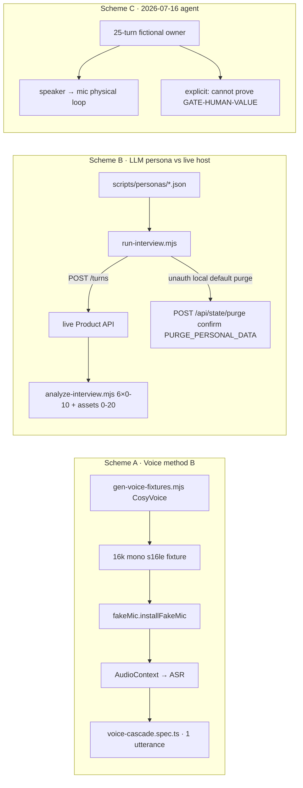
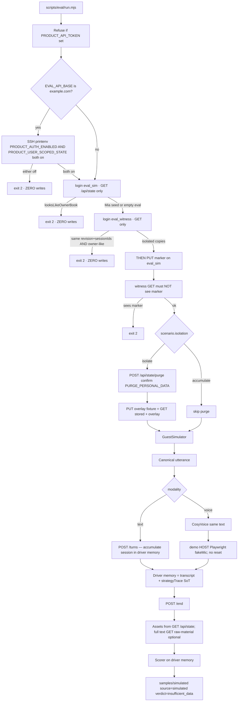
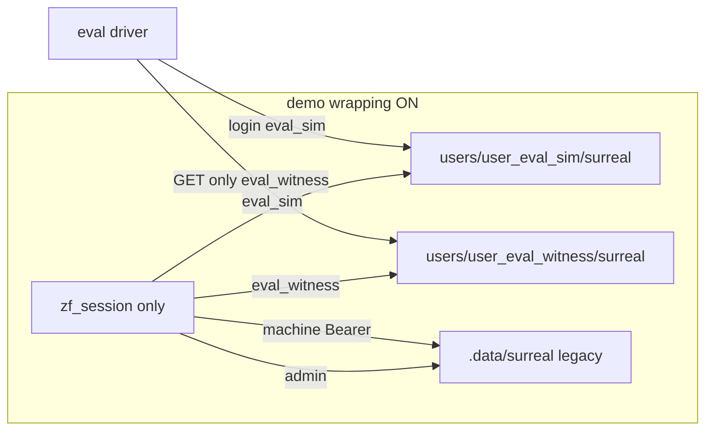

# 统一真人对抗评测系统（Unified Adversarial Interview Eval）

| 字段 | 值 |
|------|-----|
| 文档 ID | `design-unified-adversarial-eval-e36d94d7` |
| 作者 | （待填） |
| 日期 | 2026-08-20 |
| 修订 | Rev D（白天公网语音；模拟全文进 git；Open Questions 全部已拍板） |
| 状态 | Draft |
| 仓库 | `/home/admin/projects/zhuanfang` |
| HEAD | `e9db733` (`docs(sic+): record demo USER_SCOPED=1 dual-user isolation smoke`) |
| 验收环境 | 已部署 demo：`https://zhuanfang.example.com`（宿主机 SSH 从部署配置读取，不写入仓库） |

---

## Overview

专访产品今天有三套互不合并的「像不像真人访谈」试验：**语音办法 B**（`fakeMic` + 一轮 TTS PCM，只证明链路）、**LLM 人设嘉宾对真实主持人**（`scripts/run-interview.mjs`，合作型 250–500 字回答、默认对**无鉴权本地** purge、20k 字）、**2026-07-16 代理验收**（25 轮虚构案例 + 扬声器→麦克风物理环）。它们各自绿了，都不能回答两个产品问题：

1. 系统面对**不配合、会犹豫、会收缩、会说「这段别写」**的真人，还会不会继续访谈？
2. 打开一场结束后的书，**真实产品能力**（策略时钟、记忆确认跨场、do-not-save、barge-in、embedding 失败 fail-loud……）是不是都被打到了，而不是「pipeline 200 + 主持人没犯规」？

本设计把 A+B+C 和现有 craft-golden / 五维 rubric / GATE-HUMAN-VALUE 收成 **一个驱动器、三层矩阵**（能力覆盖 × 嘉宾行为 × 模态），对着 **已部署 demo 的独立评测仓**跑。模拟产出的是 **proxy scorecard** 和 `source: simulated` 样本；**永远不得把 GATE-HUMAN-VALUE 标成 go**（writer + 单测机械锁）。

隔离不是「登录了 `eval_sim` 就安全」。分仓包装成立当且仅当 **`PRODUCT_AUTH_ENABLED` ∧ `PRODUCT_USER_SCOPED_STATE=1`**。评测进程 **禁止出现 `PRODUCT_API_TOKEN`**。对照用第二个 **session 用户** `eval_witness`，不用机器 token。**证明 wrapping 必须先只读**：wrapping 关着时任何 `PUT /api/state` 都是整包写回主人仓。公网 demo 上 SSH 读两个 flag 是硬门槛，不是旁证。

---

## Background & Motivation

### 当前三套方案（As-Is）



| 方案 | 真源 | 证明了什么 | 没证明什么 |
|------|------|------------|------------|
| **A** | `tests/e2e/VOICE-INJECTION.md`，`scripts/gen-voice-fixtures.mjs`，`tests/e2e/fakeMic.ts`，`voice-cascade.spec.ts`（一轮，**开场 `resetServerState` → `RESET_ALL_DATA`**），`voice-fakemic-mechanism.spec.ts`（无 key 机制冒烟） | fake mic → AudioContext → ASR → 一场 user turn 写入 session。门控 `E2E_REAL=1` + `DASHSCOPE_API_KEY`/`BAILIAN_API_KEY` | 访谈价值、15 轮跟踪、情绪、记忆、资产、barge-in、echo guard 多轮。**不得**把该 spec 对着 demo 公网跑 |
| **B** | `scripts/run-interview.mjs` + `analyze-interview.mjs` + `scripts/run-all-interviews.sh` + 10 份 `scripts/personas/*.json` | 真实 `POST /api/interview-sessions/:id/turns` 主持人（`qwen-plus-character`）对 LLM 嘉宾；finalize 后硬指标 + LLM-judge | 嘉宾被 prompt **强制合作**（第一人称、具体场景、250–500 字、把题拉回领域）。`run-interview.mjs` 无 auth、默认 `http://127.0.0.1:3210`、未设 `SKIP_PURGE` 就 `scope: "all"` purge。`run-all-interviews.sh` ACCUMULATE **自己 curl 裸 purge**。ACCUMULATE 把 10 场堆进同一份 state |
| **C** | `docs/superpowers/2026-07-16-真人业务全链路验收报告.md` | 真实 UI、真实模型、独立库、25 轮 + 物理扬声器环 | 案例明确标为虚构；结论写死 **不能**证明主人 GATE-HUMAN-VALUE |

### 人工门禁是空的

`docs/interview-rubric.md` 规定 craft compliance / turn-15 / **GATE-HUMAN-VALUE** 必须人工书面，n 不足写 `insufficient_data`，工程 PR 永不标 GO。落盘目录 `docs/superpowers/eval/samples/` **只有 `TEMPLATE.md`**（表里仍允许手填 `gate_status: go`——模拟路径必须用代码禁止）。双角色复审结论成立：工艺工程强，「专业追问对真人有价值」的证据为零。

确定性 `craft-golden`（`src/domain/craft-golden.ts`，5 场景含 `decision_review_once`、无 live LLM）只锁策略/检索回归，**不**证明开放域文采，也 **不**蕴含 HUMAN-VALUE。

### 产品能力与评测缺口（对照代码，不是愿望清单）

以下是主人关心、现有方案几乎没打到的能力。评测矩阵必须逐条映射；**未接线的能力标 `gap`，不得用合作嘉宾把主持人「看起来很好」当成已交付。**

| 能力 | 代码现状 | 现评测 |
|------|----------|--------|
| 时钟策略 `debt_followup`（`previousUserTurns∈{1,2}` → 第 2–3 个 user turn）、`decision_review`（`previous∈{1,2,3}`，与债互斥、到期决策优先）、`contradiction_review`（`previous` 4–8）、`blindspot_probe`（`previous≥7`，排在 contradiction 之后） | `src/domain/strategy.ts` `decideInterviewStrategy`。口径：`previousUserTurns` = 本轮 user 文本**计入前**的 user 条数；`turnIndex = previousUserTurns+1` | craft-golden 有债/决策/矛盾；E2E 人设嘉宾不构造这些前置条件。purge 后债/决策/对立观点/playbook **全空** |
| 内容策略（抽象→具体时刻、代价→挑战前提） | 同上 + 已 applied 的 `playbookPatches.ruleTypes` 含 `concrete-moment`（`hasConcreteMomentPlaybookRule`） | golden 有；live 合作嘉宾很少给抽象空话；purge 后 patch 为空则 live 不会走该策略 |
| `strategyTrace` vs 落库话术 | Brain 把 `strategyDecision` 软注入 `buildCharacterSystemPrompt`（`apps/api/src/providers/bailian/_impl.ts` L1107–1123）；`receiveUserTurnWithAssistant` 把 decision 追加到 `session.strategyTrace`。**正常 `/end` 后热态 `turns`/`strategyTrace` 被 `offloadCompletedSession` 清空** | analyze 只看问句前 **12** 字重复（源码注释误写 10），**不对齐** trace；打分若只 GET `/api/state` 会空读 |
| 情绪/关系层 hold · emotion_acknowledge · dig-deeper | `InterviewControlAction` **只有**六键（`src/domain/types.ts` L13）。`GuidanceKind` 有 `emotion_label`（L1338），但 live `onGuidance` **写死** `kind: "nudge"`（`startRealtimeVoiceConnect.ts` L392–398）。`challengeUsed` **只在 docs/** | 未测；覆盖结果只允许 `gap` |
| embedding/recall 失败 | `interviewer-brain.ts` L169–200：仅当 **存在** `embeddingClient` 且 embed/recall 抛错 → **502，本轮不落库**。无 client 时 `embedQueryText` 返回 `undefined` **不抛**。注释 L166 写 fail-safe，**代码不是** | 单测锁；demo 满配不注入故障 |
| 六控制动作 | `POST .../control` → `updateInterviewControl`；`do-not-save` **翻转**；立刻插入 canned「控制反馈」turn；`pendingControl` 在 **下一轮 LLM 追问**才清 | `real-interview.spec.ts` 点一次「更直接」 |
| hold / dig-deeper / close | **未进入** `InterviewControlAction` | — |
| 跨场记忆 | `POST /api/memory-candidates/:id/approve`（冲突 409，embed 失败 502）；下一场 cosine 召回 | B 的 ACCUMULATE 堆库但不做 HITL |
| 矛盾 HITL | `POST /api/memory/consolidate` `{mode:"queue"}` + `.../resolve-conflict` | 未测 |
| do-not-save | `/control` 翻转 `doNotSave`；`/end` 短路：不调 finalize LLM、session 从 `sessions[]` 删除、`longTermAssetsPersisted:false`、审计「未写入长期资产」；录音 422 | C 测过数据边界 |
| 语音 ASR 断句 vs organizing-hold vs `silenceHoldMs` | Cascade 落轮：`server_vad` 1500ms + `speak()` 默认再等 1700ms；`organizing` 不 `sendUserTurn`（`cascadedPipeline`）。`silenceHoldMs` 默认 1200 只管 `buildRealtimeTurnState` 的 holding/backchannel 文案，**不是** cascade 是否提交 user turn。backchannel 主路径未接线 | A 只一轮；把 `silenceHoldMs` 当落轮阈值是错的 |
| Fail-loud 假追问 | Brain：无 LLM → 503，失败不落轮 | 未作为评测断言；满配 demo 只能 `observed_configured` |
| 用户分仓 | wrapping = `isSessionAuthEnabled` ∧ `isUserScopedStateEnabled`（`server.ts` L213–216）。机器 Bearer **永远进 legacy/admin**（`resolveStoreUserKey` L73–75）。`GET /api/health` / `capabilities` **不暴露**这两个 flag | 旧脚本无登录。**当前**对 `zhuanfang.example.com` 未登录 purge 是 **401**，不会清 legacy。P0 是：无鉴权本地默认 purge；以及 **任何 Bearer 打 demo = 主人仓** |

### 痛点（为何必须合成一套）

1. **三套脚本会漂**：语音 fixture 剧本、人设 JSON、代理手记互不共享 utterance。
2. **嘉宾太乖**：`intervieweeSystem()` 强制 250–500 字、拉回领域，主持人被抬高。
3. **绿 ≠ 能力**：craft 五维 + 问句长度/重复/括注泄漏，测的是纪律，不是「这场戏发生了没有」。
4. **默认 purge 是事故（分场景）：**（1）无鉴权本地（默认 `127.0.0.1:3210`）一跑就清库；（2）任何 `Authorization: Bearer` 打 demo 进主人仓；（3）`run-all-interviews.sh` 开头裸 curl purge。不是「对着公网未登录就会清主人」。
5. **Grok 机不能当执行面**：~1.6Gi、无 swap；禁止本机 `npm ci` / Playwright / 本地 Surreal 作为默认路径。`run.mjs` 不得顶层 import Playwright。

---

## Goals & Non-Goals

### Goals

1. **一个驱动器**跑完：文本对抗嘉宾 + 可选同一句 TTS 注入 cascade，对着 **已部署 demo** 的 **评测用户仓**。
2. **嘉宾行为一等公民**：犹豫、短答、跑题收缩、羞耻、与上场立场矛盾、「算了不说了」、「这段别写」、长静音、抢话、自我纠正。
3. **能力矩阵 + 冻结的 smoke/full pack**：每条 shipped 能力都有「坏了就会红」的 scenario；多行合并进同一场，避免 1:1 开场打穿预算。
4. **评分**：保留工艺五维；价值三维以 judge 引用「哪一句」为准，硬信号只做召回；`strategyTrace` 对齐单独打分。打分真源 = 驱动器内存（每轮 `/turns` 响应），不是 `/end` 后的热态。
5. **隔离**：wrapping = AUTH ∧ USER_SCOPED，启动用 **第二 session 用户**探针证明；评测环境 **零** `PRODUCT_API_TOKEN`；默认 **永不** purge 主人 legacy。
6. **诚实**：模拟只出 proxy；GATE-HUMAN-VALUE 机械锁为 `insufficient_data`。
7. **成本分档**：见 §11 的 id 列表与硬上限。full+voice **允许工作日白天**对公网 ASR 跑；仍受 host/guest/TTS 硬上限，且必须 `EVAL_MODALITY=voice|both`（避免 Grok 机误加载 Playwright）。
8. **不取代** vitest / 默认 Playwright mock 族。
9. **模拟全文进 git**：smoke/full 的逐字稿与记分板提交到 `docs/superpowers/eval/samples/simulated/`；GATE-HUMAN-VALUE 仍机械锁 `insufficient_data`。

### Non-Goals

- **LLM 嘉宾不是主人的内心。** 模拟替代不了 GATE-HUMAN-VALUE。
- 不在 Grok 运行机起第二套 Surreal / compose / 全量 Playwright。
- 不把 hold / dig-deeper / close / `challengeUsed` / 情绪层评成 pass。
- 不把合作型 20k×10 人设当能力评测（只允许 `EVAL_TIER=populate`）。
- 不自动宣称 craft ≥80% / turn-15 ≥70% go。
- 不修改生产鉴权变弱、不把评测密码写入 git、不把 `PRODUCT_API_TOKEN` 放进评测进程「只读对照」。
- 本任务 **只出设计**；不改 zhuanfang 工作树。

---

## Proposed Design

### 1. 总结构：一个驱动器，三层矩阵



Scheme A = modality `voice` 的投递器（**新 adapter，禁止 import 现有 cascade spec**）；Scheme B = 文本宿主（去掉合作默认）；Scheme C = 矩阵来源。

### 2. 目录与入口

```text
scripts/eval/
  run.mjs
  lib/
    auth-client.mjs          # login cookie jar; refuse Bearer; unset PRODUCT_API_TOKEN
    wrapping-probe.mjs       # read-only first; SSH flags on public demo; marker only after proof
    product-client.mjs       # sessions/turns/control/end/state/memory/raw-material
    fixtures.mjs             # PUT body = GET stored + overlay; never overlay-only
    guest-simulator.mjs
    tts-bridge.mjs
    voice-adapter.mjs        # dynamic import only; never helpers.reset*
    scorer.mjs
    strategy-align.mjs
    coverage.mjs
    artifacts.mjs            # assertSimulatedGate()
    simulated-gate.ts        # pure function + vitest
  scenarios/
    pack.smoke.json
    pack.full.json
    *.json

docs/superpowers/eval/samples/
  TEMPLATE.md
  simulated/                 # 提交 git：全文 transcript + scorecard（plain md/json）
  human/                     # 主人真人样本
```

旧入口（PR-0 必须先安全）：

| 旧命令 | 新行为 |
|--------|--------|
| `node scripts/run-interview.mjs` | 无成功的 eval session 登录 → **不得** purge；默认 API 不是 example.com；进程内出现 `PRODUCT_API_TOKEN` → exit 2 |
| `bash scripts/run-all-interviews.sh` | **删除/默认关闭** 开头裸 `curl .../purge`。要灌库必须 `EVAL_TIER=populate` + 已登录 eval + `EVAL_ALLOW_PURGE=1`。无 cookie 调 purge → 脚本 exit ≠ 0（回归） |
| `npx playwright test voice-cascade` | **只**打本机 `E2E_REAL=1` 隔离 tmp 库。评测语音 **禁止** 复用该 spec |

### 3. 执行面

| 角色 | 机器 | 做什么 |
|------|------|--------|
| 驱动器（文本） | Grok 机可以 | 轻量 HTTP。`EVAL_MODALITY=text` 时 **不得** import `playwright` / `fakeMic` |
| 驱动器（语音） | **demo 宿主机**（SSH 从 `EVAL_SSH_HOST` 读取），**不是** `app-zhuanfang-1` 容器 | 对 `https://zhuanfang.example.com` 跑 fakeMic；浏览器已装在宿主机。禁止容器内 `npx playwright install`。**允许工作日白天**打公网 ASR；不要等夜里/周末。仍须 `EVAL_MODALITY=voice\|both`，Grok 机不得跑 Playwright |
| 被测系统 | demo compose | 评测仓 `/app/.data/users/user_eval_sim/surreal` |
| CI vitest | 现有 | craft-golden、echo-guard、**新增 `assertSimulatedGate`** |

环境变量：

```bash
EVAL_API_BASE=http://127.0.0.1:3210    # 默认本地。指向 example.com 必须显式且 login 已成功
EVAL_USERNAME=eval_sim                 # 禁止 admin / smoke_a / PRODUCT_LEGACY_OWNER
EVAL_PASSWORD=                         # 未跟踪文件
EVAL_WITNESS_USERNAME=eval_witness     # 第二 session 用户，只 GET 做隔离探针
EVAL_WITNESS_PASSWORD=
EVAL_TIER=smoke                        # smoke | full | populate
EVAL_MODALITY=text                     # text | voice | both；voice|both 才动态 import Playwright（Grok 机保持 text）
EVAL_ALLOW_PURGE=0                     # 唯一允许 purge 的开关（取代 SKIP_PURGE）
EVAL_ISOLATION=isolate                 # isolate | accumulate
# PRODUCT_API_TOKEN 必须 unset。出现则 exit 2，没有 EVAL_ALLOW_MACHINE_BEARER 后门
EVAL_MAX_HOST_CALLS=50                 # smoke 默认 50；full 180
GUEST_MAX_CALLS_PER_RUN=40             # smoke 默认 40；full 120
JUDGE_MAX_CALLS_PER_RUN=8              # smoke 默认 8；full 30
```

**硬拒绝：**

1. `process.env.PRODUCT_API_TOKEN` 非空 → exit 2（评测环境禁止该变量，包括「只读 admin」）。
2. Cookie **只用** `zf_session`。禁止读/写 `product_api_token`。
3. `EVAL_API_BASE` 含 `example.com` 且尚未 `GET /api/auth/me === EVAL_USERNAME` → 不得发任何写请求。
4. wrapping 探针失败（含只读阶段）→ **零写**：不得 marker PUT、不得 purge、不得 fixture PUT、不得建场。

语音登录：走 **HTTPS** `https://zhuanfang.example.com`，`context.addCookies([{ name: "zf_session", url: "https://zhuanfang.example.com", httpOnly: true, secure: true }])`。禁止 `http://127.0.0.1` 反代（Secure cookie 会被 jar 丢掉，见 2026-08-10 规格）。

### 4. 隔离机制

**包装公式（代码真源 `server.ts` L213–216）：**

```text
userScoped wrapping = isSessionAuthEnabled(env)   // PRODUCT_AUTH_ENABLED ∈ {1,true,yes,on}
                    ∧ isUserScopedStateEnabled(env) // PRODUCT_USER_SCOPED_STATE ∈ {1,true,yes,on}
```

任一为假：所有登录用户共享同一份热态，`eval_sim` 的 purge/reset/PUT **就是**主人仓。这两个 flag **没有** HTTP 探针。

**启动自检（先只读、后才写。探针的 PUT / 建场不得出现在步骤 6 之前）：**

`PUT /api/state` 是整包写回（`normalizeProductState`）。wrapping 关时，eval_sim 的 GET 就是主人整份书；若先 PUT marker，失败发现发生在 **已经改写主人档案之后**。所以「exit 2，零 destructive」必须包含：**证明 wrapping 之前零写。**

1. 拒绝 Bearer / `PRODUCT_API_TOKEN`。
2. **公网 demo 硬门槛（不是旁证）：** `EVAL_API_BASE` 含 `example.com` 时，必须 SSH `docker exec app-zhuanfang-1 printenv PRODUCT_AUTH_ENABLED PRODUCT_USER_SCOPED_STATE`，**两个都为开**（`1`/`true`/`yes`/`on`）才继续。任一关 → **exit 2，零写**。结果写入 run 元数据。本地 `127.0.0.1` 无 SSH 则跳过本步，靠步骤 4–5。
3. `POST /api/auth/login` `{username: eval_sim}` → `zf_session`。`GET /api/auth/me` 必须等于 `eval_sim`，且 ≠ legacy owner。
4. **`eval_sim` 只 GET** `/api/state`。若 `looksLikeOwnerBook(state)` → **立刻 exit 2，零写**。  
   **什么叫主人仓（避免把处女仓 Mia 种子误判成主人）：**  
   - **允许继续：** `profile.name` 已是 `eval-marker-*`；或与 `createInitialProductState()` 指纹一致（`profile.name==="Mia"` 且笔记/会话 id 只有 `note-seed-*` / `session-seed-*`）；或已 purge 的空资产数组。处女分仓会灌 Mia 种子（`surreal-product-state-repository.ts` 无 `state_meta` 时），这 **不是** 主人仓。  
   - **判定主人仓：** 出现 **种子以外** 的 `sessions`/`notes` id，或 `memoryRecords.length>0`，或 `profile.name` 不在 `{"","Mia","未设置"}` 且不以 `eval-marker-` 开头。
5. **换 cookie，`eval_witness` 只 GET。** 若与 sim 的 `revision` **且** `sessionId` 集合相同 **且** 任一侧 `looksLikeOwnerBook` → 共享热态 → **exit 2，零写**。两份各自的 Mia 种子（相同 seed id、可能都是 revision 0）**不算**主人仓，允许继续。
6. **以上通过后才允许写：** 换回 `eval_sim`，`PUT /api/state` 叠加 `profile.name = "eval-marker-<runId>"`（body = GET 到的整份 + overlay，见 §4.1）。禁止这时新建访谈当 marker。
7. `eval_witness` 再 GET：**不得**看见该 marker。看见 → wrapping 实际未生效 → exit 2（此时写已落在本应隔离的仓；公网有步骤 2 兜底）。
8. 之后才允许 purge / fixture PUT / 建场。

**负例（实现错误）：** 登录后立刻 PUT marker 或 `POST /api/interview-sessions`。即使用于探针，wrapping 关时改的是主人书。



**规则：**

1. 用户用库函数 `createUser` 写入 volume 的 `auth-users.json`（**无 HTTP**，`PRODUCT_BOOTSTRAP_USERS` 在已有 admin/smoke 时不生效）。PR-0.5 命令见下。默认 **新建** `eval_sim` + `eval_witness`，**不复用** `smoke_a`。
2. Destructive 白名单只有：步骤 1–5 **只读通过之后** 的 marker PUT、`POST /api/state/purge` `{confirm:"PURGE_PERSONAL_DATA", scope:"all"}`，以及 eval 用户的 revision-matched overlay PUT。**对 demo 永不 `RESET_ALL_DATA`，永不 `resetServerState` / `resetDemoState`。**
3. `EVAL_ALLOW_PURGE=1` + isolate：purge 前再次 `GET /api/auth/me === eval_sim`。
4. accumulate 只在评测仓。
5. 隔离对照 **禁止** 机器 token。

#### 4.1 评测仓 fixture 写入（isolate purge 之后）

`createPurgedProductState` 之后债、决策、观点、`playbookPatches` **全空**（不是 Mia seed）。仓库 **没有** `POST /api/debts`。时钟行必须 **PUT 整份 ProductState**。

`scripts/eval/lib/fixtures.mjs`（**只在 §4 步骤 1–7 通过之后**）：

1. `GET /api/state` → 记为 `stored`（含 `revision`）。
2. `body = applyOverlay(stored, overlay)`：以 **整份 stored 为底** 叠加 scenario 声明的数组/字段；`revision` 必须原样拷贝 `stored.revision`。`systemConfig` **深合并**（只改 `interview.maxFollowUpDepth` 时不得丢掉其余配置）。
3. `PUT /api/state` 发送 **完整 body**。`revision` 不等 → 409。非法枚举 → 422。
4. `fixtures.mjs` 在发送前断言：`body.sessions`/`notes`/`debts`/`decisions`/`points`/`playbookPatches`/`systemConfig` 均为数组或对象（与 stored 同形），不是「只有 overlay 那几个键」。
5. 禁止「先跑一场合作访谈碰运气抽债」。

**负例（实现错误）：** 只 PUT `{ revision, debts: [...] }`。缺省数组时 `normalizeProductState` **静默回落** `createInitialProductState()`（Mia 种子），不是 422。时钟互斥表会假红或假过。

每个时钟 scenario 写明 **必须有 / 必须无**：

| scenario | 必须有 | 必须无 | 轮次窗口 |
|----------|--------|--------|----------|
| `CLOCK-debt` | `debts[]` 一条 `status==="待了解"` | 到期已确认决策（否则 `decision_review` 优先） | 断言在 `previousUserTurns∈{1,2}`（第 2–3 个 user turn）出现且仅一次 `debt_followup` |
| `CLOCK-decision` | `decisions[]`：`status==="待复盘"` ∧ `confirmationStatus==="用户确认"` ∧ (`reviewAt` 空或已到期) | 更老的开放债不是必须无，但文档按「无债」最干净，避免 `daysOpen` 比较翻盘 | `previous∈{1,2,3}` 一次 `decision_review`，同场不二次 |
| `CLOCK-contradiction` | 两条 `points` 互写 `contradictsPointIds`（checklist 才会出现「对立看法」） | 不依赖嘉宾口头矛盾 | `previous∈{4,5,6,7,8}` 至多一次；**会挡住同窗口 blindspot** |
| `CLOCK-blindspot` | purge 后缺视角即可让 `buildBlindspotCandidates` 非空；overlay **必须**写入 `systemConfig.interview.maxFollowUpDepth ≥ 8`（叠在 stored.systemConfig 上，见下方） | **不得**预置 `contradictsPointIds` | `previous≥7` 一次 `blindspot_probe` |
| `ADV-short-abstract` | `playbookPatches` 一条 `status:"applied"`, `ruleTypes:["concrete-moment"]` | 债/到期决策 | `previousUserTurns===0` 的抽象首句 → `concrete_example_probe` |

**下列片段是 overlay，不是 PUT body。**  
`PUT body = stored（GET 整份） + overlay`。实现里若把下面某一段当成全文发出，视为 bug。

```js
// overlay only — CLOCK-debt
debts: [{
  id: "debt-eval-1",
  concept: "成核点",
  context: "评测预置开放知识债",
  whyImportant: "策略时钟",
  status: "待了解",
  nextQuestion: "你现在能解释成核点吗？",
  updatedAt: new Date(Date.now() - 40*864e5).toISOString()
}]
// CLOCK-decision
decisions: [{
  id: "dec-eval-1",
  title: "是否放权",
  decisionKind: "候选决策",
  confirmationStatus: "用户确认",
  choice: "关键节点把控",
  tradeOff: "短控 vs 长期",
  riskHypothesis: "短期失控",
  reviewAt: new Date(Date.now() - 864e5).toISOString(),
  status: "待复盘",
  updatedAt: new Date(Date.now() - 40*864e5).toISOString()
}]
// CLOCK-contradiction
points: [
  { id: "pt-a", title: "远程优于现场", content: "…", status: "稳定观点",
    confidence: "用户确认", evidence: ["从前"], important: true, updatedAt: now,
    contradictsPointIds: ["pt-b"] },
  { id: "pt-b", title: "现场不可替代", content: "…", status: "稳定观点",
    confidence: "用户确认", evidence: ["现在"], important: true, updatedAt: now,
    contradictsPointIds: ["pt-a"] }
]
// concrete-moment
playbookPatches: [{
  id: "patch-eval-cm", title: "具体时刻", description: "eval",
  sourceInsightId: "insight-eval", status: "applied",
  rules: ["先让被访者落到一个真实场景"],
  ruleTypes: ["concrete-moment"], impact: "medium",
  createdAt: now, appliedAt: now
}]
// overlay only — CLOCK-blindspot（深合并进 stored.systemConfig，不要替换整个 systemConfig）
systemConfig: {
  interview: { maxFollowUpDepth: 8 }
}
```

时钟场必须在 `session.startedAt` 后 **10 分钟内** 跑完（`hasReachedStageSummaryWindow` 会在债/决策之前抢 `synthesis`）。HTTP 短场通常 2–4 分钟。超时 → 该 scenario `retry`/`na`，不当 fail。

### 5. 嘉宾模拟器

#### 5.1 Canonical utterance

文本 POST 与语音 TTS **同一字符串**。TTS 复用 `gen-voice-fixtures.mjs` 参数：16k mono s16le、句内 300ms < `server_vad` 1500ms。缓存 `scripts/eval/.tts-cache/<sha256>.json`。

#### 5.2 Scenario script

`expect.host.should` **不再**含 hold / 情绪接住。`do_not_write` 的断言在 `system.expect`。

```json
{
  "id": "ADV-short-shame-dns",
  "capabilities": ["C-control-dns", "C-isolation", "C-value-unexpected"],
  "isolation": "isolate",
  "maxUserTurns": 8,
  "guest": {
    "behaviors": [
      { "at": "turn>=1", "kind": "short_answer", "maxChars": 40 },
      { "at": "turn==4", "kind": "shame_contract", "text": "这个……算了不说了。" },
      { "at": "turn==7", "kind": "do_not_write", "text": "刚才那段别写进档案。" }
    ]
  },
  "expect": {
    "host": {
      "mustNot": ["advice_list", "fake_template_followup"]
    },
    "system": {
      "endPath": "do-not-save",
      "doNotSavePosts": 1,
      "longTermAssetsPersisted": false
    },
    "driver_action": ["optional_softer_after_shame"]
  }
}
```

`driver_action` 记入 run 日志，**不**写入 coverage pass。

#### 5.3 对抗行为库

| kind | 戏 | 驱动器 | 打哪条 |
|------|----|--------|--------|
| `short_answer` | 半句 | `maxChars` 20–80 | 具体时刻，不是陪聊 |
| `hesitation` | 「那个……」 | 低信息；voice 可插 PCM 静音 | `C-voice-asr-endpointing` / organizing-hold（unit） |
| `topic_contract` | 缩成「就那样」 | 减少具体性 | 具体时刻探针 |
| `shame_contract` | 「算了不说了」 | 原文；**不**要求产品 hold | 下一问不是建议清单（`COUNSELOR_PATTERN_RES`）。C-emotion = gap |
| `contradict_past` | 与上场确认记忆相反 | accumulate | HITL / 主持人指出前后（非 `contradiction_review` 时钟，那要软链） |
| `do_not_write` | 「这段别写」 | **恰好一次** `POST control {action:"do-not-save"}` | **系统**短路，不是「主持人听懂伦理」 |
| `self_correction` | 先 A 再 B | 原文 | 下一问钉更正后命题 |
| `barge_in` | 抢话 | speaking 态 `speak()` | interrupt 200、499 不落鬼轮 |
| `long_silence` | 说完不补 | 不在 1500ms 内再 push | ASR 断句，不是 `silenceHoldMs` |
| `cooperative` | 旧 B | **仅 populate** | 不当默认 |

脚本规定的 `text` **必须原文**。Guest LLM 只写未规定的台词。

#### 5.4 语音投递（独立 adapter）

**死命令（红字）：** 评测 voice adapter **禁止** `import` `tests/e2e/voice-cascade.spec.ts`、`resetServerState`、`resetDemoState`。对 demo **永不** `POST /api/state/reset` / `RESET_ALL_DATA`。允许的破坏性 API 只有已通过 §4 自检的 purge。

允许复用：`fakeMic.ts` 的 `installFakeMic` / `speak` / `speakSession`（纯注入，无 reset）。

步骤：

1. 仅 `EVAL_MODALITY=voice|both` 时 `await import("./voice-adapter.mjs")`（内部再动态 import `playwright`）。
2. 跑在 demo **宿主机**已有 Chromium；禁止 app 容器装浏览器。
3. HTTPS + 注入 `zf_session`。
4. 等 UI「聆听」再 `speak`（echo guard 会吞开场 TTS 窗）。
5. `vadSilenceMs` 默认 1700（> `server_vad` 1500）。
6. `waitForReply` 以 **驱动器已见的 user-turn 计数**为准（voice 路径可能走 `/turns/stream` 或前端 `record-turn`；adapter 轮询 eval 仓 session，**在 /end 前**）。
7. ASR CER >15% → `asr_mismatch`，不计入 craft。
8. 本机 `voice-cascade.spec.ts` / mechanism spec 仍是开发者隔离回归，**不是** demo 评测。

### 6. 能力矩阵

状态：`shipped` / `gap` / `proxy` / `observed` / `verified_by=unit`。coverage 结果：`pass|fail|gap|na|unit|observed`。**`gap` 行不允许 `pass`。**

轮次一律双写 `previousUserTurns` / `turnIndex`。

| ID | 能力 | Pack 场次 | 失败判据 | 状态 |
|----|------|-----------|----------|------|
| `C-turn-live` | 真 LLM，失败不落假模板 | ADV-short-abstract | 503/502 时无新 assistant；无「你刚才的锚点是」域内稿 | shipped |
| `C-strategy-clock-debt` | 开放债第 2–3 user turn | CLOCK-debt | `previous∈{1,2}` 仅一次 `debt_followup` | shipped |
| `C-strategy-clock-decision` | 到期已确认决策回访 | CLOCK-decision | `previous∈{1,2,3}` 仅一次 `decision_review` | shipped |
| `C-strategy-clock-contradiction` | 对立看法 4–8 | CLOCK-contradiction | `previous∈{4…8}` ≤1 次；fixture 软链 | shipped |
| `C-strategy-clock-blindspot` | `previous≥7` 盲区 | CLOCK-blindspot | 无 contradicts；trace 一次 `blindspot_probe` | shipped |
| `C-strategy-content-concrete` | 抽象首句要时刻 | ADV-short-abstract | `previous===0` + applied `concrete-moment` | shipped |
| `C-strategy-align` | 软注入能在话术认出来 | 各 CLOCK + 长场 | §7.3；驱动器内存中的 trace | shipped |
| `C-control-six` | 六键改下一问 | ADV-control-six | 见下「可实现副作用」 | shipped |
| `C-control-dns` | 本场不写长期资产 | ADV-short-shame-dns | control **恰好一次**；`/end` `longTermAssetsPersisted:false`；state 无该场 note；audit 含「未写入长期资产」 | shipped |
| `C-control-hold` / `dig` / `close` | — | — | 无该 action | **gap** |
| `C-emotion` | 羞耻后接住 | ADV-short-shame-dns 可观察 | **覆盖结果只允许 `gap`**。shame 的产品断言仅：下一问不是 `COUNSELOR_PATTERN_RES`。驱动器可选 `softer` = `driver_action` | **gap** |
| `C-challenge-budget` | — | — | `challengeUsed` 不在 `src/` | **gap** |
| `C-embed-502` | client 存在且失败 → 502 不落轮 | 单测 | 无 client 时不抛、不 502 | `verified_by=unit` |
| `C-memory-confirm-recall` | 确认后下场引用 | FLOW-memory（accumulate） | 场 2 `guide.relevantMemories` 或 `referencedMemory` 命中场 1 确认原文 | shipped |
| `C-memory-conflict-409` | 冲突确认被拦 | FLOW-memory 步骤 S1b | 仍为 **pending** 的候选 + `suggestedUpdate:"conflict"`（或与显式修正文案冲突）→ approve 无 force → **409 且 `blocked:true`**，未进 `memoryRecords`。禁止「对已确认/已拒绝的再 approve」（那是另一条 409，无 `blocked:true`） | shipped |
| `C-hitl-contradiction` | 巩固队列可裁决 | FLOW-memory | queue `contradictionCandidates`；resolve 后一方 superseded/demoted | shipped |
| `C-voice-one-shot` | 一轮真 ASR | 开发者 `voice-cascade` **隔离端口**；评测用 VOICE-echo 的第一轮 | 有 user turn。评测 **不**跑 reset 版 spec | shipped |
| `C-voice-asr-endpointing` | PCM 静音与断句 | VOICE-endpoint | 句内/轮内静音 **&lt;1500ms** 不新 user turn；`speak` 后再等 ≥1700ms 且 concluding 才落一轮 | shipped（voice 档） |
| `C-voice-organizing-hold` | organizing 不 sendUserTurn | — | **断言走** `cascadedPipeline.test.ts` golden | `verified_by=unit` |
| `C-voice-backchannel` | 留白「嗯」 | — | `buildRealtimeTurnState` 有文案；cascade 主路径未接线 | **gap** 或 unit |
| `C-voice-bargein` | 打断停播不落鬼全文 | VOICE-barge | interrupt 200 + `bargeInSuccess`；in-flight stream 499 不 persist | shipped |
| `C-voice-echo` | 开场 TTS 回声不进 turn | VOICE-echo | speaking 态 speak → 无新 user turn | shipped |
| `C-fail-loud` | 无 key 不装追问 | capabilities | 满配 demo = `observed_configured`，**本行不红也不当 shipped 主路径** | observed |
| `C-isolation` | 评测不进主人/witness 仓 | 启动探针（先只读） | 只读阶段发现主人仓或双用户同 revision+sessionIds → 零写退出；marker 只在其后；witness 不得见 marker；**禁止** Bearer | shipped |
| `C-value-insight` / `tension` / `unexpected` | 价值三维 | ADV-insight-tension、shame-dns | §7.2 | proxy |
| `C-turn15` | 中后段贴题 | ADV-turn15 | 抽 ≈15；n&lt;5 场 → `insufficient_data` | proxy |
| `C-assets` | 可追溯资产（非 dns） | ADV-short-abstract `/end` | **按 `sessionId` 过滤** note/points/debts；禁止抄 analyze 数整库 | shipped |
| `C-user-scoped-flag` | wrapping 开着 | 启动探针 | 探针失败则拒跑；不是 HTTP 读 flag | shipped（探针） |

**六键可实现副作用：** `do-not-save` 只 POST **一次**（翻转）。每个动作：立刻多一条 `intent==="控制反馈"` 的 canned assistant；再发一轮 user 之后 `pendingControl` 为空；下一问相对 canned 反馈有方向变化（softer 不更尖、sharper 含前提/代价、skip 不回到刚跳过的锚点、different-angle 换视角、summary 先收束）。**不**读取 character prompt 原文。

**embed 502：** 仅 `embeddingClient` 存在且失败。demo 满配记 `verified_by=unit`。

### 7. 评分

```text
scorecard
├── hard
├── craft
├── strategyAlign          # from driver memory, not hot state after /end
├── valueProxy
├── coverage[]             # pass|fail|gap|na|unit|observed
└── gates
    ├── craftGolden
    ├── humanValue         # 恒 insufficient_data（模拟）；assertSimulatedGate throw otherwise
    └── engineeringGo      # false
```

#### 7.0 打分数据真源（/end 降冷）

正常 `/end`（有 `rawMaterialRepository`，demo 是）会 `offloadCompletedSession`：热态 `turns: []`、`strategyTrace: []`、`rawMaterialOffloaded: true`。全文在 `GET /api/sessions/:id/raw-material`。

**契约：**

1. 每轮从 `POST /turns`（或 stream `final`）响应累积 `transcript` + `session.strategyTrace` → **驱动器内存是 SoT**。
2. `/end` 后资产/note 走 `GET /api/state`，**按 `sessionId` 过滤**。
3. 需要核对冷层时再 GET raw-material；与内存不一致记 `offload_mismatch`（观察，不覆盖 SoT）。
4. dns：session 已从 `sessions[]` 删除 → 只认驱动器 transcript + `/end` 的 `longTermAssetsPersisted:false`。

#### 7.1 工艺纪律

`INTERVIEW_RUBRIC_DIMENSIONS` 五维 0–2。硬启发式先跑；LLM-judge 6×0–10 **降为诊断**。问句重复前缀 **12** 字。`VOICE_CRAFT_OUTPUT_GUARD` 默认 off，评测不靠它变绿。

#### 7.2 价值三维

硬信号 **只做召回**（有没有进入 judge 的资格），0–2 分以 judge 引用的具体回合为准。禁止二字共现/问句词表单独给 2 分。

**洞察增量：** 戏 = 中后段说出开场 seed 没有的一件具体事，且是主持人追出来的。硬召回：`S_later \ S0` 非空才进入 judge。Judge 唯一句：「打开记录，嘉宾有没有讲出开场没说的一件具体事？是哪一句主持人把它逼出来的？」0 = 无新事或全是独白；1 = 有新事但 judge 指不出那句追问；2 = judge 引用了具体 assistant 回合。堆名词不得自动 1。

**张力利用：** 戏 = `card.potentialTension` 被当成要挖的那一件。空 → `na` + `C-card-tension-nonempty` 观察。硬召回：问句是否碰到张力内容词（不够 2 分）。2 分 **必须**指出嘉宾在张力两边 **站队或给出代价** 的那一轮 user 回答 + 把它逼出来的问句。共现最高 1。

**意外时刻：** 按 kind 一条一事。`self_correction` → 下一问钉更正后命题。`shame_contract` → 下一问不是建议清单；可选 `driver_action` softer **不计** coverage。`do_not_write` → **system.expect** dns。`long_silence` → 不在 ASR 1500ms 窗内新 user turn（不要用 `silenceHoldMs`）。未安排则 `na`。

#### 7.3 strategyTrace 对齐

Trace = 引擎标签 ≠ 话术执行。对齐用 **驱动器内存**。表同前（债概念、决策 title/choice、对立看法内容词、blindspotConcept、具体时刻问法、synthesis 收束）。`mechanism_probe` 低权重。阈值 0.6 建议、不进 CI。

#### 7.4 硬指标

保留 chars/turns/avgQ/repeats(12)/asideLeak/degraded。删除 20k/30min 及格。资产 **session-scoped**。dns 场零长期资产。

### 8. Pack 清单与跨场（冻结）

多行合并进同一场。**不是**矩阵一行一场。

#### Smoke pack（`EVAL_TIER=smoke`，默认）

| id | user turns | 覆盖 | 预估 host 调用 |
|----|------------|------|----------------|
| `ADV-short-abstract` | ≤8 | C-turn-live, C-strategy-content-concrete, C-strategy-align（弱）, C-assets, C-isolation | ~8 turn + 1 finalize + extras ≤12 |
| `ADV-short-shame-dns` | ≤8 | C-control-dns, C-value-unexpected（dns）, C-isolation；C-emotion 输出 gap | ~8 turn + 1 control，**0** finalize LLM |
| `ADV-control-six` | ≤6 | C-control-six | ~6 turn + 5 control + 1 finalize ≤10 |

硬上限：`EVAL_MAX_HOST_CALLS=50`，`GUEST_MAX_CALLS_PER_RUN=40`，`JUDGE_MAX_CALLS_PER_RUN=8`。isolate + fixture PUT 不计 LLM。

#### Full pack（`EVAL_TIER=full`，显式）

| id | 说明 | 覆盖 |
|----|------|------|
| smoke 三场 | 同上 | 同上 |
| `CLOCK-debt` | 3 user turns | C-strategy-clock-debt, align |
| `CLOCK-decision` | 3 | C-strategy-clock-decision, align |
| `CLOCK-contradiction` | 8 | C-strategy-clock-contradiction |
| `CLOCK-blindspot` | 8 | C-strategy-clock-blindspot（无 contradicts） |
| `FLOW-memory` | accumulate：S1 确认 P；**S1b 409 blocked**；S2 ¬P + queue/resolve | C-memory-confirm-recall, C-memory-conflict-409, C-hitl-contradiction |
| `ADV-insight-tension` | ≤12 | C-value-insight, C-value-tension |
| `ADV-turn15` | 15 user | C-turn15, align |

Voice（`EVAL_MODALITY=voice|both`，demo 宿主机，另计；**允许工作日白天**对公网 ASR，不要等夜里/周末）：

| id | 覆盖 |
|----|------|
| `VOICE-echo` | C-voice-echo + 一轮 ASR（C-voice-one-shot 评测形态） |
| `VOICE-endpoint` | C-voice-asr-endpointing |
| `VOICE-barge` | C-voice-bargein（可叠加一次 dns，control 仍一次） |

Full 硬上限：最多 **10** 场 text（上表）+ 最多 **3** 场 voice；`EVAL_MAX_HOST_CALLS=180`；`GUEST_MAX_CALLS_PER_RUN=120`；`JUDGE_MAX_CALLS_PER_RUN=30`。超限提前 `/end`，scenario `budget_stop`。

`FLOW-memory` 编排（wrapping 已证明之后；accumulate，**不要**用二次 approve 冒充冲突）：

```text
S1: 嘉宾主张 P（「远程优于现场」）
    /end → memoryCandidates
    POST approve 一条含 P、非 conflict 的 pending → 进入 memoryRecords

S1b · C-memory-conflict-409（对照 `memory-candidates-conflict.test.ts`）:
    另取一条 **仍为 pending** 的候选 C（不要 reject 它）。
    确定性做法（推荐，不靠 finalize 运气）：
      overlay PUT：
        memoryCandidates 保留 C，且 C.suggestedUpdate === "conflict"
        memoryCorrections += [{ text: "纠正：效率瓶颈不是结构性前提，也不是必须全部满足的准入门槛" }]
        （C.text 用测试同款：「组织效率提升的结构性前提缺一不可，必须满足全部准入门槛」）
    POST /api/memory-candidates/:id/approve  { mode: "add" }  **无 force**
    断言：409、body.blocked === true、C.status 仍 pending、memoryRecords 无 C 的 sourceCandidateId
    禁止：先 reject 再 approve（409「not pending」、无 blocked）
    禁止：对 S1 已确认那条再 approve（同上）

S2: 嘉宾主张 ¬P
    断言 guide/relevantMemories 含 P
    /end → POST /api/memory/consolidate { mode: "queue" }
    resolve-conflict keep ¬P demote P

S3: 再开场不得把已 demote 的 P 当确认事实
```

口头矛盾 **不等于** `contradiction_review` 时钟（那要 `contradictsPointIds`）。`shouldBlockSilentMemoryConfirm`（`memoryReview.ts` L219–226）为真当：`suggestedUpdate==="conflict"` **或** 与 `memoryCorrections` 里含「纠正|不是|…」的文案概念冲突。`collectConflictCorrectionTexts` **不读** reject 的 `reviewNote`。

### 9. 与现有测试金字塔

vitest domain 不变（含新 `assertSimulatedGate`）。Playwright 默认族 / `E2E_REAL` 隔离 tmp 不变。`scripts/eval/run.mjs` 打 demo 评测仓。GATE-HUMAN-VALUE 仅 `samples/human/`。

### 10. 产物落盘

**模拟全文进 git（主人拍板）。** smoke/full 跑完后，逐字稿与记分板都提交到：

```text
docs/superpowers/eval/samples/simulated/
  <date>-<runId>/
    coverage.md              # 覆盖矩阵汇总
    <scenario>.transcript.md # 全文（人能在 git 里直接读）
    <scenario>.scorecard.json
```

- 格式：plain Markdown + JSON，**不 gzip**（仓库会随长稿变大，按主人要求仍提交）。
- 脱敏：禁止 cookie、token、密码、`PRODUCT_API_TOKEN`、评测口令。`source: simulated` 必填。
- 机械锁不变：`assertSimulatedGate` → `user_value_verdict` 只能 `insufficient_data`，`engineering_pr_claims_go` 只能 false。CI 扫 `samples/simulated/**` 禁止 `verdict: go` / `gate_status: go`。
- 工作副本可先写 `/tmp/zhuanfang-eval/<runId>/`，落盘脚本再拷进上述目录并 `git add`。TEMPLATE 人工表仍可填 go——仅 `source: human`。

Scheme C 报告不自动改写。

### 11. 成本信封

- 会话桶默认 200；`/end` 含 memory_extraction + cognitive_relations。
- Judge/guest 用驱动器自己的 DashScope key，**不占** demo session 桶，但占账单 → `GUEST_MAX_*` / `JUDGE_MAX_*`。
- **限流：** `POST /api/interview-sessions/:id/turns` **不在** `STRICT_PREFIXES`，走 `RATE_LIMIT_MAX≈60`/60s。strict 20：login、purge、reset、export、import、`/api/realtime-voice*`、chat/rag。文本 turn 间 sleep 服务 LLM 延迟，不是 20/分硬约束；voice/interrupt/purge 遵守 strict。
- 串行。429 `llm_budget_exceeded` → 该场 `fail_loud`，不打满。
- **白天公网 ASR 允许**（主人拍板）。不因此放开上限，也不改「Grok 机不跑 Playwright / 禁止容器内装浏览器 / 只 HTTPS `zf_session`」。

| 档 | 场次 | host 上限 | guest 上限 | TTS |
|----|------|-----------|------------|-----|
| smoke | 3 text | 50 | 40 | 无 |
| full text | ≤10 | 180 | 120 | 无 |
| full+voice | +≤3（**白天可跑公网 ASR**） | 计入 180 | 计入 120 | 缓存后每场少量 ASR；超上限 `budget_stop`，不因白天而放开 |
| populate | 禁止默认 | 可吃满 200/场 | — | 无 |

### 12. 风险

| 风险 | 严重度 | 缓解 |
|------|--------|------|
| wrapping 关时任何 PUT = 主人仓 | **P0** | 公网 SSH 双 flag 硬门槛；eval_sim/witness **只读**识别主人仓后才允许写；Mia 种子不算主人 |
| 评测进程带 Bearer | **P0** | unset + 启动拒绝；对照只用 eval_witness |
| demo 机 Playwright + shell token / reset | **P0** | 独立 adapter；禁 reset；只 zf_session |
| `/end` 后空读 trace 假红 | P1 | 驱动器内存 SoT |
| 时钟场无 fixture 假红 / overlay 当全文灌 Mia | P1 | PUT = stored + overlay；fixtures.mjs 拒发残缺 body |
| full 1:1 矩阵打穿预算 | P1 | 冻结 pack + 硬上限 |
| C-emotion 假绿 | P1 | coverage 只允许 gap |
| 模拟写成 HUMAN-VALUE go | P0 | `assertSimulatedGate` + CI 扫 |
| Grok 机加载 Playwright | P0 | 动态 import 仅 voice |
| 同厂 judge 偏袒 | P2 | 硬召回 + judge 必须引用回合 |
| 10min synthesis 抢时钟 | P2 | 短场；超时 na/retry |

---

## API / Interface Changes

不改 Product API。**不**为评测加假追问/跳过 embedding 后门。

| 接口 | 评测用法 |
|------|----------|
| `POST /api/auth/login` | eval_sim 与 eval_witness；唯一身份 |
| `GET /api/auth/me` | 写前校验 |
| `POST /api/interview-sessions` | `{ mode, topicHint, strength }` |
| `POST .../turns`、`.../turns/stream` | 文本主路径；响应写入驱动器内存 |
| `POST .../control` | 六键；dns **一次** |
| `POST .../end` | finalize / dns 短路 |
| `GET /api/sessions/:id/raw-material` | `/end` 后冷层全文（可选核对） |
| `POST .../interrupt` | barge-in |
| `POST /api/memory-candidates/:id/approve\|reject\|resolve-conflict` | HITL |
| `POST /api/memory/consolidate` `{mode:"queue"}` | 矛盾预览 |
| `GET /api/state` | 资产（session 过滤）；fixture 读 revision |
| `PUT /api/state` | **仅** wrapping 只读通过后的 eval 仓；body = 整份 stored + overlay，`revision` 精确匹配 |
| `POST /api/state/purge` | `{confirm:"PURGE_PERSONAL_DATA", scope:"all"}` 仅 isolate+自检 |
| `GET /api/health` | 免登探活；**不含** wrapping flags |
| `GET /api/system/capabilities` | fail-loud 观察 |

**禁止：** `POST /api/state/reset` 对着 demo。

---

## Data Model Changes

产品 schema 不改。`EvalScenarioResult.gateHumanValue` 字面量 `"insufficient_data"`。coverage result 含 `gap|observed|unit`。

---

## Alternatives Considered

### 替代 1：三套脚本 +「请一起看」— 否决。

### 替代 2：平行 Surreal/compose — 否决为默认。

### 替代 3：只靠 Playwright UI — 否决为唯一驱动。文本 HTTP + 语音 demo 宿主机 adapter。

### 替代 4：真人录音黄金集 — 后续，不挡 v1。

### 替代 5：继续用合作 10 人设，只改 purge — **否决。** 主人要的是不配合的人 + 全能力；合作人设仍抬高主持人，时钟/HITL/dns/语音对抗仍无入口。只允许 `populate`。

### 替代 6：隔离对照用机器 token「只读 admin」— **否决。** `resolveStoreUserKey(machine)` 永远 legacy；同一进程一次写就进主人仓。对照 = `eval_witness` session GET。

### 替代 7：复用 `smoke_a` 当评测仓 — **否决。** 与双用户冒烟抢仓。评测用户固定 `eval_sim` / `eval_witness`。

---

## Security & Privacy Considerations

- **威胁 A：** 无鉴权本地默认 purge 清掉开发库。缓解：PR-0 默认拒绝 purge；无 cookie 的 shell purge exit ≠ 0。
- **威胁 B：** 任何 Bearer / `product_api_token` 打 demo = 主人仓。缓解：评测环境禁止 `PRODUCT_API_TOKEN`；只 `zf_session`。
- **威胁 C：** wrapping 关时 session 用户共享热态。缓解：公网 SSH 双 flag；**先只读**识别主人仓，零写退出；禁止在证明前 PUT。
- **威胁 D：** 语音 spec reset 打公网。缓解：独立 adapter，死命令禁 reset。
- scorecard 标 `source: simulated`；密码不进 git。
- dns 走真短路。
- 限流/配额：分档、串行、strict 前缀遵守。

---

## Observability

```json
{"event":"eval_wrapping_flags","auth":true,"scoped":true,"source":"ssh"}
{"event":"eval_wrapping_readonly","looksLikeOwnerBook":false,"witnessSharesOwnerBook":false}
{"event":"eval_wrapping_probe","ok":true,"witnessSeesMarker":false}
{"event":"eval_purge_blocked","reason":"wrapping_probe_failed"}
{"event":"eval_token_refused","reason":"PRODUCT_API_TOKEN_present"}
{"event":"eval_turn","n":4,"behavior":"shame_contract","hostStrategy":"concrete_example_probe"}
{"event":"eval_budget_stop","hostCalls":180}
```

误伤 admin：停跑、走 backup-export。实现 README 红字。

---

## Rollout Plan

1. 无产品 feature flag。
2. **PR-0.5** 在 demo 机创建用户（无 HTTP）。可复制：

```bash
# 在 demo 宿主机（SSH 从 EVAL_SSH_HOST / EVAL_SSH_KEY 读取），密码只写入未跟踪文件
ssh -i "$EVAL_SSH_KEY" "$EVAL_SSH_HOST"
# 容器内调用库函数（路径随镜像；实现 PR 以实际 dist 为准）
docker exec -i app-zhuanfang-1 node --input-type=module -e "
  import { createUser, userExists } from './apps/api/src/auth/users.ts';
  const env = process.env;
  for (const [u,p] of [['eval_sim', process.env.EVAL_SIM_PASSWORD], ['eval_witness', process.env.EVAL_WITNESS_PASSWORD]]) {
    if (!p) throw new Error('missing password for '+u);
    if (!userExists(u, env)) createUser(u, p, env);
    console.log('ok', u);
  }
"
```

密码来自 `/opt/zhuanfang/app/.env.eval.local`（gitignore / 不进 git）。**不要**改 admin 密码、不要复用 smoke_*。

3. 启动探针 **只读阶段** 通过前，**禁止**对 `zhuanfang.example.com` 跑任何写（含 marker PUT）。SSH 双 flag 未确认前同样禁止。
4. smoke 默认。full 文本与 **full+voice 允许工作日白天**在 demo 宿主机对公网 ASR 跑；仍须显式 `EVAL_TIER=full` 且 `EVAL_MODALITY=voice|both`。不要等夜里/周末。Grok 机保持 `EVAL_MODALITY=text`，不得加载 Playwright。
5. 回滚 = 停驱动器。误伤评测仓：eval 用户 purge。误伤 admin：备份恢复。

---

## Open Questions

无未决项。

1. ~~eval_sim vs smoke_a~~ → **已拍板：新建 `eval_sim` + `eval_witness`。** 密码仍只放 demo 未跟踪文件。
2. ~~full 语音是否工作日白天打公网 ASR？~~ → **已拍板：白天可以对公网 ASR 跑完整语音。**
3. ~~模拟全文要不要进 git？~~ → **已拍板：模拟全文进 git。**

---

## Key Decisions

1. **一个驱动器，三层矩阵。** A=投递，B=文本宿主（去合作默认），C=矩阵来源。
2. **嘉宾对抗脚本是主约束；LLM 只写台词。** 合作 10 人设 ≠ 本评测。
3. **同一句 utterance 供 text 与 voice。**
4. **隔离 = AUTH ∧ USER_SCOPED。证明顺序：公网 SSH 双 flag 硬门槛 → eval_sim 只读 GET（主人仓则零写退出）→ eval_witness 只读 GET → 通过后才允许 marker PUT。** 评测进程禁止 `PRODUCT_API_TOKEN`。登录 `eval_sim` 本身不够。探针 PUT 不得出现在只读证明之前。
5. **模拟永不能写 GATE-HUMAN-VALUE=go。** `assertSimulatedGate` 单测 + 可选 CI 扫。
6. **未接线能力（hold / dig-deeper / close / challengeUsed / C-emotion）coverage 只允许 gap。** 驱动器 softer 不是产品 pass。
7. **Grok 机只跑轻量 HTTP；Playwright 仅 `EVAL_MODALITY=voice|both` 动态 import，且只在 demo 宿主机 + HTTPS `zf_session`。** 禁止 app 容器装浏览器。禁止复用 `voice-cascade.spec.ts` / reset。白天可对公网 ASR 跑（见 KD17）。
8. **20k×10 降为 populate。** 能力评测用冻结 smoke/full pack。
9. **strategyTrace 对齐单独计分；SoT = 驱动器内存。** `/end` 后热态为空是设计，不是丢分。
10. **embed 502 仅 client 存在且失败；verified_by=unit。**
11. **PR-0 同时锁 `run-interview.mjs` 与 `run-all-interviews.sh` 裸 purge；默认 API 不是 example.com。**
12. **时钟/具体时刻前置用 eval 用户 `PUT /api/state`：body = GET 整份 stored + overlay，禁止只发 overlay 片段（缺数组会静默灌 Mia 种子）。CLOCK-blindspot 的 maxFollowUpDepth≥8 写在 overlay 的 `systemConfig.interview` 上。**
13. **评测账号新建 `eval_sim`/`eval_witness`，不复用 `smoke_a`。** `createUser` 无 HTTP。
14. **价值三维：硬信号只召回；2 分必须指出那一轮戏。**
15. **dns control 恰好一次；资产计数 session-scoped；fail-loud 在满配 demo 为 observed。**
16. **C-memory-conflict-409 必须打到 `blocked:true`：pending + `suggestedUpdate:"conflict"`（或显式修正文案），无 force 的 approve。禁止用二次 approve / 先 reject 冒充。**
17. **full+voice 允许工作日白天对公网 ASR 跑。** 仍须 `EVAL_MODALITY=voice|both` 且只在 demo 宿主机；Grok 机不加载 Playwright；host/guest/TTS 硬上限不因白天放开。不要等夜里/周末。
18. **模拟全文进 git。** smoke/full 的 transcript + scorecard 提交 `docs/superpowers/eval/samples/simulated/`（plain md/json）；GATE 仍机械锁 `insufficient_data`；禁止密钥。

---

## PR Plan

每个 PR 独立可合并。

### PR-0 · 评测安全默认（阻断误 purge）

- **标题：** `fix(eval): refuse purge without eval session; kill shell bare purge`
- **影响：** `scripts/run-interview.mjs`，`scripts/run-all-interviews.sh`
- **依赖：** 无
- **内容：**  
  - 无成功 `EVAL_USERNAME` 登录 → 不得 `POST /api/state/purge`。  
  - **删除或默认关闭** `run-all-interviews.sh` 开头裸 curl purge；populate 才允许且必须 cookie + `EVAL_ALLOW_PURGE=1`。  
  - 回归：无 cookie 调 purge → 脚本 exit ≠ 0。  
  - 进程存在 `PRODUCT_API_TOKEN` → exit 2。  
  - 默认 `EVAL_API_BASE` 不是 example.com。  
  - 废弃 `SKIP_PURGE`；只认 `EVAL_ALLOW_PURGE`。  
  **优先合。在隔离自检落地前，不对公网跑 destructive。**

### PR-0.5 · 开通 eval 用户 + wrapping 探针

- **标题：** `feat(eval): eval_sim/eval_witness bootstrap and wrapping probe`
- **影响：** `scripts/eval/lib/auth-client.mjs`，`wrapping-probe.mjs`，demo 一次性 `createUser` 命令（文档）
- **依赖：** PR-0
- **内容：** 实现 §4 **先只读后写** 探针：公网 SSH 两 flag 硬门槛；`looksLikeOwnerBook` 不计 Mia 种子；witness 只 GET；**marker PUT / 建场只在只读通过之后**。失败则拒绝一切写。无 Bearer。这是对 demo smoke **安全**的前置。未按此顺序的探针不得合入。

### PR-1 · 驱动器骨架

- **标题：** `feat(eval): unified driver skeleton against user-scoped demo`
- **影响：** `scripts/eval/run.mjs`，`product-client.mjs`
- **依赖：** PR-0.5
- **内容：** login、2 轮固定剧本、/end、驱动器内存落 `/tmp`。动态 import：text 路径不加载 Playwright。

### PR-2 · Scenario pack + 对抗嘉宾

- **标题：** `feat(eval): adversarial guest simulator and smoke scenarios`
- **影响：** `guest-simulator.mjs`，`scenarios/pack.smoke.json` + 三场 json
- **依赖：** PR-1
- **内容：** 行为库；smoke 三场 id 冻结。

### PR-3 · Fixture + 打分器 + 时钟场

- **标题：** `feat(eval): eval-store fixtures, scorecard, strategy alignment`
- **影响：** `lib/fixtures.mjs`，`scorer.mjs`，`strategy-align.mjs`，CLOCK-* scenarios
- **依赖：** PR-2
- **内容：** GET+PUT revision fixture（§4.1）；hard + align；时钟窗口用 `previousUserTurns`；SoT = 驱动器内存；raw-material GET 可选。

### PR-4 · 价值三维 + 模拟门禁机械锁

- **标题：** `feat(eval): value-proxy dimensions and simulated gate lock`
- **影响：** `scorer.mjs`，`artifacts.mjs`，`lib/simulated-gate.ts` + vitest，`TEMPLATE.md`，`proxy-scorecard.md`
- **依赖：** PR-3
- **内容：** §7.2；`assertSimulatedGate`；CI 扫 `samples/simulated/**` 禁 go。writer 把全文 transcript + scorecard 写入该目录（进 git）。

### PR-5 · 覆盖矩阵 + HITL flow + 冻结 full pack

- **标题：** `feat(eval): coverage matrix, HITL flow, freeze full pack`
- **影响：** `coverage.mjs`，`pack.full.json`，FLOW-memory
- **依赖：** PR-3（价值三维可缺；full pack 在本 PR 冻结）
- **内容：** 矩阵跑批；C-emotion 只输出 gap；session-scoped 资产；fail-loud observed。

### PR-6 · 语音投递（demo 宿主机）

- **标题：** `feat(eval): voice adapter on demo host with zf_session only`
- **影响：** `tts-bridge.mjs`，`voice-adapter.mjs`（动态 import）
- **依赖：** **PR-3 至少**（interrupt 200、不 persist、asr_mismatch≠craft）；**最好 PR-5**（VOICE-* 行）
- **验收：** 禁止 import cascade spec / reset\*；HTTPS `zf_session`；宿主机浏览器；禁止 app 容器 `npx playwright install`。Grok 机 `EVAL_MODALITY=text` 不加载 playwright。VOICE-echo / endpoint / barge。**允许工作日白天**对公网 ASR 跑这三场；遵守 §11 硬上限，不要等夜里/周末。

### PR-7 · 旧入口退役与成本档

- **标题：** `chore(eval): wrap legacy scripts and document tiers`
- **影响：** `run-all-interviews.sh` → populate；`docs/COST-ENVELOPE.md` 评测档
- **依赖：** PR-1～5
- **内容：** smoke/full 表与硬上限；删除 20k 达标；注明 full+voice 白天可跑公网 ASR。

**不在本系列：** 实现 hold/dig-deeper/close/challengeUsed/情绪层。

---

## References

- `scripts/run-interview.mjs` L72–80 合作 prompt；L96–100 默认 purge；无 Authorization
- `scripts/run-all-interviews.sh` L17–24 ACCUMULATE 裸 purge
- `apps/api/src/server.ts` L213–216 wrapping = AUTH ∧ SCOPED
- `apps/api/src/auth.ts` `isSessionAuthEnabled`；`apps/api/src/auth/user-stores-registry.ts` `resolveStoreUserKey` machine→legacy
- `apps/api/src/auth/users.ts` `createUser`（无 HTTP）
- `src/domain/privacy.ts` `createPurgedProductState`（债/决策/观点/patches 空）
- `src/domain/strategy.ts` 时钟顺序与 `previousUserTurns`；`maxFollowUpDepth` 默认 4；10min synthesis
- `src/domain/context-pack.ts` 债/决策门控、`buildContradictionReviewHints`、`collectAppliedPlaybookRuleTypes`、`buildBlindspotCandidates`
- `apps/api/src/routes/raw-material.ts` `offloadCompletedSession`；`GET /api/sessions/:id/raw-material`
- `apps/api/src/routes/state.ts` PUT revision；purge `confirm: PURGE_PERSONAL_DATA`；reset `RESET_ALL_DATA`
- `apps/api/src/server/auth-bootstrap.ts` `STRICT_PREFIXES`（turns 不在其中）
- `apps/api/src/routes/interview-session-helpers.ts` `embedQueryText` 无 client → undefined
- `src/realtime/startRealtimeVoiceConnect.ts` L392–398 `kind: "nudge"`
- `tests/e2e/helpers.ts` `resetServerState` / `resetDemoState`
- `docs/COST-ENVELOPE.md`，`apps/api/src/llm-budget.ts` 默认 200
- `docs/superpowers/specs/2026-08-10-sic-scoped-demo-smoke.md` Secure cookie / 分仓
- Demo：`https://zhuanfang.example.com`，`e9db733`
