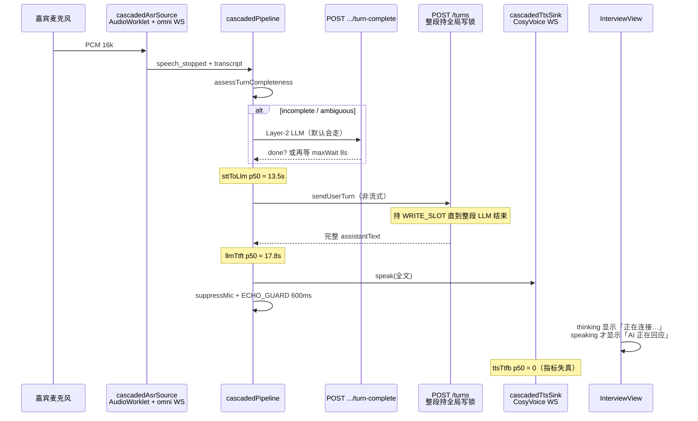
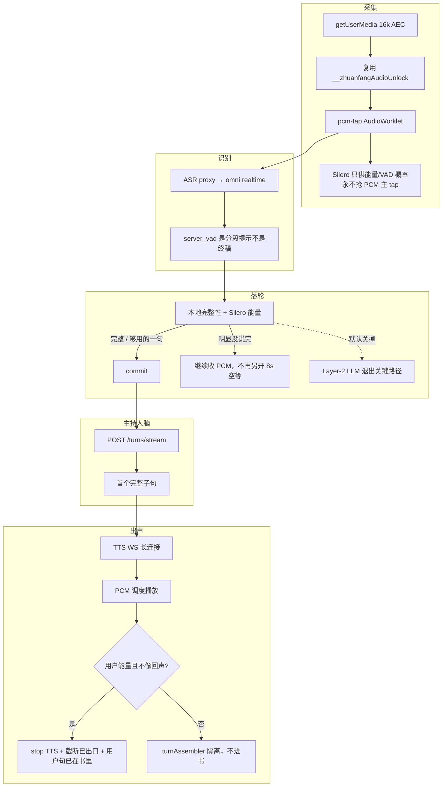
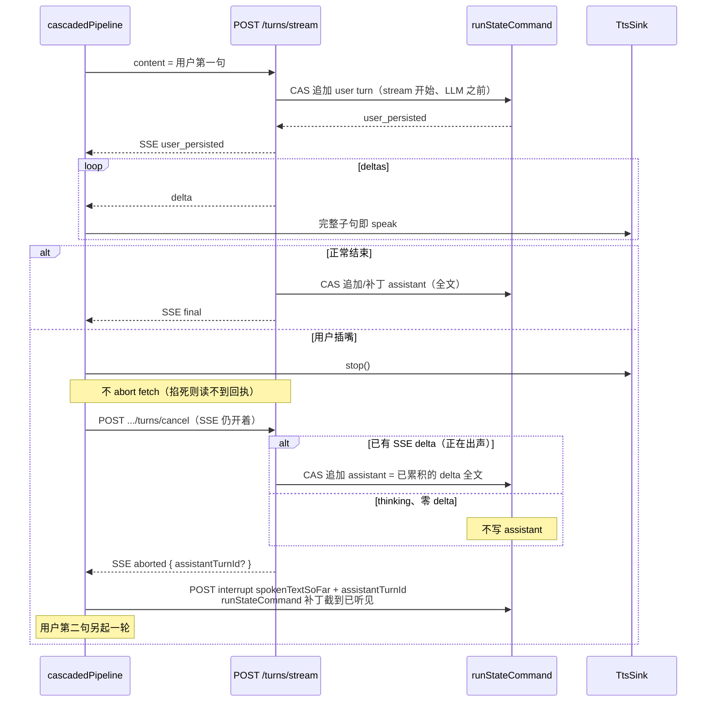
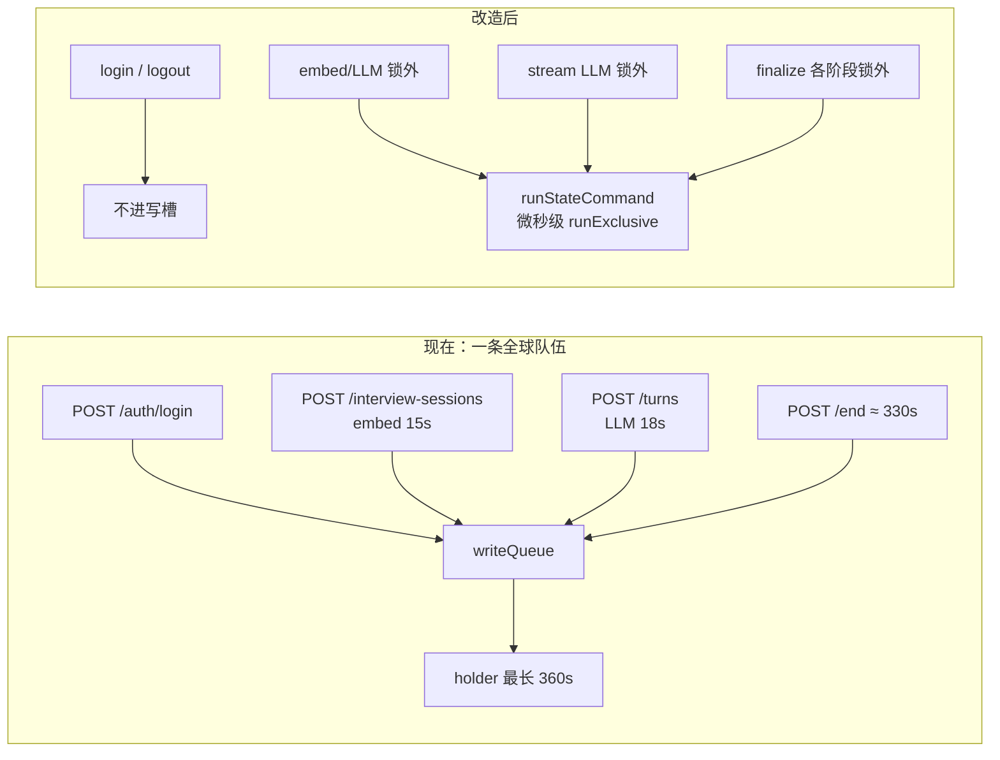
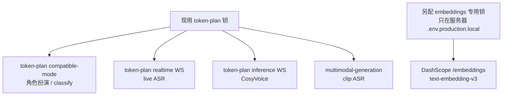

# 专访产品系统改造：让人话进书、开场出声、插嘴能停、登录不排队

| 字段 | 值 |
|------|-----|
| **文档标题** | zhuanfang 语音主路径 + 写锁 + 进书语义 最优改造 |
| **作者** | Grok Design |
| **日期** | 2026-08-21 |
| **状态** | Draft · Rev D（Open Q1 已拍板：demo 另配 embeddings 专用钥，不进 git，不用本机向量模型） |
| **仓库** | `/home/admin/projects/zhuanfang` |
| **验收环境** | 已部署 demo `https://zhuanfang.qing.blue`（宿主机 SSH 从部署配置读取，不写入仓库） |
| **本文性质** | 系统改造（评测只作证据）。评测框架见 `docs/plans/2026-08-20-unified-adversarial-eval.md`，不在此重造。 |
| **现场指标** | 2026-08-21 `GET /api/health` 进程环（n=14，**不是**结构常数）：`ttfaP50Ms=31136`、`sttToLlm p50=13570`、`llmTtft p50=17754`、`ttsTtfb p50=0`、`vadEndToStt p50=147`、`interruptCount=1`。方向：两段空等（落轮 ~13s + 整段 LLM ~18s）。验收必须用**热更后的新样本**（n≥10），见 §Observability。 |

---

## Overview

专访不是通用语音助手。默认路径已经是 cascade：麦克风 → 识别成字 → 文本主持人脑生成下一问 → CosyVoice 读出来。工艺、记忆、策略都活在文本脑里。语音层的职责只有一件：把人说的字完整送进脑，把脑写的下一问及时读出来，并在人插嘴时立刻停。

**给产品负责人的人话（打开书会看到什么、怎样算做完）：**

你点「开始录音」，主持人要用自己的声音先开口（不能弹「语音播放中断」然后哑巴）。你对着麦克风把「授权让我最难受的是那次救火」说完，这一句要尽快、整句进书，不能被切成两轮，也不能干等半分钟。主持人要马上追这件事本身，不能只回「好，你说。」却假装在追机制。他正在说话时你插嘴，他必须停、听你第二句；书里要留下你的第一句、他已说出口的半句、你的第二句。开场那一声不能当成你的发言写进去。新建一场不能把测试编号或随口主题写成「你刚在资产库选中的线索」。别人正在收工写书时，你登录不能卡死。模拟评测永远不能替真人宣布「这场对主人有价值」。

**这一轮做成什么样：** 真人在 `https://zhuanfang.qing.blue` 连说三轮，书里是访谈；从停口到听见下一问，从现在的大约半分钟变成一两秒。评测脚本绿了不算完。听错字（「救火」变成「那次纠」）是识别模型自己砍的，**不能靠再等 8 秒修好**，不放进这一轮的完成线；700ms 是以后的预算，不是这次合并的完成线。

**本方案的核心：治产品链路，不治评测脚本。** 评测已经把缺口钉死。对照代码后，根因不是「麦克风坏了」或「模型不够聪明」，而是四件实现错误叠在一起：

1. **活路径没有走流式追问**（`llmTtft p50 ≈ 18s`）。
2. **落轮在等一层帮不上忙的 LLM 判定**（`sttToLlm p50 ≈ 14s`；识别早已定稿，再等 8 秒也补不回被砍的字）。
3. **TTS 把正常关连接当成播放失败**；说话期间把麦克风当成静音键，插嘴进不去。
4. **全局写锁把登录、建场、每一轮追问和最长 6 分钟的收工串在同一条队伍里。**

旧设计 `docs/design-voice-system-cfc-plus-f77a7584.md` 写「cascade 已接 `sendUserTurnStream`」。代码事实是：`App.tsx` 只走 `useRealtimeVoiceControls.ts`，**没有**把 `sendUserTurnStream` 传给 `connectCascadedPipeline`。流式代码活在无人调用的 `startRealtimeVoiceConnect.ts`。本文以活路径为准。

---

## Background & Motivation

### 当前默认语音路径（As-Is，活代码）



| 层 | 活路径文件 | 现状 |
|----|------------|------|
| 采集 | `src/realtime/cascadedAsrSource.ts`，`public/pcm-tap.worklet.js` | 主路径已是 AudioWorklet，复用 16k `AudioContext`（`__zhuanfangAudioUnlock`）。Worklet 失败才 ScriptProcessor。Silero **不再** `await` 挡住 `startMic`（`void createSileroVadController`）。 |
| 识别 | `apps/api/src/realtime/asrProxyConnection.ts` | live：`wss://token-plan…/api-ws/v1/realtime`，`qwen3.5-omni-flash-realtime`（及 fallback）。`server_vad` `silence_duration_ms=900`，`create_response:false`。clip ASR 是另一条 `qwen-audio` multimodal。 |
| 落轮 | `cascadeTurnDecision.ts`，`turnCompleteness.ts`，`turnEngine.ts`，`pvadEndpointing.ts`，`cascadedPipeline.ts` | 默认 `endpointingMode=semantic`。无标点口语多为 `ambiguous` → `uncertain`。活路径**无论 mode** 都传 `classifyEndpoint` → `POST /api/interview-sessions/:id/turn-complete`。无 classifier 时 fallback 是 `armMaxWait(8000)`，不是 commit。`semantic` 的 `preferRespondOnAmbiguous` **仅当 completeness 已是 complete** 才为 true，对 ambiguous 无效。`finalStabilityMs=450`。 |
| 主持人脑 | `useRealtimeVoiceControls.ts` → `productApiClient.sendInterviewTurn` | **非流式** `POST /turns`。`startRealtimeVoiceConnect.ts` 里的 `sendUserTurnStream` **App 未调用**。 |
| TTS | `cascadedTtsSink.ts`，`realtime-voice.ts` TTS proxy，`bailian-streaming-tts.ts` | CosyVoice PCM 24k。`onclose` **一律** `reject(TtsPlaybackInterruptedError)`。 |
| 回声 / 插嘴 | `cascadedPipeline.ts` `suppressMic` / `ECHO_GUARD_MS=600` | 说话期间直接丢弃 ASR 事件。`shouldAcceptBargeIn` **只在单测里存在**，`minBargeInMs` 解构后从未使用。 |
| 写锁 | `apps/api/src/server/write-gate.ts` | 进程级一条队列。`WRITE_SLOT_MAX_HOLD_MS=360_000`。`POST /auth/login`、`POST /interview-sessions`、`POST /turns`、`POST /end` **均未豁免**。 |

### 评测已经证明、代码也对得上的痛点

评测设计（2026-08-20）负责「怎么打」；本文负责「产品为什么被打穿」。绿样本：

- 回声对白：`docs/superpowers/eval/samples/simulated/2026-08-21-eval-mt2fhf0q/VOICE-echo.transcript.md`
- 打断四句：`docs/superpowers/eval/samples/simulated/2026-08-21-eval-mt2fsix3/VOICE-barge.transcript.md`（偶发绿本，多数连跑看不到「AI 正在回应」）

| # | 现场现象 | 代码根因（不是愿望） |
|---|---------|----------------------|
| A1 采集 | Playwright 上曾 `__asrTicks=0` | ScriptProcessor 对跨 `AudioContext` 的 fakeMic 不回调。现主路径 Worklet。回退仍在，评测仍靠 `__asrFeedPcm` 补送。 |
| A2 识别截断 + TTFA | 「救火」→「那次纠」；「就不补了」→「就不」；TTFA 31s | `vadEndToStt p50=147ms`：识别**已经很快定稿**。截断发生在 provider 的 completed 文本里。Layer-2 + 8s max-wait **补不回被砍的字**，只把 `sttToLlm` 堆到 13.5s。 |
| A3 开场 TTS 中断 | UI「语音播放中断」；`ttsTtfb p50=0` | `cascadedTtsSink` 在 WS `onclose` 时 reject 在飞的 `speak()`。Cosy 任务结束后上游关连接是常态。`ttsTtfb≈0` 另有一层：非流式路径在 `speak()` 前才标 `llmFirstTokenAt`，指标退化，**不能单独当成「没出声」的证据**。 |
| A4 打断失败 | 多数看不到「AI 正在回应」；第二句不落书 | thinking 被画成「正在连接…」（`setVoiceStatus("connecting")`）。真正 speaking 时 `micSuppressed=true`，`handleSpeechStarted` 直接 return。评测在 speaking 时插嘴 = 对着静音键说话。 |
| A5 回声 | 产品靠 mute + 600ms，不是声学消除 | `getUserMedia({ echoCancellation: true })` 有，但 pipeline 在 TTS 期把 ASR 当不存在。`turnAssembler` 的相似+无能量隔离是第二道，被 mute 挡住，经常轮不到。 |
| B6 进书≠访谈 | 卡片曾是「继续追问：VOICE-barge」 | `buildInterviewCard`：有 `topicHint` 就 `继续追问：${topicHint}`，`whyNow` 写成「你刚在资产库中选中了这条线索」。评测已改 hint 为「授权那次救火」，**产品语义仍把任意 hint 当选中资产**。`run.mjs` L95 仍 `topicHint: scenario.topicHint \|\| scenario.id`。 |
| B8 策略标签撒谎 | 「好，你说。」打上 `mechanism_probe` | `decideInterviewStrategy` 默认就是 `mechanism_probe`。LLM 只把它当软指引，说出来的话可以是客套接话。没有「插嘴后让位」策略，落库仍贴默认标签。`preSignals.backchannelWhitelist` 含「好」。 |
| C11 写锁 | `write_slot_blocked`；建场持锁到 6 分钟；登录排队 | 全局单槽。`/end` 预算 330s，上限 360s。登录是 `POST` 且不在 `WRITE_GATE_EXEMPTIONS`。建场在锁内 `embedQueryText`（15s timeout）。`/turns` 整段 LLM 持锁。R3 CAS 只试点了记忆/资产小写。 |
| C12 Embeddings 401 | token-plan SK 打 `text-embedding-v3` InvalidApiKey；召回 `frozen_guide` | 代码已把 chat 的 token-plan URL **改道** `https://dashscope.aliyuncs.com/compatible-mode/v1`（`resolveBailianEmbeddingBaseUrl`）。同一把 SK 在 DashScope embeddings 上仍 401。`runtimeSettingDefinitions` **没有** `BAILIAN_EMBEDDING_*`；`capabilities` 见 key 就标 ready。无 client 时 embed 返回 `undefined` 不抛；有 client 且 401 时 turn 路径 fail-soft `frozen_guide`。 |
| C13 模型拓扑 | 文本/TTS/ASR 共用一把钥，embedding 不是同一服务 | 文本：token-plan compatible-mode。live ASR：token-plan realtime WS。TTS：token-plan inference WS。clip ASR：multimodal-generation。embedding：DashScope compatible `/embeddings`。**不是**「同一 URL 万事皆可」。 |

### 为什么必须治本

评测绿本证明：当 TTS 真的出声、第二句在 listening 窗口进来时，书里可以出现四句对白。那是**偶发时序碰巧绕开 mute**，不是打断能力交付。TTFA 31 秒是活路径结构问题：13.5s 白等落轮 + 17.8s 白等整段 LLM。把评测超时加长、把 `__asrFeedPcm` 再补一次，只会让模拟继续「过」，真人仍然无法访谈。

---

## Goals & Non-Goals

### Goals

1. **第一阶段进书（整句、不切轮、不空等）**：人说完的那一轮按识别结果整句进书，不被切成两轮，也不因 Layer-2 / 8s max-wait 干等。listening 态不丢掉前段。**不把「救火→那次纠」这类 provider 听错字当作本阶段完成线**（那是 PR-12 可选 clip，见 Goal 1b）。
2. **开场必出声**：点录音后主持人开口；WS 正常结束不得弹「语音播放中断」。
3. **插嘴是产品能力**：状态为「正在想下一问」或「AI 正在回应」时插嘴，TTS 停；书里留下用户第一句 + 主持人已说出口的部分 + 用户第二句。用户句先落库；取消生成时 **不掐断** 那条流，等服务器回执说助手句已在书里，再截成听见的字（§1.1）。
4. **TTFA（第一阶段，只有这一条门）**：热更后 **新样本 n≥10**，听见下一问（`ttfaMs` + `ttsTtfbMs`，见 §Observability）P50 落在 **1–2 秒**（上限 2000ms）。`sttToLlm` 从 ~13s 掉到亚秒、`llmTtft` 从 ~18s 掉到模型首 token，只作分段诊断，**不是**第二条 SLA（`ttfa` 已包含这两段，不能同时要求 llmTtft 小于 1500 且听见小于 1200）。700ms 是以后的预算。
5. **写路径不冻登录**：`POST /auth/login` 不等写槽；建场/追问的慢 IO 不整段持全局槽。`/end` 分阶段是后续 PR，本阶段至少 login 与追问 CAS 不互相冻死。
6. **进书像访谈**：卡片标题是这场要谈的事，不是测试编号，也不是「你刚选中资产」的误用。策略标签在**开口之前**就按责任选，薄接话不得叫 `mechanism_probe`。
7. **embedding 诚实**：demo 另配 embeddings 专用钥（服务器 env，不进 git）；capabilities **仅在该钥探活成功后** ready。召回继续 fail-soft。
8. **GATE-HUMAN-VALUE**：模拟样本机械锁 `insufficient_data`（已有 `assertSimulatedGate`），本改造不得改口。

Goal 1b（下一阶段，非本轮完成线）：句尾听错/截断（「那次纠」「就不」）用能量未落则拼接 + 可选短 clip 确认。

### Non-Goals

- 不重造评测框架、不把 GATE-HUMAN-VALUE 标 go。
- 不把默认路径改成 Omni E2E 或 LiveKit。
- 不在 Grok 运行机 `npm ci` / Playwright / 起 Surreal / 全量测。
- 不为验收再拉一套 Surreal 或平行 compose。
- 不清主人仓；密钥不进 git。
- 不把浏览器做成专业声学 DSP 实验室（第一阶段用浏览器 AEC + 已有 `turnAssembler` 相似隔离，不上 Speex）。
- 不在本机加载 `EMBEDDING_PROVIDER=local` 的 bge 模型。
- **本轮不把 `writeQueue` 改成 per-user。** 评测仓与主人仓隔离仍靠 `PRODUCT_USER_SCOPED_STATE` 分仓（wrapping probe），不靠写槽分队。

---

## Proposed Design

改造分成四条骨干，全部落在**活路径**。原则：每个 PR 必须可审、可回滚；**不是**每一项合并后都能单独听见产品变好——流式与落库协议、Layer-1 判定表、打断与回声契约必须成套，见 PR Plan。

### 1. 语音编排：一条活路径，流式先响



#### 1.1 流式先响，但用户句必须先落库（否则插嘴会把第一句从书里抹掉）

**事实：**

- `App.tsx` → `useRealtimeVoiceControls` 是唯一产品入口。`startRealtimeVoiceConnect.ts` **从未被 import**。活路径只传 `sendUserTurn`（364–367），`thinking` 画成 `connecting`（375）。
- 死文件里的 stream 闭包会在 `/turns` 前调用 `consumeInterruptStashPrompt()`（167–176）；活路径的 `sendUserTurn` **没有** stash。
- `handleTurnsStreamRequest`（`interviewer-brain.ts` 416–447）**只在 stream 整段结束后**才 `receiveUserTurnWithAssistant` + `replaceStateDurable`。`clientAborted || assistantResult === undefined` 时写 SSE error，**用户句和主持人均不落库**。Abort 来自 pipeline `AbortController`（`cascadedPipeline.ts` `handleSpeechStarted`）。
- 今日非流式 `/turns` 是整对落库后再 TTS，所以手动按钮 `interruptAssistant()` → `POST /api/realtime-voice/sessions/:id/interrupt` 还能截断。pipeline 自动 barge **只** `abort()` + `tts.stop()` + `resetTurn()`，从不打 interrupt REST。

若只把活路径接到现有 `/turns/stream` 再打开 barge，嘉宾说完「那次救火」、听见主持人开头再插嘴：SSE 被 abort，**第一句从书里消失**，interrupt 也没有助手句可截。Goal 3 会失败。

**落库协议（Key Decision 11，必须在活路径切 stream 的同一切片落地）：**



契约：

1. **禁止** `record-turn` 用户句再调 `/turns/stream`（`receiveUserTurnWithAssistant` 会再追加一条 user，整句复制两遍）。落库发生在 `/turns/stream` 内部。
2. Stream 开始：`runStateCommand` 重读 latest，只 upsert **本 session** 追加这一条 user turn。禁止 `{ ...state, revision: state.revision }` 这种 t0 整包回写（今天 442–447 正是这个形状）。
3. 正常结束：第二次 CAS 追加 assistant（若 user 已在 turns 尾部则不要再 `receiveUserTurn` 一次）。助手正文的**创建**只发生在服务端（final 或 abort 时用已累积 SSE delta）。
4. **插嘴不得 `abort()` 这条 SSE fetch。** 今日 `sendInterviewTurnStream`（`productApi.client.ts` 559–624）把 `AbortSignal` 绑在 `authedFetch` 上：一 abort，reader 停，服务端往死 socket 写 `aborted` 客户端看不见，随后 interrupt 常打在助手句尚未存在之时 → `truncateAssistantTurn` no-op。握手选 **A**：另发 `POST /api/interview-sessions/:id/turns/cancel`（进程内 abort 该场 LLM，**不**拆掉 hijack 的 SSE）。Stream 在 cancel 后：有 delta 则 CAS 创建助手=累积 delta；零 delta 不写助手；然后在**仍活着的** SSE 上写 `event: aborted`（`{ assistantTurnId?: string }`），再 `end`。Cancel 请求本身无 `spokenTextSoFar`。
5. 助手正文的**截短**只有 interrupt REST，且必须在客户端 **读到** `aborted` 之后：有 `assistantTurnId` 才打，用浏览器 `spokenTextSoFar` 经 `runStateCommand` 补丁（禁止 t0 `replaceStateDurable`）。没有 `assistantTurnId`（thinking）则跳过 interrupt。空的 `spokenTextSoFar` 会保留原文（`signals.ts` 250–259）——有听见前缀就必须带上。
6. Barge 顺序：`tts.stop()` → 已见 `user_persisted` → **POST cancel，不停 fetch** → `await` SSE `aborted`（超时 2s 则打一条日志并仍尝试一次 interrupt，避免死等）→ 有 id 则 `POST .../interrupt`。禁止 `void interrupt` 且无回执。手动按钮同一条 interrupt REST。不要用「interrupt 自己 upsert 助手句」（那是第二创建者）。

`productApi.client.ts` 必须解析 `user_persisted` 与 `aborted`（PR-3，今日只认 `delta`/`final`/`error`）。金样：流式第一句播放中插嘴 → 用户句1 + **已听见的**主持人半句 + 用户句2。含「cancel 回执先到、interrupt 紧跟」；缺用户句1、或主持是空/全文而不是半句，都失败。thinking 期允许没有助手句。

**前端接线（同一切片的后半，或紧随的 PR-3）：**

- 从 `startRealtimeVoiceConnect.ts` **抽出** stream 闭包到一个模块（含 `consumeInterruptStashPrompt`），`useRealtimeVoiceControls` 只引用它。PR-10 变成删除死文件，而不是再复制一份。
- `thinking` → UI「正在想下一问」，禁止 `setVoiceStatus("connecting")`。
- `voice_stream_fallback`：仅当 `POST /turns/stream` 404/405、或 SSE 无法建立、或服务端因缺少 `createAssistantTurnStream` 退回一次性 delta 且客户端检测到没有增量时，**一次**回退 `sendUserTurn`。5xx 不静默回退（fail-loud）。回退必须打点，出现即回归失败。

这是 TTFA 最大单点：`llmTtft` 从整段 ~18s 落到模型首 token。但**没有落库协议的 stream 不得上活路径。**

#### 1.2 落轮：识别已经定稿就不要再等一层 LLM

现场 `vadEndToStt p50=147ms`、`sttToLlm p50=13570ms`。含义：

- 百炼 `speech_stopped` + `completed` **很快**。
- cascade 随后把大量句子判成 `ambiguous`（`assessTurnCompleteness` 对没有句末语气词/句号的口语一律 ambiguous）。
- 于是每次都打 `classifyTurnComplete`（又一次 chat LLM），失败/未完成再 `armMaxWait(8000)`。
- **这个等待不能把「就不」变回「就不补了」。** provider 已经 completed。空等只伤害 TTFA。

**新落轮责任（先写戏，再写给机器的一句）：**

> 打开书，这一轮是：人把那句话说完了，系统就把这一句交给主持人，而不是再请另一位模型来考试「算不算说完」。

**只关掉 `classifyEndpoint` 不够。** 活代码在 `classifyEndpoint` 缺失时（`cascadedPipeline.ts` 497–501）是 `armMaxWait(8000)`。`assessTurnCompleteness("授权让我最难受的是那次救火")` 为 `ambiguous`（无句号/吗呢吧、无悬挂连词）。`decideCascadeTurn`：`ambiguous` → `uncertain`。`semantic` 模式的 `preferRespondOnAmbiguous` 只在 completeness 已是 `complete` 时为 true（`pvadEndpointing.ts` 46–52），对 ambiguous **从不**把 `uncertain` 打成 `respond`。所以「默认不调用 Layer-2」若不同时改 Layer-1，`sttToLlm p50` 仍是 8s 量级。

**Layer-1 是一条 if-chain，不是可以并行命中的表。** `speech_stopped` / `completed` 上必须按这个顺序（PR-4 写进 `handleSpeechStopped` / `decideTurn`，**能量判定在 `preferRespondOnAmbiguous` 之前**）。今日 `applyPvadDecisionBias` 只把 `uncertain`→`respond`，不管能量。

```
1. silence < minPause → wait
2. hanging incomplete（连词/「和把被」）或 completed 后 hasRecentUserEnergyEvidence → wait/拼接；
   listening 的 speech_started 不得 resetTurn；不要把 8s max-wait 当主路径
3. emotional / circling → backchannel（不变）
4. 至此才：ambiguous 或 complete → respond
   （semantic 的 preferRespondOnAmbiguous 扩到 ambiguous；默认不调 /turn-complete）
5. 仅当仍悬挂且能量已落、silence 走到 maxWait → 安全网 respond
```

对照（改造后默认；「今日」列只说明现状）：

| 顺序 | 条件 | 今日无 L2 | 改造后 |
|------|------|-----------|--------|
| 1 | silence < minPause | wait | wait |
| 2 | incomplete 悬挂，或 completed 后能量仍高 | wait 或过早 commit | **wait/拼接**（先于第 4 步） |
| 3 | emotional / circling | backchannel | 不变 |
| 4 | ambiguous 且能量已落 | uncertain → 8s | **respond**，不 arm max-wait |
| 4 | complete 且能量已落 | respond | respond |
| 5 | 仍悬挂、能量已落、maxWait | respond | 仅安全网 |

实现落点（不要发明 `semantic-llm` mode）：

- `endpointingMode` 仍只有 `"silence" | "semantic" | "pvad-experimental"`。
- `semantic` 的 `preferRespondOnAmbiguous` 扩到 ambiguous，但 **pipeline 必须先做步骤 2**，否则「那次纠」类 `ambiguous` 会在能量未落时被提交，切成两轮，Goal 1 失败。
- 活路径**默认不传** `classifyEndpoint`。旧 Layer-2 用 `systemConfig.voice.useLayer2Endpoint`（默认 false）。
- 单测两条：
  1. `"授权让我最难受的是那次救火"` + **能量已落** + 无 L2 → commit，不 arm max-wait。
  2. 同一句 `ambiguous` + **能量仍高** → 不 commit；下一段 `completed` **拼接**进同一轮。

**截断分两层，不要把 Goal 1 写成「书里不能出现那次纠」：**

1. **本阶段（随 Layer-1 PR）：** 能量未落则拼接；listening 不 reset。这防止「一句切两轮」和「后半段被丢掉」。若 provider 已经在第一次 `completed` 里写成「那次纠」，拼接也变不回「救火」——会**更快**把错字写进书，这是诚实的权衡（换掉 13s 空等）。
2. **下一阶段（PR-12，默认关）：** 文本过短或与能量时长明显不匹配时，用 PCM 环做一次 clip ASR。失败用 live。不进第一阶段完成线。

#### 1.3 TTS：关连接不是播放中断

`createBrowserTtsSink` 当前：

```247:252:src/realtime/cascadedTtsSink.ts
      socket.onclose = (event) => {
        if (ws === socket) ws = null;
        const error = new TtsPlaybackInterruptedError(event.reason || "TTS WebSocket interrupted", event.code);
        interruptSpeakForSocket(socket, error);
        reject(error);
      };
```

CosyVoice `task-finished` 后上游关 socket 是正常收尾。浏览器侧若已收到 `tts.done`，应 **resolve 并排空已调度的 PCM**，不得 reject。`openWs` 的 Promise 也不得在后续 close 时把下一次 `speak` 的 race 打成失败。

配套：

- TTS WS **按会话长连**（proxy 已按 session 保活 + 滑动 TTL）。一次 `speak` 结束不主动 `ws.close`。
- `speak()` 的成功条件 = 收到 `tts.done` **或** 已调度缓冲开始播放（首包已出声）。不要等 drain 才算成功——drain 期间 close 是正常的。
- `onTtsPlaybackInterrupted` 只在：**还没有首包 PCM** 且 socket 异常 / `type:error`。开场有字无声才提示「语音播放中断」。
- 撤掉任何开场 12s timeout（已撤，禁止加回来）。用 TTS connect timeout（服务端已有 `STREAMING_TTS_CONNECT_TIMEOUT_MS=10_000`）即可。
- 指标：`ttsTtfbMs` = 首包 PCM 到达（或 `AudioBufferSourceNode.start`）相对 `llmFirstTokenAt`，不是 `speak()` 调用时刻。非流式降级时该字段标 `undefined`，**不要写 0**。

#### 1.4 插嘴：停止把麦克风当静音键

当前半双工：

```373:421:src/realtime/cascadedPipeline.ts
  // While the AI is speaking (and ~ECHO_GUARD_MS after it stops), the mic hears
  // the AI's own TTS output. Suppress ASR-driven turns/barge-in during that
  // window ...
  function suppressMic() { micSuppressed = true; ... }
  function handleSpeechStarted(): boolean {
    if (micSuppressed) return false;
```

结果：人在「AI 正在回应」时说话，事件被丢。`shouldAcceptBargeIn(speechMs, 280)` 从未接线。`minBargeInMs` 传入 pipeline 后未使用。

**新契约（复用 `turnAssembler` + `shouldAcceptBargeIn`，不发明 `isLikelyEcho`）：**

`speechMs` 时钟：`thinking|speaking` 下 `speech_started` 记 t0；在 `minBargeInMs`（默认 280，pipeline **必须真正使用** 已解构的该参数）内若 `speech_stopped`，视为 blip，不 barge。定时到期且仍在说话，再判回声。

回声判定 = 现有 `turnAssembler.ingest`（`turnAssembler.ts` 53–66）：窗内、与最近 TTS 高相似、且 **没有** 独立用户能量 → quarantine。不要新函数。

能量默认在 TTS 期间必须保守：今日 `hasRecentUserEnergyEvidence?.() ?? true`（pipeline 735）会让 quarantine **永远不触发**。播放中缺省改为 `?? false`。`sileroSpeechProb > 0.35` 可被 TTS 残响打真：相似且像回声时 **即使能量高也 quarantine**；只有 **不相似** 的高能量才 barge。

AEC 探测：`getUserMedia` 之后 `track.getSettings().echoCancellation === true` 才视为 AEC 开。不是新 worklet capability。AEC 关/不明 → 半双工 `suppressMic`（行为退回今天）。可选 `systemConfig.voice.halfDuplexFallback` 默认「跟 AEC 设置走」；不要假装已有 `bargeUsesHalfDuplexFallback` 字段直到 PR 加上。

停声协议：`tts.stop()` 已发送 `{type:"cancel"}` 并 `resolveActiveSpeak`（sink 414–415）。目标 ~200ms = 停调度源 + cancel，不等 drain。不要另做 12s 超时。

Pipeline barge 必须按 §1.1 **握手 A**：`tts.stop()` → 已见 `user_persisted` → `POST .../turns/cancel`（**不** abort fetch）→ 等到 SSE `aborted`（带可选 `assistantTurnId`）→ 有 id 才 `POST .../interrupt`。掐断 fetch 则回执不可达，interrupt 会 no-op。手动按钮同一条 interrupt REST。

开场 TTS：AEC 开时同样走 assembler，不再无条件 `suppressMic()`（`startListening` 841）。这是行为变化：现有 echo-guard golden（pipeline ~1138、1255）**要求** opening 期 mute，PR-5 **必须重写**这些 golden，不能保绿混过。新金样：

| 场景 | 期望 |
|------|------|
| TTS 开，转写与 TTS 高相似、低能量 | quarantine，不进书 |
| TTS 开，转写不相似、高能量、speechMs≥280 | barge；书里有用户句 |
| `echoCancellation` 不为 true | mute，行为同今日 |

未重写 golden 不得合 PR-5。

绿本 `VOICE-barge.transcript.md` 四句是验收样例。打开书必须能看出第二句插在主持人说话时。产品不得靠「等 listening 再送第二句」冒充打断。

#### 1.5 采集：Worklet 为主，Silero 不抢 tap，ScriptProcessor 退出 cascade 默认

维持现有 Worklet + 16k unlock context。明确优先级：

1. `pcmTap = "worklet"` 成功则 **禁止** 再挂 ScriptProcessor（现已如此）。
2. Silero 只更新 `sileroSpeechProb` / 能量证据；仅当 `pcmTap === "none"` 才允许它成为 tap。
3. ScriptProcessor 仅作为无 Worklet 浏览器的兼容模式，并在 UI 保持「语音兼容模式」。Playwright/Chromium 评测不得依赖这条回退——`voice-adapter.mjs` 的 peak 不够再 `__asrFeedPcm` 是评测适配，不是产品能力。

### 2. 写锁：慢 IO 不准占槽，登录不准排队



R3 骨架已经存在：`runStateCommand` + `WRITE_GATE_EXEMPTIONS` + 终写必须 `writeGate.runExclusive`。欠的是把**热点长路由**换轨，而不是再加一个 6 分钟上限。

**阶段顺序：**

1. **立刻豁免不碰 `ProductState` 的 mutating 路由：** `POST /api/auth/login`、`POST /api/auth/logout`。登录排队是假持锁——handler 只发 cookie。
2. **`POST /api/interview-sessions`：** embed/recall 锁外；终写 CAS。401 继续 fail-soft。
3. **`POST /turns` 与 `/turns/stream`（与 §1.1 同切片，不得晚于活路径切 stream）：** LLM 锁外；persist 见下方 mutate 契约。`reply.hijack()` 会在 `reply.raw.close` 时放槽（write-gate 318），但 **LLM 期间仍占槽直到本项落地**。只切 stream 不换 CAS，会让登录在长 SSE 后面排更久。
4. **`POST /end`：** 另 PR。见下方崩溃/重试。本项之前靠 login 豁免，不靠拆 `/end`。
5. **Per-user 写槽：本轮明确不做。** `write-gate.ts` 仍是进程级一条 `writeQueue`。评测仓不堵主人仓靠 user-scoped stores + wrapping probe，不是锁。

铁律不变：豁免的是 handler 不整段持槽，**不是**终写绕过串行化。

**`/turns` CAS mutate 契约（约十行，PR-2 必须实现 + r3 风格测试）：**

```ts
await runStateCommand(repo, (latest) => {
  const current = findSession(latest, sessionId);
  if (!current || current.status !== "active") return null;
  // 只 upsert 本 session：追加 user 和/或 assistant，禁止回放 t0 的 sessions[]/notes/memories
  return upsertSession(latest, applyTurnPatch(current, patch));
}, { writeGate, label: `command:turns:${sessionId}` });
```

禁止：`const baseNextState = { ...state, sessions: state.sessions.map(...), revision: state.revision }` 再 `replaceStateDurable`（今日 stream 442–447、非流式 295–313 都是 t0 整包）。`expectedRevision` 来自 **mutate 读到的 latest**，不是请求开始的 snapshot。

测试（PR-2 产品行为，**不是**「CAS 等着 `/turns` 占槽」）：挂起一轮 LLM / 长 SSE，并发笔记/login/另一场 **都能完成**；LLM hang **不得**挡住它们。豁免之后 `/turns` 只在微秒级 CAS 上排队，长生成不占 `writeQueue`。

**r3-cas-pilot 的长写夹具只能是仍整段占槽的路由。** 今日夹具用挂起的 `POST /interview-sessions` embed（`r3-cas-pilot.test.ts` 253–258、400–401）。PR-2 豁免 `/turns` 之后，挂起的 `/turns` LLM **不再**占 `writeQueue`（183 行今天还断言 `/turns` 未豁免）。**不要**写「`/turns` 当 hang holder 更干净」。PR-6 把 hang **只**改到 `/end`（PR-11 之前它仍整段持槽）。另测：login 在 `/end` in-flight 时 <2s；create-session embed hang **不**挡 login。

**`/end` 崩溃与重试（PR-11 设计注，不是「切几刀 IO」就完）：**

今日 `/end` 是读整态 → 抽记忆/finalize/精判/embed（预算 330s）→ 无 `expectedRevision` 整包写回。成功后 `status=completed`，再 POST 409。

分阶段后：

- 每阶段结束短 CAS：只合并该阶段产物（候选记忆、笔记、矛盾、embedding），并写 `session.finalizeCheckpoint: "extract" | "finalize" | "contradiction" | "embed" | "done"`。
- 进程死在阶段 2：session 仍 `active`，checkpoint=`extract`。重试 `/end` **从下一缺产物的阶段继续**，已有 note/候选按 id 幂等跳过，禁止再插一份。
- 已 `completed`：保持 409，不重跑。
- 阶段失败：保持 session `active` + checkpoint + 5xx；不要标 completed 却缺笔记。
- 客户端可原样再点「结束」。

没有这条，PR-11 会在半成品书上制造重复资产。

### 3. 进书语义：主题不是资产，标签不是嘴里的话

#### 3.1 `topicHint` 只表示「这场谈什么」

`buildInterviewCard`（`src/domain/context-pack.ts` L236–275）把任意非空 `topicHint` 当成「你刚在资产库中选中了这条线索」，标题 `继续追问：…`。评测把 hint 改成「授权那次救火」后标题变成「日常复盘：继续追问：授权那次救火」——话能读，语义仍是「选中资产」。

**改造：**

- 卡片标题：用户写下的主题就当主题（「授权那次救火」），不要套「继续追问：」除非真的来自会后问题或 revisit queue。
- `whyNow`：仅当 `searchBriefId` 存在时，才说选中了外部素材；仅当 `fromRevisitQueue` 时用 autoLaunch 的 reason。自由 `topicHint` 走「你准备谈这件事」，**不要**说「你刚在资产库中选中了这条线索」。
- **不新增 `CreateSessionPayload.topicSource`。** 来源从已有字段推断：`searchBriefId` → 简报；无 hint 时 `pickInterviewLaunchRecommendation` → revisit/cold_start；其余有 hint → 打字主题。缺省当成 typed 会把 revisit 误标成打字，所以不要新字段的默认值。
- `scripts/eval/run.mjs` L95 的 `scenario.id` 回退删掉（语音路径 L384 已默认「授权那次救火」）。评测一行防护，不是主交付。

#### 3.2 策略标签必须能被嘴里的话解释

`decideInterviewStrategy` 在没有时钟命中时默认 `mechanism_probe`。`buildCharacterSystemPrompt` 把它当软指引。LLM 完全可以说「好，你说。」绿本第二问就是这样，书里若同时写着「追问机制」，打开书会对不上。

**改造：**

- 在 **开口之前** 改策略：用户句是插嘴/短接话（「等一下」「我想打断你」、过短且无问句）时，`decideInterviewStrategy` 返回 `space_holding`，`buildCharacterSystemPrompt` 注入「让人把那件事说完」，**不要**注入「本轮建议动作：追问机制」。只在落库后改徽章来不及，嘴已经按错误责任说完了。
- `space_holding` 必须同时写入：`InterviewStrategyId` union（`types.ts`）、`VALID_STRATEGY_IDS`、`INTERVIEW_STRATEGY_LABELS`（`turn-builder.ts` 340–369）。漏一张表会在 record-turn / UI 徽章丢标签。
- 落库后再做一层薄接话覆盖（`isThinHost` 同类）：若模型仍说出「好，你说。」却带着别的 id，覆盖为 `space_holding`。这是第二道，不是唯一一道。

#### 3.3 其余进书项（评测已改、产品要守住）

- 收工前 `getState` 落对白：保持。`/end` 会 `offloadCompletedSession` 清空热态 turns，驱动器内存 / 收工前 GET 才是真源。
- play + feed 双写：评测已「peak 足够不补送」。产品侧 Worklet 正常则 `__asrFeedPcm` 只是调试钩子，不得在 UI 路径自动调用。
- GATE-HUMAN-VALUE：保持 `assertSimulatedGate`。本改造的验收是 demo 真人/语音冒烟，不是把 simulated scorecard 标 go。

### 4. Embedding 与模型拓扑



**决定（Open Q1 已拍板，不再讨论）：**

1. **今天没有「用户模型表」里的 embedding 行。** `runtimeSettingDefinitions`（`system.ts` 87–298）只有 search/character/TTS/ASR，没有 `BAILIAN_EMBEDDING_*`。`capabilities.embedding` 见 `DASHSCOPE_API_KEY` 或 `EMBEDDING_PROVIDER=local` 就 `ready`（479–491）。PR-7 **要新增**这两条 settings + 探活缓存字段。
2. **两把钥：** 聊天 / TTS / ASR 继续用现有 token-plan 钥。记忆检索另配一把**只能打 embeddings** 的 SK，只写入 demo 服务器 `/opt/zhuanfang/app/.env.production.local`（或现用 env 文件），**不进 git**。不要用 token-plan 那把去探 `/embeddings`。不要在 Grok 运行机、也不要在本决策里改走 `EMBEDDING_PROVIDER=local`。
3. 启动或首次 embed 用 **embeddings 专用钥** 做 1 字探活。**capabilities 标 ready 当且仅当这次探活成功**。401/403 → client 置空 + `embedding_key_unusable`，走无 client 关键词路径（与没配 client 同一条）。见 key 不等于 ready。
4. 召回失败保持 fail-soft：建场已 catch；turn 已 `frozen_guide`。**不要**改回 fail-loud 挡开场。追问 LLM 本身失败仍 5xx。

---

## API / Interface Changes

| 接口 | 变更 |
|------|------|
| `POST /api/interview-sessions/:id/turns/stream` | 默认语音路径。SSE 事件：`user_persisted`、`delta`、`final`、`aborted`（`{ assistantTurnId? }`）、`error`。插嘴**不** abort 该 fetch。 |
| `POST /api/interview-sessions/:id/turns/cancel` | 新。只把该场在途 LLM 的 AbortController 扳掉，**自己不写 ProductState**（落库仍在原 SSE 上）。须写锁豁免或纯内存。无听见文本。 |
| `POST /api/interview-sessions/:id/turn-complete` | 活路径默认 **不再调用**（注意路径是 `/turn-complete`，不是 `classify-turn-complete`）。`useLayer2Endpoint=true` 时才打。 |
| `POST /api/auth/login` | 行为不变；不再进全局写槽。 |
| `POST /api/interview-sessions` | 响应不变；embed/recall 锁外；CAS 终写。 |
| `POST /api/realtime-voice/sessions/:id/interrupt` | 在助手句**已存在**之后打；`spokenTextSoFar` 经 `runStateCommand` 补丁。禁止 t0 `replaceStateDurable`。无助手句 → no-op。 |
| `GET /api/system/capabilities` | embedding **仅 embeddings 专用钥探活成功** 才 ready；见 token-plan 钥不算。 |
| `POST /api/system/runtime-metrics/voice` | `ttsTtfbMs` = 首包 PCM；禁止用 0 表示未测。验收读热更后带 `at` 的新点。 |
| `CreateSessionPayload` | **不改**。仍是 `topicHint` + `searchBriefId`（`interview-session-helpers.ts` 52–58）。 |

前端 stream 必须带 interrupt stash，并且 **解析** `user_persisted` / `aborted`（`productApi.client.ts` 今日只认 delta/final/error）：

```ts
sendUserTurnStream: async (text, signal, onDelta) => {
  const stash = consumeInterruptStashPrompt();
  if (stash) { /* best-effort refreshVoiceInstructions */ }
  return productApiClient.sendInterviewTurnStream(
    interviewId, { content: text }, {
      signal, // 截止/关场才 abort fetch；插嘴不要用它掐 SSE
      onDelta,
      onUserPersisted,
      onAborted: ({ assistantTurnId }) => { /* 握手完成 */ }
    }
  );
}
```

Pipeline barge（无 `isLikelyEcho`）：

```ts
if (!shouldAcceptBargeIn(speechMs, minBargeInMs)) return false;
const assembled = turnAssembler.ingest({ text, isFinal, atMs, hasUserEnergyEvidence });
if (assembled.action === "quarantine") { surfaceQuarantine(...); return false; }
tts.stop();
await waitUserPersisted();
await productApiClient.cancelInterviewTurnStream(interviewId); // 不 abort fetch
const { assistantTurnId } = await waitAborted({ timeoutMs: 2000 });
if (assistantTurnId) {
  await productApiClient.interruptRealtimeVoiceSession(realtimeSessionId, {
    spokenTextSoFar, assistantTurnId, reason: "user_interrupt"
  });
}
```

---

## Data Model Changes

| 字段 | 说明 | 迁移 |
|------|------|------|
| `InterviewCard` 标题/whyNow | 纯函数：有 hint 且无 brief/revisit 时当打字主题 | 旧场保留旧标题 |
| `InterviewStrategyId` + `VALID_STRATEGY_IDS` + `INTERVIEW_STRATEGY_LABELS` | 三处同时加 `space_holding` | 旧 trace 不变 |
| `systemConfig.voice.endpointingMode` | **不新增枚举值**。`semantic` 的 `preferRespondOnAmbiguous` 扩到 ambiguous（显式行为迁移） | 存盘 `semantic` 无需改值 |
| `systemConfig.voice.useLayer2Endpoint?: boolean` | 默认 false；true 才接线 `classifyEndpoint` | 缺省 = 关 Layer-2 |
| `systemConfig.voice.halfDuplexFallback?: boolean` | 可选；默认跟 `getSettings().echoCancellation` | 缺省 = 跟 AEC |
| `CreateSessionPayload` | 不加 `topicSource` | — |
| 无 Surreal schema 变更 | 不新起库 | — |

---

## Alternatives Considered

### A. 默认改走 Omni 端到端（bailian realtime 既识别又说话）

- **优点：** 厂商处理打断/VAD，TTFA 可能更好。
- **缺点：** 工艺、记忆、策略、do-not-save、截断已说出口的句子，全部活在文本 `/turns`。E2E 会把主持人脑降成「模型自己聊」。与 CFC+ 及仓库工艺护城河冲突。辅路径可留，**不得**变默认。
- **结论：** 拒绝作为本改造主方案。

### B. 默认改走 LiveKit + Python agent

- **优点：** 现成 barge、流式 TTS。
- **缺点：** 又一套进程、token、部署面；demo 已有 cascade。Grok 机/验收约束不允许为「再验一次」拉平行栈。
- **结论：** 拒绝作为本改造主方案。可继续当辅路径。

### C. 保留全局写槽，只把上限再加大 / 把 `/end` 拆成后台 job 但不换 CAS

- **优点：** 改动小。
- **缺点：** 登录排队、建场卡住的根因是 **IO 持槽**，不是上限不够。已经从注释里的合法长写把上限推到 360s，问题变成「合法写冻死别人」。
- **结论：** 拒绝。按 R3 把 IO 移出槽。

### D. 每轮 live ASR + 全量 clip ASR 双跑

- **优点：** 可能减少「救火/那次纠」。
- **缺点：** 成本、延迟、写锁（若 clip 也占槽）。多数截断是句尾，不需要全文重识。
- **结论：** 仅在「文本过短 / 与能量时长不匹配」时可选 clip，第一阶段非默认。

### E. 只改评测（加长等待、强制 feedPcm、在 listening 后再送第二句）

- **优点：** 分数好看。
- **缺点：** 用户要的是访谈。已发生过「评测绿、产品哑巴/插嘴失败」。
- **结论：** 明确拒绝作为本方案。评测只回归产品缺口。

### F. 用户句先落库，流式助手，插嘴停 TTS/生成但不丢掉 HTTP 上的 user 写（采纳）

- **优点：** 解决「切 stream + abort 抹掉第一句」。助手正文只由服务端 delta 创建，interrupt 只补丁已听见的前缀。
- **缺点：** `/turns/stream` 从一次写变成两次 CAS；要防与 `record-turn` 双写 user；插嘴必须 **cancel + 等 SSE 回执**，不能掐 fetch。
- **结论：** **采纳**，作为 Key Decision 11。活路径切 stream 的前置条件。握手是 A，不是「abort fetch 再 interrupt」。

### G. 保留 Layer-2，但 250ms 超时后强制 commit

- **优点：** 看起来「还在用语义判定」。
- **缺点：** `classifyTurnComplete` 是一次完整 chat `complete()`，250ms 几乎总会超时，等于「ambiguous → respond」再加一笔税和写锁竞争。超时后的 commit 与改 Layer-1 相同，还更慢。
- **结论：** **拒绝**默认路径。Layer-2 仅 `useLayer2Endpoint`。

### H. 两条写队列（auth vs ProductState）而不做 CAS

- **优点：** login 立刻不再排队。
- **缺点：** 不解决 `/turns` t0 整包 clobber；建场 embed 仍冻其它写。
- **结论：** login/logout 豁免是 H 的最小集，**采纳**。主写路径仍要 CAS，不能用第二条队列代替 D3。

---

## Security & Privacy Considerations

| 风险 | 严重度 | 缓解 |
|------|--------|------|
| TTS/ASR WS 已有 Origin 白名单 + cookie/bearer | 已有 | 保持 `isAllowedWsOrigin`；不把 token 写入 git |
| 写锁豁免登录后，登录本身无 ProductState 写 | 低 | 豁免名单写明「无终写」；测试锁死「login 不等 holder=/end」 |
| `/turns` IO 出锁后的丢失更新 | 高（仓库付过 D3 学费） | mutate 契约：重读 latest、只 upsert 本 session、禁止 t0 `revision`；r3 测试挂 LLM + 并发笔记 |
| clip ASR 多一次音频出站 | 中 | 默认关；开启时走现有转写客户端，不落盘额外副本 |
| embedding 探活可能把 key 打到 DashScope | 低 | 已是现网行为；失败只记 status，不记 key |
| 评测 purge | 高 | 保持 wrapping 探针；禁止 `PRODUCT_API_TOKEN`；不碰主人仓 |

威胁模型不因本改造扩大到新的公网面。不引入新的匿名 WS。

---

## Observability

沿用 `POST /api/system/runtime-metrics/voice` + `summarizeVoiceLatency`。环大小 `MAX_VOICE=64`，**热更前的 18s 点会留在 p50 里**，直到进程重启或环滚掉。`GET /api/health` 只暴露子集（无 `ttfaCount`）；验收读 `GET /api/system/runtime-metrics`。

`ttfaMs` 今日定义是停口 → **调用 `speak()`**，不是第一帧可听（`docs/cascade-l1-ttfa-baseline.md`）。第一阶段：

- `ttfaMs`：停口 → `speak()`（保持，便于分段）
- `ttsTtfbMs`：LLM 首 token → **首包 PCM**（禁止未测写 0；非流式降级用 `undefined`）
- **听见下一问** ≈ `ttfaMs + ttsTtfbMs`（另加 ~50ms AudioContext 垫片，不进环）。`ttfaMs` 已含 sttToLlm + llmTtft。
- **合并门只有一条：** 新样本 n≥10，听见下一问 P50 在 **1–2 秒**（上限 2000ms）。
- `sttToLlm`、`llmTtft` 是分段诊断（从十几秒掉到亚秒 / 模型 TTFT），**不要**再写一条会和 2000ms 打架的 llmTtft SLA。

验收步骤：热更（`deploy_demo.sh` 会重启 API，环清空）→ 同一人连说 ≥10 轮 → 只看新环。禁止拿合并前 n=14 的 31s 当对照「已经好了」。

| 信号 | 用途 | 告警 |
|------|------|------|
| 听见下一问（ttfa+ttfb） | **唯一**第一阶段门 | 新样本 n≥10 且 P50 > 2s |
| `sttToLlmMs` | 诊断：落轮是否空等 | 仍 ~10s 量级 → Layer-1/max-wait 回潮 |
| `llmTtftMs` | 诊断：是否真 stream | 仍 ~18s 量级 → 又丢了 stream |
| `ttsTtfbMs` | 首包 PCM | `undefined` 与 0 分开 |
| `bargeInSuccess` | 真打断 | 必须在 speaking/thinking 窗口 |
| `falseTriggerKind` | 回声 | quarantine 升、echoCreatedTurn 仍 false |
| `write_slot_blocked` | 写锁 | waiting=login 且 heldBy=/end → P0（PR-2 后 `/turns` 不再是合法长 holder） |
| `voice_stream_fallback` | 接线回退 | 出现即回归失败 |
| `embedding_key_unusable` | 401 | capabilities 不得 ready |

日志保持现有 JSON `event:` 字段。

---

## Rollout Plan

全部对着 **已部署 demo** 热更（`./scripts/deploy_demo.sh`）。

只有 **PR-1（TTS close）** 是单独可听的 bugfix。PR-2（stream+落库+CAS）未齐前不要把活路径切到会 abort 的 stream。PR-4（Layer-1）和 PR-5（打断）是行为变化，用开关回滚，不要当成「修 typo」。

| 阶段 | 内容 | 回滚 |
|------|------|------|
| P0 | 记基线；热更后环会清空 | — |
| PR-1 | 开场出声 | revert |
| PR-2 → PR-3 | 后端落库+CAS，再接前端 stream；login 在追问中不排队 | revert 这对 |
| PR-4 | Layer-1；`useLayer2Endpoint` 可退回旧等 | flag |
| PR-5 | 打断；AEC 关则 mute | flag + 重写的 golden |
| PR-6 | login 豁免 + 建场出槽 + **先换 hang 夹具** | 豁免表回滚 |
| embedding / 卡片 / 策略 | 诚实与进书语义 | revert |
| 评测 | VOICE-* 回归，**不得**改 GATE | — |

Flag：`voice.useLayer2Endpoint`（默认 false）；半双工跟 AEC；clip 默认关。不改 `endpointingMode` 枚举来开关 Layer-2。

---

## Open Questions

1. **Demo embedding 钥：已拍板。** demo 另配一把只能做记忆检索的 embeddings SK，写入服务器 `.env.production.local`，不进 git。聊天/语音仍用现有 token-plan 钥。capabilities 仅在 embeddings 钥探活成功后 ready。不要在 Grok 运行机装本机向量模型，本决策也不走 `EMBEDDING_PROVIDER=local`。
2. **`space_holding`：** 已拍板进 union + 两张表，不再留空。
3. **clip：** 已拍板不进第一阶段完成线（PR-12，默认关）。
4. **per-user 写队列：** 已拍板本轮不做。隔离靠分仓。
5. **Layer-2 去留：** 已拍板默认关；拒绝 250ms 超时方案（备选 G）。

---

## Key Decisions

1. **默认路径仍是 cascade（文本脑 + Cosy TTS）。** 不切 Omni/LiveKit。
2. **活路径 = `useRealtimeVoiceControls`。** `startRealtimeVoiceConnect` 从未被 import；抽出其 stream+stash 闭包，不要再复制。
3. **Layer-1 按 if-chain：能量未落/悬挂先 wait 拼接，然后才 ambiguous→respond。** 只拔 classifier 仍会 `armMaxWait(8000)`。`preferRespondOnAmbiguous` 不得抢在能量检查前。Layer-2 用 `useLayer2Endpoint`。
4. **TTS `onclose` 在 `tts.done` 之后不是失败。**
5. **打断复用 `turnAssembler` + `shouldAcceptBargeIn(speechMs)`。** AEC 用 `getSettings().echoCancellation`；播放中能量缺省 `false`；相似则 quarantine。`suppressMic` 仅 AEC 关。未重写 echo golden 不得合。
6. **写锁：IO 出槽，终写 `runStateCommand` 只 upsert 本 session。login 豁免。** `/turns` 豁免后不再当 r3 长 holder（只剩 `/end`）。interrupt 同样 CAS。本轮 **不做** per-user 队列。
7. **`topicHint` 从已有 `searchBriefId` / revisit 推断，不加 payload 字段。**
8. **策略在开口前改：`space_holding` 进三张表。** 不只改落库徽章。
9. **embedding 分钥：** demo 在 `.env.production.local` 另配 embeddings 专用 SK；chat/TTS/ASR 仍用 token-plan 钥。`runtimeSettingDefinitions` 新增端点项。capabilities **仅 embeddings 钥探活成功才 ready**。召回 fail-soft。密钥不进 git；不在 Grok 机装本机向量模型。
10. **验收只打已部署 demo 的热更后新样本（n≥10）。** 模拟永不标 HUMAN-VALUE go。合并门：听见下一问 P50 在 1–2 秒，不是 700ms，也没有第二条 llmTtft SLA。
11. **用户句 LLM 前 CAS；助手句由服务端用 SSE delta 创建；插嘴发 cancel、等 SSE `aborted`，再 interrupt 补丁。** 不 abort fetch。无此握手不得切活路径到 stream。

---

## Risks

| 风险 | 严重度 | 缓解 |
|------|--------|------|
| 关掉 Layer-2 后抢话/误切增多 | 中 | 悬挂仍 wait；能量未落拼接；`useLayer2Endpoint` 可退回 |
| 播放期开 ASR 导致回声进书 | 高 | 相似→quarantine（即使能量高）；能量缺省 false；AEC 关则 mute；**重写** mute 系 golden |
| 掐断 fetch 后 interrupt no-op | 高 | 握手 A：cancel + 等 `aborted`（assistantTurnId）再补丁 |
| `/turns` t0 整包 clobber | 高 | mutate 契约；interrupt 也走 `runStateCommand` |
| PR-6 弄坏 r3-cas-pilot | 高 | hang holder **只**改 `/end`；豁免后 `/turns` 不再当长 holder |
| 指标环混入旧 18s | 中 | 热更重启；只认新 n≥10 |
| 双接线再漂移 | 中 | PR-3 抽出单模块，PR-10 只删 |
| `/end` 半成品重复资产 | 中 | checkpoint + 幂等重试（PR-11） |

---

## References

- 活路径：`src/hooks/useRealtimeVoiceControls.ts`，`src/realtime/cascadedPipeline.ts`，`cascadedAsrSource.ts`，`cascadedTtsSink.ts`，`cascadeTurnDecision.ts`，`sileroVad.ts`
- 未接线流式：`src/realtime/startRealtimeVoiceConnect.ts`，`productApi.client.ts` `sendInterviewTurnStream`
- 写锁：`apps/api/src/server/write-gate.ts`，`apps/api/src/state-command.ts`，`apps/api/src/routes/r3-cas-pilot.test.ts`
- 建场/脑：`apps/api/src/routes/interview-sessions.ts`，`apps/api/src/interview/interviewer-brain.ts`（`handleTurnsStreamRequest` 仅在 final 后 persist；abort 丢轮），`src/domain/context-pack.ts` `buildInterviewCard`，`src/domain/strategy.ts`
- 模型：`apps/api/src/providers/bailian/_impl.ts` `resolveBailianEmbeddingBaseUrl`，`apps/api/src/routes/system.ts` capabilities
- 评测（不重造）：`docs/plans/2026-08-20-unified-adversarial-eval.md`，`scripts/eval/run.mjs`，`scripts/eval/lib/voice-adapter.mjs`，`scripts/eval/lib/voice-book.mjs`
- 绿样本：`docs/superpowers/eval/samples/simulated/2026-08-21-eval-mt2fhf0q/`，`2026-08-21-eval-mt2fsix3/`
- 过期前提（本文已校正）：`docs/design-voice-system-cfc-plus-f77a7584.md` 声称 stream 已接
- TTFA 读法：`docs/cascade-l1-ttfa-baseline.md`
- 告警：`docs/runbooks/ALERTS.md` `write_slot_*`

---

## PR Plan

每个 PR 可审、可回滚。**不要**假设「每一个都能单独听见产品变好」。必成套：PR-2（后端落库+CAS）→ PR-3（前端 stream）；PR-5 必须重写 echo golden。

### PR-1 · TTS 正常结束不得当播放失败

- **标题：** `fix(voice): treat TTS socket close after tts.done as success`
- **文件：** `src/realtime/cascadedTtsSink.ts`，`cascadedTtsSink.test.ts`
- **依赖：** 无
- **内容：** `onclose` 在已 `tts.done` / 已有首包时 resolve，不 `TtsPlaybackInterruptedError`。禁止恢复开场 12s timeout。冒烟：点录音必须出声。**唯一可单独听的 bugfix。**

### PR-2 · `/turns` 与 `/turns/stream`：用户先落库 + CAS（语音+锁切片的后端）

- **标题：** `fix(turns): persist user at stream start; CAS mutate; abort keeps the turn`
- **文件：** `apps/api/src/interview/interviewer-brain.ts`，`apps/api/src/routes/interview-sessions.ts`（`POST .../turns/cancel`），`apps/api/src/server/write-gate.ts`（turns 豁免 + 终写经门），`apps/api/src/routes/realtime-voice.ts` interrupt 改 `runStateCommand`，`apps/api/src/state-command.ts` 调用
- **依赖：** 无（必须 **先于** PR-3）
- **内容：** 见 §1.1。Stream 开始 CAS user。Cancel **不**拆 SSE：累积 delta 则 CAS 创建助手并 `event: aborted { assistantTurnId }`；零 delta 只发 aborted。不读 `spokenTextSoFar`。JSON `/turns` 同一 mutate。测试：LLM hang **不**挡笔记/login。金样：cancel 后客户端能读到 aborted；有 delta 则助手句在（全文 delta，随后 interrupt 截短）。

### PR-3 · 活路径接 stream + stash + 抽出单模块

- **标题：** `fix(voice): live cascade uses stream helper with interrupt stash`
- **文件：** 新建共用模块（从 `startRealtimeVoiceConnect.ts` 抽出 stream + stash），`src/api/productApi.client.ts`（解析 `user_persisted` / `aborted`；插嘴不 abort fetch），`src/hooks/useRealtimeVoiceControls.ts`，`InterviewView` thinking 文案，metrics `ttsTtfb` 首包
- **依赖：** **PR-2**
- **内容：** 活路径传 `sendUserTurnStream`；thinking =「正在想下一问」；`voice_stream_fallback` 仅 404/405 或明确无 stream。合并门：新 n≥10 听见下一问 P50 在 1–2 秒。

### PR-4 · Layer-1 if-chain：能量/悬挂先 wait，然后才 ambiguous → respond

- **标题：** `fix(voice): commit unpunctuated speech without layer-2 or 8s max-wait`
- **文件：** `cascadeTurnDecision.ts`，`pvadEndpointing.ts`（semantic 对 ambiguous 的 `preferRespondOnAmbiguous`），`turnEngine.ts`，`cascadedPipeline.ts`（默认不传 `classifyEndpoint`；completed 后能量未落 wait/拼接；listening 不 reset），`systemConfig.voice.useLayer2Endpoint`，单测
- **依赖：** PR-3（否则只是更早开始等整段 LLM）
- **内容：** if-chain 见 §1.2（能量/悬挂先于 ambiguous-respond）。单测：救火句 **能量已落** → commit、不 arm max-wait；**能量仍高** → 不 commit，下一段拼接。不承诺修好「那次纠」。诊断：新样本 `sttToLlm` 从十几秒掉到亚秒。可用 `useLayer2Endpoint` 回滚。

### PR-5 · 真正的插嘴（重写 echo golden）

- **标题：** `fix(voice): barge-in via turnAssembler and shouldAcceptBargeIn`
- **文件：** `cascadedPipeline.ts`（`minBargeInMs`；AEC；能量缺省 false；cancel 后等 `aborted` 再 interrupt），`cascadeTurnDecision.ts`，`turnAssembler.ts`，**重写** `cascadedPipeline.test.ts` echo-guard golden（约 1138、1255）
- **依赖：** PR-1、PR-2、PR-3
- **内容：** 握手 A：stop TTS → cancel（不 abort fetch）→ 等 `aborted` → 有 `assistantTurnId` 才 interrupt。新金样：相似低能量 quarantine；不相似高能量 barge；AEC 关 mute。金样：第一句流式中插嘴 → 用户1 + **已听见的**主持半句 + 用户2。未重写 golden 不得合。

### PR-6 · 写锁：登录豁免 + 建场出槽 + 先换 hang 夹具

- **标题：** `fix(write-gate): exempt login; session-create embed off-slot; retarget r3 hang fixture`
- **文件：** `write-gate.ts`，`interview-sessions.ts` create，`r3-cas-pilot.test.ts`（**先**把 hang 从 create-session embed 换成 **`/end` only**）
- **依赖：** 无强依赖 PR-2；豁免 `/turns` 之后 **禁止**再用 `/turns` 当 hang holder
- **内容：** login/logout 豁免。create-session embed 锁外、CAS 终写。r3 断言「长写挂起时 CAS 未 settle」的 holder 只能是 `/end`。测试：login 在 `/end` in-flight 时 <2s；create-session embed hang 不挡 login。

### PR-7 · embedding 探活 + settings 行

- **标题：** `fix(embedding): add settings, probe key, keep fail-soft`
- **文件：** `apps/api/src/routes/system.ts`（`runtimeSettingDefinitions` 增加 `BAILIAN_EMBEDDING_BASE_URL` / `BAILIAN_EMBEDDING_MODEL`；capabilities 用探活），`bailian/_impl.ts`，`server.ts` refresh
- **依赖：** 无
- **内容：** 代码支持独立 embeddings 钥（与 token-plan chat 钥分开）。Demo：**只在服务器** `.env.production.local` 写入该 SK，不进 git。Chat/TTS/ASR 环境变量保持现钥。探活用 embeddings 钥；**capabilities ready 当且仅当探活成功**。失败 → client 置空 + `embedding_key_unusable`，fail-soft。不在 Grok 机、也不在本 PR 改走 local bge。不要把「模型表」写成已经存在。

### PR-8 · 卡片主题不再冒充选中资产

- **标题：** `fix(interview): typed topicHint is a topic, not a selected asset`
- **文件：** `src/domain/context-pack.ts` `buildInterviewCard`，domain 测试；可选 `scripts/eval/run.mjs` 去掉 `scenario.id` 回退
- **依赖：** 无
- **内容：** 不新增 payload 字段；用 `searchBriefId` / `fromRevisitQueue` 推断。

### PR-9 · 策略在开口前让位

- **标题：** `fix(strategy): space_holding before the mouth speaks`
- **文件：** `types.ts` `InterviewStrategyId`，`turn-builder.ts` `VALID_STRATEGY_IDS` + `INTERVIEW_STRATEGY_LABELS`，`strategy.ts`，`buildCharacterSystemPrompt`，interviewer-brain
- **依赖：** 无
- **内容：** 插嘴/短接话在 prompt 注入前就是 `space_holding`；落库薄接话再覆盖一层。

### PR-10 · 删除死接线

- **标题：** `refactor(voice): delete unused startRealtimeVoiceConnect after extract`
- **文件：** `src/realtime/startRealtimeVoiceConnect.ts` 及引用
- **依赖：** PR-3（抽出已完成）
- **内容：** 只删不改行为。

### PR-11 · `/end` 分阶段 + 崩溃重试

- **标题：** `fix(write-gate): phased finalize with idempotent retry`
- **文件：** `interview-sessions.ts` `/end`，session checkpoint 字段，ALERTS
- **依赖：** PR-2、PR-6
- **内容：** 见 §2 崩溃注：checkpoint、产物按 id 跳过、失败保持 active、completed 仍 409。不要无设计地「把 IO 挪出槽」。

### PR-12 · 可选句尾 clip（非默认、非完成线）

- **标题：** `feat(asr): optional short clip confirm when live transcript is too thin`
- **文件：** `cascadedAsrSource.ts` PCM ring，clip transcription
- **依赖：** PR-4
- **内容：** 默认关。不把 Goal 1 的听错字绑在本 PR 上才算产品完成。

以上均可 `git revert`。不 force-push。不在 Grok 机跑重活。热更 demo，用新样本冒烟。
