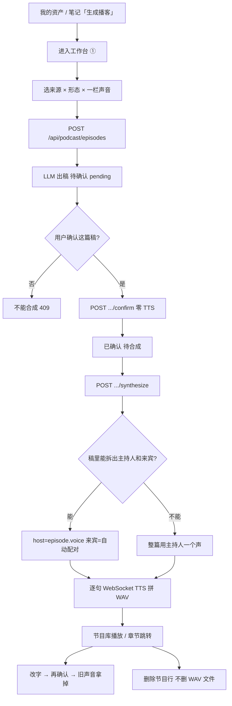
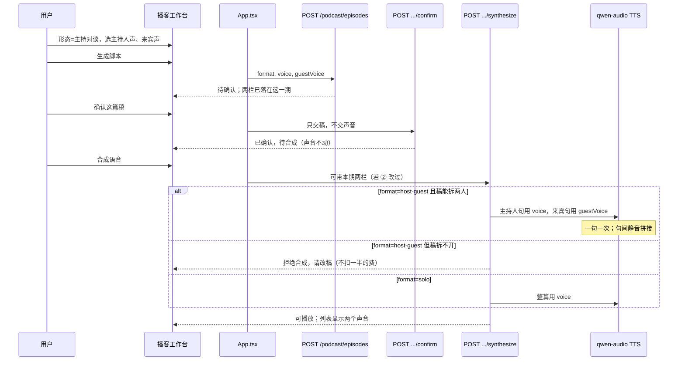

# 播客主持对谈：两个人的声音都由你来选

| 字段 | 值 |
|------|-----|
| **文档标题** | 播客双人声音自选 + 整条制作闭环审查 |
| **作者** | Grok Design |
| **日期** | 2026-08-22 |
| **状态** | Draft |
| **仓库** | `/home/admin/projects/zhuanfang` |
| **验收环境** | 已部署 demo `https://zhuanfang.qing.blue` |
| **git tip 对照** | `7dacb3b`（主持对谈自动配对聆心/谦；工作台仍只有一个「声音配置」） |
| **本文性质** | 产品闭环审查 + 最优改造。上一拍是捷径（自动配对），本拍把「两个声音自己选」做成第一等能力，并走完整条播客业务。评测脚本绿了不算完；模拟评测不能替真人宣布「这期播客有价值」。 |

---

## 给产品负责人的人话

打开播客工作台（从「我的资产」档案卡点「生成播客」进去），你会看到三步：**① 选来源 → ② 确认脚本 → ③ 合成收听**。节目形态可以选「单人旁白」或「主持对谈（两个声音）」。

**现在实际怎样：**

- 声音只有一栏，写着「声音配置」。选主持对谈时，页面会告诉你：系统会用龙安聆心和龙安谦轮流说，你选的那个当主持人，另一个当来宾。**来宾那个人你选不了。**
- 上一拍代码就是这么做的：检测到稿子里有「主持人：」「来宾：」，就自动配上另一条声音。这是捷径，不是你要的「两个声音自己选」。
- 声音名单里还摆着龙安欢、龙安洋。现网上这两条 **出不了声**（会报引擎错误），系统会悄悄换成聆心和谦。你以为选了欢，听到的是聆心。
- 口播稿确认已经能单独点了：可以只确认、不合成。这点保持，不要退回去。
- 默认生成脚本 **不会** 自动出声扣费。这也保持。

**做成之后，你打开工作台会看到：**

1. 选「单人旁白」：还是一栏声音，只出这一个声。
2. 选「主持对谈」：出现 **两栏**——「主持人声音」「来宾声音」。两栏都是你选的。默认会给你两个 **不同** 的、现在真能出声的人（聆心 + 谦）。你仍可以把两栏选成同一个人，页面会提醒「听起来会像一个人在对答」，但不会偷偷改掉。
3. 欢、洋 **不再当成能出声的选项** 摆在播客里。专访现场用的声音名单不动。
4. 点「生成脚本」→「确认这篇稿」→「合成语音」。听的时候是两个人轮流说。刷新后再点这一期，两栏声音还在，不会丢成「系统自己配的」。
5. 主持对谈按 **每人一句** 出声，费用大约是两个人轮流说的字数，不是一份钱。没点合成就不会扣。

**怎样算做完：** 真人在 `https://zhuanfang.qing.blue` 走完这一圈——选主持对谈，自己挑两个不同的声音，生成、只确认、再合成，能听出两个人；刷新后两栏还是你选的那两个。旧的一期如果从来没记过来宾声音，听的时候仍按今天的自动配对，不把旧节目弄坏。

**这一轮明确不做：** 不把生成改成自动出声；不拿掉「确认这篇稿」；不把专访现场的声音名单改掉；不为验收再起一套库；不让评测脚本替你宣布这期播客有没有价值。

---

## Overview

播客「主持对谈」的产品承诺是 **两个人、两个声音、都由用户指定**。域层和脚本 LLM 已经按双人写：`format: "host-guest"`，嘱咐用「主持人：」「来宾：」交替行（`podcast-script-llm.ts` L18）。合成路径在 `7dacb3b` 已经会按句拆开、轮流调用 TTS 再拼成一条 WAV。

缺口在 **声音是谁的**：`PodcastEpisode` 只有 `voice: string`（`src/domain/types.ts` L1217）；工作台只有一个 `podcastVoice`（`App.tsx` L285）和一个「声音配置」输入（`PodcastStudioView.tsx` L196–217）；`renderEpisodeAudio` 用 `pairQwenAudioTtsVoice(host)` 自动配来宾（`podcast.ts` L61–78）。用户不能选来宾。同时，token-plan 上 `longanhuan` / `longanyang` 会 411，`resolveQwenAudioTtsVoice` 静默改映射（`voice-presets.ts` L41–54）。上一拍把「听得出两个人」做成了，但把「选谁」做成了系统决定。

本方案做三件事，并且必须走完整条制作闭环（进工房 → 出稿 → 确认 → 选声 → 合成 → 收听 → 再编 → 删除 → 刷新），不是再打一针自动配对：

1. **主持对谈两个声音都是第一等字段**：生成时写入 `voice` + `guestVoice`；合成用库存的两栏；缺 `guestVoice` 的旧节目才回落到今天的自动配对。
2. **声音目录诚实**：播客只提供现网真能出声的人；专访名单不跟着改。
3. **费用与格式对齐**：双人按句计费，必须用户点合成才发生；`format=host-guest` 但稿子分不出两人 → 拒绝合成，不假装单人过关。

确认口播稿、CAS 写路径、默认生成不出声，全部保持已上线契约。

---

## Background & Motivation

### 打开书，这一章的责任

这一期若是主持对谈，打开书应该听到 **两个人在说话，而且是用户点名的那两个人**。世界收的账是 **按句出声的语音费**。上一拍留下的是「系统替你配了聆心和谦」；这一拍必须把选择权交回去，并且不把旧节目、专访现场、确认按钮弄坏。

### 上一拍为什么不够

`7dacb3b` 做了两件事：进度条跟着当前这一期走；主持对谈按句用两个声音。帮助文案写的是：

> 主持对谈会用龙安聆心和龙安谦两个人声轮流说。你选的是主持人；另一个当来宾。

这正好是用户否定的方案 B。用户原话：「两个声音模式的声音为什么不能自己选?现在声音配置还是一个。」以及「整个业务我说过要进行彻底业务闭环和完善性以及爆炸半径进行审查,制定最优的改造方案,你没有做啊」。本文补的是那次没做的审查，不是再补一个配对函数。

### 整条闭环 As-Is（对照源码，2026-08-22）



下面按产品步骤走。每一步写 **现在怎样 / 缺口 / 本方案动不动**。

#### 1. 进入工作台

| 事实 | 代码 |
|------|------|
| 顶栏没有「播客」。从「我的资产」档案卡或笔记页点「生成播客」 | `MyAssetsView.tsx` L245–251；`NotesView.tsx` L357–358；`navigation.spec.ts` L256–261 |
| 点击 **只预选这条笔记并切到工作台，不自动生成** | `App.tsx` L2098–2102、L2213–2217：`setPodcastNoteId` + `sourceType="note"` + `setView("podcast")` |
| 来源类型：笔记 / 搜索简报 / 长期主题 / 知识债 | `PodcastStudioView.tsx` L42–47、L80–91 |
| 默认形态是 **单人旁白**，写死在 React state，**不读** `systemConfig.voice.podcastFormat` | `App.tsx` L288 vs `seed.ts` L211 / `types.ts` L42 |
| 声音初始值来自 `systemConfig.voice.podcastVoice`（默认 `longanlingxin`） | `App.tsx` L285；`seed.ts` L210 |

缺口：入口只带笔记，简报/主题/债要进工作台后再改来源——可接受，不是本轮主缺口。形态默认单人保持（产品未要求改默认）。**真正的缺口是进了工房仍只有一栏声音。**

#### 2. 生成脚本

| 事实 | 代码 |
|------|------|
| `POST /api/podcast/episodes`，body：`sourceType/sourceId/format/voice`，**没有 guestVoice** | `productApi.types.ts` L487–496；`podcast.ts` L29–35、L137–148 |
| LLM 嘱咐：主持对谈用「主持人：」「来宾：」交替行 | `podcast-script-llm.ts` L12–19、L50–51 |
| 四条域生成函数都只收 `{ format, voice }` | `podcast.ts` L36、L139、L251、L370 |
| 生成后 `scriptReviewStatus="待确认"`，`audioRenderStatus="pending"`，文案「脚本待确认，确认后才会渲染音频。」 | `podcast.ts` L67–90 等同构 |
| 默认 **不** 自动 TTS | `podcast.ts` L216–217；`shouldAutoRenderPodcastOnCreate` 仅 `true\|1\|yes\|on` |
| 写路径已是 LLM 锁外 + `runStateCommand` CAS 追加本条 | `podcast.ts` L165–210；`write-gate.ts` L193–197 |

缺口：生成只存一个 `voice`。主持对谈的来宾在这一步就已经丢了。

#### 3. 确认口播稿（已上线，本轮不得退）

| 事实 | 代码 |
|------|------|
| `POST /api/podcast/episodes/:id/confirm`，零 TTS | `podcast.ts` L264–308 |
| 改字再确认：音频打回 pending，URL 换成不可播占位 | `confirmPodcastScript` `podcast.ts` L566–575 |
| 未确认合成 → 409（旗默认开） | `podcast.ts` L316–323、L582–586 |
| 「确认这篇稿」/「确认并合成」按钮矩阵 | `PodcastStudioView.tsx` L471–537 |
| 脏编辑器不能合成 | `App.tsx` L1282–1286；列表「重新合成」在脏时 disabled（L392） |

本轮 **不改确认语义**。声音不是稿，换声音不必再确认正文。换声音后若已经出过声，旧 WAV 作废，要听须重新合成。

#### 4. 选声音（本轮主缺口）

| 事实 | 代码 |
|------|------|
| 工作台一栏自由文本 + datalist，「声音配置」 | `PodcastStudioView.tsx` L196–217 |
| App 只有 `podcastVoice`，没有 guest | `App.tsx` L285、L2069 |
| 「保存为默认声音」只写 `systemConfig.voice.podcastVoice` | `App.tsx` L1448–1458 |
| 系统配置里「播客默认声音」与「默认访谈声音」共用 `voices` 列表 | `ConfigView.tsx` L514–551 |
| `voices` 声明了 `listVoices`，**App 从未在挂载时拉取**；`setVoicesLoading` 只声明、从不置位 | `App.tsx` L277–278 vs `productApi.client.ts` L859–860 |
| 播客名单与专访预置共用 `COSYVOICE_PRESET_VOICES`（聆心/谦/洋/欢） | `voice-presets.ts` L5–10；`GET /api/realtime-voice/voices` `realtime-voice.ts` L151–162 |
| token-plan 实测（2026-08-22）：`longanlingxin`、`longanqian` 能说；`longanhuan`、`longanyang` 411 | `resolveQwenAudioTtsVoice` 静默映射欢→聆心、洋→谦（`voice-presets.ts` L41–50） |
| 主持对谈来宾 = `pairQwenAudioTtsVoice(host)`：host 是谦则来宾聆心，否则来宾谦 | `voice-presets.ts` L52–54；`podcast.ts` L61–62 |
| 合成成功后 **把 `episode.voice` 改写成解析后的 host** | `podcast.ts` L102–107：`voice: hostVoice`。用户选欢，落库变成聆心 |

缺口：不能选来宾；目录不诚实；合成还会改写用户选的那一栏。

#### 5. 合成

| 事实 | 代码 |
|------|------|
| 必须已确认；TTS 在锁外；终写 CAS | `podcast.ts` L310–337、L404–453 |
| 拆句：`parsePodcastDialogue` 认「主持人/主持/来宾/嘉宾/被访者/Host/Guest」 | `podcast.ts` L481–513 |
| **是否双声只看稿子能否拆出两种角色，不看 `episode.format`** | `podcast.ts` L64–67 |
| 双声：逐句 `audioClient.synthesize`，句间 0.28s 静音，PCM 拼接成 WAV | `podcast.ts` L69–97 |
| 单声：整篇当 host 一次合成（内部仍可能按 1500 字切段） | `bailian-tts-inference.ts` `splitPodcastScript` L53–70 |
| 时长按 PCM 重算；章节按比例缩放 | `podcast.ts` L97、L108；`scalePodcastChapters` L515–527 |
| 音频落 `.data/podcast-audio/{id}.wav`，`GET /api/podcast/episodes/:id/audio` | `podcast-audio-store.ts`；`podcast.ts` L246–262 |
| 模型：`qwen-audio-3.0-tts-plus`（不是 CosyVoice HTTP） | `bailian/_impl.ts` L27–28、L799–811 |

缺口：

- `format=solo` 但稿里碰巧有「主持人：」「来宾：」→ **会按双声自动配对**（产品没答应）。
- `format=host-guest` 但 LLM 没按标签写 → **整篇一个声**（产品答应了两个人，静默食言）。
- 来宾声音不落库，刷新后无法还原用户选择（因为用户根本选不了）。
- 双人 = **一句一次** TTS。八轮对答 ≈ 八次账单。今日帮助文案没把账讲清楚。

#### 6. 收听 / 章节跳转

| 事实 | 代码 |
|------|------|
| 播放器条件：`audioRenderStatus==="rendered"` 且 URL 可播 | `PodcastStudioView.tsx` L540–543、L624–626 |
| 章节按钮 `seekEpisodeAudio` | L577–584 |
| 列表时长 pill 用 `episode.durationSec` | L351–353 |
| 合成后 `durationSec` 来自真实 PCM，章节按旧估计缩放到新时长 | `podcast.ts` L97–108 |

合成成功后 pill 与文件时长应对齐。合成前 pill 是 `max(180, script.length * 0.8)` 的估计（`podcast.ts` L68、L181），旁边没有播放器——可接受。改稿再确认会把 `durationSec` 打回估计，直到再合成。本轮不把「估计时长」当主缺口。

#### 7. 再编辑 / 再确认 / 再合成

已闭环：改字 → 确认（旧声拿掉）→ 再合成。本轮要补的是：**换声音不改稿、不必再确认，但已出的声要作废**，与改稿清音频同构。

#### 8. 删除

| 事实 | 代码 |
|------|------|
| `DELETE /api/podcast/episodes/:id` CAS 删节目行 | `podcast.ts` L381–401；`lifecycle.ts` L22–26 |
| **不删除** `.data/podcast-audio/{id}.wav` | `podcast-audio-store.ts` 只有 read/write，无 unlink |

完善性：孤儿 WAV。爆炸半径小，单独一 PR，不和双声选择混在一起。

#### 9. 刷新 / 再进工作台

| 事实 | 代码 |
|------|------|
| 进入播客页且没有当前期时，自动展开最近一条「待确认」 | `App.tsx` L426–439 |
| 形态/声音 pickers 是 **会话级 React state**，刷新后形态回到 solo，声音回到系统默认 | `App.tsx` L285–288 |
| 节目行上的 `format`/`voice` 在库存里 | 列表 pill：`formatLabel[episode.format] · episode.voice`（`PodcastStudioView.tsx` L348–350） |

本轮：节目自己的两栏声音必须在库存里，刷新后点这一期仍能看见。工作台 ① 的 pickers 继续表示「下一期生成用什么」；打开某一期时，② 面板展示并允许改 **这一期** 的两栏。

#### 10. 列表 / 编辑器 / 播放器一致

确认拍已修好：pending + 残留 https 不再画出播放器；「已确认，待合成」与「待确认脚本」分开。仍不一致的是列表只显示一个 `voice`，主持对谈看不出来宾。

#### 11. 写路径 / 锁

生成 / 确认 / 合成 / 删除均已 `runStateCommand` + 精确豁免（`write-gate.ts` L183–201）。本轮 **禁止** 退回 t0 整包，禁止在 CAS 内再调 `generatePodcastEpisode*`，禁止新开全局锁。双声字段只作为本条 episode 的附加字段走进现有 CAS。

#### 12. 费用

`COST-ENVELOPE.md` §3.5：脚本 LLM 走 `system` 桶 1 次；TTS 一般不走 LLM 预算，按字符/请求计供应商。确认零 TTS。双人今日已按句请求，但产品没让用户点头「我知道这是两个人的账」。本轮：选主持对谈 + 点合成 = 用户 opt-in；帮助文案写清「按每人一句出声」。

#### 13. 声音目录诚实

| 用途 | 名单 | 现网能否出声 |
|------|------|----------------|
| 播客 TTS（qwen-audio-3.0-tts-plus） | 代码预置 4 个；实际能说 2 个 | 聆心、谦能说；欢、洋 411 |
| 专访 Realtime | `BAILIAN_REALTIME_VOICE` 另有灵犀/小新/陆风等 | **不要**用播客的 411 映射去改这条 |
| 级联/旧 CosyVoice HTTP | 与 qwen-audio 不是同一条引擎 | `realtime-voice-helpers.ts` L274–288 仍按 CosyVoice 口径 |

`COSYVOICE_PRESET_VOICES` 被播客工作台、系统配置「播客默认音色」、专访 `GET /api/realtime-voice/voices` 的 fallback **共用**。本轮 **禁止** 从这份预置里删欢/洋来「修播客」——那会让专访测试（`realtime-voice.test.ts` L1919–1925 断言含 `longanyang`/`longanhuan`）和现场选声一起坏。播客必须有 **自己的能说名单**。

### 应对齐 / 不要混

| 业务 | 动什么 | 本轮 |
|------|--------|------|
| 播客口播稿确认 | `scriptReviewStatus` | **不动契约** |
| 播客双人声音 | `voice` + 新增 `guestVoice` | **本方案** |
| 专访现场声音 | `GET /api/realtime-voice/voices`、Realtime voice | **禁止改名单语义** |
| 决策确认 / 记忆候选 | 另一条产品 | 不碰 |
| 模拟评测价值线 | `scripts/eval` | 不宣布播客价值 |

---

## Goals & Non-Goals

### Goals

1. 主持对谈：**两栏声音都由用户选**，并写进这一期节目。单人旁白仍一栏。
2. 生成、确认、合成、刷新、再进工作台：两栏选择还在。旧节目没有来宾栏时，合成仍用今天的自动配对，听感不回退。
3. 播客只提供现网真能出声的人（聆心、谦）。欢、洋不当成可选项。合成层保留 411 兜底映射，但 **不得** 把用户看见的选择改写成映射结果（禁止再写 `voice: hostVoice` 覆盖原值，除非原值非法占位）。
4. 双声是否发生看 **`format === "host-guest"` 且稿能拆出两种角色**。solo 即使稿里有标签也不自动配对。host-guest 拆不出两人 → 合成拒绝，提示改稿，不装成单人成功。
5. 换声音不要求再确认正文；若已经出过声，换声音后旧音频拿掉（与改稿清音频同构）。
6. 费用：主持对谈按句出声；帮助文案讲清。默认生成仍不出声。确认仍零 TTS。
7. 写路径继续本条 CAS。验收只打已部署 demo。

### Non-Goals

- 不把默认生成改成自动 TTS。
- 不拿掉「确认这篇稿」，不把确认绑回合成。
- 不把 `voice` 重命名成 `hostVoice`（旧节目只有 `voice`）。
- 不把欢/洋从专访预置名单里删掉。
- 不做逐行指定声音（方案 D）。
- 不做「女主持+男来宾」套装代替两栏（方案 C 可当快捷，不当唯一入口）。
- 不把 `systemConfig.podcastFormat` 接到工作台默认（默认仍单人；形态是当期选择）。
- 不在本轮修孤儿 WAV（记入后续 PR，不和选声混提）。
- 不清主人仓；密钥不进 git；不为验收再起 Surreal。
- 不冻结专访工程给打分器；不把播客价值写进评测通过线。

---

## Proposed Design

### 目标链路（To-Be）



### 1. 域：来宾声音是可选附加字段

`PodcastEpisode` **加** `guestVoice?: string`，保留 `voice` 当主持人/单人声。

```ts
export interface PodcastEpisode {
  // ...
  format: "solo" | "host-guest";
  voice: string;          // 单人=唯一声；对谈=主持人。旧节目只有这一栏。
  guestVoice?: string;    // 对谈=来宾。缺省=合成时自动配对（回滚口径）。
  // ...
}
```

`SystemConfig.voice` **加** `podcastGuestVoice?: string`，仅作「下一期主持对谈」的默认来宾。`podcastVoice` 语义不变。

四条 `generatePodcastEpisode*` 的 options 扩成：

```ts
{ format: PodcastEpisode["format"]; voice: string; guestVoice?: string }
```

生成时：`format==="host-guest"` 则写入 `guestVoice`（有则用用户值，无则 **先不算进库存**——让合成回落配对；UI 主路径生成时必带）。solo 不写 `guestVoice`。

`confirmPodcastScript` **不读不写** 声音。声音不是稿。

新纯函数（域层，供合成前/UI 共用口径）：

```ts
export function resolveEpisodeVoices(episode: PodcastEpisode): {
  host: string;
  guest: string;
  dual: boolean;
  guestFromFallback: boolean;
}
```

规则：

1. host = 用户写的 `voice`（非法占位仍走 `normalizeCosyVoiceId`）。
2. `format !== "host-guest"` → `dual=false`，guest 忽略。
3. `format === "host-guest"` 且 `guestVoice` 有值 → guest 用它，`guestFromFallback=false`。
4. `format === "host-guest"` 且 `guestVoice` 缺省 → guest = `pairQwenAudioTtsVoice(host)`，`guestFromFallback=true`（**旧节目回滚**）。
5. 两栏可以相同；函数不改成配对。

合成是否双声 **另外** 看 `parsePodcastDialogue`：

```
wantDual = episode.format === "host-guest"
parsedDual = 同时有 host 句和 guest 句
```

| wantDual | parsedDual | 行为 |
|----------|------------|------|
| false | * | 整篇 host。即使稿里有标签也不配对。 |
| true | true | 按句双声。 |
| true | false | **拒绝合成**（handler 409，不调 TTS）。文案：「这篇对谈稿没有把主持人和来宾分开写。先改稿再合成。」 |

这是产品承诺，不是词表检查：打开书应该是两个人在对答；稿里没分开，就不该发出「好像成功了」的一个声。

### 2. 声音目录：播客一份，专访一份

在 `voice-presets.ts` **新增**，不要改 `COSYVOICE_PRESET_VOICES` 的成员：

```ts
/** 现网 qwen-audio-3.0-tts-plus 能出声的系统音色。播客工作台只用这份。 */
export const QWEN_AUDIO_SPEAKING_VOICES = [
  { voice: "longanlingxin", name: "龙安聆心·温暖共情" },
  { voice: "longanqian", name: "龙安谦" }
] as const;

export function isQwenAudioSpeakingVoice(id: string): boolean { /* ... */ }
```

`resolveQwenAudioTtsVoice` 保留（旧库存欢/洋、非法占位）。**合成调用 TTS 时**用它；**写回 episode.voice / guestVoice 时不用它覆盖用户选择**。列表/② 面板展示用户选的 id。

工作台与「播客默认声音」下拉：**只渲染 `QWEN_AUDIO_SPEAKING_VOICES`**。不要再拿 `GET /api/realtime-voice/voices` 的 preset（含欢/洋 + 复刻）当播客选项。复刻音色未在 qwen-audio TTS 上验证，本轮不提供。

`App.tsx` 今日根本不在挂载时 `listVoices()`。本轮 **不要** 为了播客去修专访拉名单的旧洞（那是另一条产品）。播客两栏用静态能说名单即可，不依赖 `voices` state。

系统配置：

- 「默认访谈声音」继续用专访名单（现状，含拉取洞则另案）。
- 「播客默认声音」改成能说名单的 select；主持对谈可多一个「播客默认来宾声音」（`podcastGuestVoice`）。本项可放在 UI PR，不阻塞 API。

运行配置 `BAILIAN_TTS_VOICE`（`system.ts` L249–255）今日 options 来自整份 `COSYVOICE_PRESET_VOICES`。那是 **运维 env 下拉**，会进专访级联默认。本轮 **不要改这个 options 列表**（避免专访默认声被拿掉）。播客工作台不读这个 env 下拉，读节目字段。

### 3. 合成：用库存两栏；缺省才配对

`renderEpisodeAudio` 改成：

```ts
const { host, guest } = resolveEpisodeVoices(episode);
const dialogue = parsePodcastDialogue(episode.script);
const wantDual = episode.format === "host-guest";
const parsedDual =
  dialogue.some((i) => i.role === "host") &&
  dialogue.some((i) => i.role === "guest");

if (wantDual && !parsedDual) {
  return {
    audioRenderStatus: "failed",
    audioRenderMessage: "这篇对谈稿没有把主持人和来宾分开写。先改稿再合成。"
  };
}

const turns = wantDual && parsedDual
  ? dialogue
  : [{ role: "host" as const, text: episode.script }];
// 每句：guest → resolveQwenAudioTtsVoice(guest)，否则 host
// patch 不得用映射后的 id 覆盖 episode.voice / guestVoice
```

Handler：`wantDual && !parsedDual` 在调用 TTS **之前** 409，避免先扣一半再 failed。域函数返回 failed 是防御第二道（AUTO_RENDER 路径没有 409 门）。

`commitSynthesizePatch` 已按 latest CAS 合并音频字段。本轮合并时允许带上 `voice`/`guestVoice`（若 body 更新了本期两栏）。**不要**再写 `scriptReviewStatus`。

合成请求 body 扩：

```ts
{ script?: string; voice?: string; guestVoice?: string }
```

旗 true（默认）：`script` 仍不得顺便确认（与库存不一致 → 409）。`voice`/`guestVoice` **可以**在已确认前提下更新本期声音并用于这一次 TTS。这样 ② 改声音不必再确认正文。

旗 false（完整旧合成路径）：保持今天「script 可写稿+确认」；新增的 guestVoice 仍尽量写入，以免回滚窗口丢掉双栏。

### 4. 生成：把两栏写进新节目

`normalizePayload` 增 `guestVoice?: unknown`。

```
voice = normalizeCosyVoiceId(payload.voice || systemConfig.voice.podcastVoice)
guestVoice = payload.guestVoice 有值则 normalize；否则 undefined
```

不要在服务端替用户填配对结果再落库——否则「用户没选」和「用户选了配对那一个」分不清。UI 主路径生成时 **必带** 两栏。服务端缺省 = 旧客户端/回滚。

`buildEpisodeSkeleton` 把 `guestVoice` 传进四条生成函数。

### 5. 换声音清音频

与改稿同构，但 **不经过 confirm**：

- ② 面板改了本期声音且库存已是 `rendered`/`failed`：点「合成语音」即按新声音重做（今日「重新合成」已存在）。
- 若只改声音、还没点合成：不必清。
- 若产品要「改了声音立刻拿掉旧播放器」：在合成请求发出前，前端可本地藏播放器；权威清场仍以合成 CAS 覆盖 WAV（`writePodcastAudio` 同 id 覆盖）为准。
- **不要**为换声音新开 confirm。也不要在 confirm 里顺手写声音（确认零 TTS、只动稿，契约不能脏）。

可选小接口 `POST .../voices` 本轮不做。合成 body 带两栏足够闭环。

### 6. 界面

① 选来源：

| 形态 | 控件 |
|------|------|
| 单人旁白 | 一栏「声音」，select，选项=能说名单 |
| 主持对谈 | 「主持人声音」「来宾声音」两个 select；默认两个不同的能说 id（当前 `podcastVoice` + `podcastGuestVoice`，若相同则来宾自动改成另一个能说 id **仅作 UI 预填**，用户仍可改回相同） |

帮助文案（人话）：

- 单人：「只出这一个声音。」
- 对谈：「两个人各用各的声音。合成会按稿里每一句分别出声，费用按两个人说的字算。」
- 两栏相同：「两个人用同一个声音，听起来会像一个人在对答。你仍可以这样选。」

去掉自由文本 CosyVoice id。去掉「系统会给你配另一个」。

② 面板标题行：`形态 · 主持人 voice · 来宾 guestVoice`（solo 只显示一栏）。② 内再放与 ① 同结构的两栏，绑定 **当期节目**（改这里不改「下一期默认」）。脏稿判定仍只比 script 字符串。

节目库 pill：`主持对谈 · 聆心 / 谦`，不再只印一个 id。

「保存为默认声音」：solo 存 `podcastVoice`；host-guest 存两栏。仍走今日本地 `systemConfig` + autosave，不新开路由。

进度条 ①②③ 已跟当期，保持。

### 7. 存储 / Surreal

`podcast_episode` 是 SCHEMAFULL：核心列 + `rest` FLEXIBLE（`007_r1a_entities.surql` L56–66）。`node-mapper.ts` L54 核心列含 `voice`，不含 guest。

**本轮 `guestVoice` 进 rest，不加列、不迁表。** persist 会把非核心字段放进 rest，load 再摊回对象。`storage.ts` clamp 加：

```ts
voice: str(p.voice),
guestVoice: optStr(p.guestVoice),
```

缺省保持 undefined。坏类型丢掉，不冒充能说 id。

若以后要按来宾声查询再升核心列（5 步清单见 node-mapper 文件头）。本轮查询需求为零。

`systemConfig` 是单例路径，`podcastGuestVoice` 进现有 voice 对象即可。`normalizeVoiceConfig` 对缺省不填；非法占位与 `podcastVoice` 同一黑名单纠正。

### 8. 回滚口径（必须显式）

| 层 | 回滚后怎样 |
|----|------------|
| 旧节目没有 `guestVoice` | `pairQwenAudioTtsVoice(host)`，与 `7dacb3b` 听感一致 |
| 新 UI 未上、旧客户端仍只发 `voice` | 同上，服务端不 422 |
| 关掉新 UI、数据已有 `guestVoice` | 合成继续用库存来宾；旧 UI 只显示一栏但不丢字段 |
| 禁止 | 清空 demo 节目库；force-push；从专访预置删欢/洋 |

---

## API / Interface Changes

### 生成

```
POST /api/podcast/episodes
Body: {
  noteId?: string,
  sourceType?: "note"|"search-brief"|"theme"|"knowledge-debt",
  sourceId?: string,
  format: "solo"|"host-guest",
  voice: string,
  guestVoice?: string
}
```

`guestVoice` 可选。solo 忽略。host-guest 缺省 = 不落来宾栏（合成回落配对）。

### 确认

**不变。** Body 仍只有 `{ script?: string }`。禁止顺手写声音。

### 合成

```
POST /api/podcast/episodes/:id/synthesize
Body: { script?: string, voice?: string, guestVoice?: string }
```

旗 true：

- 未确认 → 409，TTS=0。
- script 与库存不一致 → 409。
- `format=host-guest` 且稿拆不出两人 → **409**，TTS=0，稿与声音不改（若 body 带了新声音也先不写——拆不开就不要先改声再失败；实现取：先校验稿，再合并声音，再 TTS）。
- 已确认且稿可合：body 的 voice/guestVoice 若出现则写入本期再 TTS。
- 成功 patch **不覆盖** 用户选择的 id 为 411 映射值。

### 客户端

```ts
generatePodcastEpisode(input: GeneratePodcastEpisodeRequest & { guestVoice?: string })
synthesizePodcastEpisode(episodeId, script?, voices?: { voice?: string; guestVoice?: string })
```

实现上合成 body 合并可选字段即可，不必新方法。

### 视图 props

```ts
voice: string;
guestVoice: string;
onVoice: (value: string) => void;
onGuestVoice: (value: string) => void;
```

`empty-state-render.test.tsx` / `PodcastStudioView.test.tsx` 必须补 `guestVoice` / `onGuestVoice`，否则空态编译失败。

---

## Data Model Changes

| 层 | 变化 |
|----|------|
| TypeScript `PodcastEpisode` | 加 `guestVoice?: string` |
| TypeScript `SystemConfig.voice` | 加 `podcastGuestVoice?: string` |
| `storage.ts` clamp | `guestVoice: optStr`；config 非法占位纠正 |
| Surreal `007_r1a` | **不迁表**；字段进 `rest` |
| `node-mapper` 核心列 | **不改**（改了就要走 5 步 + 测试夹具） |
| 备份/导出 | 整份 ProductState 已含节目；无新密钥字段 |
| 音频文件 | 同 id 覆盖 WAV；删除节目仍暂留孤儿文件（Non-goal） |

旧行只有 `voice`：load 后 `guestVoice===undefined`，合成走配对。无需数据迁移作业。

---

## Alternatives Considered

### 方案 A — 主持对谈两栏自选，两栏都落在节目上（采用）

- **做法：** format=host-guest 显示「主持人声音 / 来宾声音」；`guestVoice` 可选字段；缺省回落自动配对。
- **优点：** 对上用户原话；旧节目不坏；确认契约不动；专访名单不动。
- **代价：** 类型/API/UI/测试都要跟；双人费用按句，必须讲清楚。
- **结论：** 采用。

### 方案 B — 一栏 + 自动配对（现状，用户已否定）

- **做法：** `7dacb3b`。
- **优点：** diff 小，听得出两个人。
- **缺点：** 来宾不能选；刷新还原不出「用户的选择」（因为没有）；帮助文案还在教系统决定。
- **结论：** 否。

### 方案 C — 声音套装（「女主持+男来宾」）代替两栏

- **做法：** 预置几对，用户选套装。
- **优点：** 一栏就能保证两个不同的能说 id。
- **缺点：** 用户要的是自己选；套装锁死组合；以后加能说音色还要维护笛卡尔积。
- **结论：** 不当唯一入口。若以后要快捷，只能是两栏之上的预填，不能取代两栏。

### 方案 D — 编辑器里逐行指定声音

- **做法：** 每句一个 voice id。
- **优点：** 极端灵活。
- **缺点：** 口播稿确认会变成声线编辑器；和「先确认这些字再出声」抢责任；爆炸半径到解析器、脏稿、费用预估。
- **结论：** 过重。稿继续用「主持人：」「来宾：」分角色；角色映射到两栏系统声。

### 方案 E — 把 `voice` 重命名为 `hostVoice`

- **优点：** 名字对称。
- **缺点：** 旧节目、备份、测试夹具、Surreal rest 摊回都要兼容别名。收益纯美观。
- **结论：** 否。`voice` 保持主持人/单人；来宾用附加字段。

---

## Security & Privacy Considerations

| 威胁 | 缓解 |
|------|------|
| 未登录改别人节目的声音 | 与现网播客写接口同一套会话鉴权 + 用户作用域 ProductState |
| 用合成 body 改稿绕过确认 | 旗 true 时 script 不一致仍 409；声音字段不写 `scriptReviewStatus` |
| 用确认接口改声音/决策/记忆 | confirm 继续只动稿；单测钉死其它集合引用不变 |
| 超大 script | 已有 32_000 上限，不动 |
| 未读稿扣 TTS | 服务端 409 门保持 |
| 未选来宾却按双人扣 N 次 TTS | host-guest 是用户显式形态；合成是显式点击；拆不开两人则 409 且 TTS=0 |
| 把专访复刻音色送进 qwen-audio 导致 411 重试环 | 播客下拉只用能说名单；禁止把 enrollment 自定义声塞进播客选项 |
| 密钥进 git / 进导出 | 声音字段是公开系统 id；备份检查保持 |
| 删除节目后 WAV 仍在磁盘 | 本轮记风险，不在双声 PR 里顺手 rm；路径仍受 `SAFE_ID` 约束 |

---

## Observability

沿用 JSON line `event` / `capability`：

| 事件 | 何时 |
|------|------|
| 已有 `tts_failed` `capability: podcast_tts` | 合成失败 |
| 新增 `podcast_tts_dual` | 双声合成开始：`turns`、`host`、`guest`、`guestFromFallback` |
| 新增 `podcast_tts_rejected_undual` | host-guest 稿拆不开，409 |
| 已有 `podcast_script_confirmed` | 确认；不应出现声音字段 |

指标（从日志抽，不新系统）：

- 双声合成 200 次数 vs 单声 200
- `guestFromFallback=true` 的比例（高=旧节目或旧客户端；新 UI 主路径应接近 0）
- 合成 409 `undual`（非零=LLM 没按「主持人：」「来宾：」写，应回头看脚本嘱咐，而不是改成自动单声）

告警：不必为双声单独 Pager。411 若再次出现在能说名单上，才是目录诚实回归。

---

## Rollout Plan

验收定义 = **demo 热更成功 + 真人冒烟绿**。不在 Grok 运行机 `npm ci` / Playwright / 本机 Surreal。不因 GHA 红阻塞。部署走 `./scripts/deploy_demo.sh`。

### 阶段

1. **PR-1 域与 API 契约（对旧 UI 无感）：** `guestVoice` 可选；缺省合成=今日配对。旧工作台一栏仍能听出两个人。
2. **PR-2 合成认 format + 拆不开则 409：** 行为收紧，须与脚本 LLM 现状兼容（嘱咐已要求标签）。准备回滚：若 demo 上大量旧 host-guest 稿没有标签，可临时把 409 改回「整篇 host」——但那是食言，默认不要开这个后门。
3. **PR-3 工作台两栏 + 诚实名单：** 用户能选。与 PR-2 同一热更窗口更稳（否则新 UI 选出的来宾，旧合成仍忽略）。
4. **PR-4 配置默认来宾 + 费用文案 + 测试/e2e 对齐：** 不改专访名单。

PR-2 与 PR-3 **不要**和无关重构混提。不要并行改 `podcast.ts` 终写骨架。

### Demo 冒烟（已部署栈，禁止另起库）

1. 登录 `https://zhuanfang.qing.blue`，我的资产 → 生成播客。
2. 形态保持单人，生成 → 确认 → 合成：一个声，行为与今日一致。
3. 新开一期，形态=主持对谈：必须看到两栏。选聆心 + 谦（或反过来），生成。② 和列表都能看见两个名字。
4. 只确认、不合成。刷新。再点这一期：两栏还在，状态仍已确认。
5. 合成。能听出两个人。时长 pill 与播放器大致同长。章节能跳。
6. 把两栏改成同一个能说 id，再合成：能出声，像一个人在对答；不要报错。
7. 把稿里的「来宾：」全删掉再确认再合成：应失败并提示改稿，**不能**变成单人成功。
8. 打开 `7dacb3b` 之前已经存在、没有来宾栏的旧主持对谈（若 demo 上有）：再合成仍能出两个声（自动配对），不要 500。
9. 进系统配置：访谈声音名单仍有洋/欢（专访侧）；播客默认声音只有能说的。
10. 生成过程中不要指望本机 Playwright；以浏览器真人点击为准。

### 回滚

- API：停发 `guestVoice` 即回到配对。不要删字段。
- UI：回退两栏后，旧客户端只发 `voice`。
- 已写入的 `guestVoice` 留着无害。
- 禁止 force-push；禁止清空 demo 节目库。

---

## Risks

| 严重度 | 风险 | 缓解 |
|--------|------|------|
| 高 | 从 `COSYVOICE_PRESET_VOICES` 删欢/洋，专访选声和单测一起坏 | 播客另建 `QWEN_AUDIO_SPEAKING_VOICES`；预置四项不动 |
| 高 | PR-2 拆不开则 409，但 demo 上已有 host-guest 稿没有标签 | 冒烟第 8 步；LLM 嘱咐已要求标签；409 文案指向改稿，不自动单声 |
| 中 | 合成 patch 继续 `voice: hostVoice` 把欢写成聆心，目录诚实白做 | 明确禁止用映射值覆盖库存 id；单测钉死 |
| 中 | 两栏相同被当成 bug 去 409 | 产品允许；仅 UI 提醒 |
| 中 | 双人按句 TTS，长稿超时/账单惊吓 | 帮助文案；确认仍零 TTS；默认生成不出声；超时沿用现有 90s/按字放大 |
| 中 | `empty-state-render` / 视图测漏新 prop 编译失败 | PR-3 必改这两处 |
| 中 | e2e `getByLabel("声音配置")` 失效 | PR-3 改 `corpus-podcast.spec.ts` / `navigation.spec.ts` |
| 中 | 改 `node-mapper` 核心列却不走 5 步，rest 丢字段 | 本轮不改核心列 |
| 低 | 孤儿 WAV | 后续小 PR |
| 低 | App 不拉取专访 `listVoices` | 另案；播客不依赖它 |
| 低 | `systemConfig.podcastFormat` 仍不驱动默认形态 | Non-goal；避免「保存默认声音」顺手改形态 |

---

## Open Questions

没有未决分叉会挡住开工。用户已经要「两个声音自己选」；同声两栏允许；拆不开的对谈稿拒绝合成；旧节目缺来宾栏走自动配对。自定义复刻音色进播客是 **以后** 的产品分叉，本轮明确不做。

---

## Key Decisions

1. **采用方案 A。** 主持对谈两栏自选；用户已否定一栏自动配对。
2. **附加 `guestVoice`，不重命名 `voice`。** 旧节目只有 `voice` 继续有效。
3. **缺 `guestVoice` = 今日 `pairQwenAudioTtsVoice`。** 这是回滚与旧数据口径，不是新 UI 的静默默认。新 UI 生成必带两栏。
4. **同声两栏允许，但不是默认。** 默认预填两个不同的能说 id。
5. **双声发生条件 = 形态是对谈 且 稿能拆出两人。** solo 不因稿内标签自动配对；对谈拆不开则 409，不装单人成功。
6. **播客能说名单与专访预置分开。** 禁止为修 411 去改 `COSYVOICE_PRESET_VOICES`。
7. **411 映射只用于送进 TTS 的那一跳，不写回用户选择。**
8. **确认继续只动稿。** 换声音走合成 body / 本期字段，不脏确认契约。
9. **默认生成仍不出声；确认仍零 TTS。** 双人费用在用户点合成时发生。
10. **`guestVoice` 进 rest，不迁 Surreal 表。**
11. **写路径继续本条 CAS。** 不回归 t0 整包。
12. **验收 = 已部署 demo 真人冒烟。** 模拟评测不宣布价值；本机不做重活。
13. **删除 WAV、专访 listVoices 未拉取、估计时长 pill，不塞进双声 PR。**

---

## References

- 上一拍确认设计（质量标准）：`docs/plans/2026-08-22-podcast-script-confirm.md`
- 捷径提交：`7dacb3b` `fix(podcast): highlight the current studio step and speak host-guest with two voices`
- 合成：`apps/api/src/routes/podcast.ts` `renderEpisodeAudio` L56–127
- 配对/映射：`apps/api/src/voice-presets.ts`
- 域类型：`src/domain/types.ts` `PodcastEpisode` L1209–1233
- 域生成/拆句/确认：`src/domain/podcast.ts`
- 脚本 LLM：`apps/api/src/intelligence/podcast-script-llm.ts`
- 工作台：`src/features/podcast/PodcastStudioView.tsx`
- 装配：`src/App.tsx` L285–288、L1190–1331、L2053–2080
- 客户端：`src/api/productApi.types.ts` L487–496；`productApi.client.ts` L795–838
- 归一化：`src/domain/storage.ts` L515–528、L917–942
- Schema / mapper：`packages/db/src/surreal/migrations/007_r1a_entities.surql` L56–66；`node-mapper.ts` L54
- 写锁：`apps/api/src/server/write-gate.ts` L183–201
- TTS：`apps/api/src/providers/bailian-tts-inference.ts`；`bailian/_impl.ts` L27–28、L782–818
- 音频存储：`apps/api/src/podcast-audio-store.ts`
- 专访名单：`apps/api/src/routes/realtime-voice.ts` L151–175
- 计费：`docs/COST-ENVELOPE.md` §3.5
- 测试：`apps/api/src/routes/podcast.test.ts`；`apps/api/src/voice-presets.test.ts`；`src/domain/podcast-confirm.test.ts`；`src/features/podcast/PodcastStudioView.test.tsx`；`tests/e2e/corpus-podcast.spec.ts`；`tests/e2e/navigation.spec.ts` L260–261

---

## PR Plan

每 PR 可独立审查、可合并。双声选择 **不** 与写锁重构、确认语义、专访名单、删除 WAV 混提。

### PR-1 — 来宾声音字段 + 合成回落配对（旧 UI 无感）

- **标题：** `feat(podcast): persist optional guestVoice with auto-pair fallback`
- **影响文件：**
  - `src/domain/types.ts`（`guestVoice?`；`podcastGuestVoice?`）
  - `src/domain/podcast.ts`（生成 options；`resolveEpisodeVoices`）
  - `src/domain/engine.ts`（re-export）
  - `src/domain/podcast-confirm.test.ts` 或 `podcast-voices.test.ts`
  - `src/domain/storage.ts`（`optStr(guestVoice)`；config 纠正）
  - `src/domain/storage.test.ts` / `seed.ts`（缺省不必填）
  - `apps/api/src/routes/podcast.ts`（payload、skeleton、`renderEpisodeAudio` 用库存 guest 或配对；**patch 不覆盖用户 voice id 为映射值**）
  - `apps/api/src/routes/podcast.test.ts`（host-guest 有 guestVoice 则 TTS 两次不同 voice；缺省则配对；solo 一次）
  - `apps/api/src/voice-presets.ts` / `voice-presets.test.ts`（可在此 PR 加 `QWEN_AUDIO_SPEAKING_VOICES`，但 **不改** `COSYVOICE_PRESET_VOICES`）
  - `src/api/productApi.types.ts` / `productApi.client.ts` / `productApi.test.ts`（生成 body 可带 `guestVoice`）
- **依赖：** 无
- **内容：** 字段加法。旧客户端不发 `guestVoice` 时听感=今日。禁止在本 PR 改工作台布局。禁止改确认 handler。禁止改 `write-gate.ts`。
- **验收：** API inject：solo 一声；host-guest 无 guestVoice 走配对；有 guestVoice 用用户值；两栏相同仍 200。demo 可热更，旧 UI 不坏。

### PR-2 — 对谈必须真的是两个人（合成认 format）

- **标题：** `fix(podcast): dual TTS only for host-guest scripts that split`
- **影响文件：**
  - `apps/api/src/routes/podcast.ts`（`wantDual && !parsedDual` → 409 且 TTS=0；AUTO_RENDER 路径用 failed 文案）
  - `apps/api/src/routes/podcast.test.ts`
  - `src/domain/podcast-confirm.test.ts`（parse 用例保持）
- **依赖：** PR-1（`resolveEpisodeVoices` / format 已在域层）
- **内容：** 关掉「solo 因稿内标签自动双声」和「host-guest 拆不开却单声成功」。不改 UI。不改确认。
- **验收：** solo + 带「主持人：来宾：」的稿 → 一次 TTS、voice=host。host-guest + 无标签稿 → 409、TTS=0。host-guest + 有标签 → 按句双声。

### PR-3 — 工作台两栏自选 + 诚实名单

- **标题：** `feat(podcast): let host-guest pick both voices`
- **影响文件：**
  - `src/features/podcast/PodcastStudioView.tsx`
  - `src/features/podcast/PodcastStudioView.test.tsx`
  - `src/features/empty-state-render.test.tsx`
  - `src/App.tsx`（`podcastGuestVoice` state；生成/合成带上两栏；打开当期时 ② 显示库存两栏）
  - `tests/e2e/corpus-podcast.spec.ts`（不再 `getByLabel("声音配置")` 一栏填完）
  - `tests/e2e/navigation.spec.ts` L260–261
- **依赖：** PR-1。建议与 PR-2 同一 demo 热更窗口。
- **内容：** format=host-guest 两栏 select（能说名单）。solo 一栏。列表/② 展示两个名字。同声允许 + 提醒。保存默认：对谈存两栏。禁止改 `GET /api/realtime-voice/voices`。禁止改 `COSYVOICE_PRESET_VOICES`。禁止动确认按钮矩阵语义。
- **验收：** demo 真人：选两个不同能说 id → 生成 → 只确认 → 刷新两栏还在 → 合成能听出两人。

### PR-4 — 配置默认来宾 + 费用信封（小、可单独回滚）

- **标题：** `docs(podcast): dual-voice cost and config defaults`
- **影响文件：**
  - `src/features/config/ConfigView.tsx` / `ConfigView.test.tsx`（播客默认声音用能说名单；可选默认来宾；**访谈声音下拉不改选项源**）
  - `docs/COST-ENVELOPE.md` §3.5（主持对谈 = 一句一次 TTS；确认仍零）
- **依赖：** PR-3（否则配置项工作台用不上）
- **内容：** 只文案与配置默认。不改合成算法。
- **验收：** 配置页访谈名单仍含洋/欢（若该下拉仍走专访 preset）。播客默认声音不含欢/洋。

### 不在本系列

- 删除节目时 unlink WAV
- App 挂载拉取 `listVoices`（专访配置洞）
- `systemConfig.podcastFormat` 驱动工作台默认形态
- AUTO_RENDER 语义清理
- 逐行指定声音
- 播客评测金样 / 价值分数
- 改专访 Realtime 音色列表
- 写锁 / 确认契约再设计

---

## 给机器用的一句

`PodcastEpisode.guestVoice?: string` 进 rest 不迁表；`generate` body 可选 `guestVoice`；`synthesize` 已确认后可带 `voice`/`guestVoice` 写入本期再 TTS；缺 `guestVoice` 且 `format==="host-guest"` → `pairQwenAudioTtsVoice(host)`；`format!=="host-guest"` 即使稿有「主持人：来宾：」也整篇 host；`format==="host-guest"` 且 `parsePodcastDialogue` 不能同时拆出两角 → 409 TTS=0；`QWEN_AUDIO_SPEAKING_VOICES = longanlingxin,longanqian` 仅播客 UI；禁止改 `COSYVOICE_PRESET_VOICES` / `GET /api/realtime-voice/voices`；`resolveQwenAudioTtsVoice` 只用于送 TTS 不得 patch 回 `episode.voice`；confirm 仍只 `{script}`；`PODCAST_AUTO_RENDER_ON_CREATE` 默认关；CAS 终写保持 `runStateCommand` 只改本条；UI host-guest 两栏 select，同声允许非默认；验收 `https://zhuanfang.qing.blue` + `./scripts/deploy_demo.sh`。
