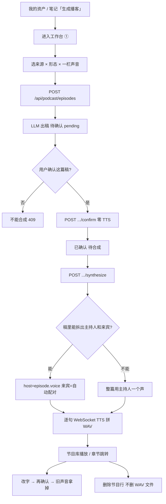
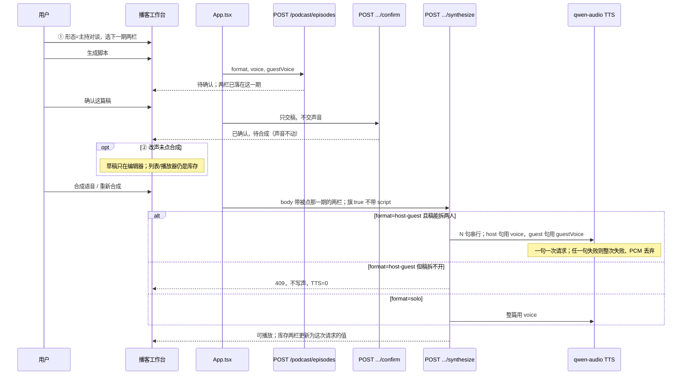

# 播客主持对谈：两个人的声音都由你来选

| 字段 | 值 |
|------|-----|
| **文档标题** | 播客双人声音自选 + 整条制作闭环审查 |
| **作者** | Grok Design |
| **日期** | 2026-08-22 |
| **状态** | Draft |
| **仓库** | `/home/admin/projects/zhuanfang` |
| **验收环境** | 已部署 demo `https://zhuanfang.qing.blue` |
| **实现对照** | `7dacb3b`（主持对谈自动配对聆心/谦；工作台仍只有一个「声音配置」） |
| **本文上一提交** | `cfc95e8`（计划稿）；行号是索引，实现以符号为准 |
| **本文性质** | 产品闭环审查 + 最优改造。上一拍是捷径（自动配对），本拍把「两个声音自己选」做成第一等能力，并走完整条播客业务。评测脚本绿了不算完；模拟评测不能替真人宣布「这期播客有价值」。 |

---

## 给产品负责人的人话

打开播客工作台（从「我的资产」档案卡点「生成播客」进去），你会看到三步：**① 选来源 → ② 确认脚本 → ③ 合成收听**。节目形态可以选「单人旁白」或「主持对谈（两个声音）」。

**现在实际怎样：**

- 声音只有一栏，写着「声音配置」。选主持对谈时，页面会告诉你：系统会用龙安聆心和龙安谦轮流说，你选的那个当主持人，另一个当来宾。**来宾那个人你选不了。**
- 上一拍代码就是这么做的：检测到稿子里有「主持人：」「来宾：」，就自动配上另一条声音。这是捷径，不是你要的「两个声音自己选」。
- 声音名单里还摆着龙安欢、龙安洋。产品按现网编码处理：这两条 **出不了声**，系统会悄悄换成聆心和谦。你以为选了欢，听到的是聆心。
- 口播稿确认已经能单独点了：可以只确认、不合成。这点保持，不要退回去。
- 默认生成脚本 **不会** 自动出声扣费。这也保持。

**做成之后，你打开工作台会看到：**

1. 选「主持对谈」会出现两栏——「主持人声音」「来宾声音」。**现网能说话的只有龙安聆心、龙安谦两个人**；对谈就是排谁主持、谁来宾（你也可以故意选成同一个）。单人旁白仍是一栏，也是这两人里选。
2. 生成并点过「确认这篇稿」之后刷新，再点这一期：两栏还是你生成时选的那两个。
3. 再点合成，能听出两个人。若你把稿里的「来宾：」删光再确认再合成，会失败并让你改稿，**不会假装一个人成功**。
4. 没点合成不扣语音费。主持对谈是 **稿里每一句单独出一次声**（八轮对答大约八次），不是一份钱打天下。
5. 上面 ② 里改了声音但还没点合成：列表和播放器仍是书里那一版。刷新后，没点合成的改动会回到书里那一版。改完声音要再点一次合成才换声，没点之前听的还是上一版。
6. 以前选过欢、洋的旧期：名字还在下拉里，会标明现网可能改用聆心或谦出声；听的是系统能说的那两位，书上的名字不偷偷改掉。

**怎样算做完：** 真人在 `https://zhuanfang.qing.blue` 走完——选主持对谈，两栏分别选聆心和谦，生成、只确认、刷新两栏还在、再合成能听出两个人；删光「来宾：」再合成会失败；② 改声不点合成就刷新，选择回到书里那一版。旧的一期如果从来没记过来宾声音，再合成仍按今天的自动配对，不把旧节目弄坏。

**这一轮明确不做：** 不把生成改成自动出声；不拿掉「确认这篇稿」；不把专访现场的声音名单改掉；不为验收再起一套库；不让评测脚本替你宣布这期播客有没有价值。

---

## Overview

播客「主持对谈」的产品承诺是 **两个人、两个声音、都由用户指定**。域层和脚本 LLM 已经按双人写：`format: "host-guest"`，嘱咐用「主持人：」「来宾：」交替行（`podcast-script-llm.ts` 铁律第 4 条）。合成路径在 `7dacb3b` 已经会按句拆开、轮流调用 TTS 再拼成一条 WAV。

缺口在 **声音是谁的**：`PodcastEpisode` 只有 `voice: string`（`src/domain/types.ts` `PodcastEpisode`）；工作台只有一个 `podcastVoice`（`App.tsx`）和一个「声音配置」输入（`PodcastStudioView.tsx`）；`renderEpisodeAudio` 用 `pairQwenAudioTtsVoice(host)` 自动配来宾（`apps/api/src/routes/podcast.ts`）。用户不能选来宾。产品已按 token-plan 编码处理：`longanhuan` / `longanyang` 送 TTS 会走 411 兜底，`resolveQwenAudioTtsVoice` 静默映射（`voice-presets.ts`）。上一拍把「听得出两个人」做成了，但把「选谁」做成了系统决定。

本方案做三件事，并且必须走完整条制作闭环（进工房 → 出稿 → 确认 → 选声 → 合成 → 收听 → 再编 → 删除 → 刷新），不是再打一针自动配对：

1. **主持对谈两个声音都是第一等字段**：生成时写入 `voice` + `guestVoice`；合成用库存的两栏（请求里也可带上 ② 草稿）；缺 `guestVoice` 的旧节目才回落到今天的自动配对。
2. **声音目录诚实**：播客新选只提供现网真能出声的人；旧库存 id 仍可见；专访名单不跟着改。
3. **费用与格式对齐**：双人按句、串行请求，必须用户点合成才发生；`format=host-guest` 但稿子分不出两人 → 拒绝合成，不假装单人过关。

确认口播稿、CAS 写路径、默认生成不出声，全部保持已上线契约。

**换声口径（只留这一种）：** ② 改声在点合成前只是本地草稿。列表、播放器仍展示库存两栏与已渲染音频。点合成才把这次请求里的两栏写入并覆盖 WAV。不做 `POST .../voices`，也不把改声做成和改稿一样立刻清播放器。

---

## Background & Motivation

### 打开书，这一章的责任

这一期若是主持对谈，打开书应该听到 **两个人在说话，而且是用户点名的那两个人**。世界收的账是 **按句出声的语音费**。上一拍留下的是「系统替你配了聆心和谦」；这一拍必须把选择权交回去，并且不把旧节目、专访现场、确认按钮弄坏。

### 上一拍为什么不够

`7dacb3b` 做了两件事：进度条跟着当前这一期走；主持对谈按句用两个声音。帮助文案写的是：

> 主持对谈会用龙安聆心和龙安谦两个人声轮流说。你选的是主持人；另一个当来宾。

这正好是用户否定的方案 B。用户原话：「两个声音模式的声音为什么不能自己选?现在声音配置还是一个。」以及「整个业务我说过要进行彻底业务闭环和完善性以及爆炸半径进行审查,制定最优的改造方案,你没有做啊」。本文补的是那次没做的审查，不是再补一个配对函数。

### 整条闭环 As-Is（对照源码，2026-08-22）



下面按产品步骤走。每一步写 **现在怎样 / 缺口 / 本方案动不动**。行号是索引，实现以符号为准。

#### 1. 进入工作台

| 事实 | 代码 |
|------|------|
| 顶栏没有「播客」。从「我的资产」档案卡或笔记页点「生成播客」 | `MyAssetsView.tsx`；`NotesView.tsx` 档案卡「生成播客」按钮；`navigation.spec.ts` |
| 点击 **只预选这条笔记并切到工作台，不自动生成** | `App.tsx`：`setPodcastNoteId` + `sourceType="note"` + `setView("podcast")` |
| 来源类型：笔记 / 搜索简报 / 长期主题 / 知识债 | `PodcastStudioView.tsx` `sourceOptions` |
| 默认形态是 **单人旁白**，写死在 React state，**不读** `systemConfig.voice.podcastFormat` | `App.tsx` `podcastFormat` 初始 `"solo"` vs `seed.ts` / `types.ts` |
| 声音初始值来自 `systemConfig.voice.podcastVoice`（默认 `longanlingxin`） | `App.tsx` `podcastVoice`；`seed.ts` |

缺口：入口只带笔记，简报/主题/债要进工作台后再改来源——可接受，不是本轮主缺口。形态默认单人保持（产品未要求改默认）。**真正的缺口是进了工房仍只有一栏声音。**

#### 2. 生成脚本

| 事实 | 代码 |
|------|------|
| `POST /api/podcast/episodes`，body：`sourceType/sourceId/format/voice`，**没有 guestVoice** | `GeneratePodcastEpisodeRequest`；`podcast.ts` `normalizePayload` |
| LLM 嘱咐：主持对谈用「主持人：」「来宾：」交替行 | `podcast-script-llm.ts` 铁律第 4 条；`formatLabel` 只是形态中文名 |
| 四条域生成函数都只收 `{ format, voice }` | `generatePodcastEpisode*` |
| 生成后 `scriptReviewStatus="待确认"`，`audioRenderStatus="pending"` | 四条生成函数同构 |
| 默认 **不** 自动 TTS | `shouldAutoRenderPodcastOnCreate` 仅 `true\|1\|yes\|on` |
| 写路径已是 LLM 锁外 + `runStateCommand` CAS 追加本条 | `registerPodcastRoutes` POST `/api/podcast/episodes`；`write-gate.ts` 播客生成豁免 |

缺口：生成只存一个 `voice`。主持对谈的来宾在这一步就已经丢了。假 chat 金样是 **无角色标签** 的一句正文（`fake-llm-clients.ts` `podcastScript`）；e2e `corpus-podcast.spec.ts` 也断言这句——对谈合成测试必须自己注入带「主持人：/来宾：」的稿，不能假定假 LLM 会拆出两人。

#### 3. 确认口播稿（已上线，本轮不得退）

| 事实 | 代码 |
|------|------|
| `POST /api/podcast/episodes/:id/confirm`，零 TTS | `podcast.ts` confirm 路由 |
| 改字再确认：音频打回 pending，URL 换成不可播占位 | `confirmPodcastScript` |
| 未确认合成 → 409（旗默认开） | `shouldRequirePodcastConfirmOnSynthesize` |
| 「确认这篇稿」/「确认并合成」按钮矩阵 | `DraftActionButtons` |
| 脏编辑器不能合成 | `App.tsx` `synthesizePodcastSpeech`；列表「重新合成」在脏时 disabled |

本轮 **不改确认语义**。声音不是稿，换声音不必再确认正文。② 改声 **不会** 立刻拿掉播放器；要听新声须再点合成。

#### 4. 选声音（本轮主缺口）

| 事实 | 代码 |
|------|------|
| 工作台一栏自由文本 + datalist，「声音配置」 | `PodcastStudioView.tsx` `#podcast-voice` |
| App 只有 `podcastVoice`，没有 guest | `App.tsx` |
| `beginEditEpisode` 只灌 `id` + `script`，不灌声音 | `PodcastStudioView.tsx` |
| 「保存为默认声音」只写 `systemConfig.voice.podcastVoice` | `saveDefaultPodcastVoice` |
| 系统配置里「播客默认声音」与「默认访谈声音」共用 `voices` 列表 | `ConfigView.tsx` |
| `voices` 声明了 `listVoices`，**App 从未在挂载时拉取**；`setVoicesLoading` 只声明、从不置位 | `App.tsx` vs `productApi.client.ts` `listVoices` |
| 播客名单与专访预置共用 `COSYVOICE_PRESET_VOICES`（聆心/谦/洋/欢） | `voice-presets.ts`；`GET /api/realtime-voice/voices` fallback |
| 产品按现网编码：`longanlingxin`、`longanqian` 能说；`longanhuan`、`longanyang` 送 TTS 走 411 映射 | `resolveQwenAudioTtsVoice`（欢→聆心、洋→谦）。本次审查未重打现网，以仓库编码为准 |
| 主持对谈来宾 = `pairQwenAudioTtsVoice(host)`：映射后是谦则来宾聆心，否则来宾谦 | `voice-presets.ts`；`renderEpisodeAudio` |
| 合成成功后 **把 `episode.voice` 改写成解析后的 host** | `renderEpisodeAudio` 成功 patch 含 `voice: hostVoice`。用户选欢，落库变成聆心 |
| 当前值不在 datalist 时会 prepend | `voiceOptions` |

缺口：不能选来宾；目录不诚实；合成还会改写用户选的那一栏。`pair*` / `COSYVOICE_PRESET_VOICES` **全部只在** `apps/api/src/voice-presets.ts`，`src/` 零处 import——能说名单若只写在 API 模块，工作台第一天引用不了。

#### 5. 合成

| 事实 | 代码 |
|------|------|
| 必须已确认；TTS 在锁外；终写 CAS | synthesize 路由；`commitSynthesizePatch` |
| 拆句：`parsePodcastDialogue` 认「主持人/主持/来宾/嘉宾/被访者/Host/Guest」 | `src/domain/podcast.ts` |
| **是否双声只看稿子能否拆出两种角色，不看 `episode.format`** | `renderEpisodeAudio` 里的 `dual` |
| 双声：逐句 `audioClient.synthesize`，句间 0.28s 静音，PCM 拼接成 WAV | 同一循环；**N 句 = N 次供应商请求，串行** |
| 单声：整篇当 host 一次合成（内部仍可能按 1500 字切段） | `splitPodcastScript` |
| 单次 qwen-audio 超时按字放大、上限 180s | `createBailianPodcastAudioClient`；这是 **单句/单次**，不是整次 synthesize 的总封顶 |
| 时长按 PCM 重算；章节按比例缩放 | `scalePodcastChapters` |
| 音频落 `.data/podcast-audio/{id}.wav` | `podcast-audio-store.ts` |
| 模型：`qwen-audio-3.0-tts-plus` | `BAILIAN_PODCAST_TTS_MODEL` |
| 客户端合成今日 **不带 script、更不带声音** | `App.tsx` `synthesizePodcastEpisode(targetId)`；`productApi.client.ts` 只在有 script 时发 JSON |

缺口：

- `format=solo` 但稿里碰巧有「主持人：」「来宾：」→ **会按双声自动配对**（产品没答应）。
- `format=host-guest` 但 LLM 没按标签写 → **整篇一个声**（产品答应了两个人，静默食言）。
- 来宾声音不落库；合成请求也不带两栏。
- 双人 = **一句一次** TTS。八轮对答 ≈ 八次账单。某一句抛错则整次 failed，循环里已拼的 PCM 丢弃。
- 终写 `{ ...current, ...audioPatch }`，audioPatch 若仍带 `voice`，会盖掉用户刚写入的两栏。

#### 6. 收听 / 章节跳转

播放器条件：`audioRenderStatus==="rendered"` 且 URL 可播。章节 `seekEpisodeAudio`。列表时长 pill 用 `episode.durationSec`。合成成功后 pill 与文件时长应对齐。合成前是估计时长、旁边没有播放器——可接受。本轮不把「估计时长」当主缺口。

#### 7. 再编辑 / 再确认 / 再合成

改字 → 确认（旧声拿掉）→ 再合成，已闭环。换声音 **不** 走这条：不必再确认正文，也 **不** 立刻清播放器。点合成才换声。

#### 8. 删除

`DELETE` CAS 删节目行；**不删除** WAV 文件。完善性：孤儿 WAV。单独一 PR，不和双声选择混提。

#### 9. 刷新 / 再进工作台

进入播客页且没有当前期时，自动展开最近一条「待确认」。形态/声音 pickers 是会话级 React state，刷新后形态回到 solo，声音回到系统默认。节目行上的 `format`/`voice` 在库存里。

本轮必须把 ①「下一期默认」和 ②「这一期草稿」拆开，见 Proposed Design §6。只加一个 `podcastGuestVoice` 会把点开旧期和「下一期默认」绑死。

#### 10. 列表 / 编辑器 / 播放器一致

确认拍已修好 pending + 残留 https 不再画出播放器。仍不一致的是列表只显示一个 `voice`。换声草稿未合成时，列表/播放器必须仍跟库存，不能跟 ② 草稿走。

#### 11. 写路径 / 锁

生成 / 确认 / 合成 / 删除均已 `runStateCommand` + 精确豁免（`write-gate.ts` 播客四条）。本轮 **禁止** 退回 t0 整包。双声字段只作为本条 episode 的附加字段走进现有 CAS。

#### 12. 费用

`COST-ENVELOPE.md` §3.5：脚本 LLM 走 `system` 桶 1 次；TTS 一般不走 LLM 预算。确认零 TTS。双人今日已按句请求。本轮帮助文案写清 **一句一次出声**。

#### 13. 声音目录诚实

| 用途 | 名单 | 现网能否出声 |
|------|------|----------------|
| 播客 TTS（qwen-audio-3.0-tts-plus） | 代码预置 4 个；产品按能说 2 个编码 | 聆心、谦能说；欢、洋送 TTS 走 411 映射 |
| 专访 Realtime | `BAILIAN_REALTIME_VOICE` 另有灵犀/小新/陆风等 | **不要**用播客的 411 映射去改这条 |
| 级联/旧 CosyVoice HTTP | 与 qwen-audio 不是同一条引擎 | `normalizeCosyVoice` 仍按 CosyVoice 口径 |

`COSYVOICE_PRESET_VOICES` 被播客工作台、系统配置「播客默认音色」、专访 `GET /api/realtime-voice/voices` 的 fallback **共用**。本轮 **禁止** 从这份预置里删欢/洋来「修播客」——专访测试（`realtime-voice.test.ts` 断言含 `longanyang`/`longanhuan`）会一起坏。播客必须有 **自己的能说名单**，且放在 `src/domain` 让 UI 能 import。

`storage.test.ts` 仍断言 `podcastVoice: "calm-host"` → `longanhuan`。欢正是要赶出播客新选项的 411 id。来宾字段 **不得** 复制这条纠正。

### 应对齐 / 不要混

| 业务 | 动什么 | 本轮 |
|------|--------|------|
| 播客口播稿确认 | `scriptReviewStatus` | **不动契约** |
| 播客双人声音 | `voice` + 新增 `guestVoice` | **本方案** |
| 专访现场声音 | `GET /api/realtime-voice/voices`、Realtime voice | **禁止改名单语义** |
| 决策确认 / 记忆候选 | 另一条产品 | 不碰 |
| 模拟评测价值线 | `scripts/eval` | 不宣布播客价值 |

---

## Goals & Non-Goals

### Goals

1. 主持对谈：**两栏声音都由用户选**，并在生成时写进这一期节目。单人旁白仍一栏。现网新选只能是聆心、谦。
2. 生成并确认后刷新，再点这一期：两栏还是库存里那两个。旧节目没有来宾栏时，合成仍用今天的自动配对，听感不回退。
3. 播客新选项只有能说的两人。欢、洋不当成新的能出声选项，但 **旧库存 id 仍出现在该期下拉里**（诚实标注）。合成层保留 411 兜底映射，只用于送 TTS。`renderEpisodeAudio` 的成功 patch **不得含** `voice` / `guestVoice`。
4. 双声是否发生看 **`episode.format === "host-guest"` 且稿能拆出两种角色**。solo 即使稿里有标签也不自动配对。host-guest 拆不出两人 → 合成拒绝，提示改稿，不装成单人成功。
5. 换声音不要求再确认正文。② 改声在点合成前是本地草稿；列表/播放器仍播库存那一版；点合成才写入两栏并覆盖 WAV。
6. 费用：主持对谈 **一句一次** 出声；帮助文案讲清。默认生成仍不出声。确认仍零 TTS。
7. 写路径继续本条 CAS。验收只打已部署 demo。

### Non-Goals

- 不把默认生成改成自动 TTS。
- 不拿掉「确认这篇稿」，不把确认绑回合成。
- 不把 `voice` 重命名成 `hostVoice`（旧节目只有 `voice`）。
- 不把欢/洋从专访预置名单里删掉。
- 不做逐行指定声音（方案 D）。
- 不做「女主持+男来宾」套装代替两栏（方案 C 可当快捷，不当唯一入口）。
- 不把 `systemConfig.podcastFormat` 接到工作台默认（默认仍单人）。
- 不在本轮修孤儿 WAV。
- 不做 `POST .../voices`；不做「改声立刻清播放器」的第二条写路径。
- 不清主人仓；密钥不进 git；不为验收再起 Surreal。
- 不冻结专访工程给打分器；不把播客价值写进评测通过线。

---

## Proposed Design

### 目标链路（To-Be）



### 1. 域：来宾声音是可选附加字段

`PodcastEpisode` **加** `guestVoice?: string`，保留 `voice` 当主持人/单人声。

```ts
export interface PodcastEpisode {
  // ...
  format: "solo" | "host-guest";
  voice: string;          // 单人=唯一声；对谈=主持人。旧节目只有这一栏。
  guestVoice?: string;    // 对谈=来宾。缺省 / 空 / 非法 = 合成时自动配对。
  // ...
}
```

`SystemConfig.voice` **加** `podcastGuestVoice?: string`，仅作「下一期主持对谈」的默认来宾。`podcastVoice` 语义不变。

四条 `generatePodcastEpisode*` 的 options 扩成：

```ts
{ format: PodcastEpisode["format"]; voice: string; guestVoice?: string }
```

生成时：`format==="host-guest"` 且 `guestVoice` 经 trim 后非空，才写入。solo 不写。空串、空白、非法占位 **省略字段**（`undefined`），不要写成欢或洋。UI 主路径生成时必带两栏。服务端缺省 = 旧客户端/回滚。

`confirmPodcastScript` **不读不写** 声音。

新纯函数放在 **`src/domain/podcast.ts`**（或同文件旁），**不要**返回名为 `dual` 的字段——现网 `renderEpisodeAudio` 的 `dual` 只表示稿能否拆出两角，和 format 不是一回事：

```ts
export function resolveEpisodeVoices(episode: PodcastEpisode): {
  host: string;
  guest: string;
  guestFromFallback: boolean;
}
```

规则：

1. `host` = 库存 `episode.voice`（**不**做 411 映射）。
2. `guestVoice` trim 后非空 → `guest` 用它，`guestFromFallback=false`。
3. 否则 `guest` = `pairPodcastGuestVoice(host)`，`guestFromFallback=true`。
4. 两栏可以相同；函数不改成配对。
5. 函数 **不** 看稿、**不** 决定是否按句合成。

合成开关写死两行，禁止用 `resolveEpisodeVoices` 的任何布尔去跳过拆句：

```
wantDual = episode.format === "host-guest"
parsedDual = parsePodcastDialogue(script) 同时有 host 句和 guest 句
```

| wantDual | parsedDual | 行为 |
|----------|------------|------|
| false | * | 整篇 host。即使稿里有标签也不配对。 |
| true | true | 按句双声。host 句用 `voice`，guest 句用 `guestVoice` 或配对。调用次数 = 拆出的 turn 数（不是「两次」）。 |
| true | false | **拒绝合成**（handler 409，TTS=0，**不写** voice/guestVoice）。文案：「这篇对谈稿没有把主持人和来宾分开写。先改稿再合成。」 |

### 2. 声音目录必须在 `src/domain`，UI 才能引用

新建 **`src/domain/podcast-voices.ts`**（名称可同等，但必须在 `src/domain`，禁止只放 `apps/api`）：

```ts
export const QWEN_AUDIO_SPEAKING_VOICES = [
  { voice: "longanlingxin", name: "龙安聆心·温暖共情" },
  { voice: "longanqian", name: "龙安谦" }
] as const;

export function isQwenAudioSpeakingVoice(id: string): boolean { /* ... */ }

/** 来宾缺省配对：host 是谦则来宾聆心，否则来宾谦。不做 411 映射。 */
export function pairPodcastGuestVoice(host: string): string {
  return host.trim() === "longanqian" ? "longanlingxin" : "longanqian";
}
```

`apps/api/src/voice-presets.ts` **re-export** 上述符号，可让 `pairQwenAudioTtsVoice` 变成对 `pairPodcastGuestVoice` 的薄封装。**不改** `COSYVOICE_PRESET_VOICES` 成员。

`resolveQwenAudioTtsVoice` **仍留 API**（只在送 TTS 那一跳用）。域函数 / `resolveEpisodeVoices` 返回库存 id，不返回映射后的 id。

工作台与「播客默认声音」下拉：选项 = `QWEN_AUDIO_SPEAKING_VOICES` ∪ **当期库存 id**（若库存不在能说名单里，prepend 一条只读额外 option，文案：「现网可能改用聆心/谦出声」）。不要拿 `GET /api/realtime-voice/voices` 当播客选项。复刻音色本轮不提供。

`App.tsx` 今日不拉取 `listVoices()`。本轮不要为播客去修专访拉名单的旧洞。播客两栏用域模块静态名单。

系统配置：

- 「默认访谈声音」继续用专访名单。
- 「播客默认声音」改成能说名单；可多一个「播客默认来宾声音」。

运行配置 `BAILIAN_TTS_VOICE` options **不要改**（专访级联默认）。

### 3. 合成：body 可带两栏；audioPatch 不准带声音

`POST .../synthesize` body：

```ts
{ script?: string; voice?: string; guestVoice?: string }
```

旗 true（默认）顺序，写死：

1. 锁外读当期。不存在 → 404。
2. `scriptReviewStatus !== "用户确认"` → 409，TTS=0，不写声。
3. body.script 若出现且与库存不一致 → 409，TTS=0，不写声。旗 true 的 UI **不发 script**（避免脏稿 409）；改稿只走 confirm。
4. **先**按库存稿算 `wantDual` / `parsedDual`。host-guest 且拆不开 → 409，TTS=0，**不合并、不写** body 里的声音。
5. **再**把 body 里出现的 `voice` / `guestVoice` 合进内存中的 episode（trim；来宾空串当省略）。
6. TTS：`resolveEpisodeVoices` 得到 host/guest；送引擎前才 `resolveQwenAudioTtsVoice`。
7. CAS：`{ ...current, ...voicePatch, ...audioPatch }`。`voicePatch` 仅含 body 里真正出现的声音字段。`audioPatch` **不得含** `voice` / `guestVoice`。

`renderEpisodeAudio` 成功返回只含音频字段：`audioUrl`、`durationSec`、`audioRenderStatus`、`audioRenderMessage`、`chapters`、可选 `audioExpiresAt`。**删除今日的 `voice: hostVoice`。** 单测：库存 `voice=longanhuan`、TTS 实际用聆心，落库仍是 `longanhuan`。

旗 false（完整旧合成路径）：保持今天「script 可写稿+确认」；若带了 guestVoice 仍尽量写入。

N 句串行：总墙钟是各次超时相加，**没有**整次 synthesize 的 90s 封顶。单次请求仍按字放大、上限 180s。任一句失败 → 整次 `failed`，已收集 PCM 丢弃（今日 for 循环 throw 就是这样）。本轮不做长稿截断/拒稿，但禁止在文案里暗示有整单 90s 封顶。

AUTO_RENDER 路径没有 409 门：`wantDual && !parsedDual` 时 `renderEpisodeAudio` 返回 failed 文案，不调 TTS。

### 4. 生成：把两栏写进新节目

`normalizePayload` 增 `guestVoice?: unknown`。

```
voice = normalizeCosyVoiceId(payload.voice || systemConfig.voice.podcastVoice)
guestVoice = trim 后非空才留下；否则 undefined（不落库、不纠正成欢/洋）
```

不要在服务端替用户填配对结果再落库。`buildEpisodeSkeleton` 把 `guestVoice` 传进四条生成函数。

### 5. 换声音：本地草稿，点合成才生效

只留这一种口径（Key Decision）：

- ② 改声 **不写库、不清音频、不改** `scriptReviewStatus`。
- 列表 pill、播放器、章节跳转仍用库存 `voice` / `guestVoice` 与已渲染 WAV。
- 点「合成语音」或该期「重新合成」：把 **被点那一期** 的两栏放进 synthesize body，服务端写入并覆盖 WAV。
- 刷新 / 再进：② 从库存重新灌入；未点合成的草稿丢弃。
- **不要**为换声音新开 confirm 或 `POST .../voices`。
- **不要**前端先藏播放器冒充「已经换了」。

与改稿不同：改稿走 confirm，立刻拿掉旧声，因为稿和声必须一致。改声还没出新声之前，旧 WAV 仍对应库存两栏，听起来是对的。

### 6. 界面：① 下一期默认 vs ② 这一期草稿

App 必须有 **两套** 声音 state，禁止 ①② 绑同一对：

| 用途 | state | 谁改 | 发给谁 |
|------|--------|------|--------|
| ① 下一期生成默认 | `podcastFormat`、`podcastVoice`、`podcastGuestVoice` | ① 的控件；「保存为默认」 | 只进 `POST /api/podcast/episodes` |
| ② 这一期草稿 | `episodeVoice`、`episodeGuestVoice`（另已有 `editingScript` / `activeEpisodeId`） | `beginEditEpisode` 灌入；② 的控件 | 只进被点那一期的 `POST .../synthesize` |

写死四件事：

1. **①** 用 `podcastVoice` + `podcastGuestVoice` + `podcastFormat`。刷新后回到 `systemConfig`（形态仍默认 solo，不读 `podcastFormat` 配置——Non-goal）。
2. **②** 用 `episodeVoice` / `episodeGuestVoice`。`beginEditEpisode(episode)` 必须：`onActiveEpisodeId`、`onEditingScript(episode.script)`、`episodeVoice = episode.voice`、`episodeGuestVoice = episode.guestVoice`（trim 后非空）否则若 `format==="host-guest"` 则 `pairPodcastGuestVoice(episode.voice)` **仅作预填**。预填不等于写库；用户没改就点合成，新 UI 会把这两栏放进 body，于是配对结果 **这时** 才落库——这是「新 UI 必带两栏」的自然结果，旧客户端不点合成就不会写。
3. **合成只发送被点的那一期的两栏，且旗 true 不带 `script`。** 列表「重新合成」点的是 B 期：用 B 的库存两栏（若 B 正是当前 ② 且草稿脏了声音，用 ② 草稿）。**禁止**把 ① 的下一期默认、或另一期的 ② 草稿塞进 B。脏稿时「重新合成」保持 disabled。
4. **「保存为默认」：** solo 只写 `podcastVoice`，**不得清空** 已有 `podcastGuestVoice`。host-guest 写两栏。仍走今日本地 `systemConfig` + autosave。

① 控件：

| 形态 | 控件 |
|------|------|
| 单人旁白 | 一栏「声音」，select |
| 主持对谈 | 「主持人声音」「来宾声音」两个 select；默认两个不同的能说 id。① 里若两栏相同，来宾自动改成另一个能说 id **仅作预填**，用户仍可改回相同 |

下拉选项 = 能说名单 ∪ 该控件当前值（旧欢/洋带诚实标注）。

帮助文案：

- 单人：「只出这一个声音。」
- 对谈：「两个人各用各的声音。合成按稿里每一句单独出一次声，一句算一次。」
- 两栏相同：「两个人用同一个声音，听起来会像一个人在对答。你仍可以这样选。」
- ②：「改完声音要再点一次合成才换声。没点之前，听的还是上一版。」

去掉自由文本 CosyVoice id。去掉「系统会给你配另一个」。

② 标题行展示 **库存** 两栏（不是未保存草稿），避免标题和播放器打架。② 内的 select 绑草稿。节目库 pill 展示库存：`主持对谈 · 聆心 / 谦`；缺 `guestVoice` 时来宾位可写「（配对）」或只印主持人，不要假装已经存了来宾。

`src/ui.ts` 仍有「声音配置」文案（制作设置描述），PR-3 必须改掉，避免和两栏打架。

进度条 ①②③ 已跟当期，保持。

视图 props（空态测试必补）：

```ts
// ①
voice: string;
guestVoice: string;
onVoice: (value: string) => void;
onGuestVoice: (value: string) => void;
// ② 草稿
episodeVoice: string;
episodeGuestVoice: string;
onEpisodeVoice: (value: string) => void;
onEpisodeGuestVoice: (value: string) => void;
```

若实现选择把 ② 草稿只存在 View 内部、合成时经 callback 交出，也可以，但 **App 合成 handler 仍必须按「被点的 id」取声，不得误用 ①**。推荐 App 持有 ②，因为列表「重新合成」和刷新灌入都在 App。

### 7. 存储 / Surreal

`guestVoice` 进 rest，不加列、不迁表。`node-mapper` 核心列不改。

`storage.ts` **不要** 对来宾用裸 `optStr`：`optStr("")` 会留下空串（只拦非 string），空串会被当成「有值」从而跳过配对。来宾 clamp：

```
typeof !== "string" → undefined
trim 后空 → undefined
KNOWN_INVALID_VOICE_IDS（calm-host / warm-interviewer / local-demo）→ undefined
否则保留 trim 后的 id（包括旧的 longanhuan / longanyang，以及自定义串）
```

**禁止** 把空/非法来宾纠正成 `longanhuan` 或 `longanlingxin` 再落库。`podcastGuestVoice` 同一口径。

`podcastVoice` 今日 `calm-host` → 测试仍期望 `longanhuan`（过时）。本轮 **不要复制** 这条到来宾；也不必在双声 PR 里改 `podcastVoice` 纠正目标（避免和配置页专访默认搅在一起）。若有人改那条测试，另开，不塞进 PR-1。

### 8. 回滚口径

| 层 | 回滚后怎样 |
|----|------------|
| 旧节目没有 `guestVoice` | `pairPodcastGuestVoice(host)`，与 `7dacb3b` 听感一致 |
| 新 UI 未上、旧客户端仍只发 `voice` | 同上，服务端不 422 |
| 关掉新 UI、数据已有 `guestVoice` | 合成继续用库存来宾 |
| host-guest 无标签 409 伤到旧稿 | 显式 env `PODCAST_HOST_GUEST_UNLABELED_FALLBACK`（仅 `true\|1\|yes\|on` 打开）→ 整篇当 host 合成。**默认关**。不是口头「临时改回」 |
| 禁止 | 清空 demo 节目库；force-push；从专访预置删欢/洋 |

---

## API / Interface Changes

### 生成

```
POST /api/podcast/episodes
Body: { noteId?, sourceType?, sourceId?, format, voice, guestVoice? }
```

`guestVoice` 可选。solo 忽略。host-guest 缺省 / 空 = 不落来宾栏。

### 确认

**不变。** Body 仍只有 `{ script?: string }`。

### 合成

```
POST /api/podcast/episodes/:id/synthesize
Body: { script?: string, voice?: string, guestVoice?: string }
```

旗 true：见 §3 顺序。成功不把映射 id 写回。undual 409 不写声。

### 客户端（PR-1 就要改，不能拖到 PR-3）

今日 `synthesizePodcastEpisode(episodeId, script?)` 只在有 script 时发 body。改成 options，避免和 script 抢位：

```ts
generatePodcastEpisode(input: GeneratePodcastEpisodeRequest) // 加 guestVoice?: string

synthesizePodcastEpisode(
  episodeId: string,
  options?: { script?: string; voice?: string; guestVoice?: string }
): Promise<GeneratePodcastEpisodeResponse>
```

同一 PR 改所有调用点（`App.tsx` 主路径旗 true 不传 script；PR-3 再把两栏填进 options）。`productApi.test.ts` 钉：只传 voices 时 body 含 voice/guestVoice、不含 script。

### 视图 props

见 §6。`empty-state-render.test.tsx` / `PodcastStudioView.test.tsx` 必补，否则空态编译失败。

---

## Data Model Changes

| 层 | 变化 |
|----|------|
| TypeScript `PodcastEpisode` | 加 `guestVoice?: string` |
| TypeScript `SystemConfig.voice` | 加 `podcastGuestVoice?: string` |
| 新模块 `src/domain/podcast-voices.ts` | 能说名单 + `pairPodcastGuestVoice` |
| `storage.ts` | 来宾：trim 空/非法 → **省略**，永不写成欢 |
| Surreal `007_r1a` | **不迁表**；字段进 `rest` |
| `node-mapper` 核心列 | **不改** |
| 备份/导出 | 无新密钥字段 |
| 音频文件 | 同 id 覆盖 WAV；删除仍暂留孤儿文件 |

旧行只有 `voice`：load 后 `guestVoice===undefined`，合成走配对。无需数据迁移作业。

---

## Alternatives Considered

### 方案 A — 主持对谈两栏自选，两栏都落在节目上（采用）

对上用户原话；旧节目不坏；确认契约不动；专访名单不动。代价：类型/API/UI/测试都要跟。

### 方案 B — 一栏 + 自动配对（现状，用户已否定）

否。

### 方案 C — 声音套装代替两栏

不当唯一入口。只能是两栏之上的预填。

### 方案 D — 编辑器里逐行指定声音

过重。稿继续用「主持人：」「来宾：」分角色。

### 方案 E — 把 `voice` 重命名为 `hostVoice`

否。附加字段，不重命名。

### 方案 F — 改声立刻清播放器（与改稿同构）

否。那必须加一条只写声音+清音频、不碰 `scriptReviewStatus` 的接口。本轮明确用合成 body，旧 WAV 在点合成前仍对应库存两栏，听起来是对的。

---

## Security & Privacy Considerations

| 威胁 | 缓解 |
|------|------|
| 未登录改别人节目的声音 | 同一套会话鉴权 + 用户作用域 ProductState |
| 用合成 body 改稿绕过确认 | 旗 true 时 script 不一致仍 409；声音字段不写 `scriptReviewStatus` |
| 用确认接口改声音/决策/记忆 | confirm 继续只动稿 |
| 未读稿扣 TTS | 服务端 409 门保持 |
| 未选来宾却按双人扣 N 次 TTS | 形态是用户选的；合成是显式点击；拆不开则 409 且 TTS=0 |
| 专访复刻音色送进 qwen-audio | 播客下拉=能说名单 ∪ 该期库存 id；不把 enrollment 当新选项 |
| 空串来宾跳过配对 | clamp 省略空/非法 |
| 删除节目后 WAV 仍在磁盘 | 本轮记风险，不在双声 PR 里 rm |

---

## Observability

| 事件 | 何时 | 落在哪一 PR |
|------|------|-------------|
| 已有 `tts_failed` `capability: podcast_tts` | 合成失败（含 N 句中某一句） | 已有 |
| 新增 `podcast_tts_dual` | 实际按句双声开始：`turns`、`host`、`guest`、`guestFromFallback` | PR-1（`podcast.ts`） |
| 新增 `podcast_tts_rejected_undual` | host-guest 稿拆不开，409 | PR-2（`podcast.ts`） |
| 已有 `podcast_script_confirmed` | 确认；不应出现声音字段 | 已有 |

指标：双声 200 vs 单声 200；`guestFromFallback=true` 比例；undual 409。不必为双声单独 Pager。

---

## Rollout Plan

验收定义 = **demo 热更成功 + 真人冒烟绿**。不在 Grok 运行机 `npm ci` / Playwright / 本机 Surreal。不因 GHA 红阻塞。部署走 `./scripts/deploy_demo.sh`。

### 阶段

1. **PR-1** 字段 + 停止写回映射 id + **synthesize body 解析/合并声音**（旧 UI 不发两栏则听感=今日配对）。
2. **PR-2** 合成认 format；拆不开 409。
3. **PR-3** 工作台两栏。
4. **PR-4** 配置默认来宾 + 费用信封。

**PR-2 与 PR-3 必须同一趟 `./scripts/deploy_demo.sh` 热更。** 只上 PR-2：旧 UI 对无标签对谈会 409。只上 PR-3：新 UI 选出的来宾，若 PR-1 的 body 已在则能用，但无标签 409 的产品文案还不在。部署步骤把 PR-2+PR-3 写成同一次热更，不要分开隔夜。

PR-2 热更 **前** 在 demo 抽几条已有 host-guest 节目看稿是否带「主持人：」「来宾：」。无标签旧稿走 8b，不要指望 8a 的绿能代替。

后门：`PODCAST_HOST_GUEST_UNLABELED_FALLBACK` 默认关。

### Demo 冒烟（已部署栈，禁止另起库）

1. 登录 `https://zhuanfang.qing.blue`，我的资产 → 生成播客。
2. 形态保持单人，生成 → 确认 → 合成：一个声。
3. 新开一期，形态=主持对谈：必须看到两栏，选项主体只有聆心、谦。选聆心 + 谦，生成。② 和列表都能看见两个名字。
4. 只确认、不合成。刷新。再点这一期：两栏还在，状态仍已确认。
5. 合成。能听出两个人。时长 pill 与播放器大致同长。章节能跳。
6. ② 把两栏改成同一个能说 id，**先听**：播放器仍是上一版。再点合成：能出声，像一个人在对答。
7. 把稿里的「来宾：」全删掉再确认再合成：失败并提示改稿，不能变成单人成功。
8a. 没有 `guestVoice`、但稿里仍有「主持人：/来宾：」的旧对谈：再合成两个声（自动配对），200，不要 500。
8b. 形态是对谈、稿里没有两种角色：409、零 TTS、提示改稿。热更前在 demo 抽旧 host-guest 稿分类到 8a 或 8b。
9. ② 改声、不点合成、刷新：两栏回到书里那一版。
10. 系统配置：访谈声音名单仍可含洋/欢；播客默认声音以能说的为主。
11. 以前选过欢/洋的旧期：下拉里还能看见那个名字，并标明现网可能改用聆心/谦；合成后书上的名字不变。

Playwright 的 canned 稿没有角色标签：**不要**在 e2e 里对主持对谈点合成。真人冒烟才走真 LLM。solo 路径 e2e 可继续合成。

### 回滚

- API：停发 `guestVoice` 即回到配对。不要删字段。
- UI：回退两栏后旧客户端只发 `voice`。
- 无标签 409：开 `PODCAST_HOST_GUEST_UNLABELED_FALLBACK`（默认关的显式旗）。
- 禁止 force-push；禁止清空 demo 节目库。

---

## Risks

| 严重度 | 风险 | 缓解 |
|--------|------|------|
| 高 | 从 `COSYVOICE_PRESET_VOICES` 删欢/洋，专访选声和单测一起坏 | 能说名单放 `src/domain/podcast-voices.ts`；预置四项不动 |
| 高 | PR-2 无标签对谈 409，demo 旧稿中招 | 冒烟拆 8a/8b；热更前抽稿；显式 fallback 旗默认关 |
| 高 | ①② 共用一对 state，点开旧期改掉下一期默认 | §6 两套 state；合成按被点 id |
| 中 | audioPatch 仍带 `voice` 盖掉用户两栏 | `renderEpisodeAudio` 成功返回删除这两个字段；单测欢仍落欢 |
| 中 | 空串 `guestVoice` 跳过配对 | clamp 省略；禁止纠正成欢 |
| 中 | 测试写「TTS 两次」vs 假 LLM 无标签稿 | 注入「主持人：/来宾：」；断言 turn 次数 = 拆句数 |
| 中 | 能说名单只写在 API，前端 import 失败 | 名单在 `src/domain`；API re-export |
| 中 | 两栏相同被当成 bug 去 409 | 产品允许；仅 UI 提醒 |
| 中 | 双人 N 次串行超时/账单 | 文案一句一次；确认零 TTS；默认生成不出声；**不**暗示整单 90s |
| 中 | `empty-state-render` 漏新 prop | PR-3 必改 |
| 中 | e2e `getByLabel("声音配置")` 失效 | PR-3 改 spec；主持对谈 e2e 不合成 canned 稿 |
| 低 | 孤儿 WAV；`listVoices` 未拉取；`podcastFormat` 不驱动默认 | Non-goal |

---

## Open Questions

没有未决分叉会挡住开工。用户已经要「两个声音自己选」；同声两栏允许；拆不开的对谈稿拒绝合成；旧节目缺来宾栏走自动配对；② 改声点合成才生效。自定义复刻音色进播客是以后的分叉，本轮明确不做。

---

## Key Decisions

1. **采用方案 A。** 主持对谈两栏自选；用户已否定一栏自动配对。
2. **附加 `guestVoice`，不重命名 `voice`。**
3. **缺 / 空 / 非法 `guestVoice` = `pairPodcastGuestVoice(host)`，字段省略，永不写成欢。** 新 UI 生成必带两栏。
4. **同声两栏允许，但不是默认。**
5. **双声发生条件 = 形态是对谈 且 稿能拆出两人。** `resolveEpisodeVoices` 不返回 `dual`。
6. **能说名单 + 配对放 `src/domain/podcast-voices.ts`。** 禁止为修 411 去改 `COSYVOICE_PRESET_VOICES`。`resolveQwenAudioTtsVoice` 只留 API、只送 TTS。
7. **`renderEpisodeAudio` 成功 patch 不得含 `voice` / `guestVoice`。** 声音只在 body 出现了才由 voicePatch 写。
8. **② 改声是本地草稿；点合成才写入并覆盖 WAV。** 不做立刻清播放器，不做 `POST .../voices`。
9. **① 下一期默认与 ② 当期草稿两套 state。** 合成只发被点那一期的两栏；旗 true 不带 script。solo 保存默认不得清空 `podcastGuestVoice`。
10. **确认继续只动稿。** 默认生成仍不出声；确认仍零 TTS。
11. **下拉 = 能说名单 ∪ 当期库存 id。** 旧欢/洋可见且标注可能改用聆心/谦出声。
12. **`guestVoice` 进 rest，不迁表。**
13. **写路径继续本条 CAS。**
14. **N 句 = N 次串行 TTS；一句失败则整次失败。** 没有整次 90s 封顶。
15. **PR-2 与 PR-3 同一趟 demo 热更。** 无标签后门是显式 env，默认关。
16. **验收 = 已部署 demo 真人冒烟。** 删除 WAV、专访 listVoices、估计时长 pill 不塞进本系列。

---

## References

- 上一拍确认设计：`docs/plans/2026-08-22-podcast-script-confirm.md`
- 捷径提交：`7dacb3b`；计划稿提交：`cfc95e8`
- 合成：`apps/api/src/routes/podcast.ts` `renderEpisodeAudio` / `commitSynthesizePatch`
- 配对/映射：`apps/api/src/voice-presets.ts`（本方案域模块下沉后由此 re-export）
- 域类型：`src/domain/types.ts` `PodcastEpisode`
- 域生成/拆句/确认：`src/domain/podcast.ts`
- 脚本 LLM：`apps/api/src/intelligence/podcast-script-llm.ts` 铁律第 4 条
- 工作台：`src/features/podcast/PodcastStudioView.tsx`（`voiceOptions` prepend、`beginEditEpisode`）
- 装配：`src/App.tsx` `podcastVoice` / `generatePodcastScript` / `synthesizePodcastSpeech`
- 客户端：`src/api/productApi.client.ts` `synthesizePodcastEpisode`
- 归一化：`src/domain/storage.ts` `optStr`（空串会留下）；`normalizeVoiceConfig`；`storage.test.ts` calm-host→longanhuan **不要复制到来宾**
- Schema / mapper：`007_r1a_entities.surql` `podcast_episode`；`node-mapper.ts` `podcastEpisodes`
- 写锁：`apps/api/src/server/write-gate.ts` 播客四条豁免
- TTS：`bailian-tts-inference.ts`；`createBailianPodcastAudioClient` 单次超时
- 假 LLM 金样：`apps/api/src/test-helpers/fake-llm-clients.ts` `podcastScript`（无角色标签）
- 制作设置文案：`src/ui.ts`「声音配置」
- 计费：`docs/COST-ENVELOPE.md` §3.5
- 测试：`podcast.test.ts`（知识债路径已有 host-guest 生成）；`voice-presets.test.ts`；`podcast-confirm.test.ts`；`PodcastStudioView.test.tsx`；`corpus-podcast.spec.ts`；`navigation.spec.ts`

---

## PR Plan

每 PR 可独立审查。双声选择 **不** 与写锁重构、确认语义、专访名单、删除 WAV 混提。

### PR-1 — 来宾字段 + 停止写回映射 + synthesize body

- **标题：** `feat(podcast): persist optional guestVoice with auto-pair fallback`
- **影响文件：**
  - `src/domain/types.ts`
  - `src/domain/podcast-voices.ts`（新建：能说名单 + `pairPodcastGuestVoice`）
  - `src/domain/podcast.ts`（生成 options；`resolveEpisodeVoices`，**不返回 dual**）
  - `src/domain/engine.ts`（re-export）
  - `src/domain/podcast-voices.test.ts`（或并入现有域测）
  - `src/domain/storage.ts`（来宾 trim/非法 → 省略）
  - `src/domain/storage.test.ts`（来宾空串省略；**不要**复制 calm-host→longanhuan）
  - `apps/api/src/voice-presets.ts` / `voice-presets.test.ts`（re-export；不改 `COSYVOICE_PRESET_VOICES`）
  - `apps/api/src/routes/podcast.ts`（generate payload；synthesize **解析 body 的 voice/guestVoice**；先校验确认/稿再合并声音再 TTS；`renderEpisodeAudio` 用库存 guest 或配对；成功 patch **删除 voice/guestVoice**；日志 `podcast_tts_dual`）
  - `apps/api/src/routes/podcast.test.ts`（**必须** `createFakeChatClient({ podcastScript: "主持人：…\\n来宾：…" })`；断言调用次数 = 拆出的 turn 数；host 句用 `voice`，guest 句用 `guestVoice` 或配对；缺 guestVoice 走配对；solo 整篇一声；库存欢合成后仍是欢）
  - `src/api/productApi.types.ts` / `productApi.client.ts` / `productApi.test.ts`（生成 `guestVoice?`；合成改为 options 对象）
- **依赖：** 无
- **内容：** 旧客户端不发 `guestVoice` 时听感=今日（仍按稿是否拆得出两人决定双声，**本 PR 还不按 format 收紧**）。禁止改工作台布局。禁止改确认 handler。禁止改 `write-gate.ts`。禁止在验收里写「TTS 两次」。
- **验收：** inject：solo 一声；host-guest + 标签稿 + guestVoice → 按句、两种 id；host-guest + 标签稿 + 无 guestVoice → 按句配对；两栏相同仍 200。demo 可热更，旧 UI 不坏。

### PR-2 — 对谈必须真的是两个人（合成认 format）

- **标题：** `fix(podcast): dual TTS only for host-guest scripts that split`
- **影响文件：**
  - `apps/api/src/routes/podcast.ts`（`wantDual && !parsedDual` → 409、TTS=0、不写声；日志 `podcast_tts_rejected_undual`；AUTO_RENDER 走 failed 文案；读取 `PODCAST_HOST_GUEST_UNLABELED_FALLBACK` 默认关）
  - `apps/api/src/routes/podcast.test.ts`（同样注入标签稿 / 无标签稿）
  - `src/domain/podcast-confirm.test.ts`（parse 用例保持）
- **依赖：** PR-1
- **内容：** 关掉「solo 因稿内标签自动双声」和「host-guest 拆不开却单声成功」。不改 UI。不改确认。
- **验收：** solo + 带「主持人：来宾：」的稿 → 按整篇 host 合成（一次客户端 synthesize，内部可切段）。host-guest + 无标签稿 → 409、TTS=0、声音字段不变。host-guest + 有标签 → 按句、两种 id。知识债 host-guest 生成用例若再合成，必须先改金样带标签，或只断言生成不合成。
- **部署：** 与 PR-3 同一趟 `./scripts/deploy_demo.sh`。热更前抽 demo 旧 host-guest 稿。

### PR-3 — 工作台两栏自选 + 诚实名单

- **标题：** `feat(podcast): let host-guest pick both voices`
- **影响文件：**
  - `src/features/podcast/PodcastStudioView.tsx`
  - `src/features/podcast/PodcastStudioView.test.tsx`
  - `src/features/empty-state-render.test.tsx`
  - `src/App.tsx`（① `podcastGuestVoice`；② `episodeVoice` / `episodeGuestVoice`；`beginEditEpisode` 灌入；生成带 ①；合成带被点期的 ② 或库存；不带 script）
  - `src/ui.ts`（「声音配置」制作设置描述）
  - `tests/e2e/corpus-podcast.spec.ts`（不再一栏「声音配置」；主持对谈 **不要** 对 canned 无标签稿点合成）
  - `tests/e2e/navigation.spec.ts`
- **依赖：** PR-1。与 PR-2 **同一 demo 热更**。
- **内容：** ①② 两套控件。下拉=能说 ∪ 当前值。同声允许 + 提醒。保存默认：solo 不清空来宾默认。禁止改 `GET /api/realtime-voice/voices`。禁止改 `COSYVOICE_PRESET_VOICES`。禁止动确认按钮矩阵语义。
- **验收：** demo 真人冒烟 3–7、9、11。

### PR-4 — 配置默认来宾 + 费用信封

- **标题：** `feat(podcast): speaking-voice defaults and dual-tts cost note`
- **影响文件：**
  - `src/features/config/ConfigView.tsx` / `ConfigView.test.tsx`（播客默认用域能说名单；可选默认来宾；**访谈声音下拉不改选项源**）
  - `docs/COST-ENVELOPE.md` §3.5（主持对谈 = 一句一次串行 TTS；确认仍零；不要写整单 90s）
- **依赖：** PR-3
- **内容：** 配置默认 + 信封。不改合成算法。标题用 `feat`，因为改了 ConfigView。
- **验收：** 配置页访谈名单仍可含洋/欢。播客默认声音主体为聆心/谦。

### 不在本系列

- 删除节目时 unlink WAV
- App 挂载拉取 `listVoices`
- `systemConfig.podcastFormat` 驱动工作台默认形态
- 把 `podcastVoice` 的 calm-host→longanhuan 纠正改掉
- AUTO_RENDER 语义清理
- 逐行指定声音
- 播客评测金样 / 价值分数
- 改专访 Realtime 音色列表
- 写锁 / 确认契约再设计

---

## 给机器用的一句

`PodcastEpisode.guestVoice?: string` 进 rest 不迁表；空/非法来宾省略不得写成 longanhuan；`src/domain/podcast-voices.ts` 承载 `QWEN_AUDIO_SPEAKING_VOICES`+`pairPodcastGuestVoice`，API `voice-presets.ts` re-export、不改 `COSYVOICE_PRESET_VOICES`；`resolveEpisodeVoices` 返回 `{host,guest,guestFromFallback}` 禁止字段名 `dual`；`wantDual=format==="host-guest"` 且 `parsedDual` 才按句合成，否则 solo 整篇 host、host-guest 无两角则 409 TTS=0 不写声；`synthesize` options `{script?,voice?,guestVoice?}` 先校验确认/稿再合并声音再 TTS，PR-1 就要改 client+`podcast.ts`；`renderEpisodeAudio` 成功 patch 删除 `voice`/`guestVoice`；`resolveQwenAudioTtsVoice` 只送 TTS；① `podcastVoice`/`podcastGuestVoice` vs ② `episodeVoice`/`episodeGuestVoice`，`beginEditEpisode` 从库存灌入、缺来宾预填配对不写库；合成只发被点那一期两栏且旗 true 不带 script；② 改声是草稿，点合成才覆盖 WAV；下拉=能说∪库存 id；`PODCAST_HOST_GUEST_UNLABELED_FALLBACK` 默认关；N 句串行一句失败则整次失败无整单 90s；PR-2+PR-3 同一 `deploy_demo.sh`；confirm 仍只 `{script}`；`PODCAST_AUTO_RENDER_ON_CREATE` 默认关；测试注入「主持人：/来宾：」断言 turn 数不是「两次」；验收 `https://zhuanfang.qing.blue`。
