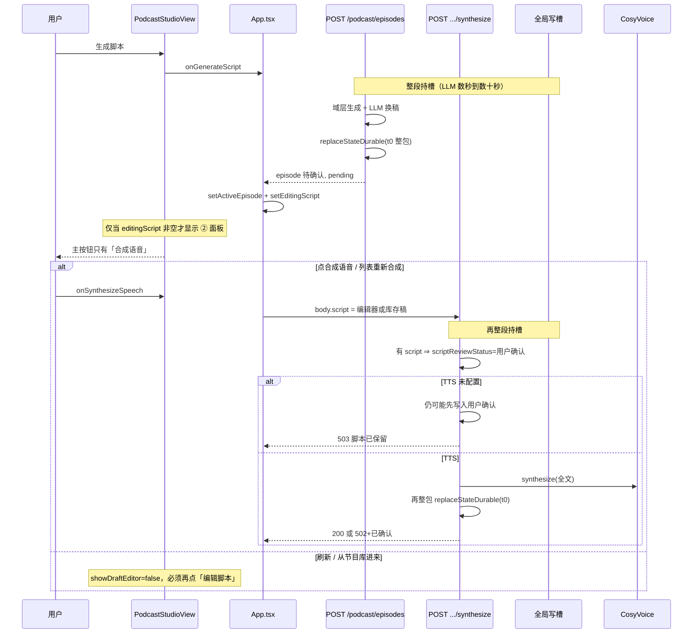
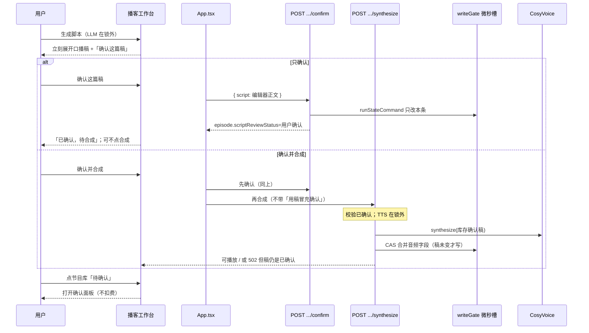
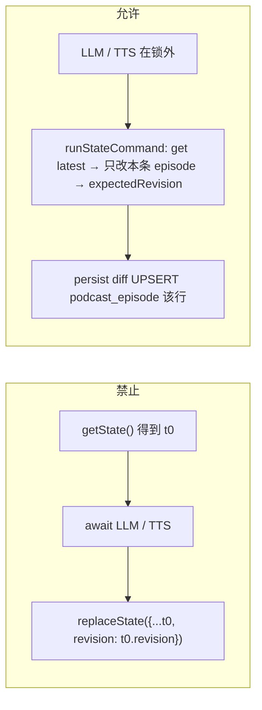
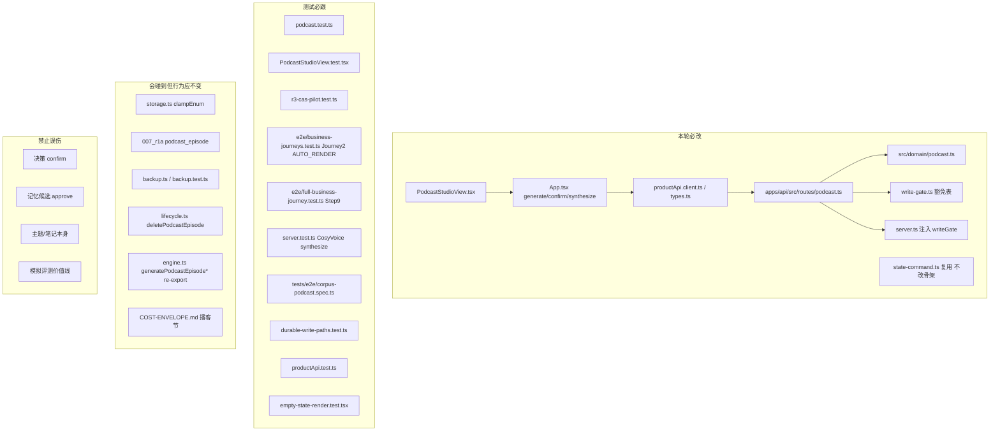

# 播客口播稿确认：让「待确认」走得下去

| 字段 | 值 |
|------|-----|
| **文档标题** | 播客工作台口播稿确认 + 合成解绑 + 写路径 CAS |
| **作者** | Grok Design |
| **日期** | 2026-08-22 |
| **状态** | Draft |
| **仓库** | `/home/admin/projects/zhuanfang` |
| **验收环境** | 已部署 demo `https://zhuanfang.qing.blue` |
| **本文性质** | 产品缺口修复 + 写路径对齐。评测脚本绿了不算完；模拟评测不能替真人宣布「这期播客有价值」。 |

---

## 给产品负责人的人话

打开播客工作台（从「我的资产」档案卡点「生成播客」进去；导航上写的是「播客」，不是博客），你会看到三步：**① 选来源 → ② 确认脚本 → ③ 合成收听**。页头已经写着：「先选来源并生成脚本，确认口播稿后再合成音频。」

**现在实际怎样：** 选好笔记 / 简报 / 主题 / 知识债，点「生成脚本」，稿子会进节目库，状态停在 **「待确认脚本」**。页面上 **没有「确认这篇稿」这个按钮**。确认面板里只有「合成语音」；节目库里「重新合成」在还没读稿时也能点。等于产品口头说「先确认再出声」，代码把确认绑死在扣语音费的合成上。合成一失败，确认和失败缠在一起。刷新或从节目库再进来，稿子还会收起来，必须再点「编辑脚本」才看得到。

**做成之后，你打开工作台会看到：**

1. 选来源，点「生成脚本」。
2. 生成成功 **立刻展开这篇口播稿**，主按钮是 **「确认这篇稿」**。旁边有 **「确认并合成」**，点了就会出声扣费。
3. 点「确认这篇稿」：状态变成已确认。这时 **可以不合成**，稿子已经定下来。
4. 已确认之后，「合成语音」才可点。节目库里点那一期的 **标题** 或 **「待确认脚本」那颗状态**，打开确认面板，**不会直接扣语音费**。
5. 你改了字，再点一次确认，以编辑器里的字为准。改过字还没再确认，不能合成。改了字没点确认就刷新，改动会丢，以书里那版为准。**改字再确认，旧声音拿掉，要听就重新合成。**

**怎样算做完：** 真人在 `https://zhuanfang.qing.blue` 走完这一圈——生成后能看见稿子和「确认这篇稿」；只确认、不合成，刷新后再点那一期的标题，稿子还在、状态仍是已确认；再合成能听到。

**写锁收尾（不是上面那条产品完成线）：** 生成或合成期间，另一个标签页 **追问、收工、整包保存** 不能排队。登录本来就不会排在播客后面，本轮不拿登录当新完成线。

**这一轮明确不做：** 生成完不自动出声（那会偷偷扣费）；不把「记忆待确认」「决策确认」和播客稿混成一个按钮；不新造一套状态词；不为验收再起一套库。

---

## Overview

播客工作台的产品契约是 **先确认口播稿，再渲染音频**。域层和创建接口已经按这个契约写好：`generatePodcastEpisode*` 把 `scriptReviewStatus` 设为 `"待确认"`，`audioRenderStatus` 为 `"pending"`，文案为「脚本待确认，确认后才会渲染音频。」`POST /api/podcast/episodes` 默认 **不** 自动 TTS（`PODCAST_AUTO_RENDER_ON_CREATE` 未开则只存稿，`apps/api/src/routes/podcast.ts` L177–180）。

缺口在第二步：**没有独立的确认动作。** `PodcastStudioView` 的 props 只有 `onGenerateScript` / `onSynthesizeSpeech` / `onDeleteEpisode`。确认被藏在 `POST /api/podcast/episodes/:id/synthesize` 里——请求带 `script` 就直接把 `scriptReviewStatus` 写成 `"用户确认"` 再 TTS（`podcast.ts` L216–237）。列表「重新合成」走同一条路，用户可以不读稿就确认并扣 CosyVoice。

同时，播客路由的终写仍是 **请求开头拍一份整包 ProductState，慢 IO 之后按 t0 快照 `replaceStateDurable`**。生成（脚本 LLM）和合成（TTS）整段占用全局写槽。登录（`POST /api/auth/login`）和追问 handler（`POST .../turns`）**已经豁免 preHandler**，不会整段跟在播客后面；真正被冻住的是 **收工 `/end`、整包 `PUT /api/state`，以及追问终写的 `runExclusive` 微秒槽**（必须等播客放开长持）。决策确认已经换轨为 `runStateCommand` CAS + 写锁豁免（`POST /api/assets/decisions/:id/confirm`）。播客脚本确认应镜像这条「只改复核状态、不整包、不绑 TTS」的路径。

本方案：新增 **只确认稿** 的接口与按钮；合成改为 **必须已确认**；生成 / 确认 / 合成 / 删除的终写改为基于最新态的本条节目 CAS。默认生成路径仍不自动 TTS。

---

## Background & Motivation

### 产品契约（文案已写、代码没兑现）

`PodcastStudioView.tsx` HeaderBlock：

> 先选来源并生成脚本，确认口播稿后再合成音频。默认不会在生成时自动扣费渲染。

进度条：① 选来源 → ② 确认脚本 → ③ 合成收听。

域层四条生成函数（笔记 / 知识债 / 搜索简报 / 长期主题）一致：

```67:90:src/domain/podcast.ts
    scriptReviewStatus: "待确认",
    ...
    audioRenderStatus: "pending",
    audioRenderMessage: "脚本待确认，确认后才会渲染音频。",
```

这是故意的「先确认再渲染」，不是漏写。

### 当前链路（As-Is）



### 六个具体缺口（已对照源码）

| # | 现象 | 代码事实 |
|---|------|----------|
| 1 | 没有独立确认动作 | `PodcastStudioViewProps` 无 `onConfirmScript`；`productApi` 无 confirm 方法 |
| 2 | 「确认」绑在合成上 | `synthesize` 在 `incomingScript` 存在时无条件写 `"用户确认"`（L216–217）；成功路径再写一次（L235） |
| 3 | ② 面板是隐式的 | `showDraftEditor = Boolean(activeEpisode && editingScript.trim())`（L91）。生成成功时 `App.tsx` L1198–1199 会塞编辑器；刷新后必须点「编辑脚本」 |
| 4 | 不能「只确认、不合成」 | TTS 503 时若带了 script，会先把确认写进去再 503（L220–228）——无 TTS 时确认与失败缠在一起；有 TTS 时不点合成就无法确认 |
| 5 | 列表「重新合成」在待确认仍可点 | L351–361 无 `scriptReviewStatus` 判断，直接 `onSynthesizeSpeech` |
| 6 | 写路径是 t0 整包 | `registerPodcastRoutes` **不** 收 `writeGate`（`server.ts` L467–469）；路由 **不** 在 `WRITE_GATE_EXEMPTIONS`；生成/合成/删除都是 `const state = repository.getState()` 后慢 IO，再 `{...state, podcastEpisodes: ...}` 回写 |

### 状态展示把两件事揉在一起

`formatEpisodeStatus`（`PodcastStudioView.tsx` L484–501）：

1. 可播放 URL 且 `rendered` → 「可播放」
2. `failed` → 「渲染失败」
3. **`pending` 或 `scriptReviewStatus === "待确认"` → 「待确认脚本」**

因此「已确认、还没合成」在 UI 上仍会显示成「待确认脚本」。用户看见这个词，以为要确认，却找不到确认按钮。

### 应对齐的同类业务（不要混）

| 业务 | 路由 | 改什么 | 写路径 |
|------|------|--------|--------|
| **决策确认**（应对齐） | `POST /api/assets/decisions/:id/confirm` | 只改 `confirmationStatus` | `runStateCommand` CAS，写锁豁免 |
| **记忆候选确认**（不要混） | `POST /api/memory-candidates/:id/approve` | 候选 → 长期记忆，还要 embed | **不** 豁免，整段持锁 |
| **播客口播稿确认**（本方案） | 新增 `POST /api/podcast/episodes/:id/confirm` | 只改 `scriptReviewStatus`（及可选稿文字） | 镜像决策确认 |

`src/domain/assets.ts` `confirmDecisionCandidate` 的注释写明：确认只改 `confirmationStatus`，不改来源标记。播客确认只改本条 `podcastEpisodes[]` 里那一期的复核状态（和用户提交的稿），不碰 `decisions` / `memoryCandidates` / `themes` / `notes`。

首页「记忆待确认」来自 `src/domain/revisit-queue.ts`，是另一条产品，禁止做成同一个按钮。

### 当前写锁为何会炸

`write-gate.ts` 文件头：每个 mutating 请求默认 **整段** 占用全局写槽，因为遗留路由是「读整态 → await 慢 IO → 整态 replaceState」。播客生成的慢 IO 是脚本 LLM（`system` 桶，capability `podcast_script`）；合成的慢 IO 是 CosyVoice。`POST /api/auth/login` 已豁免且无 ProductState 终写，**登录不会排在播客后面**。`POST .../turns` handler 已豁免，但终写仍走 `writeGate.runExclusive`，会等播客的长持结束——所以 **追问仍可能排队**。未豁免的 `/end` 与 `PUT /api/state` 会整段跟在后面。播客路由 **不** 在 `WRITE_GATE_EXEMPTIONS` 里。

`replaceStateDurable` 本身会 bump revision 并 `confirmPersisted`。问题不是「没落库」，而是 **mutate 的基线是 t0**。这只在「慢 IO 已豁免、终写仍用请求开头那份快照」时成立。今日生成/合成 **整段持槽**：确认的 `runExclusive` 会在槽外排队，**不能**插进 LLM 窗口里先提交再被 t0 盖掉。D3 反向 clobber 的真实窗口是 PR-3/PR-4 把 LLM/TTS 豁免出槽之后——所以 **豁免和 latest-CAS 必须同一提交落地**，不能先豁免再改终写。

---

## Goals & Non-Goals

### Goals

1. 生成成功后 **立刻可见口播稿**，并有明确按钮 **「确认这篇稿」**。
2. 确认只把本条节目的 `scriptReviewStatus` 写成 `"用户确认"`（可选写入编辑器里的稿），**不调用 TTS、不扣 CosyVoice**。
3. 合成仅在稿已确认（或用户在确认面板明确点「确认并合成」）之后发生。
4. 列表点 **标题或状态 pill** 打开确认面板；待确认时列表键为「去确认」，不扣费。
5. 用户改字后再确认，以编辑器为准；改了未再确认则不能合成。确认成功后把编辑器同步成服务端 trim 后的稿。
6. 确认 / 生成 / 合成 / 删除的终写：基于 **最新态** CAS 更新 **本条 episode**，禁止 t0 整包 `{...state, revision: state.revision}`。
7. 确认接口写锁豁免（handler 不整段持槽）；生成/合成的慢 IO 在锁外，终写微秒级 CAS。
8. 每步可验收、可回滚；验收只打已部署 demo。

### Non-Goals

- 不把默认路径改成生成即 TTS（保持 `PODCAST_AUTO_RENDER_ON_CREATE` 显式 opt-in，默认关）。
- 不新增第二套复核枚举；继续用 `"待确认" | "用户确认"`。
- 不新增 `CreateSessionPayload` 式多余字段。
- 不做 per-user 写队列（本轮仍用全局 `writeGate.runExclusive` 包住 CAS 同步块）。
- 不新造「按实体 UPSERT」的仓库 API；沿用 `runStateCommand` → `replaceState` → persist 按 id diff UPSERT `podcast_episode` 行。
- 不改记忆候选 / 决策 / 主题确认。
- 不清主人仓；密钥不进 git。
- 不为验收再拉一套 Surreal / compose。
- 模拟评测不能替真人宣布价值；本轮不把播客价值写进评测通过线。
- 不在本轮修改 `PODCAST_AUTO_RENDER_ON_CREATE=true` 时「待确认却已出声」的历史不一致（只记录，不扩大）。

---

## Proposed Design

### 打开书，这一章的责任

生成之后，这一期是 **用户的稿**：他要决定「这些字能不能代表我出声」。世界收的账是 **CosyVoice 按字计费**，所以没点头就不能渲染。上一拍留下的是一篇 `"待确认"` 的稿；这一拍必须把点头做成独立动作。合成是下一拍。

### 目标链路（To-Be）



### 1. 域层：确认是纯函数，只动本条节目

`runStateCommand` 契约（`state-command.ts` L47–48、L83–85）：**`null` = 不写库**；任何非 null 的 `ProductState` 都会 `replaceState`（revision bump + persist）。禁止 `return state` 来表示 422。镜像 `apps/api/src/routes/assets.ts`：mutate 开头清 `failure`，空稿/缺失返回 `null`，handler 再映射 404/422。

两个列表操作 **分开**（确认不得把旧节目挪到队首）：

```ts
/** 仅创建：新节目插到节目库最前。 */
export function prependPodcastEpisode(
  state: ProductState,
  episode: PodcastEpisode
): ProductState {
  return {
    ...state,
    podcastEpisodes: [episode, ...state.podcastEpisodes.filter((item) => item.id !== episode.id)]
  };
}

/** 确认 / 音频补丁：原地替换，保持节目库顺序（镜像 confirmDecisionCandidate）。 */
export function replacePodcastEpisode(
  state: ProductState,
  episode: PodcastEpisode
): ProductState {
  return {
    ...state,
    podcastEpisodes: state.podcastEpisodes.map((item) =>
      item.id === episode.id ? episode : item
    )
  };
}

export function confirmPodcastScript(
  state: ProductState,
  episodeId: string,
  script?: string
): ProductState | null {
  const existing = state.podcastEpisodes.find((item) => item.id === episodeId);
  if (!existing) return null;

  const nextScript = (typeof script === "string" ? script : existing.script).trim();
  if (!nextScript) return null;

  const scriptChanged = nextScript !== existing.script;
  const confirmedAt = nowIso();
  const nextEpisode: PodcastEpisode = scriptChanged
    ? {
        ...existing,
        script: nextScript,
        scriptReviewStatus: "用户确认",
        durationSec: Math.max(180, Math.round(nextScript.length * 0.8)),
        audioRenderStatus: "pending",
        audioRenderMessage: "脚本已更新，请重新合成音频。",
        // 不可播占位：今日播放器只看 URL（PodcastAudioPreview L435），https 会继续画出 <audio>。
        audioUrl: `local-audio://${existing.id}-stale.mp3`
      }
    : {
        ...existing,
        scriptReviewStatus: "用户确认"
        // 正文没变：不动 durationSec / audioUrl / audioRenderStatus（真幂等，不把真实 TTS 时长改回 length*0.8）
      };

  return withAuditEvent(replacePodcastEpisode(state, nextEpisode), {
    type: "podcast_script_confirmed",
    label: "播客口播稿已确认",
    detail: existing.title,
    severity: "info",
    entityType: "podcast_episode",
    entityId: existing.id,
    createdAt: confirmedAt
  });
}
```

稿变时 **两道都做**（只改 pill 不够）：

1. `audioRenderStatus`：`rendered` **和** `failed` 都打回 `pending`（只打 `rendered` 会让新稿仍显示「渲染失败」）。
2. `audioUrl` 改成不可播占位 `local-audio://${id}-stale.mp3`（与创建占位同一协议）。现网 `PodcastAudioPreview`（L435–466）**只看 URL**，不看渲染状态：留下 https/blob 会继续画出 `<audio controls>`，标题仍是「可播放音频」，章节跳转还会播旧稿。

与决策确认的 **刻意差异**：决策对已确认的实体返回 409。播客允许 **重复确认**——用户改字再点头是产品要求。已确认 + 相同正文 = 200 且不改音频字段；已确认 + 新正文 = 更新稿，仍为 `"用户确认"`，音频回到 pending。

禁止：改 `decisionKind` / 记忆候选 / 主题。禁止第三态枚举。「稿脏了」只存在于 UI（编辑器文字 ≠ 库存稿）。

### 2. 新接口：只确认、不合成

`POST /api/podcast/episodes/:id/confirm`

- Body：`{ script?: string }`。有则以其为准，无则确认库存稿。
- **32_000 字上限在 CAS 前校验**；mutate 内对 latest 上实际采用的正文再验一次（防重试时带进超长闭包）。超长 / 空稿 → 422。
- 找不到节目 → 404。
- 成功 → `{ episode, state }`，权威 `state` 必须是 CAS 返回值（与决策确认 L62–64 同一条教训：回传入参 revision 会让下次乐观 PUT 409）。
- **零 TTS**。handler 内禁止 `renderEpisodeAudio` / `bailianPodcastAudioClient`。
- 实现：`runStateCommand` + `writeGate`，label `command:podcast-script-confirm:${id}`。handler 形状对齐 `assets.ts`：

```ts
let failure: { code: number; error: string } | null = null;
let confirmed: PodcastEpisode | undefined;
const persisted = await runStateCommand(
  repository,
  (state) => {
    failure = null;
    confirmed = undefined;
    const existing = state.podcastEpisodes.find((ep) => ep.id === id);
    if (!existing) {
      failure = { code: 404, error: "Episode not found." };
      return null;
    }
    const nextScript = (incomingScript ?? existing.script).trim();
    if (!nextScript) {
      failure = { code: 422, error: "口播稿不能为空。" };
      return null;
    }
    if (nextScript.length > PODCAST_SCRIPT_MAX_CHARS) {
      failure = { code: 422, error: "口播稿超过 32000 字上限。" };
      return null;
    }
    const next = confirmPodcastScript(state, id, nextScript);
    if (!next) {
      failure = { code: 422, error: "口播稿不能为空。" };
      return null;
    }
    confirmed = next.podcastEpisodes.find((ep) => ep.id === id);
    return next;
  },
  { writeGate: options.writeGate, label: `command:podcast-script-confirm:${id}` }
);
if (!persisted || !confirmed) {
  const f = failure ?? { code: 500, error: "口播稿未能确认。" };
  return reply.code(f.code).send({ error: f.error });
}
return { episode: confirmed, state: persisted };
```

- `registerPodcastRoutes` 增加 `writeGate?: WriteGate`，由 `server.ts` 注入（今日播客注册 **没传** writeGate）。

写锁豁免（`WRITE_GATE_EXEMPTIONS`，M4 段级精确，禁止裸前缀）。四条规则 **按 PR 分批加入**，matcher 必须原样粘贴：

```ts
// PR-1
{
  method: "POST",
  matches: (p) => p.startsWith("/api/podcast/episodes/") && p.endsWith("/confirm"),
  reason: "R3 试点:纯同步小 RMW,走 CAS(commit 经写门)"
}
// PR-3（与 synthesize 的 latest-CAS 同一提交）
{
  method: "POST",
  matches: (p) => p.startsWith("/api/podcast/episodes/") && p.endsWith("/synthesize"),
  reason: "TTS 锁外;终写=CAS 合并本条音频字段(commit 经写门)"
}
// PR-4（与 generate/delete 的 latest-CAS 同一提交）
{
  method: "POST",
  matches: (p) => p === "/api/podcast/episodes",
  reason: "长 LLM;终写=CAS 追加本条(commit 经写门)。/:id/confirm 与 /synthesize 不命中本条"
}
{
  method: "DELETE",
  matches: idUnder("/api/podcast/episodes/"),
  reason: "R3 试点:纯同步小 RMW,走 CAS(commit 经写门)"
}
```

`r3-cas-pilot.test.ts` 豁免名单（随 PR 累加，未上的条目标 `false`）：

- PR-1：`POST /api/podcast/episodes/x/confirm` → true；`POST /api/podcast/episodes`、`.../synthesize`、`DELETE .../x`、`POST /api/memory-candidates/x/approve`、`POST .../episodes/x/confirm/extra` → false。
- PR-3：加上 `.../synthesize` → true。
- PR-4：加上精确 `POST /api/podcast/episodes` 与 `DELETE` `idUnder` → true。

### 3. 合成：必须已确认；不再用 body.script 冒充确认

`POST /api/podcast/episodes/:id/synthesize` 按旗分叉。抽出 `shouldRequirePodcastConfirmOnSynthesize(raw)`：未设置或 `true|1|yes|on` → **true**（新门）；只有显式 `false|0|no|off` → **false**（完整旧路径）。豁免名单与这面旗无关。

**旗 = true（默认，新路径）：**

1. **锁外**读当前节目。不存在 → 404。
2. `scriptReviewStatus !== "用户确认"` → **409** `脚本尚未确认，确认后再合成。`（不写库、不调 TTS）。
3. 忽略「用 body.script 顺便确认」。脚本更新只走 confirm。若仍收 `script` 且与库存不一致 → 409 `稿已改动，请先确认后再合成。`
4. TTS 在锁外调用 `renderEpisodeAudio`。
5. 终写 `runStateCommand`：基于 **latest** 找到同一 `id`；若已删除 → 404；若库存 `script` 与送去 TTS 的正文不同 → 409（确认期间改了稿，**不得**把旧音频贴到新稿上）；否则只合并 `audioUrl` / `durationSec` / `audioRenderStatus` / `audioRenderMessage` / `audioExpiresAt` / `status: "ready"`。**不再**在合成路径写 `scriptReviewStatus`。
6. TTS 未配置 → 503，**不改**复核状态、**不写稿**。旧测试「503 时 caller-supplied script 仍落库」在此旗下作废。
7. TTS 失败 → 现有 502 `{error, episode, state}`，稿仍是已确认。

**旗 = false（应急回滚 = 完整旧合成路径，不是只关 409）：**

- **跳过**「未确认 409」。
- **允许** `body.script` 写入稿，并把 `scriptReviewStatus` 写成 `"用户确认"`（今日 L216–237：有 script 即确认；无 TTS 时仍先落稿再 503）。
- 然后按旧顺序 TTS / 503 / 502。今日 `App.tsx` 合成总是带编辑器或库存稿；热更窗口若 UI 还没有「确认这篇稿」，关掉旗必须让「改了字直接点合成语音」重新能走通。只关 409、仍对不一致 script 回 409 = 旧客户端救不回来。

单测两条（`podcast.test.ts`）：

1. 旗 true（或 unset）：待确认 + `body.script` → **409**，稿不改、TTS 计数为 0。
2. 旗 false：待确认 + `body.script` → 写稿且 `"用户确认"`，再 TTS（有 client 则 200；无 client 则 503 且稿已落库）。

「确认并合成」是 **两次请求**：先 confirm（CAS 微秒），再 synthesize（TTS 在锁外）。合成 503/502 时稿已经定下来。禁止做成一个 handler 里先确认再 await TTS——那会把确认和失败重新缠在一起。

写锁：**synthesize 豁免 + latest-CAS 必须同一提交**（PR-3）。只豁免却仍用 t0 `replaceStateDurable` = D3 反向 clobber。TTS 不再占全局槽。

### 4. 生成：LLM 锁外，CAS 追加本条

今日 `POST /api/podcast/episodes`：

1. `getState()`（t0）
2. 校验来源、`tryConsume("system")`、LLM
3. `replaceStateDurable(repository, nextState)` 其中 `nextState` 来自 t0 的 `generatePodcastEpisode*`

应改为：

1. 读最新态，校验来源（笔记/简报/主题/债不存在 → 422）。无 chat client → 503。预算耗尽 → 429。这些失败 **不落节目**（保持现测）。今日路由已经在调用域函数 **之前** 422，CAS 不得丢掉这道门。
2. **冻结 `episode.id = makeId("podcast")`**（CAS 重试不得换 id）。
3. LLM 在锁外。`generatePodcastScriptFromSource` 失败 → 502，不落库。
4. **锁外、LLM 成功之后**用仍有效的来源构造 **一条** `PodcastEpisode`（冻结 id、LLM 稿、章节/shownotes）。需要纯函数就抽 `buildPodcastEpisodeRecord(id, source, script, format, voice)`——只装配这一条记录，不碰 `ProductState`、不 `makeId`。
5. `runStateCommand`：latest 上来源消失 → `failure=422`、`return null`；id 已在列表中 → 幂等返回 latest；否则 `prependPodcastEpisode(latest, episode)` 并挂 audit（`withAuditEvent` / `withAiRunEvent` 以 latest 为基）。**禁止**在 CAS 内再调用 `generatePodcastEpisode*`：四条生成函数内部自己 `makeId("podcast")`；债/简报/主题路径来源缺失会 `generatePodcastEpisode(state, state.notes[0]?.id ?? "")`（`podcast.ts` L143、L255、L374），笔记路径是 `find ?? state.notes[0]`。重入会换 id、从错误笔记静默出稿、并先写一份模板稿的 audit。
6. 默认仍 **不** TTS。`PODCAST_AUTO_RENDER_ON_CREATE` 显式打开时，TTS 仍在锁外、第二次 CAS 只 `replacePodcastEpisode` 合并音频字段。Journey 2 / Journey C 在该旗打开时的「创建即 rendered/failed」**不要改**。

**不变量：** generate 的写锁豁免与 latest-CAS **同一提交**（PR-4）。只豁免不换终写 = 确认/追问 CAS 会被 t0 整包盖掉。

删除：`deletePodcastEpisode` 已是纯函数。改为 `runStateCommand` + `DELETE` `idUnder("/api/podcast/episodes/")` 豁免，与 delete 的 CAS **同一提交**。

### 5. 界面：确认是主按钮，合成是下一步

`PodcastStudioView` 新增：

```ts
onConfirmScript: (episodeId: string) => void;
onConfirmAndSynthesize: (episodeId: string) => void; // 产品按钮，不是可选项
confirming?: boolean;
```

「确认并合成」是固定次按钮，不是「可以有」。点了 = 先 confirm 再 synthesize，会出声扣费。

**展开条件**：`activeEpisode` 存在即展开 ② 面板，不再要求 `editingScript.trim()`。进入工作台时，若存在 `"待确认"` 节目且当前没有 active，自动选最近一条待确认并填入编辑器（`App.tsx`）。生成成功路径保持现有 `setPodcastActiveEpisodeId` + `setPodcastEditingScript`。

**点击目标（今日整张 `<article>` 和 status pill 都不是 button，L326–361）：** 把 **节目标题** 做成 `type="button"`，或把 **状态 pill** 做成 button，`onClick` → `beginEditEpisode`。不要把整张卡片变成可点区域。已有「编辑脚本」按钮保留。

**脏稿判定：** `dirty = editingScript !== episode.script`（确认成功后必须把 textarea 设成服务端 trim 后的稿，见下，否则尾空白会把刚确认的人卡在脏态）。

按钮矩阵（② 面板；空编辑器则两颗确认类按钮 disabled）：

| 库存复核 × 编辑器 | 干净（textarea === 库存稿） | 脏 |
|-------------------|---------------------------|----|
| **待确认** | 主：「确认这篇稿」。次：「确认并合成」。无「合成语音」 | 同左（确认会带上编辑器里的字） |
| **已确认** | 主：「合成语音」。无「确认这篇稿」「确认并合成」 | 主：「确认这篇稿」。次：「确认并合成」。无「合成语音」 |

节目库 **「重新合成」**（不是「或」）：

- 待确认 → 文案改成 **「去确认」**，`onClick` = `beginEditEpisode`，**不**调用合成。
- 已确认 → 保持「重新合成」，`onClick` = `onSynthesizeSpeech`。若该期正在编辑且脏，禁用「重新合成」（先确认新稿）。

**播放器与 pill 必须认同一套「已渲染」**（现网缺口：`PodcastAudioPreview` L435 只看 URL）。

- `playable = audioRenderStatus === "rendered" && isPlayableAudioUrl(audioUrl)`。preview 的 `<audio controls>`、标题「可播放音频」、以及 `seekEpisodeAudio`（找不到 audio 节点则自然 no-op）都用这个条件。pending / failed 即使 URL 仍是 https，也只显示占位文案，不出现播放器。
- 这是防御第二道：即使某条路径漏清 `audioUrl`，改稿后的旧声音也播不出来。第一道是 §1 稿变时改成 `local-audio://…-stale.mp3`。

**`formatEpisodeStatus` 保持 playable/failed 优先**（L484–489 顺序不动），只拆 pending 分支。否则 AUTO_RENDER 成功（待确认 + rendered + https URL）会被改成「待确认脚本」，音频其实还能放，扩大本轮 Non-goal 的不一致。`isPlayableAudioUrl` 在 pill 里仍与 `rendered` 合取，与 preview 对齐。

```ts
function formatEpisodeStatus(episode: PodcastEpisode): string {
  if (episode.audioRenderStatus === "rendered" && isPlayableAudioUrl(episode.audioUrl)) {
    return isAudioExpired(episode) ? "音频已过期" : "可播放";
  }
  if (episode.audioRenderStatus === "failed") {
    return "渲染失败";
  }
  if (episode.audioRenderStatus === "pending" || !episode.audioRenderStatus) {
    return episode.scriptReviewStatus === "用户确认" ? "已确认，待合成" : "待确认脚本";
  }
  // status ready/draft 回退保持原样
  ...
}
```

进度条 ②：有待确认节目或确认面板打开时高亮；③ 仍以存在 `rendered` 为准。

`App.tsx`：

- `confirmPodcastScript(episodeId)`：取 `episodeId === active ? editingScript : episode.script`，调 `productApiClient.confirmPodcastScript`。成功必须：
  1. `adoptServerState(res.state)`
  2. **`setPodcastEditingScript(res.episode.script)`**（对齐服务端 trim，否则 Goal 5 的 `===` 会挡住「合成语音」）
  3. 保持 `podcastActiveEpisodeId`
- 409/422/404 当「状态已变，请刷新」；网络错误不当成业务冲突（对齐 `confirmDecision` L921–936）。
- `confirmAndSynthesize(episodeId)`：先走上面的 confirm；confirm 失败则停；成功再 `synthesizePodcastSpeech`。
- `synthesizePodcastSpeech`：**不再**把编辑器稿塞进 synthesize body 来「顺便确认」；**成功后不要 `setPodcastEditingScript("")`**（面板按 `activeEpisode` 常开，清空编辑器会让人以为稿丢了，也会把刚确认的干净态打脏）。未确认直接 return 并提示先确认。
- 合成 **502**：若 `ApiError.body.state` 存在则 `adoptServerState`（今日 catch 不 adopt；解绑确认后客户端否则会停在「已确认，待合成」，服务端已是 `failed`）。
- 加载态：`podcastConfirming` 与 `podcastSynthesizing` 分开。

`productApi.client.ts` / `.types.ts`：

```ts
confirmPodcastScript(episodeId: string, script?: string): Promise<GeneratePodcastEpisodeResponse>;
```

`POST /api/podcast/episodes/${id}/confirm`，body 可选 `{ script }`。

### 6. 终写形状（禁止 vs 允许）



Surreal 侧无需迁表：`007_r1a_entities.surql` 已有

```
scriptReviewStatus ON podcast_episode TYPE string ASSERT $value IN ['待确认','用户确认']
```

`node-mapper.ts` 已把 `scriptReviewStatus` 列为核心列。CAS 之后 persist 按 id diff，只 UPSERT 被改的那一行（外加 audit 事件流 append）。这就是「CAS upsert 本 episode」在本仓库里的既有含义——不要为播客再开一套实体仓库。

---

## API / Interface Changes

### 新增

```
POST /api/podcast/episodes/:id/confirm
Body: { "script"?: string }
200: { episode: PodcastEpisode, state: ProductState }
404: { error: "Episode not found." }
422: { error: "口播稿不能为空。" } | 超长
```

鉴权与其它播客写接口相同（用户作用域仓库）。不新开 cookie / 不降低鉴权。

### 收紧

| 接口 | Before | After |
|------|--------|-------|
| `POST .../synthesize` 未确认 | 200/503 并可能写成 `"用户确认"` | **旗 true：409 且不写稿、不调 TTS**。**旗 false：完整旧路径**（可未确认合成；`body.script` 写稿 + `"用户确认"`） |
| `POST .../synthesize` body.script | 写稿 + 强制 `"用户确认"` + TTS | **旗 true：** 改稿只走 confirm；script 与库存不一致 409。**旗 false：** 仍写稿并确认（旧客户端热更窗口） |
| `POST .../synthesize` 已确认但无 TTS | 503，且若带了 script 已写成用户确认 | **旗 true：503，复核仍是用户确认，不写稿** |
| `POST /api/podcast/episodes` | t0 整包；整段持槽 | LLM 锁外；CAS 追加本条；默认仍不 TTS |
| `DELETE .../:id` | t0 整包 | CAS 删除本条 |

### 客户端

| 方法 | 变化 |
|------|------|
| `confirmPodcastScript(id, script?)` | 新增 |
| `synthesizePodcastEpisode(id, script?)` | UI 主路径不再传 script；类型可暂留以免一次拆爆测试，PR-3 起服务端不再把它当确认 |

### 视图 props

```ts
onConfirmScript: (episodeId: string) => void;
onConfirmAndSynthesize: (episodeId: string) => void;
confirming?: boolean;
```

`empty-state-render.test.tsx` / `PodcastStudioView.test.tsx` 必须补这两个回调。

---

## Data Model Changes

**无 schema 迁移。** 继续：

- TypeScript：`scriptReviewStatus: "待确认" | "用户确认"`（`src/domain/types.ts` L1221）
- 归一化：`storage.ts` `SCRIPT_REVIEW_STATUSES`，坏值 **fail-closed 到 `"待确认"`**，绝不冒充 `"用户确认"`（L522–524，镜像决策）
- Surreal ASSERT 同上
- 备份/导出：整份 `ProductState` 已含 `podcastEpisodes`；音频若为 `local-object://` 仍走 `local-object-artifacts` 警告（`backup.test.ts`）

「编辑器脏了」不落库。刷新后以库存稿为准；未确认的编辑会丢——与今日「不点合成就不存编辑」同类。确认按钮的职责就是把编辑器里的字写进书里。

`engine.ts` `podcast_generation` 元数据已有 `scriptConfirmed: episode.scriptReviewStatus === "用户确认"`（L380）。确认后下一次工作流同步会看到 true。不必新字段。

---

## 爆炸半径



| 区域 | 路径 | 风险 | 处理 |
|------|------|------|------|
| 视图 | `src/features/podcast/PodcastStudioView.tsx` | 无确认按钮；面板隐式；`PodcastAudioPreview` 只看 URL | PR-2：按钮矩阵 + preview/seek 必须 `rendered` 才出播放器 |
| 装配 | `src/App.tsx` L1173–1240, L1986–2011 | 合成把编辑器稿当确认 | 拆 confirm / synthesize |
| 客户端 | `src/api/productApi.client.ts` L795–825 | 无 confirm | 新增方法 |
| 路由 | `apps/api/src/routes/podcast.ts` | t0 整包；合成即确认 | PR-1/3/4 |
| 域 | `src/domain/podcast.ts` | 无 `confirmPodcastScript` | 新增纯函数 |
| 引擎 | `src/domain/engine.ts` | 只 re-export 生成函数 | 增加 re-export 确认函数；`scriptConfirmed` 元数据自动受益 |
| 写锁 | `apps/api/src/server/write-gate.ts` | 播客未豁免 | 精确加 4 条（confirm / generate / synthesize / delete） |
| 装配 | `apps/api/src/server.ts` L467–469 | 未传 writeGate | 与 assets 一样传入 |
| CAS | `apps/api/src/state-command.ts` | 骨架已有 | **复用，不改语义** |
| 决策 | `apps/api/src/routes/assets.ts` | 路径不同 | 回归 `r3-cas-pilot` 既有用例，不得变红 |
| 记忆 | `memory-candidates.ts` approve | 仍整段持锁 | 不豁免、不共用按钮 |
| 笔记/债/主题 | 仅作生成来源 | 确认不得改这些集合 | 单测断言 confirm 前后 notes/debts/themes/decisions 引用相等 |
| 归一化 | `src/domain/storage.ts` | 坏值钳制 | 不改白名单 |
| Surreal | `packages/db/.../007_r1a_entities.surql` | ASSERT 已齐 | 无迁移 |
| 备份 | `src/domain/backup.ts` | 导出含节目 | 确认不新增密钥字段 |
| 计费 | `docs/COST-ENVELOPE.md` §3.5 | TTS 按字 | 确认路径零 TTS；文档补一句 |
| 结构测试 | `durable-write-paths.test.ts` | 强制 `podcast.ts` import `replaceStateDurable` | CAS 全面换轨后改为承认 `runStateCommand`（内部 `confirmPersisted`），与 memory-candidates 双写阶段可暂时两者都 import |
| API 旅程 | `business-journeys.test.ts` Journey 2 | TTS 用例是 **创建时** `PODCAST_AUTO_RENDER_ON_CREATE=true` → 200 + `failed`，**不是** synthesize-503 | **不要改这条**；创建默认不出声的用例保持 pending |
| API 旅程 | `full-business-journey.test.ts` Step 9b | 创建后直接 synthesize → 503 且仍 pending | PR-3：未确认 synthesize → **409 不写稿**；先 confirm 再无 TTS → **503 且已是用户确认** |
| 装配测试 | `apps/api/src/server.test.ts` L1081–1136 | 创建（待确认）后直接 synthesize 期望 200 + audioUrl | PR-3 必须改：先 confirm，或期望 409；假 TTS 计数证明未确认不调用 |
| 路由测试 | `podcast.test.ts` L179–207 | 「no TTS → 503；caller-supplied script 先落库」 | **作废**：未确认 synthesize → 409 且不写稿、不调 TTS；改稿只走 confirm；confirm 后再无 TTS → 503 且仍是用户确认 |
| 真 TTS 烟测 | `e2e/real-llm-journeys.real.test.ts` Journey C | 创建即 `rendered`（依赖 AUTO_RENDER / 真 key） | **旗未开则不要改这条期望**；旗开着才允许创建即出声 |
| Playwright | `tests/e2e/corpus-podcast.spec.ts` L95 | 生成后点「合成语音」 | 改为点「确认这篇稿」再合成；待确认列表键是「去确认」不是扣费「重新合成」 |
| 空渲染 | `empty-state-render.test.tsx` | 缺新 prop 会编译失败 | 补 `onConfirmScript` / `onConfirmAndSynthesize` |
| 评测 | `scripts/eval/` | **无播客场景** | 不新增「播客有价值」假金样 |
| 导航 | `tests/e2e/my-assets.spec.ts` / `navigation.spec.ts` | 只测跳进工作台 | 不改入口 |

`PODCAST_AUTO_RENDER_ON_CREATE`：保持显式 opt-in。打开时仍可能出现「音频已渲染但复核仍是待确认」（今日创建路径不写 `"用户确认"`）。本轮不扩大这个旗，也不把它当产品默认。

---

## Alternatives Considered

### 方案 A — 只改文案：把「合成语音」改成「确认并合成」

- **做法：** 生成后强制展开面板；列表待确认改为打开编辑器。
- **优点：** diff 小。
- **缺点：** 仍不能只确认不合成；TTS 503 仍和确认缠在一起；列表「重新合成」仍能跳过读稿扣费；写锁仍会让追问终写和收工排队。
- **结论：** 不够。用户要的是独立确认。

### 方案 B — 前端 PUT `/api/state` 本地改 `scriptReviewStatus`

- **做法：** 旧资产 PATCH 被删之前的 local-first 思路；确认当普通字段 autosave。
- **优点：** 不新开路由。
- **缺点：** `assets.ts` 注释已写明：带权威语义的确认必须走服务端（决策是前端唯一走服务端的资产写）。整包 PUT 正是 t0 clobber 来源。TTS 计费闸若只活在客户端可被绕过。
- **结论：** 否。权威复核与决策确认同级。

### 方案 C — 生成即视为确认 / 生成即 TTS

- **做法：** 创建时写 `"用户确认"` 或打开自动渲染。
- **优点：** 少一步点击。
- **缺点：** 直接违反页头契约和 `COST-ENVELOPE.md`「默认创建不自动渲染」。用户明确禁止。
- **结论：** 否。

### 方案 D — 本方案：独立确认 CAS + 合成门 + 慢 IO 锁外（采用）

- **优点：** 对齐已落地的决策确认 R3；确认零计费；合成失败稿仍在；写槽不再被 LLM/TTS 长持；分 PR 可回滚。
- **代价：** synthesize 对旧「带 script 即确认」客户端是破坏性收紧，必须与 UI 同一窗口上线；e2e 文案要改。
- **结论：** 采用。用 PR 切分把破坏性收紧放在 UI 已有「确认这篇稿」之后。

---

## Security & Privacy Considerations

| 威胁 | 缓解 |
|------|------|
| 未登录确认/合成别人的节目 | 与现网其它写接口同一套会话鉴权 + 用户作用域 `ProductState`；不新开豁免鉴权 |
| 超大 script 打满 Surreal 行 | confirm 422 上限 32_000 字 |
| 未读稿扣 TTS | 服务端 409 门，不依赖按钮 disabled |
| 用确认接口改决策/记忆 | 路径只映射 `podcastEpisodes`；单测钉死其它集合引用不变 |
| TTS 错误信息泄内部 | 沿用现有 `audioRenderMessage` 包装；全局 5xx 不把 stack 回给客户端 |
| 密钥进 git / 进导出 | 确认 payload 只有稿文字；备份检测密钥标记的既有检查保持 |
| CSRF / 跨站乱确认 | 与现有 cookie 会话同一策略，不单开例外 |

确认不改变节目可见性模型（本来就在用户自己的 ProductState 里）。

---

## Observability

结构化日志（JSON line，沿用 `event` / `capability`）：

| 事件 | 何时 |
|------|------|
| `podcast_script_confirmed` | 确认 CAS 成功（可与 audit `type` 同名） |
| 已有 `llm_failed` / `llm_budget_exceeded` `capability: podcast_script` | 生成 |
| 已有 `tts_failed` `capability: podcast_tts` | 合成 |

指标（能从现有日志/health 抽就不要新系统）：

- 确认 200 次数 vs 合成 200 次数（确认应 **≥** 合成，允许只确认不合成）
- 合成 409「尚未确认」（非零说明 UI 门被绕过或旧客户端）
- `write_slot_blocked` 的 `heldBy` 不再出现 `POST /api/podcast/episodes` 长达数十秒（PR-4 后）

告警：不必为确认单独 Pager。合成 502 率沿用 TTS 既有关注。确认失败以 4xx 为主，不应当成 5xx 刷屏。

---

## Rollout Plan

验收定义 = **demo 热更成功 + 真人冒烟绿**。不在 Grok 运行机 `npm ci` / Playwright / 本机 Surreal。不因 GHA 红阻塞。部署走 `./scripts/deploy_demo.sh`。

### 阶段

1. **PR-1 可先上、对用户无感：** 新接口存在，旧「合成即确认」仍活。回滚 = 删路由 + 豁免条。
2. **PR-2 UI：** demo 上出现「确认这篇稿」。此时合成仍可能顺便确认（旧 API）。用户已经能只确认。回滚 = 还原视图 props / App handler。
3. **PR-3 合成门 + TTS 锁外 CAS：** 破坏性收紧与 UI 同一窗口。**必须**落地 `PODCAST_SYNTHESIZE_REQUIRES_CONFIRM`（默认 true；`false|0|no|off` 恢复 **完整旧合成路径**：跳过未确认 409 **且** `body.script` 写稿+确认）。synthesize 豁免与 latest-CAS **同一提交**。
4. **PR-4 生成/删除 CAS + 写锁豁免（在 PR-3 之后，不并行）：** 治追问终写 / 收工 / 整包保存排队。豁免与 CAS **同一提交**。回滚 = revert 该 PR（去掉豁免会再整段持槽）。

### Demo 冒烟（已部署栈，禁止另起库）

1. 浏览器登录 `https://zhuanfang.qing.blue`，我的资产 → 生成播客。
2. 选一条笔记，生成脚本。必须立刻看到正文和 **「确认这篇稿」**。
3. 只点确认，不点合成。节目状态为「已确认，待合成」。刷新，再点该期，稿还在、仍已确认。
4. 再点合成，能听到（或 TTS 失败时稿仍已确认，提示可重试）。
5. 另开标签在生成过程中 **追问、收工、整包保存**：PR-4 后不应排队卡死。登录本来就不排在播客后面，不拿它当本轮完成线。
6. 待确认节目上点标题打开确认面板；列表键是「去确认」，不能直接扣费。

可用只读核对（在 demo 机或经现网 cookie，不把密钥写进仓库）：

```bash
# 生成后
# episode.scriptReviewStatus == "待确认" && audioRenderStatus == "pending"
# 确认后
# scriptReviewStatus == "用户确认" && audioRenderStatus 仍 pending（未点合成时）
```

### 回滚

- 接口：去掉 confirm 路由后，旧客户端仍走 synthesize。若 PR-3 已上，设 `PODCAST_SYNTHESIZE_REQUIRES_CONFIRM=false`（`false|0|no|off`）即可临时恢复 **完整旧合成路径**（未确认可合成，且 body.script 写稿+确认）；不要靠清空节目库。只关 409、仍拒绝不一致 script，不算回滚成功。
- 数据：已写成 `"用户确认"` 的行不必回滚；clampEnum 仍认这个值。
- 禁止 force-push；禁止清空 demo 节目库作为回滚手段。

---

## Risks

| 严重度 | 风险 | 缓解 |
|--------|------|------|
| 高 | PR-3 先于 UI 上线 → 工作台只剩「合成语音」且服务端 409，用户完全走不动 | PR-3 依赖 PR-2；同一热更窗口 |
| 高 | 慢 IO 已豁免、终写仍用 t0 → D3 反向 clobber（确认/追问 CAS 被盖掉） | **PR-1 确认不会被在途生成盖掉**：生成仍整段持槽时，确认 `runExclusive` 只能排队。真实窗口在 PR-3/PR-4。不变量：**豁免与 latest-CAS 同一提交**；PR-4 接在 PR-3 后，不并行改 `podcast.ts` + `write-gate.ts` |
| 中 | Playwright `corpus-podcast.spec.ts` 仍点「合成语音」 | PR-2 改 spec；GHA 红不阻塞 demo，但 spec 必须改以免假绿/假红 |
| 中 | `server.test.ts` / `podcast.test.ts` 503-落稿 在 PR-3 变红 | PR-3 必改这两处；契约见爆炸半径表 |
| 中 | 确认 trim 后编辑器仍脏，挡「合成语音」 | 成功路径 `setPodcastEditingScript(res.episode.script)`；合成成功不清空编辑器 |
| 中 | 改稿后 pill 已是待合成，旁边还能播旧 https | 稿变清 `audioUrl` 为 `local-audio://…-stale`；preview/seek 必须 `rendered` 才出播放器（两道） |
| 中 | CAS 重试生成时换新 id / 回落到 notes[0] | 禁止 CAS 内调用 `generatePodcastEpisode*`；冻结 id；来源消失 422 |
| 中 | TTS 期间用户再次确认新稿，旧音频贴上新稿 | 终写比较 `existing.script === ttsText`，不一致 409 |
| 低 | 与决策 409-if-already-confirmed 不一致，评审困惑 | 文档写明：播客允许改稿再确认 |
| 低 | AUTO_RENDER 旗标语义继续古怪 | Non-goal；`formatEpisodeStatus` 保持 playable 优先，不扩大 |

---

## Open Questions

1. **「确认并合成」要不要做成单一 HTTP？** **不要**（已锁定：两次请求 + 工作台上的固定次按钮）。合成失败时确认已经落库。禁止一个 handler 里先确认再 await TTS。
2. **稿长上限 32_000 是否过严？** 域层 `durationSec ≈ script.length * 0.8`，32k 字已远超一集口播。若产品要播整本笔记，再抬上限，不要一开始不设顶。
3. **AUTO_RENDER 打开时要不要顺便写成已确认？** 本轮不动。若运维打开该旗，仍可能「能听但显示待确认」。需要改时另开一小 PR，不要塞进确认主路径。

默认按上文建议实施，不阻塞开工。

---

## Key Decisions

1. **确认与合成解绑。** 产品责任是「先点头再出声」。合成不能再写 `scriptReviewStatus`。
2. **复用现有二元枚举。** `"待确认" | "用户确认"`。脏稿只活在编辑器里。
3. **镜像决策确认的写路径，而不是镜像决策的 409 语义。** 写路径：`runStateCommand` + 写锁豁免 + 终写经写门。语义：允许改稿后再次确认。
4. **确认零 TTS。** 「确认并合成」= 先 confirm 再 synthesize 两次调用。
5. **合成 409 门在服务端。** 按钮 disabled 只是体验；计费闸不能只活在前端。
6. **慢 IO 不得持全局写槽。** 生成 LLM、合成 TTS 锁外；CAS 只更新本条 episode。本轮不做 per-user 队列。
7. **禁止 t0 整包回写。** 不是禁止 `replaceState` 这个函数，而是禁止用慢 IO 之前的快照当基线。persist 层已经按 id UPSERT `podcast_episode`。
8. **默认生成仍不出声。** 不改 `PODCAST_AUTO_RENDER_ON_CREATE` 的默认关。
9. **不与记忆/决策确认混按钮、混路由前缀。**
10. **验收 = 已部署 demo 真人冒烟。** 模拟评测不宣布价值；本机不做重活。
11. **确认原地替换列表；只有创建 prepend。** 避免确认旧期看起来像又生成了一期。
12. **`PODCAST_SYNTHESIZE_REQUIRES_CONFIRM` 默认开，不是可选。** 回滚 = 设 false，恢复完整旧合成（跳过 409 **且** body.script 写稿+确认），不是只关一道门。
13. **PR-4 不得与 PR-3 并行。** 两 PR 都改 `podcast.ts` 与 `write-gate.ts`。
14. **改稿后旧声音必须拿掉。** 域层清成不可播占位 **且** 播放器只在 `rendered` 时出现；只改状态词不够。

---

## References

- 决策确认：`src/domain/assets.ts` `confirmDecisionCandidate`；`apps/api/src/routes/assets.ts`；`write-gate.ts` L176–181
- CAS 骨架：`apps/api/src/state-command.ts`（D3 反向 clobber 不变量）
- 建场同类「慢 IO 锁外 + CAS 追加」：`apps/api/src/routes/interview-sessions.ts` L145–155 `upsertSession`
- 播客路由现状：`apps/api/src/routes/podcast.ts`
- 域层生成：`src/domain/podcast.ts`
- 视图：`src/features/podcast/PodcastStudioView.tsx`
- 装配：`src/App.tsx` `generatePodcastScript` / `synthesizePodcastSpeech`
- 归一化：`src/domain/storage.ts` L242, L522–524
- Schema：`packages/db/src/surreal/migrations/007_r1a_entities.surql` L56–66
- 计费：`docs/COST-ENVELOPE.md` §3.5
- 写锁改造先例：`docs/plans/2026-08-21-zhuanfang-voice-lock-book.md`
- 旅程测试：`apps/api/src/e2e/business-journeys.test.ts` Journey 2（AUTO_RENDER 创建路径）；`full-business-journey.test.ts` Step 9b（无 TTS synthesize）
- 装配测试：`apps/api/src/server.test.ts` L1081–1136
- Playwright：`tests/e2e/corpus-podcast.spec.ts` L95

---

## PR Plan

每 PR 可独立审查、可合并；后面的 PR 依赖前面的行为，不依赖未合并的 rebase 魔术。

### PR-1 — 播客口播稿确认接口（后端，对 UI 无感）

- **标题：** `feat(podcast): add script confirm CAS endpoint`
- **影响文件：**
  - `src/domain/podcast.ts`（`prependPodcastEpisode` / `replacePodcastEpisode` / `confirmPodcastScript`）
  - `src/domain/engine.ts`（re-export）
  - `src/domain/podcast` 或新建 `podcast-confirm.test.ts`（纯函数测）
  - `apps/api/src/routes/podcast.ts`
  - `apps/api/src/server.ts`（`writeGate` 注入 `registerPodcastRoutes`）
  - `apps/api/src/server/write-gate.ts`（仅 **confirm** 一条豁免）
  - `apps/api/src/routes/podcast.test.ts`
  - `apps/api/src/routes/r3-cas-pilot.test.ts`（豁免名单 + 可选 wiring case）
  - `src/api/productApi.types.ts` / `productApi.client.ts` / `productApi.test.ts`
- **依赖：** 无
- **内容：** 新 `POST /api/podcast/episodes/:id/confirm`。纯同步 CAS，零 TTS。空/缺失 `return null` + handler `failure` 旗（对齐 assets.ts）。旧 synthesize 行为 **先保持**，以便 UI 未上时产品不中断。断言：confirm 不调用 audio client；不改 decisions/memory/notes；坏 id 404；空稿 422 且 revision 不 bump；稿变则 rendered 与 failed 都回 pending **且** `audioUrl` 换成 `local-audio://…-stale.mp3`；稿不变不动 durationSec/audioUrl。r3：confirm 豁免 true，generate/synthesize/delete/approve/`…/confirm/extra` false。
- **验收：** API inject 测试绿。demo 可先不热更；热更了旧 UI 也不坏。

### PR-2 — 工作台「确认这篇稿」

- **标题：** `feat(podcast): show confirm-script action in studio`
- **影响文件：**
  - `src/features/podcast/PodcastStudioView.tsx`
  - `src/features/podcast/PodcastStudioView.test.tsx`
  - `src/features/empty-state-render.test.tsx`
  - `src/App.tsx`（confirm 成功 `setPodcastEditingScript(res.episode.script)`；synthesize **不清空**编辑器；502 adopt `body.state`）
  - `tests/e2e/corpus-podcast.spec.ts`（生成后点确认再合成；待确认列表键为「去确认」）
- **依赖：** PR-1（客户端已有 `confirmPodcastScript`）
- **内容：** 生成后必展开稿；2×2 按钮矩阵；「确认并合成」为固定次按钮；标题或状态 pill 为 `beginEditEpisode` 的真实 button。`formatEpisodeStatus` 保持 playable/failed 优先，只拆 pending。**`PodcastAudioPreview` / `seekEpisodeAudio`：只有 `audioRenderStatus === "rendered"` 且 URL 可播才出 `<audio>`**（pending + 残留 https 不得出现播放器）。视图测加一条：pending + `https://…mp3` → 无 `<audio>`、无「可播放音频」。synthesize 仍可走旧「带稿确认」（PR-3 再收），但主路径已经只确认。
- **验收：** demo 热更后真人能只确认不合成；刷新后点该期 **标题** 稿还在。改字再确认后，旧播放器消失，要听须重新合成。

### PR-3 — 合成必须已确认；TTS 锁外 CAS

- **标题：** `fix(podcast): require confirmed script before TTS`
- **影响文件：**
  - `apps/api/src/routes/podcast.ts`（synthesize 409 门；去掉用 script 写用户确认；TTS 后 **latest-CAS**；`shouldRequirePodcastConfirmOnSynthesize`）
  - `apps/api/src/server/write-gate.ts`（synthesize 豁免，matcher 见 §2；**与 CAS 同一提交**）
  - `apps/api/src/routes/podcast.test.ts`（作废 503-落稿；新 409/503 契约）
  - `apps/api/src/server.test.ts`（L1081–1136：先 confirm 再 synthesize，或未确认期望 409）
  - `apps/api/src/e2e/full-business-journey.test.ts` Step 9b
  - `apps/api/src/routes/r3-cas-pilot.test.ts`（synthesize 豁免 true）
  - `src/App.tsx`（synthesize 不再传 script 当确认）
  - `docs/COST-ENVELOPE.md` 补一句：确认零 TTS
- **依赖：** PR-2（否则工作台只剩合成按钮却 409）。**不与 PR-4 并行。**
- **内容：** **旗 true：** 未确认合成 → 409 且不写稿、不调 TTS；改稿只走 confirm；confirm 后再无 TTS → 503 且 `scriptReviewStatus` 仍是用户确认。**旗 false = 完整旧路径：** 跳过未确认 409，**并且** `body.script` 写稿 + `"用户确认"`（再 TTS/503）。Journey 2 的 AUTO_RENDER-on-create **保持原样**。
- **验收：** 两条单测：① unset/true + 待确认 + body.script → 409、稿不变、TTS=0；② false + 待确认 + body.script → 稿写入且用户确认，无 TTS 则 503 且稿已落库。确认后无 TTS（旗 true）→ 503 且状态仍是用户确认。

### PR-4 — 生成/删除 CAS，生成不再让追问/收工排队

- **标题：** `fix(podcast): CAS-append episode; LLM outside write slot`
- **影响文件：**
  - `apps/api/src/routes/podcast.ts`（create/delete；**禁止** CAS 内调用 `generatePodcastEpisode*`；来源消失 422）
  - `src/domain/podcast.ts`（可选 `buildPodcastEpisodeRecord`；创建走 `prependPodcastEpisode`）
  - `apps/api/src/server/write-gate.ts`（`POST p === "/api/podcast/episodes"`；`DELETE` `idUnder`；**与 CAS 同一提交**）
  - `apps/api/src/routes/durable-write-paths.test.ts`（承认 `runStateCommand` 为耐久写）
  - `apps/api/src/routes/podcast.test.ts`（生成仍 503/429/502 不落库；成功插入一条）
  - `apps/api/src/routes/r3-cas-pilot.test.ts`（generate + delete 豁免 true）
- **依赖：** PR-3（两 PR 都改 `podcast.ts` + `write-gate.ts`，禁止并行）。PR-1 已把 writeGate 传入路由。
- **内容：** 冻结 episode id；LLM 锁外；CAS `prepend` 本条；删除同样 CAS。Journey 2 AUTO_RENDER-on-create 与 Journey C 在旗开时的 rendered 期望保持。
- **验收：** demo 上点生成脚本时，另一标签追问/收工/整包保存不排队；生成成功仍是待确认、不自动 TTS。

### 不在本系列

- per-user 写队列
- AUTO_RENDER 语义清理
- 播客评测金样 / 价值分数
- 主题或笔记上的「确认」入口

---

## 给机器用的一句

新增 `POST /api/podcast/episodes/:id/confirm`（body `{script?:string}`）→ `confirmPodcastScript` 空/缺失 `return null` + handler `failure` 旗 + `replacePodcastEpisode` 原地 map；创建才 `prependPodcastEpisode`；`WRITE_GATE_EXEMPTIONS`：confirm `startsWith("/api/podcast/episodes/") && endsWith("/confirm")`；synthesize `startsWith("/api/podcast/episodes/") && endsWith("/synthesize")`；generate `p === "/api/podcast/episodes"`；delete `idUnder("/api/podcast/episodes/")`；豁免与 latest-CAS 同一提交；`registerPodcastRoutes(..., { writeGate, llmBudget, bailian* })`；`PODCAST_SYNTHESIZE_REQUIRES_CONFIRM` 默认 true（`false|0|no|off` = 完整旧合成：跳过未确认 409 且 body.script 写稿+用户确认）；旗 true 时 synthesize **禁止**再写 `scriptReviewStatus`，未确认 409 且不写稿、不调 TTS；稿变 confirm 清 `audioUrl` 为 `local-audio://…-stale` 且 preview 仅 `rendered` 才出 `<audio>`；CAS 内禁止 `generatePodcastEpisode*`；默认 **不要** 开 `PODCAST_AUTO_RENDER_ON_CREATE`；枚举仍是 `"待确认"|"用户确认"`；UI `onConfirmScript` + `onConfirmAndSynthesize`，主按钮「确认这篇稿」；confirm 成功 `setPodcastEditingScript(res.episode.script)`，synthesize 不清空编辑器；`formatEpisodeStatus` playable/failed 优先；单测钉死不碰 `decisions`/`memoryCandidates`；PR-3 必改 `server.test.ts` 与 `podcast.test.ts` 503-落稿；验收 `https://zhuanfang.qing.blue` + `./scripts/deploy_demo.sh`。
