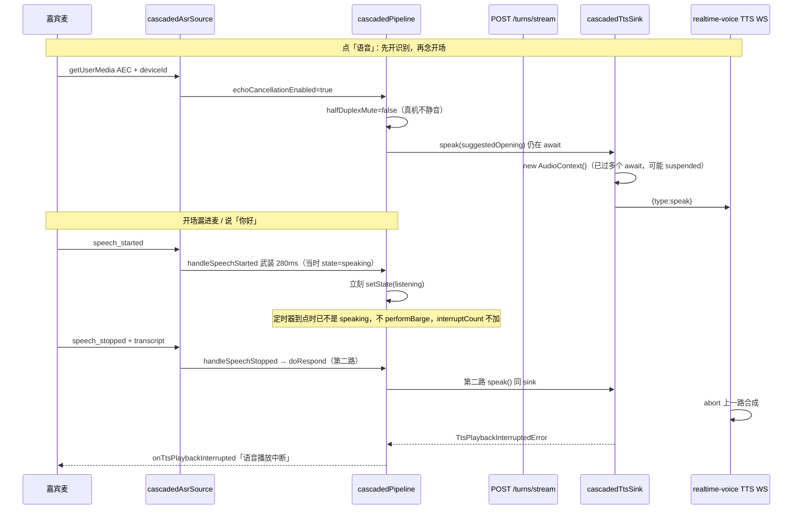
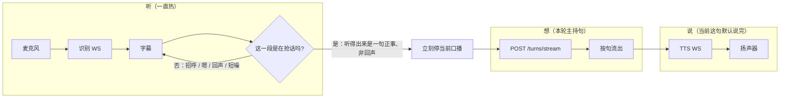
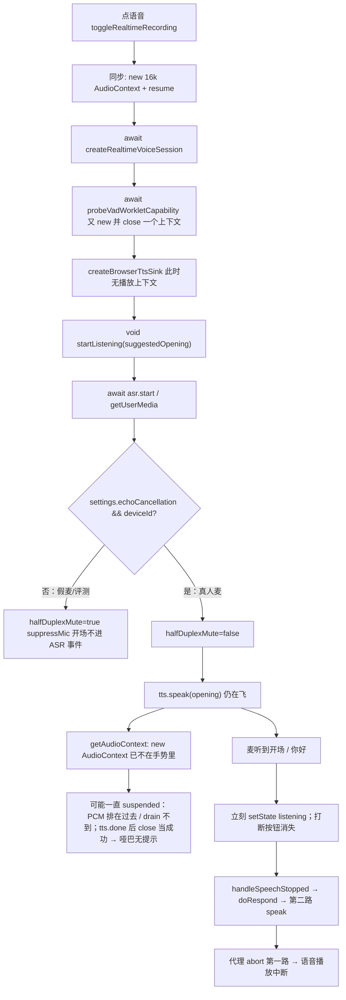

# 专访现场：听、想、说三条同时走，主持人要把话说完

| 字段 | 值 |
|------|-----|
| **文档标题** | 专访语音：听/想/说三轨并行 + 主持人出声 + 真抢话才打断 |
| **作者** | Grok Design |
| **日期** | 2026-08-22 |
| **状态** | Draft · Rev B（抢话不问 completeness；两处 AudioContext 在任何 await 之前 new+resume；TTS 心跳飞行中翻 inFlight 旗不拆定时器；日志扩 payload） |
| **仓库** | `/home/admin/projects/zhuanfang` |
| **验收环境** | 已部署 demo `https://zhuanfang.example.com`（SSH 约定机，应用 `/opt/zhuanfang/app`） |
| **对照提交** | `7fac967`（识别不再因 ping 被踢；TTS 连接/总超时 10s/60s → 30s/180s） |
| **上一份相关计划** | `docs/plans/2026-08-21-zhuanfang-voice-lock-book.md`（其中「活路径没接流式」已过时，见下文） |
| **本文性质** | 设计-only。不写代码、不盖 GATE-HUMAN-VALUE。评测脚本绿了不算完。 |

---

## 给产品负责人的人话

打开专访，点「语音」。你要听到的是：主持人先开口问一句；底下那行字跟着你的说话往前走；他正在说的时候，你随口「你好」**不会**把他掐掉，他会把这一句说完。只有你真的抢过话来——说了一段有内容的话——他才停，听你这一段，再接着问。

**现在实际怎样：**

- 识别那一行已经能跟着走了。前几天识别会大约半分钟卡死一次，已经修过。
- **主持人还是经常不说话。** 不是「慢一点」，是你坐在麦前听不到他。
- 他一开口，系统常把他自己的声音、或你随口的招呼，当成一轮新问答：正在播的那句被掐掉，弹出「语音播放中断」；有时喇叭根本没响（浏览器没真正开始播）。识别、想下一问、把话说出来，本该同时进行；现在被做成了：他一开口就容易被新一轮顶掉，或者干脆把麦克风当开关。

**做成之后，你打开专访会听到/看到：**

1. 点「语音」之后，主持人用自己的声音先问开场那一句。不是弹「语音播放中断」然后哑巴。
2. 你说话时，底下那行字继续动。他说话时，那行字也可以动，但**不会**因为一句「你好」、一声「嗯」、或扬声器漏回来的他自己的声音，就把他掐掉。
3. 他正在说的这一句，默认说完。你真的要打断——听得出来是一句正事、不是他的回声——他才立刻停。已经出口的半句留在书里；他听你这一段，再回答这一段。短促的真抢话，点「打断」也会立刻停，按钮在他还在出声时一直在。
4. 你说完正事之后，他会接着问，而且你听得到。

**怎样算做完：** 你自己坐在 `https://zhuanfang.example.com` 的麦克风前，登录主人账号，连走三轮：

1. 点语音，开场能听见主持人。
2. 他说话时你说「你好」，他继续说完；底下可以闪你的字，但不当成一轮新问答。
3. 你讲一件具体的事（不是两个字的招呼），他停、听完、再开口，你听得到下一问。

模拟评测、假麦克风、短音频片段，**不能**替你宣布这场专访有价值。

**这一轮明确不做：** 不改播客的双人声音和口播确认；不另起一套数据库；不在本机装依赖、不跑浏览器大测；不清主人仓；不把密钥写进 git；不宣布「对人有价值」。

---

## Overview

专访默认语音是 cascade：麦克风 → 识别成字 → 文本主持人脑出下一问 → `qwen-audio-3.0-tts-plus` 读出来。工艺在文本脑里。语音层只做三件事：**一直听、一边想、把正在说的话说完**——三件事同时发生，而不是半双工对讲机。

`7fac967` 修好了识别被代理心跳误杀；TTS 超时也拉长了。现网 `/api/health`（2026-08-22 审查当场）`sampleCount=3`：`ttsTtfb p50=67ms / p95=136ms`（该字段是「开始调用 speak」，**不能**当成「喇叭响了」），`llmTtft p50=12979ms`，`ttfaP50=9177ms`，`interruptCount=0`。`interruptCount=0` 与「自动抢话掐开场」对不上——自动 `performBarge` 才会打这个数。

剩下两件产品失败叠在一起：

1. **真人麦前主持人不说话**（开场尤其）。第一因不是 280ms `tts.stop()`，见 §Host mute：播放上下文可能没真正跑起来；开场 `speak` 还在飞时状态被打成聆听，第二路交卷把第一路掐成「语音播放中断」。评测假麦克风走半双工静音，所以评测绿、真人哑。
2. **听和说互斥。** 真人设备声称回声消除后，活路径故意不静音麦克风（`8b3f2f3`），识别事件在开场期间当新一轮处理。用户明确不要对讲机，也不要对每一声「你好」开新轮。

本方案选 **方案 C**：识别、思考、回答三条并行轨；只有「真的抢话」才打断当前口播。PR-1 先让人听见主持人，再做三轨——没有声音的并行是演戏。

---

## Background & Motivation

### 打开现场，这一章的责任

打开专访，这一场是 **主人和主持人面对面说话**。该发生的事：主持人先开口；主人说话时字在走；主持人说话时主人说「你好」不能把这句掐掉；主人真要讲正事时主持人让位。世界收的账是 token-plan 的识别 / 文本脑 / 语音费。上一拍留下的是「识别活了」；这一拍必须让人听见主持人，并且不要对讲机。

### 活路径（2026-08-22 对照源码，不是 08-21 愿望）

`App.tsx` 只走 `useRealtimeVoiceControls`。`src/realtime/startRealtimeVoiceConnect.ts` **仍然无人 import**。但 `2be4214` 之后，活路径 **已经** 把 `sendUserTurnStream` 传进 `connectCascadedPipeline`（`useRealtimeVoiceControls.ts` 里 `sendUserTurn` + `sendUserTurnStream` 一并注入）。08-21 计划写「流式没接上」已经过时。过时的是 **编排还把听/说互砍**，不是「脑不会流式」。



| 层 | 活文件 | 现状 |
|----|--------|------|
| 入口 | `src/hooks/useRealtimeVoiceControls.ts` | cascade 默认；点击栈里先 `new AudioContext({sampleRate:16000})` **并 await resume**，再 await 建会话 / probe VAD，再 `createBrowserTtsSink`（此时还没有播放上下文）；`startListening` **不 await** |
| 采集 | `src/realtime/cascadedAsrSource.ts` | 16k `__zhuanfangAudioUnlock`；`echoCancellation: true`；**有 deviceId 才信 AEC**（`0c26d1b`，评测假麦走半双工） |
| 识别 | `apps/api/src/realtime/asrProxyConnection.ts` | 代理：入站帧当活、上游 120s 换接（`recycleIdleAfterMs = 120_000`，`7fac967`）。`create_response:false` 在浏览器 `cascadedAsrSource.ts` `buildAsrSessionUpdate`，由代理转发，**不是**代理自己设的 |
| 编排 | `src/realtime/cascadedPipeline.ts` | 有 `sendUserTurnStream` 就按句 `tts.speak`；说话期 `suppressMic` **仅当** `halfDuplexMute`。`processSpeechStarted` **无论抢话成没成**都立刻 `setState("listening")` |
| 抢话 | `cascadeTurnDecision.ts` `shouldAcceptBargeIn` | 传入 `speechMs=0`，即时分支恒 false；武装 `minBargeInMs` 定时器，但回调要求 `state` 仍是 thinking/speaking。开场路径上定时器到点时往往已经是 listening，**不会** `performBarge` / 不加 `interruptCount` |
| 脑 | `POST /api/interview-sessions/:id/turns/stream` | 用户句先落库；`createAssistantTurnStream` 有 delta；取消走 `/turns/cancel` 不撕 SSE |
| TTS 浏览器 | `src/realtime/cascadedTtsSink.ts` | **自己** `new AudioContext()`，不复用解锁上下文；同 sink 第二路 `speak` 会中断第一路；`close(1000,"tts sink closed")` |
| TTS 代理 | `apps/api/src/routes/realtime-voice.ts` `/ws/tts/:id` | `attachWebSocketHeartbeat`；`onTimeout` 里 `cleanup()`（`abortController.abort()`），helper 的 `finally` **无条件** `socket.terminate()` |
| TTS 上游 | `apps/api/src/providers/bailian-streaming-tts.ts` | demo：`qwen-audio-3.0-tts-plus` / `longanlingxin`；连接 30s / 总 180s |
| 声音 id | `normalizeCosyVoice` vs `resolveQwenAudioTtsVoice` | 播客 HTTP 会映射欢→聆心、洋→谦；**专访流式代理不映射** |
| 打断按钮 | `InterviewView.tsx` | 仅 `voiceStatus==="speaking"` 显示。开场被打成 listening 后按钮消失，最需要时点不到 |

### 评测绿、真人哑：不是同一条路

`0c26d1b` 写得很清楚：假麦克风常声称 `echoCancellation` 但没有 `deviceId`，**强制半双工**，免得开场 TTS 把第一轮真话吃掉。

真人主人账号、真声卡：`deviceId` 在，`getEchoCancellationEnabled()===true`，`startListening` 里：

```ts
halfDuplexMute = !(echoCancellationEnabledOpt ?? asr.getEchoCancellationEnabled?.() ?? false);
```

于是 **开场不静音**。扬声器漏回来的开场、房间噪声、一句「你好」，走 `processSpeechStarted`：

1. `handleSpeechStarted` 见 `state==="speaking"`，`shouldAcceptBargeIn(0, minBargeInMs)` 为 false，武装 280ms 定时器后 return false。
2. `processSpeechStarted` **立刻** `setState("listening")`（`cascadedPipeline.ts` 约 848–865 行，注释写要先检查 speaking 再改态）。
3. 定时器到点：`state !== "thinking" && state !== "speaking"` → **return，不 `performBarge`，不 `tts.stop()`，不加 `interruptCount`**。
4. `handleSpeechStopped` 在 listening 下交卷 → 第二路 `doRespond` → 同一 sink 再 `speak` → 代理 abort 上一路 → `TtsPlaybackInterruptedError` → UI「语音播放中断」。

现网 `interruptCount=0` 与这条路径一致。`ttsTtfb p50=67ms` 只证明某次 `doRespond` 进了 `speak()`；开场 `startListening` 的 `tts.speak(opening)` **根本不打** `ttsTtfb`。

单测「AEC 开着时，不相似高能量可以打断正在出声的主持人」测的是 **`doRespond` 出声后**，不是开场。按上面状态机，静态上看定时器到点时可能已经不是 speaking，到不了 `heldStop`。本机未跑该测，**不得**把它当成「280ms 必停已锁死」的证据。产品要否定的是「开场/说话时把识别当新一轮」以及「永远可打断」，不是一篇可能过不了的金样字面。

---

## Goals & Non-Goals

### Goals

1. **开场必出声**：点语音后听见主持人开场。不得用「语音播放中断」代替声音。
2. **追问也出声**：主人说完一件事，下一问听得见。
3. **三轨同时**：主持人说话时识别仍热、字幕可走；当前口播默认说完；脑可以继续生成**这一轮**还没说完的字。
4. **打断是抢话，不是招呼**：见 §Interrupt policy。
5. **验收是主人坐在麦前走三轮**，对象是已部署的 `zhuanfang.example.com`。

### Non-Goals

- 不盖 GATE-HUMAN-VALUE；模拟评测不能当完成线。
- 不改默认路径为 Omni E2E / LiveKit。
- 不改播客确认、双人声音选择、写锁，除非证明与专访 TTS 客户端有具体耦合（目前：播客走 `createBailianPodcastAudioClient` + `resolveQwenAudioTtsVoice`；专访走 TTS WS 代理。超时常数已共享在 `bailian-streaming-tts.ts`，本方案不再动超时数字，除非 PR-1 证明仍不够）。
- 不在 Grok 运行机 `npm ci` / Playwright / 本机 Surreal。
- 不为验收再拉一套库或第二套 compose。
- 不清主人仓；密钥不进 git。
- 不上 Speex / 专业 AEC 实验室。浏览器 AEC 只作辅助，**不能**再当「可以立刻开新一轮 / 280ms 抢话」的许可证。
- 不在说话期间预生成「下一轮嘉宾还没说的问题」。想的是**这一轮还没说完的主持句**。

---

## Key Decisions

1. **选 C，不选 A/B。** 真机不再靠关麦克风装回声消除；也不对每一帧识别抢话。三条轨 + 抢话政策。
2. **PR-1 先出声，PR-2 再拆半双工。** 没有声音的并行是演戏。PR-1 **不**改 `halfDuplexMute = !AEC` 这条默认（那是 PR-2）。
3. **打断看「嘉宾是不是在抢话讲一件事」，不看词表，不看 completeness，也不看「≥6 字 AND ≥900ms」格子。** 「你好」是招呼的例子，不是要维护一份禁词名单。`assessTurnCompleteness("你好")` 是 `ambiguous`，和口语「那次救火」同类——**禁止**拿它当抢话主闸。
4. **非抢话：不 `tts.stop()`，不新开主持轮。** 字幕可以闪，不当作交卷。
5. **真抢话：立刻停 TTS，已出口的半句保留，听这一段再答这一段。** 用户句仍先落库（已有 `/turns/stream` 契约）。短促真抢话靠「打断」按钮；按钮必须在喇叭还在响时可见。
6. **16k 解锁上下文与播放上下文：两个 `new AudioContext`、两次 `resume()` 的调用，都必须发生在进入任何一个 `await` 之前。** 随后可以 `await` 这两个 Promise。禁止在 `await unlock.resume()` 之后再 `new` 播放上下文。禁止复用 16k 采集上下文；禁止在 `createBrowserTtsSink(...)` 那一行才 `new`（那一行已在建会话 / probe VAD 之后）。`getAudioContext()` 只复用传入的。`createBrowserTtsSink` 第三参 `playbackCtx?` **必须 optional**（`startRealtimeVoiceConnect.ts` 本轮不复活，但要能继续编译）。
7. **TTS 插座升级时按默认挂心跳（`terminateOnTimeout` 保持 true，空闲暖插座仍可被杀掉）。** 飞行中只翻同一份闭包里的 `inFlight` 旗（helper **每拍读取**）。timeout 且 `inFlight`：**不 `dispose()`、不 `terminate()`、不 `cleanup()`/`abort`，把 `missedPongs` 归零**，定时器继续跑。合成结束把 `inFlight` 扳回 false，空闲可再杀。**禁止**给整段 TTS 连接把 `terminateOnTimeout` 设成 false。今日 helper 在 timeout 时先 `dispose()` 再 `onTimeout`——只改 `onTimeout` 正文仍会拆掉定时器。日志：扩 `buildRealtimeProxyLog` 的 payload（可选 `inFlight`），或写进 `reason`；现函数 **没有** 这个字段。
8. **流式 TTS 的 voice 走 `resolveQwenAudioTtsVoice`。** 与播客 HTTP 对齐。demo 默认 `longanlingxin` 能说；配置里若仍选欢/洋，不能再 411 哑巴。
9. **`openingHold` 是产品态，不是只禁 `tts.stop()`。** 开场 `speak` settle 前：内部保持 `speaking`（打断按钮仍在），**不** `setState("listening"|"transcribing")`，**不** `doRespond` / `sendUserTurnStream`，**不**武装 280ms 定时器。字幕可写侧轨。用户点「打断」仍立刻停。回声不得掐开场。
10. **live TTS 文本在每一句 `tts.speak` 开始时写入相似隔离**（开场用 `suggestedOpening`，追问用即将出口的子句）。禁止等 `await speak` 之后才 `noteTtsPlayback`——那时候说话当时 `recentTts` 是空的。drain 后再记 `endedAt` 作回声窗。这是 PR-2 合同；PR-1 开场 hold 不依赖它。
11. **完成线是主人麦前三轮，不是 eval_sim。**
12. **`startRealtimeVoiceConnect.ts` 本轮不复活、不删除。**

---

## Proposed Design

### 目标编排：三条同时的轨



状态机不再把 `speaking` 写成「麦克风不存在」。建议产品态：

| 对用户显示 | 内部 | 听 | 想 | 说 |
|------------|------|----|----|----|
| 聆听中 | `listening` | 热 | 空闲 | 空闲 |
| 正在想下一问 | `thinking` | 热 | 本轮 SSE | 已开始的句子可先出声 |
| AI 正在回应 | `speaking`（含开场 hold） | 热（字幕可走） | 本轮还可继续流出 | 当前句播放 |
| 已打断 | `interrupted` 过渡 | 热 | 取消本轮生成 | 停 |

`thinking` 与 `speaking` 允许重叠：流式路径里第一句完整子句就会 `setState("speaking")` 并 `await tts.speak`，SSE 仍在收 delta（已是活路径）。缺的是 **听** 与 **说** 重叠时不要互砍：说话时不得把 UI 打成聆听，不得开第二路 `doRespond`。

---

## Host mute（主持人不出声）：as-is 调用图与最小修复

### 开场调用图（活代码）



### 原因排序（都还在活代码里；超时只是其中一条，而且已经被拉长）

| 秩 | 严重 | 原因 | 证据 | 为何评测看不见 |
|----|------|------|------|----------------|
| **1** | P0 | **播放 AudioContext 在第一个 await 之后才创建，可能一直 suspended** | 点击栈已有 16k 解锁并 `await resume`，然后 await 建会话、await probe VAD（自己又 new/close），`createBrowserTtsSink` 仍无播放上下文。`getAudioContext()` 在 `await asr.start()` 之后才 `new AudioContext()`。挂起时钟 `currentTime≈0`；`state !== "running"` 时 `resume()` 失败仍继续 schedule；已收到 `tts.done` 时 `onclose` 走 `synthesisComplete` 当成功——**哑巴且不弹中断**。现网 `ttsTtfb` 有数、`interruptCount=0`，更像「调用了 speak、喇叭没响」。 | Playwright 常放行 autoplay |
| **2** | P0 | **开场 `speak` 未 drain 时立刻 `listening`，第二路 `doRespond`/`speak` 掐成「语音播放中断」** | 真机不静音。`processSpeechStarted` 无论抢话成没成都 `setState("listening")`。280ms 定时器因状态已变 **不** `performBarge`。listening 下 `handleSpeechStopped` 交卷，同一 sink 第二路 `speak` abort 第一路。`onTtsPlaybackInterrupted`。`interruptCount` 不加。打断按钮因非 speaking 消失。 | `0c26d1b` 假麦无 deviceId → `suppressMic`，ASR 事件进不来，锁的是半双工开场金样，锁不住真机 |
| **3** | P1 | **TTS 代理把安静的浏览器当成死连接** | `attachWebSocketHeartbeat` 只把 pong / **入站** message 当活；合成音频是代理→浏览器。`onTimeout` 调 `cleanup()`（abort 合成），`finally` 无条件 `terminate()`。约 30s 量级，**解释不了开场瞬间哑巴**，但是长句地雷。 | 短样本 / 假 TTS |
| **4** | P1 | **专访流式 voice 不走 411 映射** | 代理 `normalizeCosyVoice(msg.voice)` 原样转发。`resolveQwenAudioTtsVoice` 只在播客 HTTP。配置若是 `longanhuan` / `longanyang` → task-failed。demo env 默认 `longanlingxin`，**默认配置不是主因**。 | 评测多用默认声 |
| **5** | P2 | **指标把「开始调用 speak」当成出声** | `ttsTtfbMs` 在 `firstSpeakStarted` 用 `Date.now()`，不是第一块 PCM。开场 `speak` 不打这个字段。`llmTtft p50≈13s` 会让追问 **听起来像哑巴**，但开场不经过 LLM。 | 样本少 |
| **6** | P2 | **识别耗尽会连带 `tts.close()`** | `terminateVoicePipelineAfterExhaustion` 关 pipeline。`7fac967` 后识别心跳误杀应少很多。 | 长场才出现 |

**不要**再把「再加长 TTS 超时」或「禁 280ms `tts.stop()`」当 PR-1 的主刀。连接窗口已 30s；280ms 定时器在开场路径上经常根本打不中 `performBarge`。

### PR-1 最小修复（这一拍就要能听见）

只动专访出声，不重写抢话产品（那是 PR-2），也 **不** 拆 `suppressMic` 主路径。四刀：

1. **任何 `await` 之前创建并调用 resume**  
   在 `toggleRealtimeRecording` 里，进入任何一个 `await` 之前（含 `await unlock.resume()` **之前**）：`const unlock = new AudioContext({ sampleRate: 16000 })` 与 `const playbackCtx = new AudioContext()`（播放用 24k 或浏览器默认，**不要**复用 16k）都 `new` 完，并都 **调用** `resume()`。随后可以 `await` 这两个 Promise，再 await 建会话 / probe VAD / getUserMedia。**禁止** `await unlock.resume()` 之后再 `new` 播放上下文。把 `playbackCtx` 引用穿过后续 await，传入 `createBrowserTtsSink(url, voice, playbackCtx)`。禁止在 `createBrowserTtsSink` 调用点才 `new`。`getAudioContext()` 只复用传入的；没有传入时才创建（optional 第三参，给死文件/测试）。若 `speak` 时仍非 `running`：**失败并提示「浏览器拦住了声音，请再点一次语音」**，禁止 `tts.done` + 挂起时钟当播完。

2. **openingHold = 保持 speaking + 禁第二路交卷**  
   `startListening` 在 opening `speak` 开始时设 hold，直到 settle（成功、失败、用户点了「打断」）。Hold 期间：
   - 内部保持 `speaking`（或单独 `opening` 但 UI 仍显示「AI 正在回应」），**不** `setState("listening"|"transcribing")`；
   - **不** `doRespond` / `sendUserTurnStream` / `sendUserTurn`；
   - **不**武装 280ms 定时器，**不** `performBarge`（用户点「打断」除外）；
   - 字幕可以写 `liveUserTranscript` 侧轨。  
   只禁 `tts.stop()` **不够**：真机开场经常根本没走 `performBarge`。

3. **TTS 飞行中心跳不得 abort / terminate / dispose**  
   升级 TTS 插座时按默认 `attachWebSocketHeartbeat`（`terminateOnTimeout` 保持 true：空闲暖插座仍可杀）。helper 增加每拍读取的 `isInFlight?: () => boolean`（或等价可变旗）。`synthesizeStream` 开始把旗翻 true，结束/出错翻 false。timeout 分支今天先 `dispose()` 再 `onTimeout` 再 `finally terminate()`——飞行中这条必须改成：**不 dispose、不 terminate、不 `cleanup()`/`abort`，`missedPongs = 0`，定时器继续**。空闲超时仍走原来的杀法。日志扩 `RealtimeProxyLogInput` 可选 `inFlight?: boolean`（或写入 `reason: "in-flight"`）；**不要**假设现有 `buildRealtimeProxyLog` 已接收该字段。  
   现有 `realtime-voice.test.ts`「`autoPong: false` 合成中被 1006 掐掉」改为：飞行中保持 OPEN、心跳仍在、`synthesisSignal.aborted === false`；合成结束后无 pong 仍可被空闲超时关掉。

4. **`speak` 的 voice 经 `resolveQwenAudioTtsVoice`**  
   代理在 `normalizeCosyVoice` 之后映射。浏览器仍可显示用户选的名字；送上游的是能说的 id。

**PR-1 必须新增金样**（真机开场，不是半双工那条）：`echoCancellationEnabled: true` + opening `speak` 仍 held + `speech_started` + 转写「你好」+ `speech_stopped` → `tts.stop` 不被调用、`sendUserTurn` / `sendUserTurnStream` 不被调用、不走 `onTtsPlaybackInterrupted`、状态仍是 speaking。现有半双工开场金样继续留给假麦降级。

验收（PR-1）：主人点语音，**不开口、不说你好**，开场能听见。若仍哑，必须看到「浏览器拦住了声音」（原因 1 暴露），不能再静默成功。

---

## Interrupt policy（产品，不是词表）

打开现场应该发生的事：

- 主持人正在说。你说「你好」、嗯、咳嗽、扬声器漏回来的他自己的话：**不是打断**。他继续说完。
- 你真的要讲了：侧轨里已经是在抢话讲一件事、有独立能量、不是他刚念的那句：**是打断**。他立刻停。书里留下他已经说出口的半句和你这一段。然后他答你这一段。

**禁止**把「左右必须出现某几个字」「招呼名单里有没有你好」「必须满 6 个字且满 900ms」「completeness === complete」写成产品通过条件。规则若只靠堆字、拖时长、或换一套句尾分类就能过、现场并没有人在抢话，就是坏规则。

给实现的判定（一条问一件事）。**不要**复用 `assessTurnCompleteness`：它问的是「这句说完了没」。活代码里 `assessTurnCompleteness("你好")` 是 **`ambiguous`**，与「你说得对」「我昨天去了公司」、无句号的「那次救火」同类（`TRAILING_FILLERS` 有「嗯」「呃」，**没有「你好」**）。接 `complete` 则第三轮正事不停；接 `!== incomplete` 则第二轮「你好」会掐。

```ts
export interface TakeFloorInput {
  transcript: string;
  hasUserEnergy: boolean;
  similarToLiveTts: boolean; // live 文本在 speak 开始时写入，不是 await 之后
  takingTheFloor: boolean;   // 嘉宾是不是在抢话讲一件事，不是 completeness
}

export function isTakeFloor(input: TakeFloorInput): boolean {
  if (input.similarToLiveTts) return false;
  if (!input.hasUserEnergy) return false;
  return input.takingTheFloor;
}
```

`takingTheFloor` 问的责任：侧轨是招呼/应答/语气，还是在抢话把一件事拿到场上？单独招呼、应答、语气（例如「你好」「嗯」「好的」「啊」）→ 否；有事情或明确要他停下来听（例如「等一下你听我说那次救火」）→ 是。这些是 **例子**，不是产品测试用的禁词表——实现不得扫一张招呼名单当过关。极短否决可复用现成 `turnAssembler`「去空白 ≤2 字不像交卷」，那是否决，不是「必须满 6 字才算」。

时长只作 **辅助**（可忽略极短 VAD 毛刺），**不是**与字数 AND 的硬门。麦前三轮再调辅助阈值。

PR-2 金样写死（非回声、有能量时）：转写 `你好` → `isTakeFloor` false；转写 `等一下你听我说那次救火` → true。

工程默认：

- 不在 `speech_started` 上靠定时器抢话（删掉「0ms + 280ms 一律停」）。
- 说话/思考/开场 hold 期间识别事件进入 **侧轨**：更新 `liveUserTranscript`，**不** `setState("listening")`，**不** `doRespond`。
- 每当侧轨文本变了，求一次 `isTakeFloor`。true → `performBarge`（现有：abort LLM、`tts.stop()`、保留 `spokenTextSoFar`、打 interrupt REST）。
- false → 主持人继续；侧轨字幕可显示；**不** `sendUserTurnStream`。
- 口播结束后，侧轨里若只是招呼/空，丢弃或留字幕，不交卷。若口播结束后人已经在讲正事，把侧轨并进下一轮听。

手动「打断」按钮保持立刻停，不走抢话判定。**按钮必须在喇叭还在响时可见**（依赖 openingHold / speaking 不提前翻 listening）。短促真抢话（「停」）靠这颗按钮，不靠格子。

**live TTS 文本（PR-2，否则回声变真抢话）：** 每一句 `tts.speak(segments)` **调用前**就把该句写入 live 文本（开场=`suggestedOpening`，追问=即将出口的子句）。`isTakeFloor.similarToLiveTts` 用这块。drain 后再把 `endedAt` 收进回声窗。今日 `noteTtsPlayback` 在 `await tts.speak` **之后**，说话当时 `recentTts === null`；真机漏音还会让 `hasRecentUserEnergyEvidence()` 为 true——现成相似隔离在说话当时几乎恒为假。PR-2 金样必须覆盖：AEC 开 + 正在播开场 + 回声转写 ≈ 开场原文 + 能量为 true → **不停、不交卷**。

---

## 三轨怎么改活路径

### 听

PR-2 才删掉把静音麦克风当抢话替代的用法：`muteForTts` / `suppressMic` / 说话期 `processTranscriptDelta` 直接 return，不再作为产品主路径。PR-1 不动这条默认。

`halfDuplexMute` 只允许作为 **显式降级**（Worklet 失败、用户关掉浏览器 AEC、或以后配置 `halfDuplexFallback`——该字段今天只写在 `types.ts`，**没有接线**）。PR-2 默认真机：听一直热。

回声：相似隔离必须用 **speak 开始时** 的 live 文本 + `hasRecentUserEnergyEvidence`。禁止声称「继续用已有 `noteTtsPlayback` 事后窗」就能挡住说话当时的回声。

### 想

保持活路径 `sendUserTurnStream`。`doRespond` 已按句 flush。PR-2 **不要**再接一条并行的「下一轮还没发生的问题」。SSE 在说话时继续收 delta 即可。

真抢话时：已有 `AbortSignal` + `POST .../turns/cancel`；服务端不撕 SSE，用户句已落库，主持句截到已出口。不要退回整段 `POST /turns`。

### 说

`tts.speak` 仍一句一句 drain（缝隙最小）。关键变化：非抢话不得 `stop()`。`processSpeechStarted` 在说话时 **不得** 把状态打成 `listening`（今天这会让 `doRespond` 在旧 TTS 还在播时开新一轮，这是开场「语音播放中断」的真因，不是 280ms `tts.stop()`）。

开场：PR-1 的 `openingHold` 留着，作为抢话判定之上的硬门。

---

## API / Interface Changes

无新的对外 REST。行为变化：

| 接口 | 变化 | 落在 |
|------|------|------|
| `createBrowserTtsSink(url, voice, playbackCtx?: AudioContext)` | 第三参 optional：任何 await 之前 new+调用 resume 的播放上下文 | PR-1 |
| `attachWebSocketHeartbeat(..., { isInFlight?: () => boolean })` | 升级时仍默认可杀空闲；飞行中 timeout 不 dispose/terminate/cleanup，reset missedPongs | PR-1 |
| `buildRealtimeProxyLog` | 可选扩 `inFlight?: boolean`，或写入 `reason`；现字段没有 inFlight | PR-1 |
| pipeline 内部 `openingHold` | 保持 speaking + 禁 doRespond / 禁 280ms 定时器 | PR-1 |
| TTS 代理 `{type:speak, voice}` | 上游 id = `resolveQwenAudioTtsVoice` | PR-1 |
| `ConnectCascadedPipelineOptions` / 默认 `halfDuplexMute = !AEC` | PR-2 才改：真机不再静音当主路径；抢话改走 `isTakeFloor`；speak **开始**时写 live TTS | PR-2 |
| `POST /turns/stream` / `/turns/cancel` | 不改契约 | — |
| `systemConfig.voice.minBargeInMs` | 不再是唯一闸；至多作极短毛刺辅助，不是「满 N 毫秒才算抢话」的产品定义 | PR-2 |

`startRealtimeVoiceConnect.ts` 本轮 **不复活、不删除**（无人引用）。`createBrowserTtsSink` 第三参 optional，避免该死文件编译裂。

---

## Data Model Changes

无 schema / Surreal 迁移。`halfDuplexFallback` 若接线，只是配置布尔，默认 false。不要为三轨加新的会话字段。

---

## Alternatives Considered

### A. 保持半双工 `suppressMic`

说话时丢弃识别，结束后再开麦（今日评测假麦路径）。

- 好处：开场 ASR 事件进不来，第二路交卷不会掐开场；实现已在。
- 坏处：用户明确否定。字幕在说话时假死；「你好」要么进不去、要么等他说完才变成一轮怪问答。把听/说做成对讲机。

拒绝。只允许作为设备/Worklet 降级。

### B. 天真的永远可打断 / 把每一段识别当新一轮

AEC 开着就不静音；VAD 一响或定时器一到就停 TTS，或立刻翻 listening 让 `doRespond` 开新轮（今日真机开场的实际伤害是后者，不是 280ms `performBarge`）。

- 好处：真抢话延迟低。
- 坏处：过度灵敏；开场回声或「你好」变成第二路 speak，弹出「语音播放中断」；`interruptCount` 还不涨，指标撒谎。用户点名不要。

拒绝作为产品默认。

### C. 三轨 + 抢话政策（本方案）

听一直热；当前口播默认说完；只有嘉宾在抢话讲一件事、非回声才停。

- 好处：对准产品原话；开场 hold 挡住第二路交卷；字幕可在说话时走；真抢话仍立刻停；短促抢话有「打断」按钮。
- 坏处：自动抢话要等侧轨听得出来是在讲事，比「VAD 一响就停」慢半拍。可接受：真抢话本来就不是两个字；误开新轮的代价（哑巴、乱轮）更高。

---

## Security & Privacy Considerations

- TTS / ASR WS 继续走现有 upgrade 鉴权（bearer / `?token=` / cookie）。不新开口子。
- 说话期间字幕更勤：仍只进本场 UI 与本场书，不新增长传通道。
- voice id 映射在服务端做，避免把 411 的内部错误信息回给浏览器。
- 日志继续走 `buildRealtimeProxyLog` 脱敏。不要把逐字稿打进 heartbeat 日志。

---

## Observability

现网 `GET /api/health` → `metrics.voice`。本方案要让数字对人诚实：

| 信号 | 今天 | 改为 |
|------|------|------|
| `ttsTtfbMs` | 调用 `speak()` 的时刻 | **不改这个字段的旧语义**（热更前后 p50 不可比）。PR-3 新增 `ttsPcmTtfbMs`（第一块 PCM 排进 AudioContext），snapshot 可带 `ttsTtfbDefinition: "pcm_scheduled"` 供新环。旧 `ttsTtfbMs` 可留作诊断或逐步弃用，禁止默默换定义 |
| `interrupted` / `bargeInSuccess` | 今日开场掐声往往 **不加** interruptCount（第二路 abort ≠ `performBarge`） | 拆 `takeFloor`；第二路 abort 开场算 **误交卷/误打断**（false-trigger），不要当抢话成功 |
| 新：`openingAudible` | 无 | 开场 `speak` settle 且至少一块 PCM 已 schedule |
| 新：`playbackContextState` | 无 | `running` / `suspended`（哑巴时一眼能看） |
| TTS `realtime_proxy_heartbeat_timeout` | 飞行中也会 terminate + abort | 飞行中只 info，合成仍 OPEN。`inFlight` **不是**现有 `buildRealtimeProxyLog` 字段：扩 payload 或写入 `reason` |

告警（demo，不要新栈）：连续开场无 PCM / `playbackContextState=suspended` 升高 → 主持人又哑了。`llmTtft` 仍约 13s 是追问慢，不是本方案完成线，但要标在健康页上免得和哑巴混为一谈。

样本：热更后 **新的** n，不要拿 `sampleCount=3` 的旧环证明出声。

---

## Rollout Plan

1. 实现只在本仓库；交付用已有 `./scripts/deploy_demo.sh` 热更 `zhuanfang.example.com`。不为验收再起 Surreal。
2. **PR-1 单独上 demo**，主人只验开场出声。失败则回滚该 PR（git revert + 热更）。不要夹三轨。
3. **PR-2 上 demo**，同一套栈走「你好不掐 / 真事才掐」。
4. 无 feature flag 平台：以提交为单位回滚。不要加第三套 realtimeMode。
5. 评测假麦仍可跑，但 **不能** 当 PR 合并完成线；假麦半双工降级须继续保护评测不吞第一轮，同时不得把降级当成真机默认。

---

## Risks

| 严重 | 风险 | 缓解 |
|------|------|------|
| 高 | 真机回声在 PR-2 关静音后变成假抢话 | **speak 开始时**写 live TTS；能量为 true 仍判相似则不停；开场 hold；禁止依赖事后 `noteTtsPlayback` |
| 高 | Safari 即使手势里创建上下文仍挂起 | 失败要响、要提示；不要静默成功 |
| 中 | 自动抢话要等侧轨成句，主人觉得「我说了怎么不停」 | 手动「打断」在 speaking/开场 hold 期间一直可见，立刻停 |
| 中 | 侧轨「你好」被误交卷 | openingHold + 非抢话禁止 `doRespond`（PR-1 就禁开场第二路） |
| 低 | voice 映射后欢/洋听起来像聆心/谦 | 与播客现网同一诚实口径；不在本轮改专访名单 |

---

## Blast radius

| 可以动 | 不要动 |
|--------|--------|
| `cascadedPipeline.ts`、`cascadedTtsSink.ts`、`cascadeTurnDecision.ts` / `takeFloor.ts`、`useRealtimeVoiceControls.ts` | 播客确认按钮、`guestVoice`、口播工作台 |
| `apps/api/src/routes/realtime-voice.ts` TTS 分支；`apps/api/src/realtime/websocketResilience.ts`（`isInFlight` 每拍读取；timeout 且飞行中不 dispose） | `write-gate.ts`、登录、建场 |
| TTS 代理上的 `resolveQwenAudioTtsVoice`（与播客映射函数同源、不同调用点） | `podcast.ts` 合成/确认契约 |
| 专访 UI 字幕在说话时仍显示；打断按钮随 speaking/hold | LiveKit / bailian omni 默认切路径 |
| 假麦仍可半双工降级 | eval 框架、GATE-HUMAN-VALUE |

`bailian-streaming-tts.ts` 的超时数字本轮不动。若 PR-1 出声后仍见 `TTS timeout` 再单开，避免和播客长稿抢同一常数。

---

## Open Questions

无。抢话底线是「嘉宾是不是在抢话讲一件事」（非回声、有独立能量），不是 completeness。辅助阈值麦前三轮再调，不阻塞开干。

（若实现时发现某款手机浏览器在任何 await 之前调用 `resume` 仍失败：PR-1 提示文案用「浏览器拦住了声音，请再点一次语音」，不要改成静音半双工冒充修好。）

---

## References

- `docs/plans/2026-08-21-zhuanfang-voice-lock-book.md` — 前序；流式未接线的陈述已过时
- `docs/plans/2026-08-22-podcast-dual-voice.md` — 人话 + 技术正文样式；本轮不改播客
- `8b3f2f3` — AEC 开则不静音（真机开场 ASR 事件能进编排）
- `0c26d1b` — 假麦不信 AEC（评测/真人分叉）
- `2be4214` — 活路径接上 `/turns/stream`
- `7fac967` — 识别心跳；TTS 超时拉长
- 现网 health 2026-08-22 审查当场：`ttfaP50Ms=9177`，`llmTtft p50=12979`，`ttsTtfb p50=67`（=调用 speak，不是 PCM），`interruptCount=0`，`sampleCount=3`
- demo TTS env（`docker exec app-zhuanfang-1 printenv BAILIAN_TTS_*`）：`BAILIAN_TTS_MODEL=qwen-audio-3.0-tts-plus`，`BAILIAN_TTS_VOICE=longanlingxin`
- 先前一稿引用的 `rtv-cda06211` / `tts sink closed`：当时从 `docker logs app-zhuanfang-1` 看到过；**本轮审查快查未再核到**（容器可能已轮转）。不把它当心跳踢掉的证据
- nginx `proxy_read_timeout`：**未在本仓库 `deploy/` 核到**；以服务器 nginx 配置为准。不是本方案开场哑巴的解释，不阻塞开干

---

## PR Plan

### PR-1 — 让主持人出声（开场 + 追问喇叭）

- **Dependencies:** 无
- **Files/components:** `src/hooks/useRealtimeVoiceControls.ts`（任何 await 之前两个 new + 两次 resume() 调用）；`src/realtime/cascadedTtsSink.ts`（复用传入 ctx；非 running 则失败；第三参 optional）；`src/realtime/cascadedPipeline.ts`（仅 `openingHold`：保持 speaking、禁 `doRespond`、禁 280ms 定时器）；`apps/api/src/realtime/websocketResilience.ts`（`isInFlight` 每拍读；飞行中 timeout 不 dispose/terminate，reset missedPongs；日志 payload 可选扩 `inFlight`）；`apps/api/src/routes/realtime-voice.ts`（升级时默认可杀空闲；合成期间翻旗；voice 映射）；`apps/api/src/voice-presets.ts`（只引用）；单测 `cascadedTtsSink.test.ts`、`websocketResilience.test.ts`、`realtime-voice.test.ts`（飞行中 OPEN 且未 abort，结束后空闲仍可杀）、`cascadedPipeline.test.ts`（**新增** AEC+opening+「你好」金样；保留半双工开场金样给假麦）
- **Description:** 进入任何 await 之前创建并调用 resume 播放 AudioContext，交给 TTS sink。开场 settle 前保持 speaking，禁止第二路交卷和「语音播放中断」。TTS 升级时心跳仍默认可杀空闲；合成飞行中 timeout 不 dispose/abort/terminate。`speak.voice` 经 `resolveQwenAudioTtsVoice`。挂起上下文不得当成播完。热更 demo 后主人点语音、自己不说话，必须听见开场。**不**拆 `suppressMic` 主路径，**不**改 `halfDuplexMute = !AEC`。

### PR-2 — 听/想/说三轨 + 抢话政策

- **Dependencies:** PR-1 已在 demo 上能听见开场（否则本 PR 无法验收「你好不掐」）
- **Files/components:** `src/realtime/cascadedPipeline.ts`；`src/realtime/cascadeTurnDecision.ts` 或新建 `src/realtime/takeFloor.ts`（`isTakeFloor`：非回声、有能量、`takingTheFloor`；**禁止**复用 `assessTurnCompleteness`；修正 `shouldAcceptBargeIn(0, …)` 死分支）；`src/realtime/turnAssembler.ts`（**speak 开始时**写 live TTS 文本；≤2 字可作否决）；`src/realtime/cascadedPipeline.test.ts`（`你好` → 不停不交卷；`等一下你听我说那次救火` → 停；**新增** 正在播开场 + 回声≈原文 + 能量 true → 不停不交卷）；`src/hooks/useRealtimeVoiceControls.ts` 仅当需要把说话中字幕传到现有 `liveUserTranscript`
- **Description:** 说话时识别保持热；禁止 `setState("listening")` 触发并行 `doRespond`。非抢话不 `tts.stop()`、不 `/turns/stream`。真抢话走现有 interrupt REST + `spokenTextSoFar`。默认真机不再 `suppressMic`。假麦无 deviceId 仍可降级半双工。热更后走三轮验收。

### PR-3 — 出声指标诚实（可独立审）

- **Dependencies:** 不依赖 PR-2；最好在 PR-1 sink 打点之后
- **Files/components:** `src/realtime/cascadedTtsSink.ts`（第一块 PCM 回调）；`src/realtime/cascadedPipeline.ts` `onLatency`；`apps/api/src/observability/runtime-metrics.ts`（**新字段** `ttsPcmTtfbMs` 和/或 `ttsTtfbDefinition`，不要静默改 `ttsTtfbMs` 含义）
- **Description:** 新环看第一块 PCM；开场是否 schedule 了 PCM；误交卷/误打断与真抢话分开计数。不改变听感。不得把本 PR 当做出声完成。

每个 PR 可单独 revert。PR-2 不得夹带播客/写锁。PR-1 单独可回滚到「再哑但识别仍活」。
