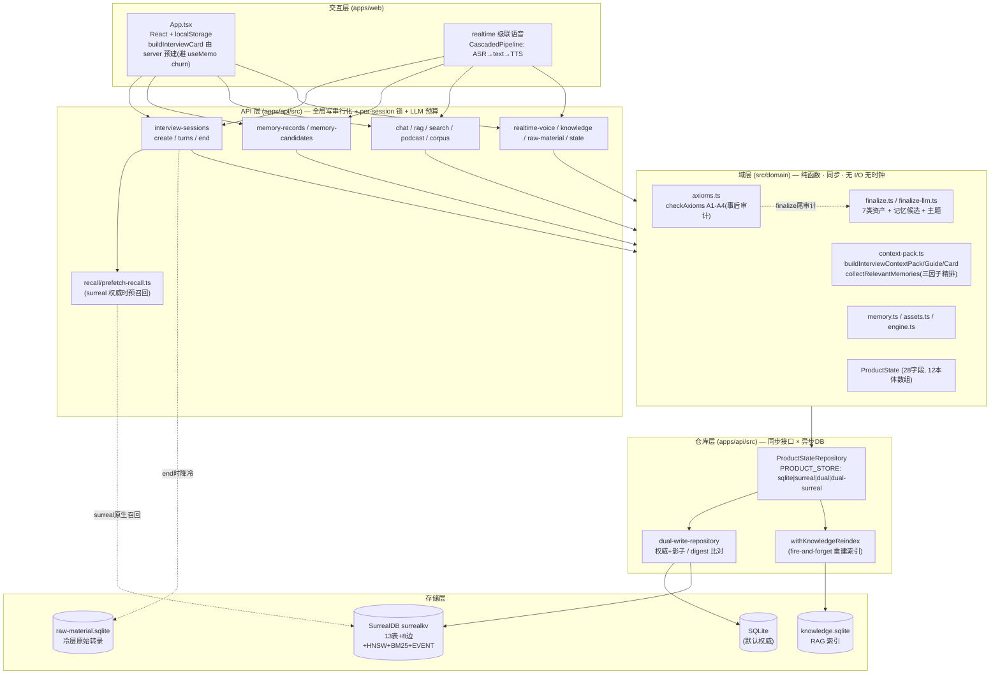
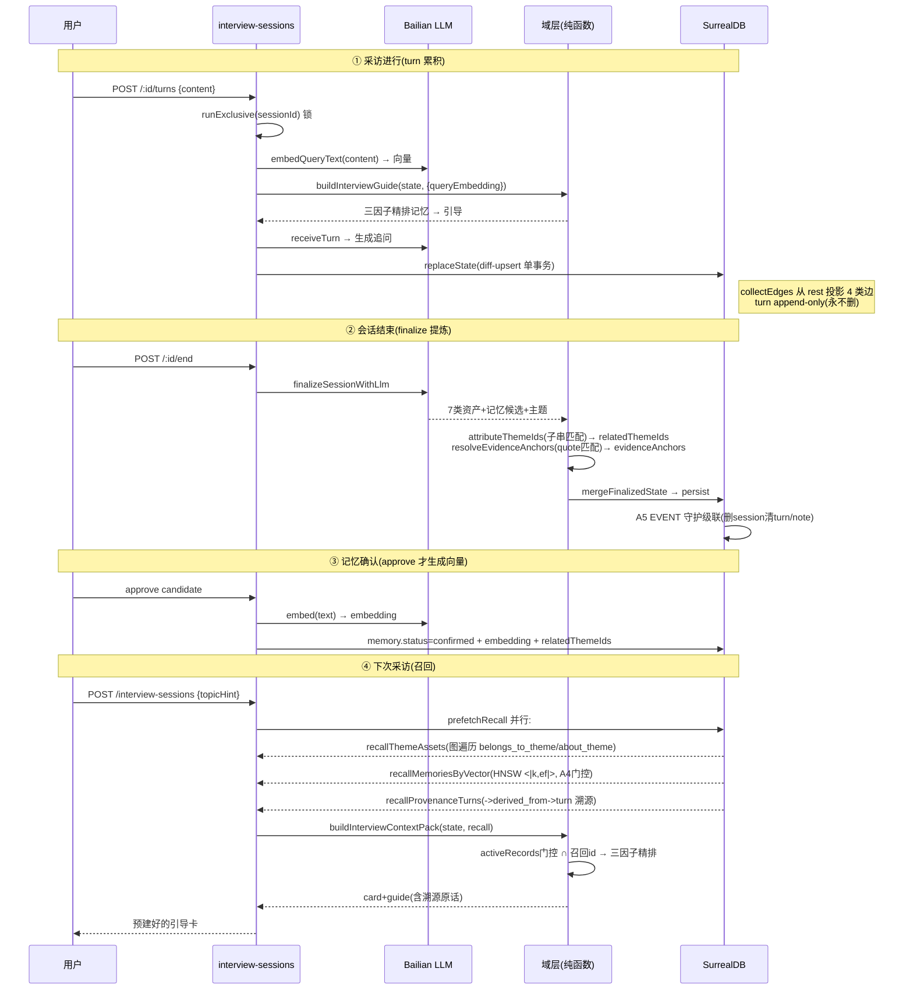

# 专访 1.0 · SurrealDB「完美使用」诊断报告

> 生成日期:2026-06-28　|　基线 commit:`6538b5f1`(本体重构全系列 P0/P1a-d/P2a-c/M1/P3 已落地,全量 1061 绿)
> 方法:2 路并行代码探索(实现层 + 业务链)→ 全网搜 SurrealDB 3.x 最佳实践 → 源码逐点验证 → 综合
> 一句话结论:**结构骨架已经是教科书级的多模型本体落地;真正"差"的不在结构,而在「检索没吃满多模型」「关系建模停在 string 外键」「语义字段闷在 rest blob 里查不动」三处,外加生成侧 relatedThemeIds 的脆弱归属拖累图召回精度。**

---

## 0. 执行摘要:还差什么(按收益/风险排序)

| 级别 | 缺口 | 一句话 | 收益 | 风险/成本 |
|---|---|---|---|---|
| **P0** | 混合检索 `search::rrf` 缺位 | memory/rag_chunk 建了 BM25 索引却只用 HNSW,BM25 完全闲置 | 召回质量立升(补 HNSW 对拼写/专名/精确匹配的盲区) | 低(索引已在,接查询即可) |
| **P0** | `relatedThemeIds` 脆弱子串归属 | 主题归属靠 `theme.name` 子串 includes + fallback themes[0] | 修图召回精度根因(GIGO) | 中(改生成侧,需测) |
| **P1** | string 外键 ≠ record link | turn/note/rag_chunk/memory 的父引用都是裸 string | 引用完整性 + 自动嵌套加载 | 高(破坏 H1 append-only + string 往返,需评估) |
| **P1** | 语义字段闷在 rest blob | evidenceAnchors/relatedThemeIds/日期 进 FLEXIBLE,SurrealQL 查不动 | schema=ontology,字段可查可约束可索引 | 中(迁移 + 映射改) |
| **P1** | 日期未类型化 | updatedAt/createdAt 进 rest 当字符串 | 可对时间做范围/排序查询 | 中(同上) |
| **P1·加固** | `recallThemeAssets` DB 层无门控 | 靠消费侧交集兜住(当前安全),无深度防御 | 防未来新消费点泄漏敏感/弃用记忆 | 低 |
| **P2** | LIVE query / change feeds 未用 | 前端靠签名去重 + 冲突检测轮询 | 多端/多 tab 实时同步 | 看产品需求 |
| **P2** | DEFINE FUNCTION 未用 | 召回 SurrealQL 在应用层拼字符串 | DB 内复用 + 减往返 | 低 |
| **P2** | `belongs_to_theme.weight` 闲置 | 边 schema 有 weight,投影不写 | 主题归属强度排序 | 低(用或删) |

> **诚实修正**:诊断中一度怀疑"`recallThemeAssets` 图遍历召回未门控的敏感/弃用记忆 → 隐私泄漏"。经源码逐行验证(`context-pack.ts:333`、`context-pack.ts:813`、`collectThemeAssetTexts` 仅含 point/decision/question),**记忆召回链路在消费侧用 `activeRecords` 交集二次门控,且 themeAssets 文本不含记忆原文,无泄漏**。降级为 P1 深度防御建议。

---

## 1. 系统架构图(最详细)

### 1.1 分层架构



### 1.2 端到端数据流(用户说话 → 落库 → 下次召回)



---

## 2. 业务流 + 交互逻辑

**核心闭环**:语音/文字采访 →(turn 累积)→ finalize 提炼认知资产 →(HITL 确认)→ 沉淀长期记忆 →(下次)图+向量+溯源召回 → 引导更深采访。

1. **创建** `createSessionDraft`(context-pack.ts:801):按 mode×strength 生成 `card`(buildInterviewCard) + `guide`(buildInterviewGuide) + `enginePolicy`。surreal 权威时 server 先 `prefetchRecall` 注入。
2. **进行** `POST /:id/turns`(interview-sessions.ts:152):per-session 锁 → 每轮重算 enginePolicy(允许 PlaybookPatch 中途调形)+ 用本轮用户话的 embedding 重排记忆 → `receiveTurn` 生成追问 → 标记被召回记忆 `lastAccessedAt`。
3. **结束** `POST /:id/end`(interview-sessions.ts:274):抽记忆候选 → `finalizeSessionWithLlm`(LLM)或 `finalizeSession`(确定性兜底)→ 7 类资产 + DualTrackNote + 主题 upsert(按 name,appearances++)+ debt upsert(按 concept)→ 降冷转录到冷层。
4. **确认**:记忆候选 pending →(用户在治理视图 approve)→ confirmed + 生成 embedding + relatedThemeIds。
5. **交互约束**:前端 `buildInterviewCard` 由 server 在创建时预建(非前端 useMemo 懒算),这是 P2b "召回保持同步域函数 + 可选 recall 参数" 架构决策的根因。状态同步靠 `productStateContentSignature` 去重 + server 冲突检测(`conflicted:true` 则客户端整体采纳新态)。

---

## 3. 现状 SurrealDB 能力盘点(用了什么)

| 维度 | 现状 | 文件 |
|---|---|---|
| **多模型** | document(13 节点表 SCHEMAFULL + rest FLEXIBLE)+ graph(8 RELATE 边)+ vector(HNSW)+ fulltext(BM25) | 001-004 migrations |
| **图** | 8 边全 `TYPE RELATION ENFORCED`(端点不存在则拒);4 类业务边投影(belongs_to_theme/derived_from/about_theme/part_of) | 002_relations / edge-mapper.ts |
| **向量** | HNSW DIM 1024 COSINE on memory/rag_chunk;KNN `<|k,ef|>`;A4 门控(confirmed+normal) | 003_index / repo:149 |
| **全文** | BM25 ANALYZER zh(ngram 2,2 + lowercase)on memory/rag_chunk | 003_index:10-12 |
| **召回** | 图遍历主题聚合 / HNSW 向量 / derived_from 溯源 三方法 | repo:123-164 |
| **写入** | diff-upsert 单事务 + lastPersisted 自愈基线 + turn append-only(H1) | repo:200-275 / diff.ts |
| **一致性** | RELATE ENFORCED + DEFINE EVENT 级联(A5,删 session/material 清子记录) | 002 / 005_p3_cascade |
| **公理** | 域层 checkAxioms A1-A4 事后审计 + A5 DB EVENT | axioms.ts |
| **切换** | 4 模式 opt-in,默认 sqlite;双写影子 digest 比对 | dual-write-repository |
| **用到的原语** | RELATE ENFORCED / HNSW / BM25 / DEFINE EVENT / ASSERT(20+字段枚举)/ FLEXIBLE / type::record / 单事务 | — |

---

## 4. 现状 vs 最佳实践:差什么(逐条 + 来源)

### P0-1 · 混合检索 `search::rrf` 缺位(BM25 索引白建)
- **现状**:`recallMemoriesByVector` 只跑 HNSW;memory/rag_chunk 的 BM25 全文索引(003_index:10-12)从未被召回查询使用。
- **最佳实践**:SurrealDB 官方文档自己的搜索就是 HNSW + BM25 并行、`search::rrf()` 倒数排名融合,单条 SurrealQL 完成。HNSW 懂语义但对拼写/专名/精确词是盲区;BM25 正好补。([SurrealDB 官方混合搜索博客](https://surrealdb.com/blog/a-real-world-example-of-hybrid-fusion-search-using-the-surrealdb-docs-search)、[hybrid search DEV](https://dev.to/atwmarshall/hybrid-search-inside-surrealdb-one-query-vector-keyword-rrf-5ade))
- **差距**:当前召回质量没吃满已建好的多模型索引。中文专访里人名/书名/术语的精确召回尤其吃亏。

### P0-2 · `relatedThemeIds` 脆弱子串归属(拖累图召回精度)
- **现状**:`attributeThemeIds`(finalize-llm.ts:222-229)= `theme.name.length>=3 && assetText.includes(theme.name)`,无命中则 fallback `themes[0]`。
- **问题**:① 子串 ≠ 语义("控制"会同时命中"控制感""控制欲");② fallback 把无关资产强挂主导主题 → 污染 `belongs_to_theme` 边 → 污染 `recallThemeAssets` 图召回;③ 短主题名(<3 字)永不命中。
- **最佳实践**:已有 embedding 基础设施,主题归属应走语义相似度阈值或让 LLM 在 finalize 时直接输出归属,而非事后子串猜。

### P1-1 · string 外键 ≠ record link(引用完整性靠手补)
- **现状**:`turn.sessionId`、`note.sessionId`、`rag_chunk.sourceId`、`memory.sourceId`、`memory_candidate.sourceId` 全是 `string` 列(node-mapper 核心列),非 `record<table>`。
- **最佳实践**:简单父子/一对多关系最优是 **record link**(`record<session>`):类型安全、`SELECT *, sourceId.* FROM rag_chunk` 自动嵌套加载、可声明 `ON DELETE`。string 外键三者皆失,引用完整性全靠应用层 + A5 EVENT 手补(且 EVENT 只覆盖了 session→turn/note、material→rag_chunk;memory.sourceId 指向 session/note 无级联)。([建模三选](https://surrealdb.com/blog/three-ways-to-model-data-relationships-in-surrealdb))
- **取舍**:转 record link 会破坏 H1 turn append-only 的 string 往返契约 + node-mapper 现有映射,改动面大 → 列为 P1 待评估,非立即。

### P1-2 · record references 的 `ON DELETE CASCADE` 不选是对的
- **验证**:全网确认 record references 的 `CASCADE DELETE on RELATION + UNIQUE index` 有 ghost-index bug([issue #7061](https://github.com/surrealdb/surrealdb/issues/7061)),且"能插入不存在记录的引用"([ENFORCED 讨论 #5674](https://github.com/surrealdb/surrealdb/issues/5674))。
- **结论**:**P3 选 DEFINE EVENT 而非 references CASCADE 是正确决策**,规避了该 bug。此条不是缺口,是已做对的事,记录备查。

### P1-3 · `recallThemeAssets` DB 层无门控(深度防御)
- **现状**:`SELECT VALUE <-about_theme<-memory FROM $t`(repo:134)不带 status/sensitivity 过滤,返回未门控 memory id。
- **当前安全**:消费侧 `context-pack.ts:333/813` 用 `memoryRecords.filter(ids.has)`(memoryRecords 已是 confirmed+非敏感 activeRecords)交集兜住,且 themeAssets 文本不含记忆原文。**无泄漏**。
- **建议**:DB 层也加 `WHERE status='confirmed' AND (sensitivity='normal' OR …)`,深度防御,防未来新消费点直接吃 themeAssets.memories。

### P2 · 未用能力(看需求)
- **LIVE query / change feeds**:前端现靠签名去重 + 冲突检测轮询。单用户本地价值有限,但多 tab/多端实时同步可受益;注意 LIVE 仅单节点支持。([实时最佳实践](https://surrealdb.com/docs/surrealdb/reference-guide/real-time-best-practices))
- **DEFINE FUNCTION**:召回 SurrealQL 在应用层拼字符串,可封装进 DB 函数(复用 + 减往返)。
- **Permissions / DEFINE SCOPE**:单用户内部库,暂不需要。

---

## 5. 数据字段问题(schema 设计层)

### 5-1【核心】语义字段闷在 rest FLEXIBLE blob
- **现状**:`evidenceAnchors[]`、`relatedThemeIds[]`、`evidence[]`、`updatedAt/createdAt`、`session.turns` 全进 `rest object FLEXIBLE`(004_p1a_rest_meta;node-mapper toRecord 规则:核心列以外全塞 rest)。
- **后果**:① 这些字段**无法被 SurrealQL 直接 WHERE/ORDER/INDEX**(只能整 blob 取出在应用层处理);② schema ≠ ontology(最佳实践:知识图谱 schema 应映射领域模型,[schema best practices](https://surrealdb.com/docs/learn/schema-management/schema-design/schema-best-practices));③ ASSERT 约束覆盖不到 rest。
- **建议**:至少把已被边投影消费的 `relatedThemeIds`/`evidenceAnchors` 显式 `DEFINE FIELD`(出 blob),可查询、可约束、可作图投影的可信源。FLEXIBLE 不是反模式,但应留给真·非结构化尾巴,不该装语义主数据。

### 5-2 双重存储(rest 字段 + 投影边),一致性靠每次重投影
- **现状**:`relatedThemeIds` 同时存 rest(真相)+ `belongs_to_theme`/`about_theme` 边(派生);`evidenceAnchors` 同时存 rest + `derived_from` 边。每次 persist 由 `collectEdges` 从 rest 重投影。
- **风险**:rest 改了但投影逻辑漏(如 known-id 过滤掉了本应合法的边)→ 图召回与 rest 真相不一致。是"边是派生索引、rest 是真相"的设计,需测试守住投影 ≡ rest。

### 5-3 日期未类型化
- **现状**:仅 `session.startedAt`/`turn.timestamp` 是 datetime 核心列;`point/decision/debt/theme/memory.updatedAt`、各 `createdAt` 进 rest 当 ISO 字符串。
- **后果**:无法 SurrealQL 查"最近 7 天更新的 point"或按 updatedAt 排序。最佳实践:datetime 内部存 datetime 类型,展示再 `time::format()`。

### 5-4 弱类型字段
- `memory.sourceType`/`material` 外无 ASSERT(其余 20+ 状态字段都有枚举 ASSERT);`sourceId` 系列 string 外键无类型(见 P1-1)。
- `belongs_to_theme.weight`(option<float>)边 schema 有但 edge-mapper 投影从不写 → 闲置:要么用作主题归属强度并参与召回排序,要么删。

### 5-5 合理的设计(非问题,记录)
- `material` 无 embedding/BM25(向量与全文只在 rag_chunk):合理,material 是原始素材、rag_chunk 是检索单元。
- `memory_candidate` 无 HNSW:合理,pending 不进召回(但见 6-3 的副作用)。

---

## 6. 数据生成 / 使用逻辑问题

### 生成侧
- **6-1 relatedThemeIds 脆弱**(=4·P0-2):子串 + fallback themes[0] → `belongs_to_theme`/`about_theme` 边质量受限 → 图召回 GIGO。**根因级**。
- **6-2 evidenceAnchors 依赖 LLM quote 保真**:`resolveEvidenceAnchors` 用 quote 子串匹配 turn,LLM 一改写 quote → anchors 空 → ① A1 公理(无溯源=幻觉)判违例;② `derived_from` 边缺失 → `recallProvenanceTurns` 溯源断。A1 达成率实际取决于 LLM quote 保真度,非纯结构保证。
- **6-3 memory embedding/relatedThemeIds 在 approve 才生成**:candidate(pending)无 embedding → pending 期记忆只能子串召回、不进 HNSW;relatedThemeIds 也 approve 时才挂(非 finalize)。pending 窗口召回降级。

### 使用侧
- **6-4 BM25 索引建了不用**(=4·P0-1):召回只 HNSW,全文索引闲置。
- **6-5 图召回精度被生成质量封顶**:`recallThemeAssets` 走 belongs_to_theme/about_theme,边源自 6-1 的脆弱归属 → 召回精度天花板在生成侧。
- **6-6 recallThemeAssets 无 DB 门控**(=4·P1-3,实际被消费侧兜住,深度防御项)。

---

## 7. 优先级路线图(达到"完美使用")

```
P0(高收益低风险,先做)
  ├─ search::rrf 混合检索:recallMemoriesByVector 升级为 HNSW+BM25 RRF 融合(索引已在)
  └─ relatedThemeIds 语义归属:用 embedding 阈值 / LLM 显式归属替代子串+fallback(修图召回根因)

P1(结构正确性,评估后做)
  ├─ relatedThemeIds / evidenceAnchors 出 rest blob → 显式 DEFINE FIELD(可查可约束)
  ├─ datetime 字段类型化(updatedAt/createdAt → 核心 datetime 列)
  ├─ 关键 string 外键 → record link(评估对 H1 append-only / node-mapper 往返的影响)
  └─ recallThemeAssets DB 层加 status/sensitivity 门控(深度防御)

P2(看产品需求)
  ├─ LIVE query:前端实时同步替代轮询(多端场景)
  ├─ DEFINE FUNCTION:封装召回 SurrealQL(复用+减往返)
  └─ belongs_to_theme.weight:启用作归属强度排序,或删

验收(完美使用)= 多模型索引全部吃满(图+向量+全文 RRF)·语义主数据显式建模可查询·关系有引用完整性·生成质量不再是召回精度天花板
```

---

## 附:本报告的事实来源与验证

- 实现层事实:`packages/db/src/surreal/`(001-005 migrations、node-mapper、edge-mapper、diff、repository、axioms)逐文件探读。
- 业务链事实:`src/domain/`(finalize/finalize-llm/context-pack/memory)+ `apps/api/src/`(routes/recall/intelligence)+ `apps/web/src/App.tsx`。
- 最佳实践:SurrealDB 官方 docs/blog + GitHub issues(见正文链接),对应 3.x(`@surrealdb/node`@3.0.3 = SurrealDB 3.0.2)。
- 关键安全结论经源码逐行验证(context-pack.ts:317/333/813、collectThemeAssetTexts:787),否定了"图召回泄漏敏感记忆"的初判。
