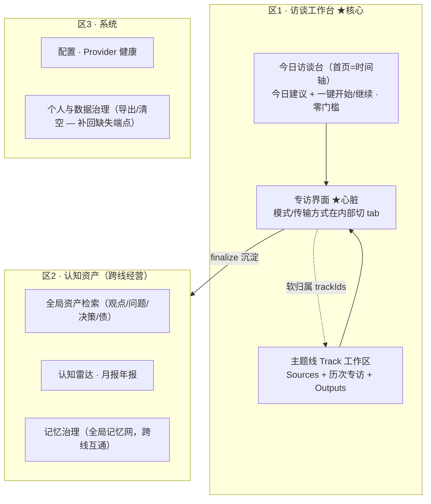
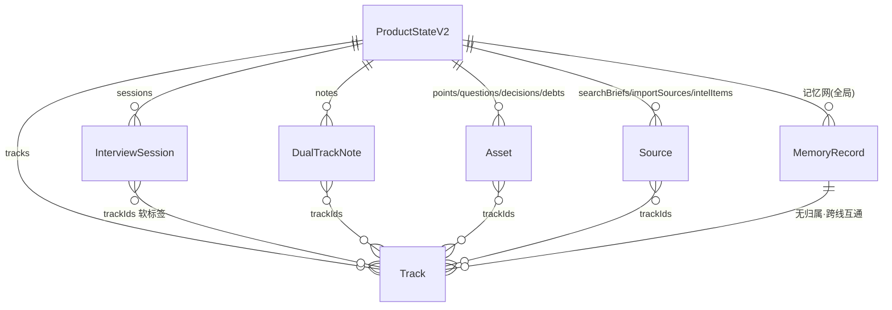

# 专访 1.0 架构改造方案：借鉴 Notebook 范式的收敛式重构

> 版本：v1 · 2026-06-18 · 分支建议：`refactor/v4-notebook-paradigm`
> 配套文档：[系统架构与问题分析报告](../../../系统架构与问题分析报告.md)（**现状诊断**）。本文是**改造处方**，两者配套使用。
> 状态：设计待审阅（brainstorming → spec）。

---

## 0. 文档定位

- **诊断**（问题报告）发现 60 个问题（P0×13 / P1×24 / P2×23）+ "散"的结构问题。
- **处方**（本文）给出：新的业务组织范式 + 数据模型 + 后端整顿 + 成熟代码引入 + 把 60 问题逐条排进重构阶段。
- **核心约束**：保留访谈引擎（护城河），单用户/本地优先，TS 单体不引入独立服务。

### 已对齐的 5 个地基决策

| # | 决策 | 取值 |
|---|---|---|
| D1 | 核心组织范式 | **时间轴为主 + 主题线 Track 软聚合**（借 Notebook 的"工作区聚合"，不借"硬容器"） |
| D2 | 导航信息架构 | **收敛为 3 区**，专访是核心区的心脏（非资产区 tab） |
| D3 | 数据模型重构激进度 | **一次性 v1→v2 重构**（有迁移函数 + 测试护航） |
| D4 | 成熟代码引入边界 | **库级借用 / 保持 TS 单体**（且对单用户规模保持克制） |
| D5 | 与 60 问题的关系 | **借重构一并清账**，每阶段可验收 |

---

## 1. 目标与设计原则

### 1.1 三个目标
1. **收敛"散"**：12 个平级视图 → 3 区，用"主题线"把散落的素材/专访/产出串成工作区。
2. **用成熟代码降难度**：在自己最弱的环节（资料检索/记忆召回/对谈播客）借成熟库/思路，但不过度。
3. **清账**：把 60 个问题排进重构阶段，重构和修问题合一。

### 1.2 设计原则
- **借工作区聚合，不借硬容器**：吸收 Notebook"一个上下文聚合素材+产出"的优点；拒绝"先建本、本间孤岛"的代价。
- **时间轴为主，主题线为辅**：保住"打开就说"的低门槛；主题线是软标签（可多归属、事后浮现、跨线互通）。
- **保护护城河**：访谈引擎、追问技法、语料习得不动其内核，只整理其接线与降级。
- **单用户规模的克制（ponytail）**：几百~几千条数据，不需要向量数据库/独立服务/分布式。能内存算就内存算，能纯函数就纯函数。
- **重构即清账**：不做与问题无关的炫技重写。

---

## 2. 核心设计决策

### 2.1 为什么不照搬 NotebookLM 的"硬容器 notebook"（被否决方案，记录在案）

NotebookLM 的 notebook 是**资料桶**（空间组织 / 先攒后问 / 本间孤岛）。直接套到专访 1.0 有 4 个真实别扭点：

1. **认知负担前置**：日记/访谈的灵魂是"打开就说"，"先选本/建本"会挡住最高频入口。
2. **流程相反**：Notebook 是"资料→本→问"，专访是"聊→才沉淀出资料"。
3. **割裂记忆网**：硬容器是孤岛，会破坏"持续跟踪同一个人"最该有的跨主题记忆图谱与认知雷达。
4. **本末倒置**：为一个非核心能力（RAG 问答）重组整个信息架构。

### 2.2 采用方案：时间轴 + 主题线 Track（软聚合）

| 维度 | 硬容器 Notebook（否决） | 主题线 Track（采用） |
|---|---|---|
| 入口 | 先选本才能用 | 时间轴首页，打开就说 |
| 归属 | 一条数据属于唯一本 | `trackIds[]` 软标签，可多归属、可不归属 |
| 浮现时机 | 建本是前置动作 | 主题事后浮现，也可主动建线深跟 |
| 记忆 | 本间孤岛 | 记忆网全局，跨线互通 |
| 聚合视图 | 进本看资料 | 进线看"该线的 Sources + 历次专访 + Outputs"（拿到工作区聚合的好处） |

**关键可行性洞察**：`Track` 不是凭空新增——现有 `LongTermTheme` 本质就是软主题，且 `points/questions/...` 已有 `relatedThemeIds` 软关联字段。所以一次性重构主要是**概念扶正 + 字段泛化 + 迁移函数**，而非推倒重来，激进度被大幅压低。

---

## 3. 目标架构

### 3.1 信息架构（3 区，专访为心脏）



- **专访的两个醒目入口**：①今日访谈台（跨线全局"今天聊什么"）②主题线内"继续追问"。永远一级动作。
- **模式切换在专访界面内部**：访谈模式（决策/学习/长期主题等）+ 传输方式（文本/cascade/livekit）是界面内 tab，不上顶层。
- **收敛映射**：search/intel/corpus → 主题线的 Sources；notes/assets/podcast → Outputs 与区2；themes/memory → 区2；config/profile → 区3。

### 3.2 核心数据模型 v2

```typescript
// ── 新增：主题线（软聚合）= LongTermTheme 升级为一等公民 ──
interface Track {
  id: string;
  title: string;
  kind: 'journal' | 'theme' | 'subject' | 'project'; // 日记线/长期主题/追踪对象/项目
  pinned: boolean;          // 长期深跟则置顶工作台（满足"少数长期对象"用法）
  createdAt: string;
  lastActiveAt: string;     // 驱动今日访谈台的时间轴排序
  summary?: string;         // 演变摘要（继承 theme 能力）
  maturity?: '聚焦' | '深化' | '成型'; // 沿用 theme 的成熟度
}

// ── 现有实体统一加软标签（泛化自已有的 relatedThemeIds）──
// sessions / notes / points / questions / decisions / debts /
// searchBriefs / importSources / intelItems / podcastEpisodes
interface Taggable { trackIds: string[]; } // 可多归属、可为空(=未归类，仍在时间轴可见)

// ── 记忆网保持全局（不加 trackIds，跨线互通，是护城河）──
// memoryRecords / memoryEdges / memoryCandidates 全局

interface ProductStateV2 {
  schemaVersion: 2;         // 新增版本标记
  tracks: Track[];          // 新增（themes 迁移而来）
  // themes 字段移除
  profile; sessions[]; notes[]; points[]; /* …均含 trackIds */
  memoryRecords[]; memoryEdges[]; memoryCandidates[]; // 全局
  intelTasks[]; intelItems[]; corpusImports[]; corpusInsights[]; playbookPatches[];
  searchBriefs[]; importSources[]; podcastEpisodes[];
  systemConfig; auditEvents[]; aiRunEvents[]; workflowRuns[]; operationalChecks[];
  revision;
}
```



**一次性迁移 `normalizeProductState` v1→v2**（纯函数，可测可回滚）：
1. `themes[]` → `tracks[]`（kind=`theme`，保留 summary/maturity/appearances）。
2. 各实体 `relatedThemeIds` → `trackIds`（**已存在的软关联直接映射**）；无该字段的补 `trackIds: []`。
3. 修正历史脏数据：`PodcastEpisode.noteId` 错配规范化为 `sourceRef`；`ImportSource.searchBriefId` 空串清理；`memoryCandidates` 回填 `reviewScore`。
4. `schemaVersion: 2`；保留 v1 快照备份。

### 3.3 后端架构整顿（不改契约，补缺删死）

- **数据治理端点（分层，已定稿）**：`GET /api/state/export`、`POST /api/state/import`、`POST /api/state/purge` **补回路由 + 前端入口**（domain 逻辑现成，数据主权刚需）；`release-gate`/`migration-readiness`/`postgres-migration-package`/`backup-rehearsal`/`go-live-checklist`/`shipping-handoff-package` 等运维/发布审计端点**从 README 删声明 + 删对应 domain 死代码**（单用户本地产品不需要企业级发布门禁）。
- **删死代码**：external-search provider、interview-turn-runner、workflow mastra 伪 adapter、guidanceEngine（接线或删）、孤儿报告函数、turnDetectors（若语音不用）、contracts 死接口。
- **修降级闭环**：主搜索失败降级到本地；专访降级补 `console.warn` + `aiRunEvent`。
- **删 PG（已定稿）**：删除 `pg-product-state-repository.ts`/`pg-schema.ts`/`postgresMigration.ts` 与相关端点声明，只保 SQLite + 内存两仓。P0-10（类型隐形）与 P1-17（id 不一致）随删 PG 一并消除。
- **静态托管**：补 `@fastify/static` 真正托管 dist，或 README 改为前后端分离。

### 3.4 成熟代码引入点（修正后 · 诚实克制）

> ⚠️ 技术核实修正：`node:sqlite`（本项目现用）加载 sqlite-vec 在 **macOS 上常因 `OMIT_LOAD_EXTENSION` 编译期失败**（本机即 darwin），FTS5 也未编译。故**不默认上 sqlite-vec**。

| 能力 | 推荐方案（单用户规模） | 升级路径（规模上来后） | 说明 |
|---|---|---|---|
| 资料/记忆**语义检索 RAG** | **纯 TS 内存 cosine 检索**（embedding 用百炼 API 算好存 ProductState，检索时内存算余弦） | sqlite-vec（需换 better-sqlite3）或 mem0 oss | 几百~几千 chunk 内存检索 <10ms，零新依赖、跨平台。这是最 lazy 且最稳的 |
| **记忆抽取** | 沿用现有 `memory-extraction-llm` + HITL | 引入 **mem0(TS)** 增强抽取/时序 | mem0 的价值在多用户/大规模/时序图谱；单用户日记，自研抽取+内存召回已够。**是否引入留作 D4 复评点** |
| **双人对谈播客** | 借 **podcast-creator** 的对谈脚本 prompt 逻辑（不必引库），TTS 走百炼 CosyVoice | 引入 podcast-creator 库 | 中文 TTS 百炼优于开源 Kokoro，脚本/音频分离 |

**结论**：D4"库级借用"在单用户规模下**进一步收敛为"主要借思路 + 极少依赖"**。真正可能引入的库只有 mem0（可选）。这比无脑引入更符合"降低难度"的本意。

---

## 4. 60 问题清账映射表

> 标记：🔧=重构顺带消灭　🛠️=需独立修复。每条归入一个阶段（见第 6 节）。

### 阶段 0 · 数据模型 v2（多为重构顺带）
| 问题 | 类型 | 如何解决 |
|---|---|---|
| P0-11 intel 隐私/迁移盲区 | 🔧 | v2 统一纳入隐私库存+迁移计数 |
| P1-17 SQLite/PG snapshot id 不一致 | 🔧 | 删 PG 后不复存在 |
| P1-18 乐观并发可伪造 revision | 🛠️ | 入口改为"必须等于"而非"≥" |
| P1-19 events 表无界增长 | 🛠️ | 加保留窗口/裁剪 |
| P2-18 memoryCandidates 不 backfill | 🔧 | 迁移函数回填 |
| P2-19 ImportSource.searchBriefId 空串 | 🔧 | trackIds 取代关联 |
| P2-20 PodcastEpisode.noteId 错配 | 🔧 | 规范化 sourceRef |
| P2-23 draft 死枚举+空壳会话 | 🔧 | 状态机收敛为 active→completed |
| P2-8 策略死分支 | 🔧 | 类型与引擎对齐 |
| P1-24 硬编码 theme-control 悬空引用 | 🔧 | Track 化迁移时清理悬空引用 |

### 阶段 1 · 后端清账
| 问题 | 类型 | 如何解决 |
|---|---|---|
| P0-1 15+ 端点未注册 | 🛠️ | 分层：export/import/purge 补回；运维审计类删声明+删死代码 |
| P0-2 purge 不可达 | 🛠️ | 接线 `POST /api/state/purge` + 前端清空入口 |
| P0-3 export/import 不可达 | 🛠️ | 接线导出/导入 + 前端入口 |
| P0-4 Docker 静态托管不成立 | 🛠️ | 补 @fastify/static 或改文档 |
| P0-6 质量护栏恒空 | 🛠️ | 填 `nextInterviewInstruction` |
| P0-10 PG 仓库违约对 CI 隐形 | 🔧 | 删 PG 一并消除 |
| P0-13 主搜索失败不降级 | 🛠️ | 降级到本地确定性 |
| P1-1 专访降级静默吞错 | 🛠️ | 补 warn+aiRunEvent |
| P1-2 env 声明不读取 | 🔧 | 清理 env/文档 |
| P1-4 docs 死链 | 🔧 | 同步文档 |
| P1-13 llm-budget 仅覆盖一条路由 | 🛠️ | 覆盖全部 LLM 入口 |
| P1-16 quality.ts 玩具正则 | 🛠️ | 标注为启发式或改真评分 |
| P1-20 engine/strategy 重复+循环依赖 | 🛠️ | 收敛重复逻辑 |
| P2-2 external-search 死代码 | 🔧 | 删 |
| P2-3 interview-turn-runner 死代码 | 🔧 | 删或接线 |
| P2-4 guidanceEngine 孤儿 | 🛠️ | 接线或删 |
| P2-5 孤儿报告函数 | 🔧 | 删或接线 |
| P2-7 mastra 伪 adapter | 🔧 | 收敛为 local |
| P2-9 contracts 死接口 | 🔧 | 删 |
| P2-21 假 source URL | 🛠️ | 去掉编造占位 |
| P2-22 /decisions 仅 stdout | 🛠️ | 落库 |

### 阶段 2 · 信息架构 3 区前端重构
| 问题 | 类型 | 如何解决 |
|---|---|---|
| P1-5 NotesView 无空状态 | 🔧 | 新视图天然含空状态 |
| P1-6 ThemesView 无空状态 | 🔧 | 同上 |
| P1-22 provider 列表三处不一致 | 🔧 | 单一真源 |
| P1-23 ConfigView label 嵌套 | 🛠️ | 修 HTML 结构 |
| P2-1 return;return; 死代码 | 🔧 | App.tsx 拆分时清理 |
| P2-11 默认 voice 418 | 🛠️ | 默认改 longanyang |
| P2-13 内容字符串作 React key | 🔧 | 改稳定 id |
| P2-16 首页二次点击 | 🔧 | 时间轴首页重设计一键开始 |

### 阶段 3 · 成熟代码（新增能力，少量关联问题）
| 问题 | 类型 | 如何解决 |
|---|---|---|
| （主要为新增 RAG/记忆召回/对谈播客能力） | — | 见 3.4 |

### 阶段 4 · 语音健壮性 + 安全
| 问题 | 类型 | 如何解决 |
|---|---|---|
| P0-5 GET /api/state 无鉴权 | 🛠️ | production profile 加本地 token |
| P0-7 ASR 失败泄漏麦+无重连 | 🛠️ | 失败 stopMic + 最小重连 |
| P0-8 打断 AbortSignal 未透传 | 🛠️ | 透传 signal 取消 LLM |
| P0-9 ASR delta 依赖 msg.stash | 🛠️ | schema 校验+空转录告警 |
| P0-12 turn-builder 追问场景硬绑定 | 🛠️ | 去种子化、scenario-agnostic |
| P1-3 CORS 硬编码 | 🛠️ | 读 PRODUCT_WEB_ORIGINS |
| P1-7 livekit interrupt 空操作 | 🛠️ | 真打断或标注限制 |
| P1-8 打断恢复部分策略无效 | 🛠️ | 补全 buildInterruptionContext |
| P1-9/10 TTS WS/AudioContext 不关闭 | 🛠️ | 加 close() 并在 pipeline.close 调用 |
| P1-11 ASR 轮询无总超时 | 🛠️ | 加总时长上限 |
| P1-12 provider 无超时 | 🛠️ | 统一 fetchWithTimeout |
| P1-14/15 注入清洗不足/易绕过 | 🛠️ | 扩清洗覆盖+标注为非安全边界 |
| P1-21 语音会话无 enginePolicy | 🛠️ | 补 enginePolicy |
| P2-6 turnDetectors 死代码 | 🔧 | 删 |
| P2-10 Python agent tool 未注册 | 🛠️ | 注册或删 |
| P2-12 transcription 覆盖式替换 | 🛠️ | 改累加 |
| P2-14 echo guard 竞态 | 🛠️ | 守卫加 micSuppressed |
| P2-15 baseline 冻结 | 🛠️ | 滑动基线 |
| P2-17 语音降级假波形 | 🔧 | 去掉假录音态 |

**统计**：阶段0:10 · 阶段1:21 · 阶段2:8 · 阶段3:0(新增能力) · 阶段4:21 = **60 条全覆盖**。🔧 重构顺带约 25 条，🛠️ 独立修复约 35 条——**印证"重构不等于万事大吉，一半是独立工程债"**。

---

## 5. 一次性数据模型重构的风险管控

用户选了"一次性重构"（D3）。ProductState 是单聚合根 JSON，迁移=一个纯函数 transform，可控：

1. **迁移函数 + 往返单测**：`v1 → v2 → 校验`，断言无字段丢失（用现有 `stateDigest` 比对）。
2. **schemaVersion 守门**：normalize 按版本分支，旧数据进来自动升级。
3. **v1 快照备份**：迁移前导出一份 v1 JSON，可回滚。
4. **全测试护航**：现有 442 vitest + Playwright 必须全绿才算迁移完成。
5. **降激进的底气**：因 `relatedThemeIds`/`themes` 机制已存在，迁移是"扶正"非"重写"。

---

## 6. 分阶段实施路线

每阶段独立可交付、可测、可回滚。

| 阶段 | 目标 | 关键交付 | 验收 | 清账 |
|---|---|---|---|---|
| **0 数据模型 v2** | 地基：Track 软聚合 | Track 类型 + trackIds + 迁移函数 + 往返测试 | 迁移无损、全测试绿 | 10 条 |
| **1 后端清账** | 让"代码=实际能力" | 补端点/删死代码/降级闭环/契约修复 | 端点可调、死代码删净、tsc 0 | 21 条 |
| **2 信息架构 3 区** | 收敛"散" | 时间轴首页 + Track 工作区 + 专访为心脏 + App.tsx 拆分 | 3 区可用、空状态齐全、Playwright 绿 | 8 条 |
| **3 成熟代码** | 补最弱环节 | 内存向量 RAG + 对谈播客（+可选 mem0） | 资料问答可用、双人播客可出 | 新增能力 |
| **4 语音+安全** | 独立工程债 | 语音泄漏/重连/超时/打断 + 鉴权/CORS/注入 | 长会话不泄漏、弱网可恢复、安全项闭环 | 21 条 |

**顺序依据**：0 是地基必须先行；1 让后续基于真实能力；2 兑现"收敛散"的核心诉求；3 是增量价值；4 是独立债，可与 2/3 并行。

---

## 7. 风险与权衡

| 风险 | 应对 |
|---|---|
| 一次性数据迁移出错 | 第 5 节五重护栏；v1 快照可回滚 |
| sqlite-vec 在 macOS 加载失败 | 默认用内存向量，绕开扩展；规模上来再换 better-sqlite3 |
| mem0 引入过重 | 列为可选复评点，单用户默认不引入 |
| App.tsx(1450 行) 拆分引入回归 | 阶段2 配 Playwright 回归；小步拆分 |
| "收敛"误伤现有可用功能 | 收敛是 UI 重组，不删业务能力；search/intel/corpus 能力保留只是换位置 |
| Track 软标签 UX 是否被理解 | 默认时间轴零门槛，主题线是渐进可选，不强制 |

---

## 8. 验收标准

- [ ] ProductState v2 迁移函数往返无损，`stateDigest` 一致，全测试绿。
- [ ] 60 问题映射表中 🔧/🛠️ 各项在对应阶段勾除（或显式标注"暂不做+原因"）。
- [ ] 导航收敛为 3 区，专访为区1心脏，时间轴首页一键开始。
- [ ] 主题线 Track 可软归属、可多归属、可不归属；进线见聚合工作区；记忆网跨线互通。
- [ ] 数据治理端点（导出/清空）真实可调，或 README 不再声称。
- [ ] 死代码删净，`tsc -b` + `typecheck:api` = 0。
- [ ] 语音长会话无连接/AudioContext 泄漏；弱网 ASR 可恢复。
- [ ] 资料语义检索可用（内存向量）；双人对谈播客可出（TTS 百炼）。
- [ ] README/docs 与实现一致，无死链、无虚假端点。

---

## 附：已定稿决策（2026-06-18 用户确认）
1. **数据治理端点 → 分层**：`export`/`import`/`purge`（数据主权刚需、domain 逻辑现成）**补回路由+前端**；`release-gate`/`migration-readiness`/`postgres-migration-package`/`backup-rehearsal`/`go-live-checklist`/`shipping-handoff-package` 等运维/发布审计类（单用户产品的过度工程）**删 README 声明 + 删 domain 死代码**。
2. **mem0 → 不引入**：自研记忆抽取 + 内存向量召回足够。
3. **PG 仓库 → 直接删**：删 `pg-product-state-repository.ts`/`pg-schema.ts`/`postgresMigration.ts` 及相关端点声明；P1-17 随之消除，P0-10 由"删 PG"解决。
4. **阶段顺序 → 确认** `0 → 1 → 2 →（3 ∥ 4）`。
