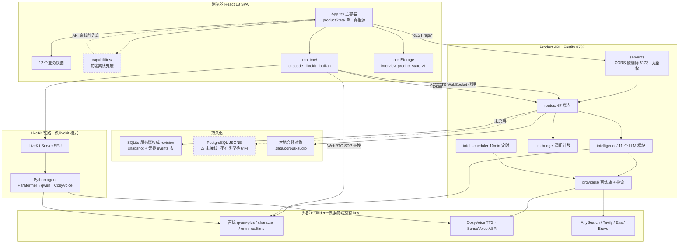
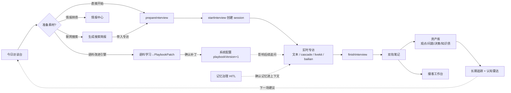
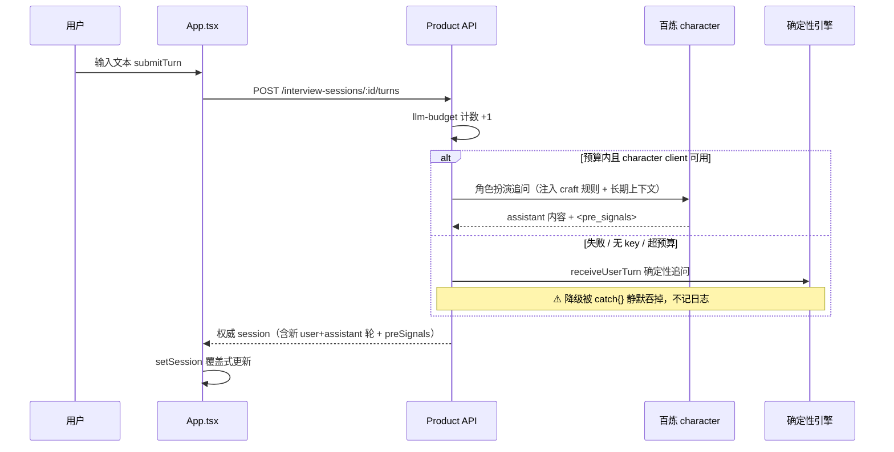
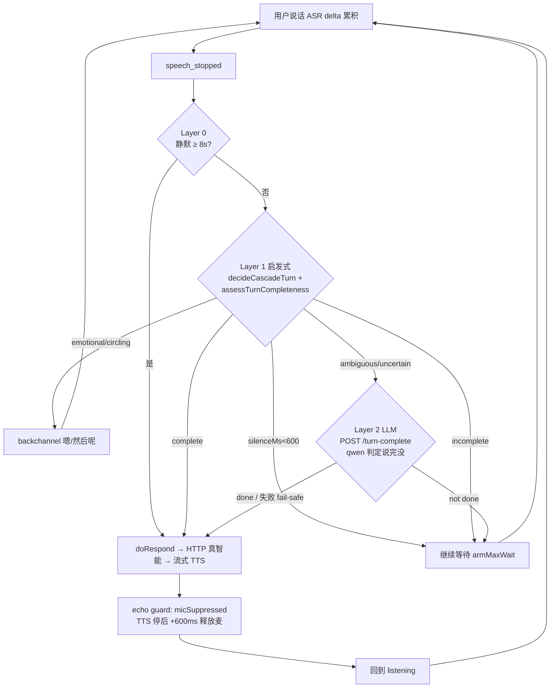
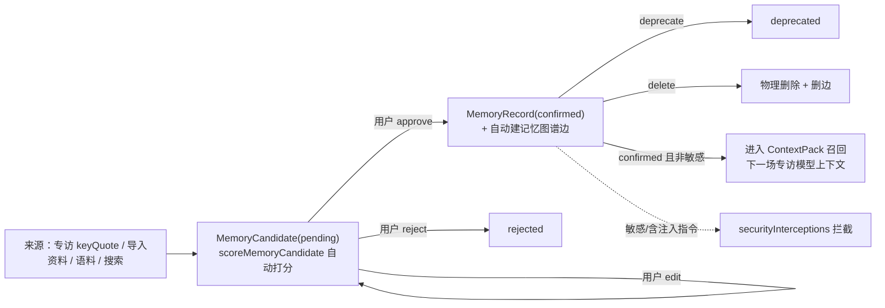
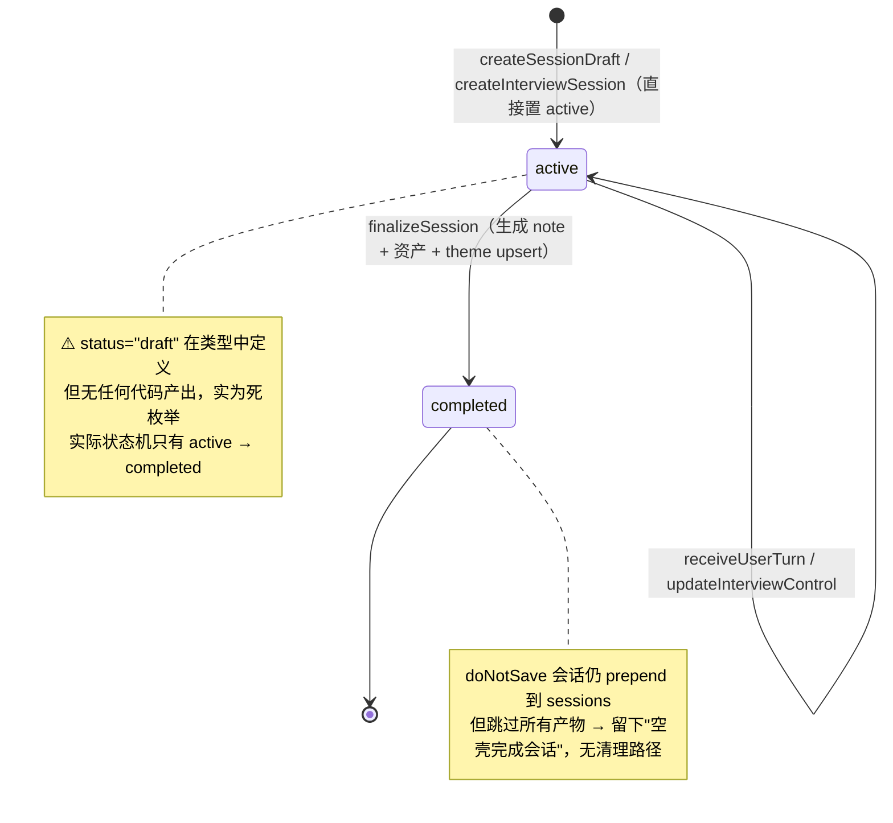
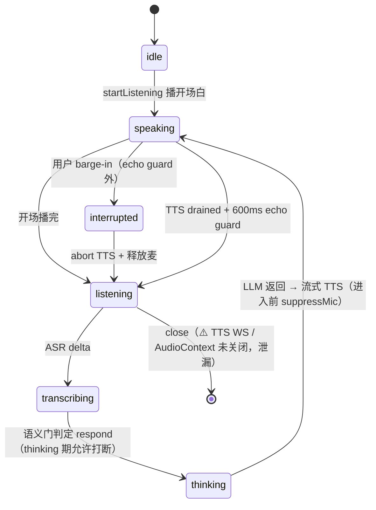
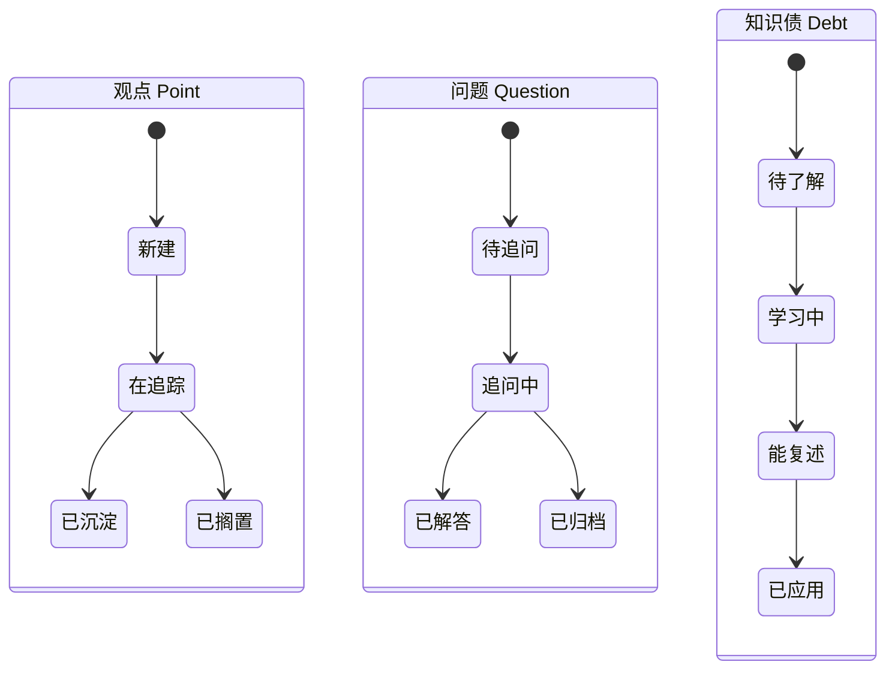
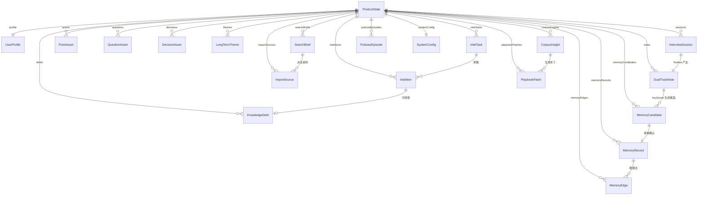

# 专访 1.0 系统架构与问题深度分析报告

> 分析对象：`/Users/miaoma/Downloads/专访 1.0` **顶层项目**（`zhuanfang/` 是更早的嵌套快照，缺少 `intelligence/`、完整 `realtime/` 与 Python agent，本报告不以它为准）。
> 分析方法：CodeGraph + 6 路并行子代理交叉审查 + 关键结论亲自复核（后端 67 个路由、README 声称端点、CORS、静态托管、文档存在性均经 grep 验证）。
> 分支：`refactor/v3-system-optimization`。所有行号基于当前磁盘内容。

---

## 目录

1. [执行摘要](#1-执行摘要)
2. [系统是什么](#2-系统是什么)
3. [技术栈与代码结构](#3-技术栈与代码结构)
4. [系统全景架构图](#4-系统全景架构图)
5. [各部分能力详解](#5-各部分能力详解)
6. [核心业务流程图](#6-核心业务流程图)
7. [关键状态机](#7-关键状态机)
8. [数据模型](#8-数据模型)
9. [问题总清单（按严重度分级）](#9-问题总清单按严重度分级)
10. [总体结论与优先修复路线](#10-总体结论与优先修复路线)

---

## 1. 执行摘要

**专访 1.0** 是一个"语音专访式日记工具"：它扮演一位张小珺式的专业访谈者，通过文本或实时语音对用户进行深度追问，会后把对话沉淀为双轨笔记与认知资产（观点 / 问题 / 决策 / 知识债 / 长期主题），并围绕这些资产提供联网搜索、情报监控、语料学习、播客生成、记忆治理等一整套"认知资产工作台"能力。

**整体评价**：这是一个**功能想象力极强、核心闭环大体成立、但完成度参差、文档与实现严重背离**的 MVP 原型。

- ✅ **做得好的部分**：核心专访闭环（准备 → 专访 → 沉淀 → 资产）确实跑通；"真智能（LLM）+ 离线确定性 fallback"的双轨设计在 9 个 intelligence 模块中基本闭环；状态持久化（SQLite 服务端权威 revision、防伪造、normalize-on-read）有测试覆盖；级联语音（cascade）的三层语义轮转和 echo guard 是真实现且较精巧。
- ❌ **最严重的系统性问题**：**一整层"运维与数据治理"能力（发布门禁、备份恢复、隐私清空、JSON 导出/导入、PostgreSQL 迁移包等）的领域逻辑全部写好并通过单测，但对应的 HTTP 路由从未注册**——README 用 8 大段文字详细描述这些"已交付能力"，实测**一个端点都不存在**。这意味着对一个长期日记/认知库，用户**无法导出、无法迁移、无法行使删除权**。

**三个最需要正视的判断**：

| # | 判断 | 影响 |
|---|---|---|
| 1 | **虚假交付**：README/`privacy.ts` 声称的 15+ 运维端点零注册；Docker 静态托管不存在；一批 env 变量是装饰性的；两个被链接的 docs 文档不存在。 | 文档不可信，"production ready"是假的，删除权/导出权缺失（合规风险）。 |
| 2 | **大量"看起来在、其实没接"的死代码与孤儿能力**：external-search provider、interview-turn-runner、guidanceEngine 整模块、质量护栏链路、followUp/resume/transparency 报告、turnDetectors 抽象——产出齐全却无调用方。 | 认知陷阱，维护者难判断什么真正生效；配置项空转。 |
| 3 | **语音子系统健壮性不足**：无任何重连逻辑、连接/AudioContext 泄漏、ASR 依赖非标准字段、打断对部分模式无效。 | 实时语音长会话或弱网下静默失效，且无 UI 提示。 |

下文逐层展开能力与问题。问题总清单见[第 9 节](#9-问题总清单按严重度分级)，共归纳 **60 项**，其中 P0（严重）13 项。

---

## 2. 系统是什么

一句话：**一个会主动追问的 AI 访谈者 + 把访谈沉淀成可经营的认知资产库**。

围绕这个核心，系统提供 8 大业务域（对应前端 12 个视图）：

| 业务域 | 用户价值 | 入口视图 |
|---|---|---|
| **实时专访** | AI 用张小珺式追问逼出"具体时刻 / 机制反转 / 反方观点"，支持文本与三种实时语音 | 今日访谈台 home、实时专访 interview |
| **会后沉淀** | 对话自动转双轨笔记（我说了什么 / 我学到了什么）+ 观点/问题/决策/知识债/主题 | 双轨笔记 notes、资产库 assets、长期追踪 themes |
| **联网素材** | 专访前用百炼内置联网 / 外接搜索生成"事实+争议+反方+角度"简报，带入专访 | 联网素材 search |
| **情报中心** | 关键词监控任务，自动抓取并分诊为情报流，可转知识债 | 情报中心 intel |
| **语料学习** | 导入优秀专访样本（文本/音频），分析追问逻辑，生成 PlaybookPatch 改进引擎 | 语料学习 corpus |
| **播客工作台** | 从笔记/简报/主题/知识债生成单人旁白或对谈脚本，TTS 直出音频 | 播客工作台 podcast |
| **记忆治理** | 导入资料抽取候选长期记忆，人工审核（HITL）后进入模型上下文 | 记忆治理 memory |
| **系统/数据治理** | Provider 健康、运行配置、产品策略、声音复刻、（README 声称的）发布门禁/备份/隐私 | 系统配置 config、个人档案 profile |

---

## 3. 技术栈与代码结构

| 层 | 技术 |
|---|---|
| 前端 | React 18 + TypeScript + Vite 7 + lucide-react，单页、客户端状态驱动 |
| 后端 | Fastify 5 + tsx，单进程 Product API（默认 `127.0.0.1:8787`） |
| 真智能 | 阿里云百炼/DashScope：qwen-plus（通用 JSON）、qwen-plus-character（角色扮演）、qwen-omni-realtime（实时）、CosyVoice（TTS）、SenseVoice（ASR）；外接搜索 AnySearch/Tavily/Exa/Brave |
| 实时语音 | 三模式：cascade（浏览器编排，ASR→HTTP LLM→流式 TTS）、livekit（LiveKit SFU + Python agent）、bailian（omni 一体化 WS/WebRTC） |
| 持久化 | 本地 localStorage + 服务端 SQLite（`node:sqlite`）；可选 PostgreSQL JSONB（drizzle，**未接线**） |
| Python | `agent/` LiveKit agents 1.5 worker（仅 livekit 模式用） |
| 测试 | Vitest（单元 + API inject E2E）、Playwright（浏览器 E2E）、`.real.test.ts`（按 key 门控的真实 LLM 测试） |
| 可观测 | OpenTelemetry（仅 Chat client 接了 span） |

```
专访 1.0/
├── src/                      前端 + 共享 domain（浏览器与服务端都用的纯函数）
│   ├── App.tsx               主容器：1450 行，视图分发 + 全部交互 handler + 语音接线
│   ├── ui.ts                 导航分组、View 类型、notice
│   ├── domain/               ★业务领域模型 + 确定性引擎（离线 fallback 核心，30 个文件）
│   ├── features/             12 个业务视图（*.tsx）
│   ├── realtime/             ★实时语音浏览器侧（cascade/livekit/bailian + turn 判定）
│   ├── capabilities/         前端确定性兜底层（search/task/contracts）
│   ├── components/           HeaderBlock / Metric / StatusButtons
│   └── api/productApi.ts     前端 Product API client
├── apps/api/src/             ★Fastify Product API
│   ├── server.ts             入口：构建/启动、CORS、provider 客户端、调度器
│   ├── routes/               24 个路由文件（67 个端点）
│   ├── intelligence/         ★11 个 LLM 模块 + sanitization
│   ├── providers/            百炼族 + 外接搜索 client
│   ├── llm-budget.ts         per-session 调用计数预算
│   ├── intel-scheduler.ts    情报任务定时器（10 分钟）
│   └── workflow-runtime.ts   工作流 runtime（仅 local）
├── packages/db/src/          SQLite / Postgres ProductState repository
├── agent/                    Python LiveKit agent（main.py / interview_tools.py / smoke_client.py）
├── tests/e2e/                Playwright 验收流程
├── docs/                     研究笔记 + superpowers 阶段方案
└── zhuanfang/                ⚠️ 旧快照（已被顶层取代，勿混淆）
```

---

## 4. 系统全景架构图



**关键架构特征**：
- **单一聚合根**：整个产品状态是一个巨型 `ProductState` JSON，本地存 localStorage、服务端存 SQLite 单行 snapshot。所有 domain mutation 都是 `(state, ...args) => nextState` 纯函数（深拷贝、不可变、新记录 prepend）。
- **双写 + 优先后端**：前端每个写操作"先打 API，失败回落本地 domain 纯函数"，保证 API 离线时 demo 仍可跑。
- **密钥只在服务端**：所有 provider key 不下发浏览器；浏览器经后端 WS 代理或 SDP 交换接触 provider。

---

## 5. 各部分能力详解

### 5.1 前端（React SPA）

**12 个视图**：

| 视图 | 能力 |
|---|---|
| 今日访谈台 home | 系统据长期主题/知识债/历史原话准备"今日主建议"，6 种访谈模式选择，本月信号 |
| 实时专访 interview | 双态：启动屏（展示开场问题）/ 对话流（文本 composer + 语音波形 + 节奏面板 + 6 个访谈控制 + turn 列表 + 上下文侧栏） |
| 联网素材 search | 主题 → provider 生成搜索简报（事实/争议/反方/角度/来源），带入专访、自动简报 |
| 情报中心 intel | 关键词监控任务 → 抓取 → 分诊（保存/忽略/转知识债） |
| 语料学习 corpus | 导入文本/音频样本 → 追问维度评分 + PlaybookPatch → 确认补丁 |
| 播客工作台 podcast | 选来源 → 生成脚本 → 编辑 → 合成语音；章节/shownotes/`<audio>` 预览 |
| 双轨笔记 notes | "我说了什么 / 我学到了什么" + 回访问题 |
| 资产库 assets | 三栏（筛选/列表/详情）管理观点/问题/决策/知识债，状态机流转 + 标记重要 |
| 长期追踪 themes | 本月回顾 + 认知雷达 + 年度回顾草稿 + 长期主题 |
| 记忆治理 memory | 导入资料 → 抽取候选 → 审核（确认/修正/拒绝）→ 已确认记忆（撤销/删除） |
| 系统配置 config | 4 分段：总览 / Provider 健康 / 策略（运行配置 + 产品策略 + 声音复刻）/ 补丁 |
| 个人档案 profile | 显性档案 + 用户边界 + 系统记忆 + 修正 AI 理解 + 清空示例 |

**交互状态覆盖**：成功/禁用/选中覆盖好；错误覆盖较好；**空状态部分缺失（notes、themes 无空状态守卫，重置后空壳）**；加载部分覆盖。

**确定性兜底层 `capabilities/`**：是"前端的离线影子"——`search.ts` 中 6 个 provider 只有 `local-demo` 是真本地输出，其余 5 个是返回模板化 needs-review 简报的"壳"；真正联网搜索在后端。

### 5.2 后端 Product API（Fastify）

**实际注册 67 个端点**（经 grep 全量确认），按域：

- **专访会话**：`POST /api/interview-sessions`、`/:id/turns`（收轮）、`/:id/control`、`/:id/end`、`/:id/pre-signals`、`/:id/record-turn`、`/:id/turn-complete`（cascade Layer 2 端点判定）、`/:id/decisions`（cascade 决策审计）、`GET /:id`
- **记忆治理**：`memory-candidates`（patch/approve/reject）、`memory-records`（patch/deprecate/delete）、`memory-corrections`
- **资产**：`assets/{points,questions,decisions,debts,readings}/:id/status`、`readings/:id/importance`、`decisions/:id/confirm`、`notes/:id/{questions,feedback}`
- **搜索/情报**：`search/briefs`、`search/auto-briefs`、`intel/tasks`（创建/run/delete）、`intel/items`（patch/to-debt）
- **生成**：`podcast/episodes`、`corpus/insights`、`corpus/transcriptions`、`generated-artifacts/cleanup`、`import/documents`、`playbook-patches/:id/{apply,revert}`
- **配置/质量**：`product-config`（patch）+ `versions/:id/rollback`、`quality/{report,scorers,score}`、`reviews`
- **状态**：`GET/PUT /api/state`、`POST /api/state/reset`
- **系统**：`system/{config(GET/PATCH),capabilities}`
- **实时语音**：`realtime-voice/{sessions,config,voices,agent-context,agent-turn,livekit-token,memory-context,sessions/:id/interrupt,sessions/:id/webrtc/answer}` + WebSocket 升级代理（ASR `/ws/:id`、TTS `/ws/tts/:id`）

**启动与中间件**：`buildApiServer()` 注册 18 个路由插件 + CORS hook；`startServer()` 额外接 SQLite 仓库与情报调度器（调度器只在 startServer 接，保证测试无 timer）。Provider 客户端按 env 惰性构建，`PATCH /system/config` 后热刷新。

### 5.3 真智能（intelligence）子系统

**统一约定**：所有模块 `throw on failure`，由路由层 try/catch 降级到确定性实现，大多记 `llm_fallback` 日志。模型统一走 `BailianChatClient.complete()`（默认 qwen-plus，JSON 模式）。

| 模块 | 职责 | Fallback |
|---|---|---|
| `finalize-llm` | 专访结束 → 双轨笔记 + 长期资产 | 确定性 `finalizeSession`（保守：只留用户原话，资产全空，绝不捏造） |
| `corpus-llm` | 优秀样本 → 评分维度 + PlaybookPatch | 确定性 `analyzeImportedInterview` |
| `intel-triage-llm` | 搜索结果 → 摘要/相关度/分类（**严格按 index 映射真实 URL 防编造**） | 前 8 条未分诊 |
| `interview-card-llm` | 开场策划卡 | 确定性 `buildInterviewCard` |
| `memory-extraction-llm` | 导入资料 → 候选记忆 | 仍 ingest 源文档，candidates 空 |
| `podcast-script-llm` | 双轨笔记 → 播客脚本 | 确定性脚本 |
| `pre-signals-llm` | 语音路径 `<pre_signals>`（深挖/不打断词/打断词/敏感度） | budget 超限返回 null |
| `review-llm` | 月/年回顾叙事字段（**计数保持确定性**） | 内建确定性回顾 |
| `search-synthesis-llm` | 搜索来源 → 专访素材 | 失败返回原 input 不变 |
| `turn-endpoint-llm` | cascade Layer 2 端点判定 | **模块内 try/catch，失败 fail-safe 到 done:true（唯一自闭环）** |

**预算控制 `llm-budget`**：per-session 内存计数 Map，默认 200 次/会话，超限只降级不报错。**仅接入 interview-sessions 一条路由**——导入/回顾/播客/情报/搜索的 LLM 调用完全不计预算。

### 5.4 实时语音（realtime）子系统

**三模式对比**：

| 维度 | cascade（默认） | livekit | bailian |
|---|---|---|---|
| ASR | omni 纯转录（`create_response:false`） | Paraformer（Python agent） | omni 一体化 |
| LLM | 服务端 HTTP 真智能 | qwen-plus（Python agent） | omni 一体化 |
| TTS | CosyVoice 流式 WS（裸 PCM 24kHz） | CosyVoice（Python agent） | omni 一体化 |
| 轮转决策 | 浏览器三层语义门 | LiveKit turn detector | omni server_vad + intent 引擎 |
| 真智能可介入 | ✅ 是 | 部分 | ❌ 否 |

**cascade 三层语义轮转**（精巧、真实现）：
- **Layer 0 VAD 安全网**：静默 ≥8s 强制 respond + 留白定时器。
- **Layer 1 启发式**：`decideCascadeTurn` + `assessTurnCompleteness`（中文语法表面线索）→ wait/backchannel/respond/uncertain。
- **Layer 2 LLM 端点**：uncertain 时调 `/turn-complete` 让 qwen 判断"说完没"，失败安全降级。

**echo guard**（仅 cascade）：AI 说话时 `micSuppressed`，停后再等 600ms 释放麦，防止听到自己。**打断回填** `truncateAssistantTurn`：把 assistant turn 截断为已朗读部分。**PCM 裸流**：因 CosyVoice 流式分块不落帧边界，改用样本精确调度回放。

**Python LiveKit agent**：从 room 名解析 session，拉 unified instructions，用阿里云 STT/LLM/TTS 组 AgentSession，含 monkeypatch 修复 plugin 1.2.9 序列化 bug。

### 5.5 domain 业务引擎（确定性核心）

**专访引擎决策树 `decideInterviewStrategy`**（按已收用户轮数优先级）：第 0 轮抽象表达→索要具体时刻 → 具体例子后→机制反转 → 超 10 分钟→阶段总结 → 有知识债→债追问 → ≥7 轮→盲区探测 → ≥3 轮→视角切换 → 默认→机制探测。

**会后 finalize**：确定性与 LLM 共享 `FinalizeContent` 契约 `{note, points, questions, decisions, debts, themes}`，经同一 `mergeFinalizedState` 落库；确定性侧极度保守（资产全空，绝不捏造）。

**记忆治理**：候选打分（基础 50，有证据+14、专访原话+14、外部资料-12、敏感-15）→ 审核 → 确认记忆 + 自动建记忆图谱边 → ContextPack 召回时仅 confirmed + 非敏感进模型上下文。

### 5.6 持久化与数据治理

- **SQLite 仓库**（健壮）：服务端权威 revision 单调 +1、防伪造、normalize-on-read、snapshot + events 双表。
- **PostgreSQL 仓库**（⚠️ 未接线）：缺 `getInterviewSession`、返回 Promise 与同步接口冲突、不在 tsconfig 类型检查范围。
- **领域纯函数**：迁移清单、PG JSONB 迁移包、备份恢复演练、隐私清空、隐私报告——**逻辑全写好且过单测，但无 HTTP 路由可触达**（见 P0 问题）。

---

## 6. 核心业务流程图

### 6.1 主业务闭环（准备 → 专访 → 沉淀 → 经营）



> 已验证闭环：搜索→专访（`startFromBrief→buildInterviewCard` 真实消费简报）、专访→笔记、笔记→资产、语料→配置。

### 6.2 文本专访单轮时序



### 6.3 cascade 语音三层轮转



### 6.4 记忆治理（HITL）



---

## 7. 关键状态机

### 7.1 专访会话状态机



### 7.2 cascade 语音管线状态机



### 7.3 认知资产状态机（AssetStatus 子集）



> AssetStatus 是 13 值超集，各实体用 `Extract` 取子集；但 `PointAsset.status` 用了全量类型，未收紧（UI 需防御非法值）。

---

## 8. 数据模型

`ProductState` 是单一聚合根（31 个顶层字段），8 个领域簇：



**关键关系断点**（详见问题清单）：
- `intelTasks/intelItems` 不被 privacy 库存与 migration 计数纳入（隐私/迁移盲区）。
- `ImportSource.searchBriefId` 手动导入恒为空串，无法精确链入专访上下文。
- `PodcastEpisode.noteId` 被非 note 来源（简报/主题/债）误填，去重键错配。

---

## 9. 问题总清单（按严重度分级）

> 共 **60 项**。P0 = 影响核心闭环/数据完整性/合规/安全；P1 = 设计缺陷/不一致/体验断点；P2 = 死代码/卫生/健壮性。每项标注 `文件:行号`、来源（✅=已亲自验证）。

### 9.1 P0 严重（13 项）

| # | 问题 | 位置 | 说明 |
|---|---|---|---|
| P0-1 | **README 声称的 15+ 运维/数据治理端点全部未注册** ✅ | `routes/system.ts`（仅 config/capabilities）、`routes/state.ts`（仅 GET/PUT/reset） | release-gate、release-audit-package、migration-readiness、postgres-migration-package、backup-rehearsal、privacy-report、privacy-operations-package、shipping-handoff-package、go-live-checklist、workflow-runtime-smoke-test、state/export、state/import、state/purge、workflows/:id/run 全部 grep 零注册。领域逻辑写好且过单测，但外部无法触达。 |
| P0-2 | **隐私清空 purge 不可达，GDPR 删除权无法行使** ✅ | `privacy.ts:332`、`local-object-artifacts.ts:37` 无路由调用方 | README 声称"彻底清空个人数据 + 删本地音频 + confirm=PURGE_PERSONAL_DATA"实际无法执行；前端"清空示例"走的是 reset（保留 profile），非 purge。长期日记工具缺删除权是合规风险。 |
| P0-3 | **JSON 导出/导入不可达** ✅ | 无 `/api/state/export`、`/import` 路由 | 用户无法导出/迁移自己的长期认知资产，数据被锁在单机 SQLite。 |
| P0-4 | **Docker 单容器静态托管不成立** ✅ | `server.ts` 无 `@fastify/static`、从不读 `PRODUCT_STATIC_DIR` | README 称"容器同 PORT 托管前端 + API"，实测生产容器只起 8787 API，访问首页 404；`dist/` 被 COPY 但永不被服务。 |
| P0-5 | **`GET /api/state` 无鉴权返回全量个人数据** ✅ | `routes/state.ts:6` + `server.ts:203` CORS 硬编码 | 含 profile、全部专访、记忆、导入资料；无任何鉴权层。production 语境下任何能访问 8787 者可拉全量数据。 |
| P0-6 | **质量护栏链路名存实亡** | `engine.ts:976` `nextInterviewInstruction` 硬编码 `""` → `buildQualityGuardrails` 恒空 | 记忆修正/质量门低分/实时轮替失败本应转成下一场 `qualityGuardrails`，实际恒为空字符串数组。 |
| P0-7 | **cascade ASR 连接失败无恢复 + 麦克风泄漏** | `cascadedAsrSource.ts:198-279` | `start()` 先开麦再开 WS，WS 失败时 `stopMic()` 不被调用 → mic track / AudioContext / processor 泄漏，指示灯常亮；全仓无任何重连/retry/backoff，WS 中途断开后链路静默死亡且无 UI 提示。 |
| P0-8 | **cascade 打断后 LLM 仍跑完（AbortSignal 未透传）** | `App.tsx:975`（`_signal` 丢弃）、`productApi.ts` 不接受 signal | 打断后服务端 LLM + 持久化仍跑完，`r.session` 覆盖式 setState 可能冲掉用户已开始的新轮，并多记一轮。 |
| P0-9 | **ASR delta 依赖非标准字段 `msg.stash`** | `cascadedAsrSource.ts:243`、`bailianWebsocket.ts:502` | `text + stash` 拼接未经 schema 校验；DashScope 标准字段名若变更，转录恒为空且无告警，整个语音模式静默失效。 |
| P0-10 | **PG 仓库接口违约对 CI 完全隐形** ✅ | `packages/db/` 不在任何 tsconfig include；`pg-product-state-repository.ts:15` 缺 `getInterviewSession`、全部返回 Promise（接口要求同步） | 一旦接进 server，`await getInterviewSession` 得 undefined（运行时 TypeError），`replaceState` 拿未 await 的 Promise 当 state → 静默数据损坏。潜伏型，迁移即爆。 |
| P0-11 | **intel 数据是隐私/迁移盲区** | `privacy.ts:155-226`、`migration.ts:109` 均无 intel 条目 | intelTasks/intelItems 不被隐私库存统计、不被迁移计数、（配合 P0-2）清空时 `createPurgedProductState:332` 返回值漏 intel 字段，靠 normalize 兜底才碰巧不残留。 |
| P0-12 | **确定性 turn-builder 追问与种子场景硬绑定** | `turn-builder.ts:18-64` | 大量 `userText.includes("失控"/"延期"/"兜底")` 与种子数据强绑；非种子主题的真实用户在离线 fallback 下会得到答非所问的追问（违背 finalize 遵守的"不捏造"原则）。 |
| P0-13 | **主搜索路由 provider 失败直接 502 不降级** | `routes/search.ts:62` | 同文件 `executeSearchProvider` 本可兜底（auto-briefs 路由正是如此），主路由不闭环，provider 抖动直接打到用户。 |

### 9.2 P1 中等（24 项）

| # | 问题 | 位置 |
|---|---|---|
| P1-1 | 专访轮次降级静默吞错（空 `catch{}`，不记日志/不写 aiRunEvent） | `routes/interview-sessions.ts:320` |
| P1-2 | 一批 env 变量声明但从不读取（`DEPLOYMENT_PROFILE`/`PRODUCT_BACKUP_STRATEGY`/`PRODUCT_WEB_URL`/`PRODUCT_WEB_ORIGINS`/`BAILIAN_TTS_PROVIDER`/`WORKFLOW_RUNTIME_PROVIDER`/`MASTRA_RUNTIME_ENDPOINT`）✅ | `.env*`/`docker-compose.yml`/README |
| P1-3 | `PRODUCT_WEB_ORIGINS` 无效——CORS 硬编码 5173，README 称改它即可放行 ✅ | `server.ts:206` |
| P1-4 | `docs/implementation-status.md` 与 `docs/deployment-runbook.md` 不存在（README 死链）✅ | `README.md:5,58` |
| P1-5 | NotesView 完全无空状态 → 重置后主落地页空白 | `NotesView.tsx:20` |
| P1-6 | ThemesView 无空状态守卫（雷达/回顾渲染空内容） | `ThemesView.tsx:23` |
| P1-7 | livekit `interrupt()` 是空操作（仅重开麦），前端打断对 livekit 无效 | `livekitVoice.ts:114` |
| P1-8 | bailian 打断恢复对 key_insight/transition/backchannel 策略无效（`buildInterruptionContext` 返回空串） | `signals.ts:307`、`bailianWebsocket.ts:253` |
| P1-9 | TTS sink WebSocket 永不关闭（接口无 close，`stop()` 只发 cancel） → 连接泄漏 | `cascadedTtsSink.ts` |
| P1-10 | TTS AudioContext 永不关闭，多次开关录音后超浏览器并发上限 → TTS 哑火 | `cascadedTtsSink.ts:54` |
| P1-11 | ASR 轮询无总时长上限，单次 fetch 无超时（百炼任务挂起即无限等待） | `bailian.ts:590-645` |
| P1-12 | Search/Realtime/Streaming-TTS provider 调用无超时（仅 Chat/Podcast TTS 有） | `bailian.ts:250,476` 等 |
| P1-13 | llm-budget 仅覆盖 interview-sessions，导入/回顾/播客/情报/搜索完全不计预算；非持久、计次非计 token | `llm-budget.ts` + 各路由 |
| P1-14 | prompt 注入清洗仅覆盖外部资料，长期记忆/用户输入直接进 system prompt 未清洗 | `bailian.ts:805-830` |
| P1-15 | 注入正则易绕过（空格/全角/Base64/英文变体），且误伤"密码学/密钥管理"合法讨论 | `domain/utils.ts:21-36` |
| P1-16 | quality.ts 敏感泄漏检测玩具级正则（手机号 `\b\d{11}\b` 中文易漏误判），却作"质量门"输入 | `routes/quality.ts:5-61` |
| P1-17 | SQLite/PG snapshot id 不一致（`default` vs `current`）+ PG 不处理 revision，迁移会断裂 | `sqlite-…ts:9`、`pg-…ts:21` |
| P1-18 | 乐观并发可被伪造高 revision 绕过（lost update，多标签页数据丢失） | `routes/state.ts:9-12` |
| P1-19 | `product_state_events` 每次写整个 state、从不清理/查询 → 无界增长 | `sqlite-…ts:63-65` |
| P1-20 | engine.ts 与 strategy.ts 质量/透明报告逻辑大段重复 + 循环依赖（重构未完成） | `engine.ts:697`↔`strategy.ts:39` |
| P1-21 | 语音会话无 `enginePolicy`，不享受 playbook 补丁/留白配置，与文本会话行为分叉 | `turn-builder.ts:218` |
| P1-22 | 搜索 provider 列表三处不一致（主按钮 3 个 / 下拉 6 个 / 配置 3 个）；选 tavily/exa/brave 设默认后无生成按钮 | `SearchIntelligenceView.tsx:36,41` |
| P1-23 | ConfigView `<label>` 嵌套 `<label>`（HTML 违规，无障碍 + 点击行为 bug） | `ConfigView.tsx:508-562` |
| P1-24 | 硬编码 `relatedThemeIds:["theme-control"]`，清空 demo 后悬空引用 | `assets.ts:65,223`、`seed.ts:55` |

### 9.3 P2 低 / 死代码 / 卫生（23 项）

| # | 问题 | 位置 |
|---|---|---|
| P2-1 | `App.tsx:1239` `return; return;` 死代码 + 可疑 catch 结构（复制粘贴遗留）✅ | `App.tsx:1239` |
| P2-2 | `external-search.ts`（Tavily/Exa/Brave，480 行）整体死代码，唯一带超时的 provider 永不执行，UI 却"假支持" | `external-search.ts:207` |
| P2-3 | `interview-turn-runner.ts` 整文件死代码（"更完善带降级遥测"的编排未接线，直接导致 P1-1） | `interview-turn-runner.ts:20` |
| P2-4 | `guidanceEngine.ts` 整模块孤儿（159 行实时引导逻辑 + `guidanceEnabled/maxGuidancePerTurn/...` 一整套配置空转） | `guidanceEngine.ts:22` |
| P2-5 | `buildInterviewFollowUpQueue` / `buildInterviewResumeCard` / `buildInterviewTransparencyReport` 孤儿导出 | `context-pack.ts:380,520`、`engine.ts:808` |
| P2-6 | `createTurnStateMachine` + `turnDetectors/` + `silenceVadDetector` 死代码（cascade/bailian 都不走） | `bailianWebrtc.ts:40`、`turnDetectors/` |
| P2-7 | `workflow-runtime` mastra adapter 伪适配器（`_env`/`_fetchImpl` 全忽略，永远返回 local） | `workflow-runtime.ts:30` |
| P2-8 | `counterexample_probe` / `learning_reflection` 策略确定性引擎从不产出（死分支） | `strategy.ts:339` vs `types.ts:209` |
| P2-9 | `capabilities/contracts.ts` 4 个 provider 接口（Voice/Podcast/Corpus/InterviewModel）无实现死代码 | `contracts.ts:32-61` |
| P2-10 | Python agent `get_interview_context`/`record_interview_turn` 两个 `@function_tool` 定义但未注册 | `interview_tools.py` / `main.py` |
| P2-11 | 默认 `BAILIAN_TTS_VOICE=longyuan_v3` 在 cosyvoice-v3-plus 上 418 报错（开箱即坏，需手改 longanyang）✅ | `.env.example:34`、`system.ts:13` |
| P2-12 | livekit/bailian transcription final 覆盖式替换 → 多段回复只剩最后一段 | `App.tsx:1090,1191` |
| P2-13 | 多处用内容字符串作 React key（重复文本致渲染错位） | 多个 `*.tsx` |
| P2-14 | echo guard 竞态（thinking 期打断后 speech_stopped 交错）+ `maxWaitTimer` 不查 `micSuppressed` | `cascadedPipeline.ts:188,256` |
| P2-15 | `expressionStateDetector` baseline 3 帧后冻结，长会话语速/音量漂移致判定失真 | `expressionStateDetector.ts:30` |
| P2-16 | 首页"开始聊这个"需二次点击（进启动屏再点"开始专访"）才真正开始 | `HomeView.tsx:33`+`App.tsx:1298` |
| P2-17 | 语音降级残留模拟录音假波形（无真实管线却显示"录音中"） | `App.tsx:1244` |
| P2-18 | `memoryCandidates` 不做 `reviewScore` backfill（旧数据反序列化字段缺失） | `storage.ts:52` |
| P2-19 | `ImportSource.searchBriefId` 手动导入恒空串，无法精确链入专访上下文 | `import.ts:80` |
| P2-20 | `PodcastEpisode.noteId` 被非 note 来源误填，去重键错配 | `podcast.ts:177` 等、`lifecycle.ts:100` |
| P2-21 | 假 source URL 占位（`aliyun.com` 笔误，且与 intel-triage 防编造原则相悖） | `bailian.ts:895` |
| P2-22 | `/decisions` 级联决策审计仅写 stdout、无持久化（重启即丢） | `interview-sessions.ts:206` |
| P2-23 | `status:"draft"` 不可达 + doNotSave 留下"空壳完成会话"无清理 | `context-pack.ts:879`、`finalize.ts:117` |

---

## 10. 总体结论与优先修复路线

### 10.1 一句话结论

**核心专访体验已经跑通且有质感，但"产品外壳"（数据治理、部署、运维、文档）大面积虚假交付，语音子系统健壮性不足，代码里沉淀了大量"看起来在、其实没接"的死代码。** 当前实际形态是"本机单用户 SQLite 原型"，距 README 描述的 production-ready 有实质差距。

### 10.2 这些问题的共同根源

绝大多数 P0/P1 指向同一个根因：**当前分支 `refactor/v3-system-optimization` 做了一次"删 Mastra / 重构"，删掉了一整层 `routes/system.ts`、`routes/state.ts` 的治理端点和旧编排，但领域层（domain）、测试、README、env 没有同步清理**。于是出现"逻辑在、测试绿、文档吹、路由没了"的系统性背离。这也解释了为何有这么多孤儿导出与死代码。

### 10.3 建议修复路线（按收益/风险排序）

**第一优先 · 止血合规与可信度（P0）**
1. 二选一处理治理端点：要么**补回** `state/export`、`state/import`、`state/purge`、`backup-rehearsal`、`migration-readiness` 等路由（领域逻辑现成，只缺薄薄一层 route），要么**从 README/privacy.ts 删除**所有不实声明。鉴于导出/删除是合规刚需，建议至少补 export + purge（P0-1/2/3）。
2. 修 `GET /api/state` 暴露（最简：production profile 下加一个本地 token 校验）（P0-5）。
3. 决定 Docker 形态：补 `@fastify/static` 真正托管 dist，或在 README 改为"前后端分离部署"（P0-4）。

**第二优先 · 核心闭环正确性（P0/P1）**
4. 专访降级补日志 + aiRunEvent（P1-1），并删除/接线 `interview-turn-runner`（P2-3）二选一。
5. 主搜索路由失败降级到本地（对齐 auto-briefs）（P0-13）。
6. 质量护栏 `nextInterviewInstruction` 填真值（P0-6）。
7. 把 intel 纳入 privacy 库存 + migration 计数 + purge 字段（P0-11）。

**第三优先 · 语音健壮性（P0/P1）**
8. ASR `start()` 失败时 `stopMic()`；加最小重连/超时；TTS sink 加 `close()` 并在 pipeline.close 调用，关闭 AudioContext（P0-7、P1-9/10/11）。
9. ASR delta 字段加 schema 校验 + 空转录告警（P0-9）。

**第四优先 · 清理认知债（P2）**
10. 删除确认无用的死代码（external-search、guidanceEngine、turnDetectors、mastra adapter、孤儿报告、`return;return;`），让"代码=实际能力"。
11. 收敛 engine.ts/strategy.ts 重复逻辑与循环依赖（P1-20）。

**第五优先 · 离线质量与卫生**
12. turn-builder 追问去场景硬编码（P0-12）；NotesView/ThemesView 补空状态（P1-5/6）；默认音色改 longanyang（P2-11）。

### 10.4 验证说明

- ✅ 已亲自复核：后端 67 个路由完整清单、README 声称 15 个治理端点零注册、CORS 硬编码 5173、server.ts 无静态托管、`docs/implementation-status.md`/`deployment-runbook.md` 在顶层不存在、前端 client 未调用治理端点。
- 其余结论来自 5 路子代理对各子系统的全量源码阅读 + grep 交叉验证，彼此互相印证（如 intel 盲区、guidanceEngine 孤儿、死代码、`return;return;` 被多方独立发现）。
- 未运行 `npm test`/`build`（本报告为只读分析，未改动任何文件）；子代理报告 `tsc --noEmit` 在当前 include 范围内通过（这恰恰是 P0-10 隐形的原因——PG 仓库不在检查范围）。
