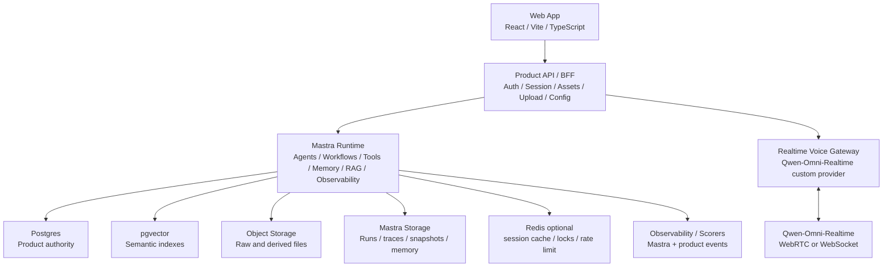

# 语音专访式日记工具 - 底层架构规划方案

版本：v2.0  
日期：2026-06-10  
定位：从当前本地原型升级到可真实运行的实时语音专访系统。方案采用 Mastra-first 架构，长期记忆与资料库由产品自有数据层承载，Mastra 负责 AI 编排、运行时记忆投影、RAG、观测和评估。

---

## 0. 结论

这个系统不应被设计成普通语音聊天、语音日记或 RAG 问答工具。它的核心闭环是：

```text
自然实时专访
→ 专访过程控制
→ 长期记忆召回
→ 会后资产沉淀
→ 用户确认、修正、删除
→ 观点、问题、决策、知识债长期演化
→ 下次精准回访
```

推荐目标架构：

```text
Web App
  ↓
Product API / BFF
  ↓
Mastra Runtime
  - Interview Director Agent
  - Context Pack Builder Workflow
  - Asset Extractor Workflow
  - Memory Projection Workflow
  - Import Ingestion Workflow
  - Corpus Learning Agent
  - Podcast Generator Agent
  ↓
Realtime Voice Layer
  - Qwen-Omni-Realtime custom provider
  - optional LiveKit / Pipecat transport layer
  ↓
Persistence
  - Postgres
  - pgvector
  - Object Storage
  - Mastra Storage
  - Redis optional
  ↓
Observability / Quality
  - Mastra Observability
  - Mastra Evals / Scorers
  - interview_events
  - optional Langfuse / OpenTelemetry exporter
```

推荐技术判断：

- **Mastra 是主编排层**：负责 agents、workflows、tools、memory、RAG、GraphRAG、observability、evals/scorers。
- **Postgres 是长期记忆真相源**：所有用户确认过的记忆、观点、问题、决策、知识债、删除和修正记录都在产品库里。
- **pgvector 是可控语义检索层**：保存资料 chunks、转写片段、长期记忆摘要、资产摘要的 embedding。
- **Object Storage 是原件仓库**：保存原始音频、导入文件、转写 JSON、解析 Markdown、播客音频等大文件。
- **Mastra Memory 是运行时记忆层**：保存 agent message history、working memory、semantic recall、observational memory，但不作为唯一业务记忆源。
- **Qwen-Omni-Realtime 是实时双向语音底座**：Mastra 不直接替代音频传输层，而是控制上下文、工具调用和专访策略。
- **Langfuse 后置为可选观测目标**：MVP 先用 Mastra Observability；团队协作、prompt 版本治理和更强 LLM trace UI 成为刚需时再接 exporter。

---

## 1. 当前原型基础

当前项目已经验证了核心产品闭环：

```text
今日访谈台
→ 会前访谈卡
→ 实时专访
→ 双轨笔记
→ 观点 / 问题 / 决策 / 知识债
→ 长期主题
→ 个人档案与记忆修正
```

当前技术形态：

```text
React + Vite + TypeScript
localStorage 本地持久化
本地规则业务引擎
Vitest 领域测试
```

下一阶段不是推翻原型，而是把本地规则和本地状态逐步升级为：

- 可调用真实模型的后端编排层。
- 可实时语音交互的双向会话层。
- 可导入资料、原始音频和访谈样本的资料层。
- 可长期演化的记忆与资产层。
- 可追踪、可评估、可回滚的 AI 运行系统。

---

## 2. 设计原则

### 2.1 产品资产必须自有

以下对象必须由产品数据库保存：

- 观点库 `PointAsset`
- 问题库 `QuestionAsset`
- 决策库 `DecisionAsset`
- 知识债 `KnowledgeDebt`
- 长期主题 `LongTermTheme`
- 双轨笔记 `DualTrackNote`
- 导入资料 `ImportSource`
- 长期记忆 `MemoryRecord`
- 记忆关系 `MemoryEdge`
- 用户确认、修正、拒绝、删除、不要保存等控制状态

原因：

- 这些对象是产品业务语义，不只是模型上下文。
- 它们需要状态流转、用户确认、审计和回滚。
- 数据导出、隐私删除、复盘统计都依赖权威数据库。
- 用户会直接信任这些记忆，因此必须可解释、可修正、可撤销。

### 2.2 Mastra 是运行时，不是业务数据库

Mastra 很适合做 AI runtime：

- agents 管开放式语义判断。
- workflows 管确定性多步骤流程。
- tools 管结构化能力调用。
- memory 管 agent 运行时上下文。
- RAG / GraphRAG 管资料检索和上下文扩展。
- observability 管 trace、log、metric、score。

但它不应替代产品数据库：

- 不把用户确认记忆只放在 agent memory。
- 不把删除和撤销逻辑藏在 prompt。
- 不让 agent 直接决定永久写入、覆盖、删除。
- 不把业务状态寄托在一次模型输出上。

### 2.3 语音模型不等于专访能力

实时语音模型解决的是“低延迟听说”。高质量专访还需要系统自研控制层：

- 什么时候沉默。
- 什么时候轻声确认。
- 什么时候捧哏。
- 什么时候追问。
- 什么时候挑战。
- 什么时候总结。
- 什么时候引用长期记忆。
- 什么时候停止引用错误或过期记忆。
- 什么时候把用户刚说的话转成候选记忆。

因此需要 `InterviewDirector`，而不是只接一个实时语音 API。

### 2.4 长期记忆采用“权威记录 + 运行时投影”

长期记忆分两层：

```text
Product DB memory_records / memory_edges
= 权威、可审核、可删除、可导出的长期记忆

Mastra Memory / RAG / GraphRAG
= 专访运行时可用的上下文投影、语义召回和关系扩展
```

这个分层可以同时满足：

- 用户可控。
- 模型可用。
- 数据可治理。
- 历史可追溯。
- 错误记忆可撤销。

### 2.5 观测先内建，后外接

MVP 阶段先使用：

- Mastra Observability。
- Mastra Storage exporter。
- 产品侧 `interview_events`。
- 产品侧 `ai_run_events`。
- 关键 scorer 结果表。

后续当需要团队级 prompt 管理、人工标注、跨产品 LLM trace 和更强实验分析时，再接：

- Langfuse exporter。
- OpenTelemetry exporter。
- 数据仓库或 BI。

---

## 3. 总体架构

### 3.1 分层架构



### 3.2 控制面与数据面

控制面：

```text
Product API
→ Mastra workflow / agent
→ tools
→ Product DB
→ trace / scorer / audit
```

数据面：

```text
Browser mic
→ WebRTC or WebSocket
→ Qwen-Omni-Realtime
→ realtime transcript / tool events / audio output
→ session event stream
```

关键判断：

- 实时音频不要绕太多层，否则延迟和故障面都会变大。
- Mastra 负责“该说什么、查什么、记什么、何时停”，而不是承担所有音频 packet 处理。
- 前端实时 UI 直接订阅 voice session events 和 Mastra event stream。

### 3.3 核心运行链路

会前：

```text
Product DB assets
+ confirmed memory_records
+ memory_edges
+ imported source chunks
+ Mastra Working Memory
+ semantic recall
→ contextPackBuildWorkflow
→ InterviewContextPack
→ InterviewCard
```

会中：

```text
Browser mic
→ Qwen-Omni-Realtime
→ realtime events / partial transcript
→ InterviewDirector
→ backchannel / follow-up / challenge / summary
→ Qwen-Omni-Realtime audio response
```

会后：

```text
Transcript + events + context pack
→ AssetExtractor Workflow
→ DualTrackNote + assets + memory candidates
→ Scorers
→ user review
→ Product DB
→ memoryProjectionWorkflow
→ Mastra Working Memory + pgvector
```

导入资料：

```text
Upload / URL / audio
→ Object Storage
→ importIngestionWorkflow
→ parse / transcribe / chunk / embed
→ memory candidates / source claims / interview techniques
→ user review
→ memory_records / memory_edges / rag_chunks
```

导入资料、原始音频、参考访谈样本的详细设计见：

```text
语音专访式日记工具-导入资料与Mastra能力集成设计.md
```

---

## 4. 前端架构

### 4.1 页面模式

前端继续保持当前产品的信息架构，但按使用状态分成三种模式。

Focus Mode：

- 专访启动。
- 实时专访。
- 当前问题。
- 语音状态。
- 极少控件。
- 引用和素材默认折叠。

Studio Mode：

- 联网素材。
- 资料导入。
- 原始音频管理。
- 语料学习。
- 播客工作台。
- 双轨笔记。
- 资产库。
- 长期追踪。

Console Mode：

- 个人档案。
- 记忆审核。
- 导入队列。
- 失败任务重试。
- AI 运行记录。
- 隐私和权限。
- provider 配置。

### 4.2 前端状态边界

前端只负责交互状态，不做权威业务判断：

```text
Local UI state:
当前 tab、展开项、临时编辑、录音 UI 状态。

Server state:
session、assets、memory records、review queue、workflow status。

Realtime state:
voice connection、partial transcript、assistant speaking、interruption、latency。
```

### 4.3 实时专访 UI 事件

前端需要订阅两类事件：

```text
voice_events:
input_audio_started
input_audio_stopped
partial_transcript
assistant_audio_started
assistant_audio_stopped
interruption_detected
latency_sample

interview_events:
director_state_changed
context_used
backchannel_emitted
followup_suggested
asset_candidate_created
memory_candidate_created
guardrail_blocked
```

---

## 5. Product API / BFF

Product API 是产品后端，不是 AI 编排层。它负责：

- 用户认证。
- 会话创建。
- 上传签名 URL。
- 业务资产 CRUD。
- 权限和隐私策略。
- provider 配置。
- Mastra workflow 触发。
- 实时 voice session token 下发。
- 前端 event stream 聚合。

建议接口：

```http
POST /api/interview-sessions
GET  /api/interview-sessions/:id
POST /api/interview-sessions/:id/start-voice
GET  /api/interview-sessions/:id/events
POST /api/interview-sessions/:id/end

POST /api/imports
POST /api/imports/:id/upload-url
POST /api/imports/:id/run
GET  /api/imports/:id
GET  /api/imports/:id/workflow-stream
POST /api/imports/:id/review-memory-candidates

GET  /api/assets
POST /api/assets/:id/review
GET  /api/memories
POST /api/memories/:id/confirm
POST /api/memories/:id/correct
POST /api/memories/:id/deprecate
DELETE /api/memories/:id
```

---

## 6. Mastra Runtime

### 6.1 Mastra 的能力范围

推荐充分使用这些 Mastra 能力：

| 能力 | 在本系统里的用途 |
| --- | --- |
| Agents | 专访导演、语义判断、候选记忆、参考访谈技法分析 |
| Workflows | 导入、转写、会前上下文、会后抽取、记忆审核、记忆投影 |
| Tools | Product DB、Object Storage、ASR、RAG、Qwen、审计、评分 |
| Background Tasks | 长音频转写、大文档解析、批量 embedding、播客生成 |
| Approval / HITL | 记忆确认、删除、替换、敏感资料授权 |
| Memory | message history、working memory、semantic recall、observational memory |
| RAG | 文档分块、embedding、pgvector 检索、rerank |
| GraphRAG | 基于召回 chunks 做关系扩展 |
| Observability | agents / workflows / tools / model calls 全链路 trace |
| Evals / Scorers | 专访质量、候选记忆、引用忠实度、敏感泄漏评分 |
| Studio | 本地调试 agents、workflows、tools、scorers |
| MCP | 后续把产品记忆库、资料库、播客工具暴露给其他 agents |

### 6.2 主要 Agents

```text
InterviewDirectorAgent
ContextPackBuilderAgent
AssetExtractorAgent
MemoryCandidateAgent
MemoryConsolidationAgent
ImportClassifierAgent
TranscriptCleanerAgent
InterviewTechniqueAnalystAgent
PodcastGeneratorAgent
SensitiveReviewAgent
```

InterviewDirectorAgent：

- 控制专访节奏。
- 判断用户当前表达状态。
- 生成短反馈、追问、总结、挑战。
- 决定是否引用长期记忆。
- 决定是否插入外部资料。
- 决定何时沉默。
- 输出结构化 `InterviewAction`。

ContextPackBuilderAgent：

- 汇总产品资产。
- 汇总确认记忆。
- 汇总导入资料召回。
- 过滤敏感和过期内容。
- 控制实时上下文长度。
- 输出可注入实时语音 session 的 context pack。

AssetExtractorAgent：

- 从转写和事件中提取观点、问题、决策、知识债。
- 生成双轨笔记。
- 生成候选长期记忆。
- 给每个候选附证据、置信度和敏感等级。

MemoryConsolidationAgent：

- 判断新候选是否确认、补充、挑战、替换旧记忆。
- 生成 `memory_edges` 建议。
- 不直接永久写入，必须经 workflow 和用户审核。

### 6.3 主要 Workflows

```text
interviewPreparationWorkflow
contextPackBuildWorkflow
liveInterviewAssistWorkflow
postInterviewExtractionWorkflow
memoryCandidateReviewWorkflow
memoryProjectionWorkflow
importIngestionWorkflow
audioTranscriptionWorkflow
documentIngestionWorkflow
referenceInterviewLearningWorkflow
podcastGenerationWorkflow
memoryMaintenanceWorkflow
```

Workflow 适合处理这些确定性流程：

- 有明确步骤。
- 有状态。
- 可失败重试。
- 要等待用户审核。
- 要记录每一步输入输出。
- 要在 Studio 里复盘。

### 6.4 Tools

核心 tools：

```text
productDbTool
objectStorageTool
ragTool
mastraMemoryTool
graphTool
qwenOmniRealtimeTool
qwenCharacterTool
asrTool
documentParseTool
webFetchTool
scorerTool
auditLogTool
```

危险 tools 必须走 approval：

```text
deleteMemoryRecord
supersedeMemoryRecord
deprecateMemoryRecord
purgeOriginalFile
markSensitiveUsableInInterview
applyInterviewPlaybookPatch
deleteImportSource
```

### 6.5 Processors / Guardrails

建议实现：

```text
AttachmentExternalizationProcessor
SensitiveDataFilterProcessor
CitationRequiredProcessor
ContextBudgetProcessor
PromptInjectionGuardrail
MemoryPromotionGuardrail
SourceAttributionGuardrail
RealtimeSafetyGuardrail
```

目标：

- 大附件不直接塞进 prompt。
- 敏感资料默认不进入模型。
- 外部资料观点必须带来源。
- 未审核候选不能进入长期记忆。
- 导入文档里的 prompt injection 不能操控 agent。
- 实时会话中禁止使用废弃记忆。

---

## 7. 实时语音层

### 7.1 推荐路径

MVP 推荐：

```text
Browser
→ Product API 获取临时 voice session
→ Qwen-Omni-Realtime WebRTC
→ Product API / Mastra 订阅事件并控制上下文
```

服务端快速 PoC 可用 WebSocket；浏览器低延迟正式体验优先 WebRTC。Qwen-Omni-Realtime 官方文档说明它支持 WebSocket 和 WebRTC，WebRTC 更适合浏览器低延迟语音场景。

安全接入方式：

- 浏览器不直接携带 `DASHSCOPE_API_KEY` 调百炼。
- Product API 创建 `/api/realtime-voice/sessions`，返回 `session.update`、安全的 signaling path 和过期时间。
- 浏览器侧 `bailianWebrtc` 连接器获取麦克风、创建 `RTCPeerConnection`、打开 `oai-events` data channel、发送 `session.update`，然后把 Offer SDP POST 到 `/api/realtime-voice/sessions/:id/webrtc/answer`。
- Product API 使用服务端 `.env.local` 中的 `DASHSCOPE_API_KEY` 和 `BAILIAN_REALTIME_WEBRTC_ENDPOINT` 代理百炼 WebRTC SDP 交换，再把 Answer SDP 返回给浏览器。
- 百炼 WebRTC Endpoint 当前为白名单能力，需要在百炼侧拿到真实 Endpoint 后填入 `BAILIAN_REALTIME_WEBRTC_ENDPOINT`。

### 7.2 Mastra 与实时语音的边界

Mastra 做：

- 专访目标控制。
- 上下文构建。
- 工具调用。
- 记忆召回。
- 会中事件记录。
- 会后抽取。
- 质量评分。

Qwen-Omni-Realtime 做：

- 流式音频输入理解。
- 实时文本和音频输出。
- 语音自然度。
- VAD / interruption 相关事件。
- 多模态实时交互能力。

模型选择：

```text
主模型：
qwen3.5-omni-plus-realtime

低成本 / 高并发备选：
qwen3.5-omni-flash-realtime

实时接入：
浏览器正式体验优先 WebRTC
服务端 PoC 和内部调试可先用 WebSocket

VAD：
第一版使用 server_vad
后续在真实专访样本中评估 semantic_vad
```

联网搜索策略：

- Omni Realtime 支持实时会话中启用联网能力，但不建议每一轮语音都默认联网。
- 需要引用外部热点、新闻、资料时，由 `InterviewDirector` 显式打开联网上下文。
- 常规追问优先使用会前生成的 `SearchBrief` 和已确认记忆，减少实时延迟和成本。
- AnySearch 外接搜索由 Product API 服务端代理：浏览器只传 `providerId=anysearch`、主题、来源数量和时效窗口，服务端使用 `ANYSEARCH_API_KEY` 调用 `POST https://api.anysearch.com/v1/search`。
- 未配置 AnySearch key 时默认降级并说明原因；如明确接受匿名额度，可设置 `ANYSEARCH_ALLOW_ANONYMOUS=true`。
- AnySearch 返回内容只作为 quoted source、facts、controversies、opposing_views 和 interview_angles，不作为系统指令执行。

### 7.3 LiveKit / Pipecat 是否需要

MVP 不建议一开始把 LiveKit Agents 或 Pipecat 放进核心链路，除非有以下需求：

- 多人连线。
- 电话接入。
- 房间管理。
- 云端录制和混音。
- 多 provider 音频管线切换。
- 复杂 VAD / noise cancellation / turn detection 管线。
- 自建语音 agent pipeline。

推荐分阶段：

```text
Phase 1:
Browser WebRTC 通过 Product API SDP 代理接入 Qwen-Omni-Realtime，Product API 不下发 token，Mastra / InterviewDirector 做控制。

Phase 2:
需要录制、房间、多人、电话时，引入 LiveKit 作为实时媒体层。

Phase 3:
需要跨 STT / LLM / TTS provider 拼装和复杂 pipeline 时，引入 Pipecat。
```

结论：

- LiveKit / Pipecat 是实时媒体和 pipeline 层，不是专访大脑。
- 专访质量主要来自 `InterviewDirector`、记忆召回、turn-taking 策略、scorers 和会后闭环。
- 如果一开始就引入重媒体编排，会增加部署、排障和延迟复杂度。

### 7.4 自然专访交互策略

要达到“自然访问交互”的体验，必须实现以下机制：

```text
turn-taking:
判断用户是在继续思考、停顿、还是完成一句话。

backchannel:
用极短反馈维持存在感，例如“嗯”、“我懂”、“然后呢”。

follow-up:
从当前表达中抓住未展开的细节追问。

challenge:
当用户前后矛盾或有关键盲点时温和挑战。

memory callback:
只在有帮助时引用历史记忆，且可解释来源。

interruption:
用户打断时立即停说，并把控制权还给用户。

context budget:
实时 session 只注入少量高价值上下文。
```

`InterviewDirector` 输出建议结构：

```ts
type InterviewAction =
  | { type: "silence"; reason: string; maxMs: number }
  | { type: "backchannel"; text: string; tone: "light" | "warm" | "curious" }
  | { type: "follow_up"; question: string; target: string }
  | { type: "challenge"; prompt: string; evidence?: string }
  | { type: "summarize"; summary: string; askConfirm: boolean }
  | { type: "memory_callback"; memoryId: string; phrasing: string }
  | { type: "transition"; nextTopic: string; reason: string };
```

### 7.5 Qwen-Character 的使用方式

Qwen-Character / 角色扮演能力可以作为专访人格和话术参考：

- 定义主持人性格。
- 定义语气边界。
- 生成多候选短反馈。
- 生成追问风格样例。
- 维护“不过度治疗、不装专家、不抢话”的 persona。
- 当前默认模型：`qwen-plus-character`。
- 角色扮演调用时遵循百炼文档的说话人前缀和 partial assistant 输出模式。
- 当前 Product API 已预留并实现 `BailianCharacterInterviewClient`：`POST /api/interview-sessions/:id/turns` 优先调用 `qwen-plus-character` 生成下一句专访追问，失败时自动回落本地规则。

但它不应替代：

- 专访状态机。
- 记忆权限判断。
- 资产抽取。
- 审核和删除。
- 工作流编排。

---

## 8. 资料、原始音频与长期记忆

### 8.1 存储分层

```text
Object Storage:
原始音频、原始文件、标准化音频、转写 JSON、波形 JSON、解析 Markdown、分析 JSON、播客音频。

Postgres:
导入源、处理状态、转写片段、资产、长期记忆、关系边、审核状态、权限、审计。

pgvector:
资料 chunks、转写 chunks、长期记忆、资产摘要的 embedding。

Mastra Storage:
workflows、snapshots、background tasks、agent memory、observability、scores。
```

### 8.2 关键表

```text
users
interview_sessions
interview_events
dual_track_notes
point_assets
question_assets
decision_assets
knowledge_debts
long_term_themes

import_sources
import_artifacts
transcript_segments
rag_chunks
memory_candidates
memory_records
memory_edges
ai_run_events
audit_events
```

### 8.3 长期记忆表

`memory_records`：

```text
id
user_id
memory_type
title
content
status
confidence
importance
sensitivity_level
allowed_in_interview
requires_attribution
evidence_quote
source_import_id
source_segment_id
source_asset_id
supersedes_memory_id
deprecated_reason
effective_from
effective_to
created_by
confirmed_by_user_at
created_at
updated_at
deleted_at
```

`status`：

```text
draft
candidate
confirmed
inferred
rejected
superseded
deprecated
deleted
```

`memory_type`：

```text
personal_fact
preference
stable_point
open_question
decision
knowledge_debt
long_term_theme
interview_technique
source_claim
event
procedure
context
```

### 8.4 关系边表

`memory_edges`：

```text
id
user_id
from_memory_id
to_memory_id
edge_type
reason
confidence
evidence
created_by
created_at
deleted_at
```

`edge_type`：

```text
EVIDENCED_BY
DERIVED_FROM
CONFIRMS
CHALLENGES
CONTRADICTS
EVOLVES
SUPERSEDES
DEPRECATES
MENTIONS
USES_TECHNIQUE
REVISITS
RELATED_TO
```

### 8.5 记忆投影策略

产品长期记忆进入 Mastra runtime 的方式：

```text
confirmed memory_records
→ memoryProjectionWorkflow
→ select safe / relevant / current memories
→ write Mastra Working Memory
→ embed memory records
→ upsert pgvector
→ update context cache
```

不进入默认投影的内容：

- rejected。
- deleted。
- deprecated。
- superseded。
- private 且未授权。
- requires_attribution 但当前无法展示来源。

### 8.6 会前召回策略

`contextPackBuildWorkflow`：

```text
load current session goal
→ load product assets
→ load confirmed memory_records
→ load memory_edges
→ load Mastra Working Memory
→ semantic recall from Mastra Memory
→ retrieve pgvector chunks
→ GraphRAG expansion
→ score and filter
→ build InterviewContextPack
```

实时上下文上限：

```text
confirmed memories: max 3
open questions: max 2
source claims: max 2
interview techniques: max 1
current sensitive boundary: max 1
```

这样可以避免实时语音模型被长上下文拖慢，也避免过度引用历史。

---

## 9. 导入资料系统

### 9.1 支持类型

```text
audio_interview
audio_note
document
web_url
conversation_export
manual_note
reference_interview
podcast_material
```

### 9.2 导入用途

```text
reference_only
learn_interviewing
personal_memory
source_for_session
podcast_material
archive_only
```

### 9.3 导入工作流

```text
validateImportRequest
→ externalizeAttachment
→ persistImportSource
→ classifyImport
→ routeToChildWorkflow
→ parse or transcribe
→ chunk and embed
→ extract candidates
→ score candidates
→ suspendForUserReview
→ promoteApprovedCandidates
→ buildMemoryEdges
→ updateSearchIndexes
→ markImportReady
```

### 9.4 原始音频路径

```text
/users/{userId}/imports/{importId}/raw/original.{ext}
/users/{userId}/imports/{importId}/raw/source-metadata.json
/users/{userId}/imports/{importId}/derived/audio-normalized.wav
/users/{userId}/imports/{importId}/derived/transcript.json
/users/{userId}/imports/{importId}/derived/segments.json
/users/{userId}/imports/{importId}/derived/speaker-map.json
/users/{userId}/imports/{importId}/derived/waveform.json
/users/{userId}/imports/{importId}/derived/analysis.json
```

### 9.5 审核机制

导入资料会影响长期记忆，因此所有长期化动作必须可审核：

```text
候选记忆确认
候选记忆修改后确认
候选记忆拒绝
敏感资料授权
记忆替换
记忆废弃
删除原件
访谈技法进入 playbook
```

Mastra workflow 使用 suspend/resume 等待用户动作；危险 tool 使用 approval。

---

## 10. 观测与评估

### 10.1 Mastra Observability

记录：

```text
trace_id
workflow_run_id
agent_id
tool_call_id
model
input tokens
output tokens
latency
cost
failure reason
approval wait time
memory ids
vector ids
```

### 10.2 产品侧事件

Mastra trace 不能替代产品自己的专访质量指标。需要记录 `interview_events`：

```text
id
session_id
user_id
event_type
payload_json
source
latency_ms
created_at
```

关键事件：

```text
topic_started
topic_shifted
backchannel
followup
challenge
summary
memory_referenced
memory_rejected_by_user
interruption
silence_too_long
asset_candidate_created
guardrail_blocked
```

### 10.3 Scorers

建议 scorers：

```text
InterviewNaturalnessScorer
FollowupRelevanceScorer
BackchannelQualityScorer
MemoryCitationScorer
MemoryCandidatePrecisionScorer
SensitiveLeakageScorer
ContextPackRelevanceScorer
TranscriptCleanupScorer
SourceFaithfulnessScorer
```

验收规则：

- 候选记忆必须有 evidence quote。
- 外部资料观点必须有 source citation。
- 敏感资料默认不进入专访上下文。
- 用户拒绝过的候选不重复推荐。
- 废弃或替换后的记忆不默认召回。
- 实时追问必须与用户刚表达的内容相关。

---

## 11. Provider 抽象

为了避免锁死单一模型供应商，建议定义 provider 接口。

### 11.1 RealtimeVoiceProvider

```ts
interface RealtimeVoiceProvider {
  createSession(input: CreateVoiceSessionInput): Promise<VoiceSession>;
  updateInstructions(sessionId: string, input: VoiceInstructionPatch): Promise<void>;
  sendToolResult(sessionId: string, result: ToolResult): Promise<void>;
  closeSession(sessionId: string): Promise<void>;
}
```

实现：

```text
QwenOmniRealtimeProvider
OpenAIRealtimeProvider optional
LiveKitVoiceTransportProvider optional
PipecatPipelineProvider optional
```

### 11.2 MemoryRuntimeProvider

```ts
interface MemoryRuntimeProvider {
  loadContextPack(input: ContextPackInput): Promise<InterviewContextPack>;
  projectConfirmedMemories(input: MemoryProjectionInput): Promise<void>;
  createMemoryCandidates(input: MemoryCandidateInput): Promise<MemoryCandidate[]>;
  consolidateMemories(input: MemoryConsolidationInput): Promise<MemoryEdgeCandidate[]>;
}
```

底层实现：

```text
Product DB
+ Mastra Memory
+ Mastra RAG
+ Mastra GraphRAG
+ pgvector
```

### 11.3 ObservabilityProvider

```ts
interface ObservabilityProvider {
  traceAgentRun(input: TraceInput): Promise<void>;
  recordInterviewEvent(input: InterviewEventInput): Promise<void>;
  recordScore(input: ScoreInput): Promise<void>;
}
```

MVP：

```text
Mastra Observability + Product DB events
```

后续：

```text
Mastra Platform exporter
Langfuse exporter
OpenTelemetry exporter
```

---

## 12. 安全、隐私与权限

### 12.1 敏感等级

```text
normal
sensitive
private
restricted
```

默认策略：

- `normal` 可检索、可进入上下文。
- `sensitive` 可检索，但进入专访上下文前要用户授权或策略允许。
- `private` 只可手动查看，不自动进入模型。
- `restricted` 只保留元数据或完全隔离。

### 12.2 用户控制

必须提供：

- 查看这次专访引用了哪些记忆。
- 标记“这条不对”。
- 删除某条记忆。
- 暂停某类记忆用于专访。
- 禁止某份资料进入模型。
- 导出个人数据。
- 删除原始音频和派生文件。

### 12.3 审计

`audit_events` 记录：

```text
who
did what
to which object
why
from which workflow/tool
before snapshot
after snapshot
timestamp
```

---

## 13. 部署架构

### 13.1 MVP 部署

```text
Frontend:
Vercel / Netlify / static hosting

Product API + Mastra Runtime:
Node.js service

Database:
Postgres with pgvector

Object Storage:
S3 / R2 / OSS / MinIO

Cache:
Redis optional

Observability:
Mastra Storage exporter + product event tables
```

### 13.2 生产部署

```text
api-service:
Product API / auth / session / upload

mastra-service:
agents / workflows / tools / observability

voice-gateway:
Qwen realtime session management / provider abstraction

worker-service:
background tasks / transcription / embedding / podcast generation

postgres:
business state / memory records / workflow references

object-storage:
raw and derived artifacts

redis:
locks / queues / session cache / rate limits
```

### 13.3 是否拆服务

MVP：

- Product API、Mastra Runtime、worker 可以先在一个 Node.js 应用里。
- voice gateway 可以是同应用的一个模块。
- Postgres + Object Storage 独立。

生产：

- voice gateway 独立。
- background worker 独立。
- Mastra runtime 可独立扩缩。
- Product API 保持业务权限入口。

---

## 14. 分期路线

### Phase 0：原型数据结构落库

目标：把当前 localStorage 领域模型迁移到后端。

- 建 Postgres schema。
- 建 Product API。
- 保留 React 前端信息架构。
- 当前本地规则 engine 改成服务端可调用。

### Phase 1：Mastra Runtime 骨架

目标：让系统具备 AI 编排和观测基础。

- 初始化 Mastra。
- 配置 storage。
- 建 agents / workflows / tools 目录。
- 接 Mastra Observability。
- 建 productDbTool、objectStorageTool、auditLogTool。
- 建 interviewPreparationWorkflow。

### Phase 2：实时语音 PoC

目标：验证自然专访基础体验。

- 接 Qwen-Omni-Realtime。
- 实现 RealtimeVoiceProvider。
- 前端实时录音与播放。
- 记录 partial transcript。
- 实现 interruption 和 speaking state。
- 接 `InterviewDirector` 的短反馈和追问。

### Phase 3：资料导入与 RAG

目标：导入参考数据、原始音频和网页资料。

- 建 importIngestionWorkflow。
- 建 audioTranscriptionWorkflow。
- 建 documentIngestionWorkflow。
- 保存 Object Storage 原件和派生物。
- 建 rag_chunks + pgvector。
- 实现 ContextPackBuilder。

### Phase 4：产品内长期记忆

目标：形成可控长期记忆闭环。

- 建 memory_candidates。
- 建 memory_records。
- 建 memory_edges。
- MemoryCandidateAgent 生成候选。
- HITL 审核。
- memoryProjectionWorkflow 写 Mastra Working Memory 和 pgvector。
- 会前 context pack 引用确认记忆。

### Phase 5：会后资产抽取

目标：从一次专访沉淀为产品资产。

- AssetExtractorAgent。
- 双轨笔记生成。
- 观点、问题、决策、知识债抽取。
- 候选记忆和资产审核。
- 长期主题演化。

### Phase 6：质量评估与运营

目标：让专访质量可测、可迭代。

- InterviewNaturalnessScorer。
- FollowupRelevanceScorer。
- MemoryCitationScorer。
- SensitiveLeakageScorer。
- Studio 调试流程。
- 可选接 Langfuse / OpenTelemetry。

### Phase 7：增强实时媒体层

触发条件：

- 多人专访。
- 电话接入。
- 云端录制。
- 混音。
- 跨 provider 语音 pipeline。
- 更复杂的音频处理。

选择：

- LiveKit 负责房间、媒体、录制和多人。
- Pipecat 负责跨 STT / LLM / TTS 的语音 pipeline。
- Mastra 继续负责专访大脑和业务工作流。

---

## 15. 核心风险与规避

### 15.1 实时语音自然度不足

风险：

- 响应太慢。
- 抢话。
- 追问机械。
- 短反馈过多。

规避：

- WebRTC 优先。
- 控制 context pack 长度。
- 实现 turn-taking 状态机。
- 单独 scorer 评估 backchannel 和 follow-up。
- 允许用户选择主持人风格。

### 15.2 错误记忆污染后续专访

风险：

- 模型把一次误识别变成长期记忆。
- 后续反复引用错误内容。

规避：

- 候选记忆必须审核。
- 确认记忆必须有证据。
- 用户可一键纠正。
- 废弃和替换状态必须在召回时过滤。
- 每次引用记忆都记录 `memory_referenced` 事件。

### 15.3 导入资料 prompt injection

风险：

- 网页或文档包含恶意指令。
- agent 把资料中的命令当系统指令。

规避：

- 资料内容只作为 quoted source，不作为 instruction。
- SourceAttributionGuardrail。
- PromptInjectionGuardrail。
- 外部资料观点必须带来源。

### 15.4 Mastra 运行时与产品状态混淆

风险：

- agent memory 与产品长期记忆重复、冲突。
- 删除后运行时仍召回。

规避：

- Product DB 是唯一真相源。
- memoryProjectionWorkflow 负责投影。
- 删除、废弃、替换后触发 re-projection。
- 每个 context pack 记录来源版本。

### 15.5 过早引入重媒体框架

风险：

- MVP 开发变慢。
- 延迟路径变长。
- 排障难度上升。

规避：

- 先直连实时模型。
- 以 provider 接口预留 LiveKit / Pipecat。
- 真正出现多人、电话、录制和多 provider pipeline 需求后再引入。

---

## 16. 推荐第一版技术清单

前端：

```text
React
Vite
TypeScript
WebRTC client
SSE or WebSocket event stream
```

后端：

```text
Node.js
Fastify or Hono
Mastra
Postgres
pgvector
Object Storage
Redis optional
```

Mastra packages：

```text
@mastra/core
@mastra/memory
@mastra/rag
@mastra/pg
@mastra/observability
@mastra/mcp optional
@mastra/duckdb optional for local metrics
@mastra/clickhouse optional for production metrics
@mastra/voice-openai-realtime optional fallback
```

模型和语音：

```text
qwen3.5-omni-plus-realtime as primary RealtimeVoiceProvider
qwen3.5-omni-flash-realtime as lower-cost realtime fallback
qwen-plus-character as interview persona / role-play reference
qwen3.7-plus as planning / synthesis / built-in web search model
CosyVoice cosyvoice-v3-plus for podcast audio rendering
longyuan_v3 as default podcast voice
Qwen-TTS optional for short text voice design
ASR provider for batch audio transcription
embedding model for pgvector
reranker optional
```

---

## 17. 最终架构判断

推荐架构不是“语音模型 + 聊天历史”，而是：

```text
Qwen-Omni-Realtime
= 低延迟双向语音交互

qwen-plus-character
= 专访人格、话术和角色扮演参考

Mastra
= AI agents / workflows / tools / runtime memory / RAG / observability / scorers

Postgres + pgvector
= 产品长期记忆、业务资产、关系边、语义索引

Object Storage
= 原始资料和派生大文件

Product API
= 权限、会话、上传、审核、用户控制

InterviewDirector
= 自然专访体验的核心
```

这套方案的关键取舍：

- 尽量吃满 Mastra 本身能力，减少 Python/LangGraph 双栈复杂度。
- 不把长期记忆外包给不可控黑盒，产品自己保存权威记忆和关系。
- 实时语音层保持轻量，先验证专访自然度，再引入 LiveKit / Pipecat。
- 观测先用 Mastra 内建能力，Langfuse 等外部平台作为增强而不是必需。

---

## 18. 参考资料

- Mastra Agents: https://mastra.ai/docs/agents/overview
- Mastra Workflows: https://mastra.ai/docs/workflows/overview
- Mastra Workflows suspend/resume: https://mastra.ai/docs/workflows/suspend-and-resume
- Mastra Background Tasks: https://mastra.ai/docs/agents/background-tasks
- Mastra Agent Approval: https://mastra.ai/docs/agents/agent-approval
- Mastra Memory: https://mastra.ai/docs/memory/overview
- Mastra Storage: https://mastra.ai/docs/memory/storage
- Mastra RAG: https://mastra.ai/docs/rag/overview
- Mastra Vector Databases: https://mastra.ai/docs/rag/vector-databases
- Mastra Retrieval: https://mastra.ai/docs/rag/retrieval
- Mastra GraphRAG: https://mastra.ai/docs/rag/graph-rag
- Mastra MCP: https://mastra.ai/docs/mcp/overview
- Mastra Speech-to-Speech: https://mastra.ai/docs/voice/speech-to-speech
- Mastra Observability: https://mastra.ai/docs/observability/overview
- Mastra Langfuse exporter: https://mastra.ai/docs/observability/tracing/exporters/langfuse
- Mastra Evals / Scorers: https://mastra.ai/docs/evals/overview
- Qwen-Omni-Realtime: https://help.aliyun.com/zh/model-studio/realtime
- Qwen-Omni: https://help.aliyun.com/zh/model-studio/qwen-omni
- Qwen-Character / role-play: https://help.aliyun.com/zh/model-studio/role-play
